<p align="center">
  <picture>
    <source media="(prefers-color-scheme: dark)" srcset="docs/brand/header-logo-dark.png">
    
  </picture>
</p>

<h3 align="center">An endless canvas for drawing and references</h3>

<p align="center">One HTML file, or a desktop app for Linux. It works offline, with no account.</p>

<p align="center"><a href="https://emarpiee.github.io/canvast/"><b>Try it in your browser</b></a> · <a href="https://github.com/emarpiee/canvast/releases/latest/download/canvast.html">Download canvast.html</a></p>

<p align="center">
  <a href="https://github.com/emarpiee/canvast/actions/workflows/tests.yml"></a>
  <a href="https://github.com/emarpiee/canvast/actions/workflows/ci.yml"></a>
  <a href="https://github.com/emarpiee/canvast/releases/latest"></a>
  <a href="LICENSE"></a>
  <a href="#installation"></a>
</p>


**Your references, drawings and notes, in one place.** canvast is a creative workspace for the whole of a project: collect references and lay them out on boards, draw and edit vectors, make comic pages and storyboards, write notes that link to your files, and keep every file in a library you can search, tag and browse. All of it on one endless canvas you can zoom into without limit, and all of it on your own machine.

| What you get | |
| --- | --- |
| **One workspace for the whole project** | Reference boards, drawing, comics, notes and the files they use, together. [What you can do](#what-you-can-do) |
| **Yours, on your machine** | No account and no upload, ever. In the browser your work stays in the browser's own storage; in the desktop app it is a plain folder that any sync or backup tool can carry. [Your workspace and data](#your-workspace-and-data) |
| **One file, or a desktop app** | Copy `canvast.html` anywhere (a folder, a USB stick) and open it, or install the desktop app on Linux. [Installation](#installation) |
| **No edges** | Pan in any direction and zoom in or out without ever reaching a border or a limit. [The endless canvas](#the-endless-canvas) |

The pictures in this README show public-domain artworks (The Met Open Access) and work made in the app by the tests that take them; [CREDITS.md](docs/screenshots/CREDITS.md) lists every one.

## Notes from the developer

canvast was first built for one person's way of working: mine. I collect references, sketch, plan stories and keep everything in plain folders that sync between my devices, and no app did all of it the way I wanted, offline and without an account. Most of what is here exists because I needed it, in the order I needed it.

It turned out useful enough that I am happy to share it with everyone, free. Some choices still show where it came from: the desktop app is made for Linux first (where I work), and new features follow my own work first. Ideas, bug reports and questions are welcome in the [issues](https://github.com/emarpiee/canvast/issues), and the [Limitations](#limitations) say plainly what it does not do yet.

The idea grew out of [Kambas](https://github.com/emarpiee/obsidian-kambas), my Obsidian plugin that extends Canvas with image controls: at some point I wanted more than a plugin could give, so I started over as an app of its own. Shipping it as a single HTML file came from the one-file tools of [iamsingle.app](https://iamsingle.app/) and [Anton Burmistrov](https://antonburmistrov.com/), which I admire for how little they ask of you.

I planned and built canvast with [Claude Code](https://claude.com/claude-code), and I want to be clear about where I stand on that. I do not believe that images made by generative AI are art, and by the same measure this project, its branding included, is not art either. I treat AI as a tool: it can make an artist's workflow better, and it can build the tools artists use to make their art, but it should not be the one making the art for them.

canvast is open source first of all, so if it almost fits your way of working, you are welcome to fork it and build a better version of it.

And if you are looking for more, these are the apps, sites and references that help with my creative work, which I use or recommend: [Tools and resources for artists](docs/creative-tools.md).

---

## Contents

| For users | For developers |
| --- | --- |
| [What you can do](#what-you-can-do) | [How it works](#how-it-works) |
| [Installation](#installation) | [API and file formats](#api-and-file-formats) |
| [Getting started](#getting-started) | [Building from source](#building-from-source) |
| [Reference boards](#reference-boards) | [Testing](#testing) |
| [Drawing and vector editing](#drawing-and-vector-editing) | [Releasing and project scripts](#releasing-and-project-scripts) |
| [Comics and storyboards](#comics-and-storyboards) | [Contributing and support](#contributing-and-support) |
| [The Library](#the-library) | [Notes from the developer](#notes-from-the-developer) |
| [Notes](#notes) | [Licence](#licence) |
| [Exporting and sharing](#exporting-and-sharing) | |
| [The endless canvas](#the-endless-canvas) | |
| [Your workspace and data](#your-workspace-and-data) | |
| [Privacy and hidden items](#privacy-and-hidden-items) | |
| [The interface, settings and keys](#the-interface-settings-and-keys) | |
| [Limitations](#limitations) | |

---

# For users

Everything you need to install canvast, use it and keep your work safe.

## What you can do

Collect drawings by different masters on one board to compare how each handles the same subject.

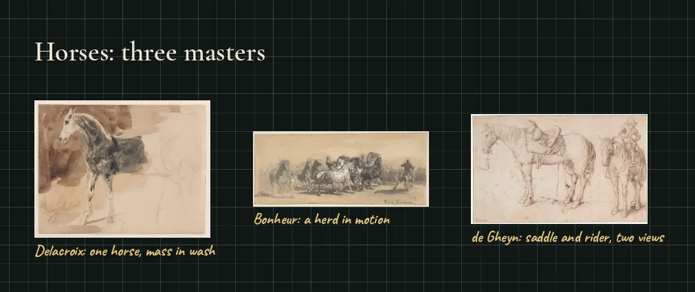

| Area | What you get |
| --- | --- |
| [**Reference boards**](#reference-boards) | Collect pictures, video and files on a canvas; crop, flip and adjust them without touching the files; lay them out on sheets by rules (auto layout); find what lies under what |
| [**Drawing and vector editing**](#drawing-and-vector-editing) | Pressure pens, shapes, Bézier paths and node editing, boolean shapes, masks, gradients and pattern fills, 38 patterns and 55 composition guides, a colour picker for everything and saved styles, layers |
| [**Comics and storyboards**](#comics-and-storyboards) | Pages and panels as sheets with real ratios, speech balloons with tails and connectors, rich text with your own fonts, pages exported to PDF |
| [**The Library**](#the-library) | Every file once, in folders and tags, with a search that knows sizes, ratios, colours and dates, a viewer, previews of art files, PDFs and 3D models (lit, or drawn as line art), similar images and safe deletion |
| [**Notes**](#notes) | Markdown, text and rich text notes in a full editor, with `[[links]]`, backlinks, properties, templates, and cards on a canvas |
| [**Exporting and sharing**](#exporting-and-sharing) | PNG, WebP, JPEG, SVG and PDF at any size; copy to other apps; share the workspace on your local network |
| [**The endless canvas**](#the-endless-canvas) | No edge and no zoom limit; bookmarks, tours and camera travel between far places; exact positions at any depth |
| [**Your workspace and data**](#your-workspace-and-data) | Saved as you work and verified; backups of everything; in the desktop app a plain folder any sync tool can carry |
| [**Privacy and hidden items**](#privacy-and-hidden-items) | Hidden items and passwords; in the desktop app hidden files are encrypted, and can be decrypted outside the app |

---

## Installation

canvast comes in two forms. Both are the same app; they differ in where your work is kept.

| | Browser version | Desktop app (Linux) |
| --- | --- | --- |
| Runs on | Any system with a modern browser: Linux, Windows, macOS and others | Linux only; other systems are out of scope for now |
| What you download | `canvast.html`, one file | A package: AppImage, `.deb`, `.rpm` or `.tar.gz` |
| Where your work is kept | The browser's own storage (IndexedDB) | A folder you choose, as ordinary files |
| Library size | Limited by the browser's storage quota | Limited by your disk; a library of a million files opens (its index on this device is a SQLite database) |
| Hidden items | Hidden behind a password, not encrypted | Encrypted on disk |
| Updates | Download the new file | The AppImage updates itself; see [Updating](#updating) |

To look around first, [try it in your browser](https://emarpiee.github.io/canvast/) (see [Trying it online](#trying-it-online)). Everything to download is on the [latest release](https://github.com/emarpiee/canvast/releases/latest). Each release's notes list its **Features** and its **Fixes** separately, and every file has its SHA-256 beside it.

### The browser version

Download [`canvast.html`](https://github.com/emarpiee/canvast/releases/latest/download/canvast.html) and open it in a modern browser: double-click it, or use *File → Open*. No installation and no web server are needed, and it works with no network connection. Keep the file wherever you like; moving it to another folder keeps your data (see [Where the data lives](#where-the-data-lives)).

### Trying it online

[emarpiee.github.io/canvast](https://emarpiee.github.io/canvast/) opens the same single file as the latest release, so you can try canvast without downloading anything. Once loaded it makes no network requests, like the downloaded file.

| | |
| --- | --- |
| Where your work is kept | In this browser's storage for that web address, apart from the work of a downloaded `canvast.html`. To move it to the downloaded file (or back), export a backup in one and import it in the other (see [Backups](#backups)) |
| Updates | The online copy changes to each new release by itself. For work you want to keep, use the downloaded file or the desktop app and make backups |

### The desktop app (Linux)

The desktop app is **built for Linux**: that is where it is made, tested and shipped. **Windows, macOS and other systems are out of scope for now**, and there are no packages for them, or a Flatpak. On those systems use the [browser version](#the-browser-version): it keeps your work in the browser's own storage, so it does not depend on the system. Its automated tests run on Linux, in Chromium and Firefox.

Each release has these packages, for 64-bit PCs (`x86_64`) and ARM64 machines (`aarch64`), named `canvast-X.Y.Z-<arch>.<format>`:

| Format | For | Install | Updates |
| --- | --- | --- | --- |
| **AppImage** | Any distribution | `chmod +x canvast-X.Y.Z-x86_64.AppImage`, then run it (or add it with an AppImage manager such as Gear Lever) | By itself, through an AppImage updater (below) |
| **`.deb`** | Debian, Ubuntu, Linux Mint and others | `sudo apt install ./canvast-X.Y.Z-x86_64.deb` | Install the new `.deb` the same way |
| **`.rpm`** | Fedora, RHEL, openSUSE and others | `sudo dnf install ./canvast-X.Y.Z-x86_64.rpm` (openSUSE: `sudo zypper install`) | Install the new `.rpm` the same way |
| **`.tar.gz`** | Anywhere, without installing | `tar -xzf canvast-X.Y.Z-x86_64.tar.gz`, then run `canvast` in the unpacked folder | Unpack the new one in its place |

The `.deb` and `.rpm` install the app under `/opt/canvast` with a menu entry, the command `canvast` and its icon. Every package is started on a fresh workspace folder before it is released (the `.deb` and `.rpm` are checked for their files and menu entry), and the `aarch64` packages are built and started on an ARM machine. On first start the app asks for a workspace folder: an empty folder starts a new workspace, a folder with `.canvast/` in it opens that one.

### Checking a download

Each file has a `.sha256` beside it. With both in one folder:

```sh
sha256sum -c canvast-X.Y.Z-x86_64.AppImage.sha256
```

### Updating

| You use | To update |
| --- | --- |
| The browser version | Download the new `canvast.html` and open it from the same place. Your work stays: it is in the browser, not in the file |
| The AppImage | It carries its update address, so an AppImage updater (Gear Lever, AppImageUpdate, or AppImageLauncher's update) finds a newer release by itself and downloads only the parts that changed (zsync). The app never checks for updates or goes online itself |
| The `.deb`, `.rpm` or `.tar.gz` | Install or unpack the new release's package. There is no package repository yet, so the system's own updates do not include canvast |

Your workspace folder is never touched by an update.

### Uninstalling

Remove the app the way you installed it. **Your workspace folders always stay where they are.**

| You installed | To remove it |
| --- | --- |
| `.deb` | `sudo apt remove canvast` |
| `.rpm` | `sudo dnf remove canvast` |
| AppImage or `.tar.gz` | Delete the file or the unpacked folder |
| App data on this device | Delete `~/.config/canvast/`; removing the app never does |
| Browser version | Delete the file and clear the site data; **this deletes the work kept there, so export a backup first** |

#### Everything left behind, and where

| What is left | Where, and what to do |
| --- | --- |
| The app's working copy and settings | `~/.config/canvast/` (`%APPDATA%\canvast` on Windows, `~/Library/Application Support/canvast` on a Mac). Removing the app never deletes it: delete that folder too to remove everything |
| A launcher entry | An AppImage may leave one if an AppImage manager added it |
| Readable copies of hidden items opened in another app | `canvast-opened-…` in the temporary folder: deleted when the app closes; a crash leaves them until the next start, or until the system clears its temporary folder |
| Working copies of workspaces no longer opened | Removed by the app itself once they are a month old |
| The browser version's work | Delete the file and clear the site data of `file://` pages in the browser (for the online copy, the site data of `emarpiee.github.io`); this deletes the work kept there, so export a backup first |

### What the desktop app keeps on this computer

Outside your workspace folders, in the app's data folder (above):

| What | Where | Holds |
| --- | --- | --- |
| A working copy of each workspace | `Partitions/`, `library-db/`, `library-looks/` | Boards, canvases and the library, so the app opens fast. Hidden items' pictures and thumbnails are encrypted there; their names, tags and notes are readable there unless *Keep hidden items' names off this device while locked* is on (Settings > Privacy) |
| This device's settings | `Partitions/` | Theme, shortcuts, panels, tools and the other *This device* settings (the workspace's are in its folder, with a copy here). Deleting it resets them; a backup restores them |
| Recent workspaces | `workspaces.json`, `partitions.json` | Their folders' paths |
| Hidden items opened in another app | the system's temporary folder, `canvast-opened-…` | Readable copies, deleted when the hidden items are locked, when the app closes, and at the next start |

**For full privacy:**

| Do | Why |
| --- | --- |
| Turn on *Keep hidden items' names off this device while locked* | The working copy then keeps no hidden item's name |
| Leave *Remember the Hidden password* off | The password is asked each time |
| Lock the hidden items before leaving the computer | Closing the app locks them too |
| Avoid *Open in default app* for hidden items | The other app may keep its own copy or recent-files entry |
| Use your system's disk encryption | It covers what the app does not |
| Remember what each export keeps | A backup keeps hidden items encrypted; a ZIP of files or an exported folder does not |

Settings > Privacy shows the same list.

### Building it yourself

See [Building from source](#building-from-source), in the developers' part.

### Platform support

| | |
| --- | --- |
| Desktop app | Linux, x86_64 and aarch64; other systems are out of scope for now (see [The desktop app](#the-desktop-app-linux)). Watching the workspace folder for changes made outside the app is verified on Linux |
| Browser version | Any system with a modern browser. It requires `BigInt`, Pointer Events, `ResizeObserver`, Canvas 2D, IndexedDB, `oklch()` and `color-mix()`: roughly Chromium 111+, Firefox 113+, Safari 16.2+. A custom background colour also needs relative colours and `abs()`: Chromium 119+, Firefox 128+, Safari 16.4+ or later |
| Tested | Chromium 156 (default, CPU-only, and devicePixelRatio 2 with touch) and Firefox 157 on Linux. The automated tests run on Linux, in Chromium and Firefox |
| Not tested | Safari, and the browsers on Windows and macOS |
| Firefox on `file://` | Supports everything canvast uses (IndexedDB, Web Locks, BroadcastChannel) with frame times close to Chromium's |

---

## Getting started

### Your first minutes

| To do this | Do this |
| --- | --- |
| Bring in references | Drag files onto the page, paste them, or use the Import button |
| Draw | Press `P` and drag |
| Add a shape | Press `U`, choose a shape, drag on the canvas |
| Write | Press `T`, click, type |
| Write a note | Press `M` and click |
| Move around | Drag with the middle button, hold `Space` and drag (a `Space` let go in another window is let go here too, once it stops repeating), or use two fingers; scroll the wheel to zoom |
| Go back to the start | Press `0` or `Home` |
| Find any command | Press `Ctrl/⌘+K` |
| Undo | `Ctrl/⌘+Z` (undoing a delete brings the items back selected) |

The info bar at the bottom left shows the zoom level and position. Click the zoom, type a level (`3000`, `2^-500`, `10^900`) and press Enter to jump there.

### Terms

| Term | Meaning |
| --- | --- |
| Canvas | One endless surface you draw on |
| Board | A group of canvases (a project, a topic). The board and canvas menu (the name at the top left) switches between them |
| Workspace | Everything you have: all boards, canvases and the library |
| Object | Anything placed on a canvas: a stroke, shape, path, text, picture, video, audio, GIF or file card |
| Library | The shared store of every imported file. Each file is stored once, and objects on any canvas are *instances* of it. On desktop, a copy you put in another folder of `library/` (same content, any name) is an item of its own |
| Sheet | A shape that holds other objects and cuts them at its edge; a page, a panel, the unit you export |
| Zoom level | `z` means 2^z screen pixels per world unit. Level 0 is the starting scale |

---

## Reference boards

Gather what you work from on a canvas: pictures, video, sound, PDFs, 3D models and any other file. Files are placed as they are and never altered: every edit here can be undone or removed.

| Section | What is in it |
| --- | --- |
| [Bringing files in](#bringing-files-in) | Import, paste, drop, whole folders |
| [Pictures](#pictures) | Pixel-exact pictures, crop and flip, corners and outlines |
| [Adjust](#adjust) | Non-destructive adjustments and shadows |
| [Video, audio and GIFs](#video-audio-and-gifs) | The media player on the canvas, extracting frames |
| [Sheets](#sheets) | Areas that hold and cut what is on them, with a ratio |
| [Auto layout](#auto-layout) | Rows, columns, wraps and grids laid out by rules |
| [Arranging and snapping](#arranging-and-snapping) | Align, distribute, grids, snapping, the same size |
| [Layers](#layers) | Groups, names, order, hiding and locking |
| [Reveal and the Ctrl list](#reveal-and-the-ctrl-list) | Seeing and picking what lies under other things |
| [Tags on the canvas](#tags-on-the-canvas) | Labels for the things on a canvas |

### Bringing files in

Drag files onto the page, paste them, use the **Import** button of the tool rail, or bring in a whole folder.

Bring a whole folder of references in at once.

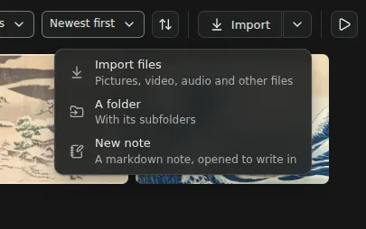

| | |
| --- | --- |
| Ways in | By button (in the Library the Import button has a menu for files or for a whole folder), drag and drop, paste, or a whole folder |
| Where they go | Into the Library, once, and onto the open canvas. In the Library, new files go into the folder, tag or favourites open in the sidebar |
| Size | Files up to 256 MiB are accepted and decoded before being stored; in the desktop app a bigger file is copied into `library/` a part at a time and comes in as a card |
| A file the library has | Not stored again. Imported into the Library under another name, the app lists the old and new names and offers to rename (in hidden mode, for hidden items only). Importing your originals again this way brings back names that were cut short; Undo puts the old names back |
| What each kind becomes | Pictures, video, audio and GIFs show as themselves; PDFs and 3D models as their pictures, opening in a [view of their own](#pdfs-and-3d-models); notes as their pages; any other file as a card with its extension, which can be downloaded again |
| File details | Type, size, pixels, time of import, place on disk and hash, with EXIF, colour profile and codec information when the file has them |

### Pictures

Pictures are placed one source pixel to one screen pixel. Zooming in shows real pixels; nothing is invented and the file is never altered.

Crop a study down to the part you are learning from, without changing the file.

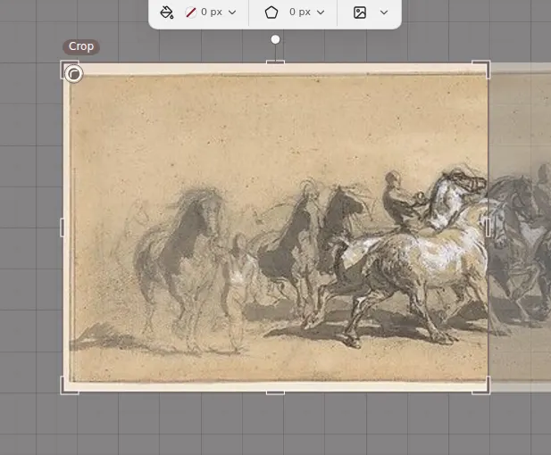

Mirror a drawing to see its proportions with fresh eyes.

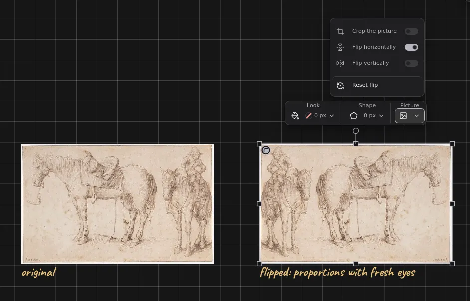

Give a print rounded corners and a thin outline, as a card on a mood board.


| Feature | What it does |
| --- | --- |
| **Crop** | The **Crop** button of the Properties bar: the picture's handles move its window, what stays does not move, and pulling back out restores it. On a flipped picture, crop cuts the side you drag |
| **Flip horizontally**, **Flip vertically** | Mirrored in the same box; **Reset flip** turns it back |
| **Corners and outline** | Rounded corners and an outline, as shapes have, on pictures, video and GIFs |
| **Masks** | By a shape, by opacity or by brightness, or a brush mask painted with the Pen (see [Masks](#masks)) |
| **Make a new picture** | Bakes the crop, flip and adjustments into a new library item; **Copy as picture** puts the result on the clipboard |
| **Make vector copy** | Turns an SVG picture into editable shapes in its place, at its size, turn and layer (one undo step; the file stays in the library) |
| **Show in library** | Opens the Library with the file selected |
| **Names on the canvas** | A sheet, picture, video or file card shows its name above its top-left corner; any other item shows its layer name while selected. Where the names of selected items would overlap (a group selected whole, a sheet and what is on it), only the outermost is written |

### Adjust

The **Adjust** panel changes how a picture, video, GIF, shape, pen stroke or text looks, in stacks you can reorder, hide and copy. The file itself is never changed. It opens from the **Adjust** group of the Actions bar, which also resets, copies and pastes the adjustments of what is selected.

Make a value study: the same painting in grey with more contrast, to read its light and dark masses.

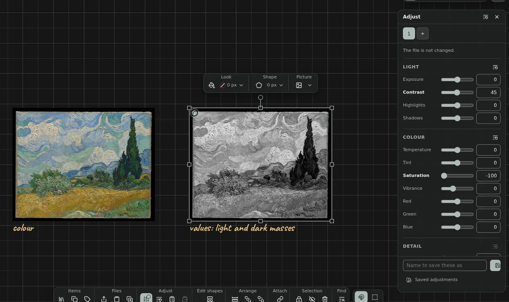

Give prints a soft drop shadow so they read as paper laid on a table.

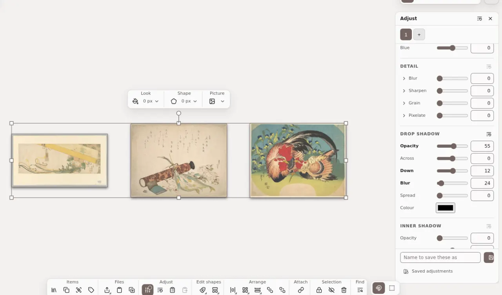

| Group | Adjustments |
| --- | --- |
| Light | Exposure, contrast, highlights, shadows |
| Colour | Temperature, tint, saturation, vibrance, red, green and blue |
| Tone | Levels, curves, gradient map |
| Detail | Blur (soft, motion along an angle, zoom out from the middle, spin round it), sharpen, grain, pixelate |
| Shadows | **Drop shadow** and **inner shadow**: opacity, across, down, blur, spread and a colour each |

| How it works | |
| --- | --- |
| Stacks | Reorder, hide, and **Copy** and **Paste adjustments** (the Adjust group of the Actions bar) to move a whole stack between items. Each group has its own *Reset* |
| Ranges | Past 100 where a stronger change means something: exposure, temperature, tint and the three primaries from -200 to 200, contrast, saturation and vibrance up to 200, blur up to 400, sharpen and grain up to 200, a shadow's blur and spread up to 400 and its offset to ±300 |
| Blur types and pixelate | The blur's *Type*: **Soft**, **Motion** (with its *Angle*), **Zoom** or **Spin**, as wide as a soft blur of the same number. **Pixelate** makes square cells, a tenth of the object at 100 |
| Advanced controls | The arrow before Blur, Sharpen, Grain and Pixelate folds out their own settings (open ones stay open on this device). **Blur**: its type; for Motion the *Angle* and *Offset* (the streak behind or ahead instead of on both sides), for Zoom and Spin the *Centre across* and *down*; *Quality* (fewer or more copies). **Sharpen**: *Radius*, one to ten pixels. **Grain**: *Size* and *Colour* (grey to coloured). **Pixelate**: *Shape*, squares or round dots. Each starts where the adjustment was before, so nothing already made changes |
| Shadows | A new shadow starts soft and a little below. Offset and blur are shares of the object's own size (an offset of 100 is a tenth of it), so a shadow looks the same at any zoom. A picture's pixels are not touched; its shadow is drawn beside it. A playing video shows no shadow (its paused frame does) |
| On shapes, strokes and text | Applied to the object as drawn (fill, outline, gradient and texture together). A blur is a share of the object's size, so it does not change with zoom (far inside an object it stays at most about 330 px wide) |
| Exporting | A selection leaves room for a blur or a drop shadow. An exported SVG carries them as a filter on the shape, and making the SVG into shapes again brings them back. A vector PDF draws such a shape as a picture instead (see [Limitations](#limitations)) |
| On a sheet that clips | The sheet cuts what a blur or a shadow spreads past its edge too |
| **Adjust what is under it** | For shapes (rectangle, ellipse, polygon, star, speech balloon; not a line or a path): the adjustments are made on what lies under the shape, inside its outline, not on the shape. A circle with no fill and a blur of 100 over a picture blurs that part of it; move it and the effect follows. Objects only (not the grid); its own fill and outline stay plain over it; its opacity is the strength. Picked anywhere inside; *Adjustment ellipse* in Layers. Making it a path turns it off |

### Video, audio and GIFs

Videos, audio and animated GIFs play on the canvas, with a player right under the item.

Plan a camera move for an animatic: a slow pan across a painting, played on the board.


Keep a key frame of a clip as a still picture, to draw from or to place in a storyboard.

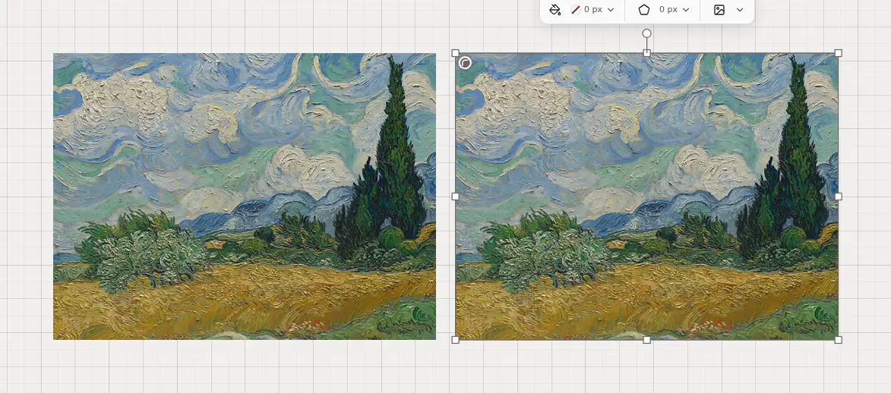

| Player control | What it does |
| --- | --- |
| Play and pause, the seek bar | As in any player; the paused frame is saved |
| Step back and forward | Seconds for video and audio, frames for GIFs |
| Repeat, speed, volume | Each player keeps its own volume |
| A start and an end | Play only part of a file |
| Waveform | Audio shows its waveform |

| | |
| --- | --- |
| Out of view | Playback continues when the item scrolls out of view |
| **Extract frame** | Turns the current frame of a video or GIF into a picture in the library (PNG, WebP or JPEG). Settings name it, file it in a folder and tag it, optionally placing it on the canvas. A PDF's page is extracted the same way, with **Extract this page** in its [view](#pdfs-and-3d-models) |
| On a sheet that clips | A playing video is cut by the sheet's shape, as the canvas cuts it |
| Long films (desktop app) | A video or sound file in the workspace's `library/` plays as it is read, on the canvas and in the gallery: an hour-long film starts at once, and in the gallery a file past the import limit plays too. A hidden one is decrypted whole first, so it takes longer to start |

### Sheets

A sheet (`C`) is an area that holds other objects and cuts them at its edge: a board within the board, a page, a panel, the unit you export. It has a ratio rather than a size (see [Shapes, sheets and masks](docs/reference/shapes-sheets-masks.md)).

Put a print and its label on a sheet: the sheet holds them, moves them as one and cuts what goes past its edges.

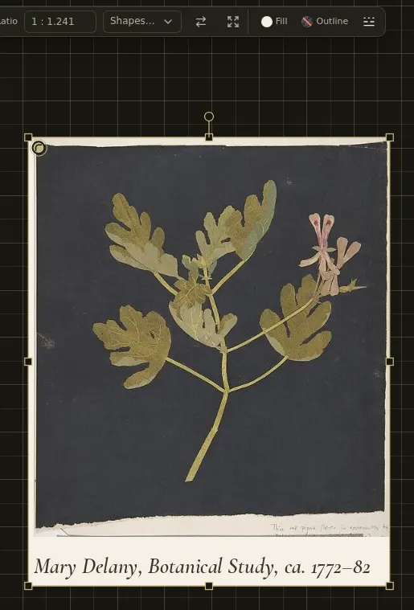

| Feature | What it does |
| --- | --- |
| **Drawing a sheet** over objects | Puts the ones wholly inside it on the sheet, in one undo step (ones it only crosses stay out) |
| **Sheets menu** (Actions bar) | *Put the selection on a sheet* (`Ctrl+Alt+G`), *Put each on its own sheet* (a picture's sheet is exactly its size, with no fill), *Fit to contents*, *Release*, *Auto layout* |
| **Clip** | What is outside the sheet is hidden, with its blur and shadows and a video while it plays; the clip button on its row in Layers shows it again |
| **Ratio** | The Properties bar's *Ratio* field: `16:9`, `A4 portrait`, a number, or a size in px (`2000 x 1920` becomes `25 : 24`); a preset from *Shapes…*; **Turn** on its side. A new ratio keeps the area and the top-left corner. One selected shape has the same field |
| **Custom ratios** | *Save this ratio…* at the top of the *Shapes…* list takes a ratio or a size in px (made a ratio) and a name; they are listed under *Custom* and given as saved, upright or on the side. Rename, change, update from the selection or delete them under *Ratios* in the Styles panel (*Manage custom ratios…*). They are kept in the workspace and always go with a backup and an Advanced export |
| **Pins** | Each object on a sheet has pins per axis (left, right, both, centre or scale) that decide what it does when the sheet is resized |
| **Scale contents** | Everything on the sheet grows with it, whatever its pins say |
| **On sheet** | X, Y, W and H of something on a sheet are per cent of the sheet, so they read the same at any zoom |
| **Picking** | A click on a thing on a sheet picks that thing alone; a click on the empty part of the sheet picks the sheet with everything on it; the name above a sheet picks it too. A sheet is ground: dragging on a selected sheet draws a selection box (hold `Ctrl` to move the sheet) |

### Auto layout

Auto layout places what is on a sheet by rules, so a board, a page of panels or a row of studies stays in order as you add, remove and resize things.

Let a sheet lay its pictures out in a grid that stays tidy as you add more.

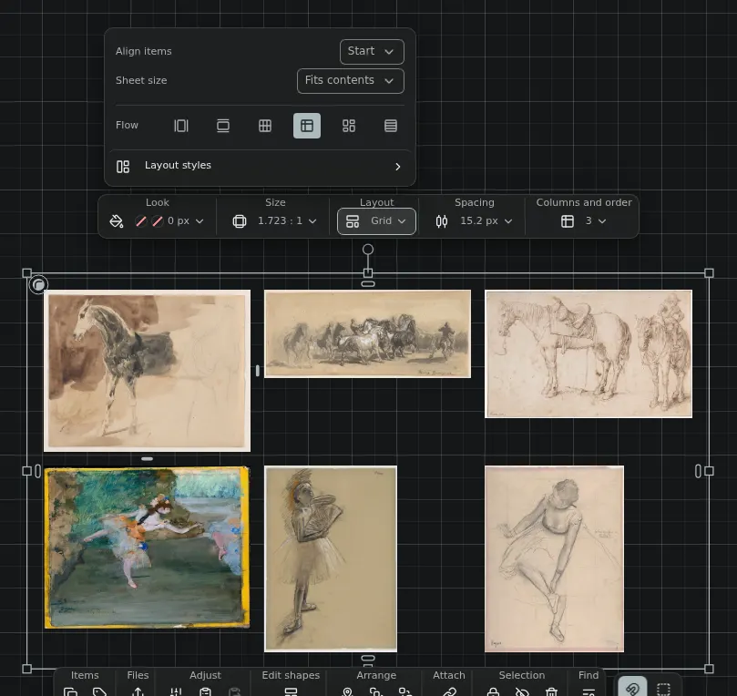

| Turn it on | |
| --- | --- |
| On a sheet | `Shift+A`, **Auto layout** in the Sheets menu of the Actions bar, or the layout badge on the sheet's row in Layers. It reads the layout from where things are, so they stay put |
| On loose things | `Shift+A`, or **Auto layout on a new sheet** in the Sheets menu: a new sheet round them (with no fill) that lays them out and fits them |

| Control (Properties bar, sheet selected) | What it does |
| --- | --- |
| **Flow** | **Row**, **column**, **wrap** (rows that break at the sheet's width), **grid**, **masonry** or **justified rows** (see below) |
| **Gap** | Between items along the flow, and between lines |
| **Pad** | Padding left and right, top and bottom; the button beside it opens each side |
| **Start, Centre, End** | Where items sit across the flow (and the block of lines in a sheet with room for them) |
| **Pack start, centre, end, Spread** | Where items sit along the flow, in a sheet wider than they are. Shown only when there is room to pack in (not in a masonry, nor when the sheet fits its contents that way) |
| **Size** | **Fits contents**: the sheet grows and shrinks to what is on it. **Set width**: you set the width, the height fits (a column: **Set height**). **Set size**: you set both, and what does not fit is cut off at the edge |
| **Doesn't fit: Fit** | Shown when something runs past the edge of a sheet whose size is set: makes the sheet fit it on that side |
| **Columns** | For a grid or a masonry: how many. Empty: chosen by the list beside it, **Auto: by shape** (from the items' shapes: a board about as wide as tall when the sheet fits its contents, or one that fills a sheet whose size you set; new layouts start with it) or **Auto: by count** (about as many as rows from the number of items alone; layouts made before keep it) |
| **Columns and rows** | For a grid: each column and row **Hug** (as large as what is in it), **Fixed** (a size in px) or **Share** (a share of the room left, never smaller than what is in it); rows past those set hug |
| **Row** | For justified rows: the height a row aims at before it is made as wide as the sheet |
| **Order** | The stacking order (as Layers lists it), or a rule kept as things are added: name A–Z or Z–A (a picture's name as placed, a text's first words), newest first (when the picture's file came into the library), largest first, by kind. An Arrange order on things of the sheet sets it too |
| **Layout styles** | Your saved layouts, and *Save this layout as a style*: kept in the [Styles](#styles) panel, given to a selected sheet from there or this menu. Lengths are kept in px as seen |

| On the sheet itself | |
| --- | --- |
| **Padding handles** | A small bar inside each edge of the selected sheet: drag it in for more padding, out for less |
| **Gap handles** | A bar between the first two items (the gap along the flow) and one between the first two lines: drag it to change that gap. Each shows its length while it moves |

| Flows that size the items | |
| --- | --- |
| **Masonry** | Columns of one width share the sheet's width; each item is made that wide, in its own shape, and goes in the shortest column, so pictures of every shape pack with no holes. A sheet that fits its contents makes the columns as wide as its widest item |
| **Justified rows** | Every item in a row is one height and the row is as wide as the sheet, as a gallery of photographs; the last row keeps the height aimed at. The row height is taken from the items when you choose it; choosing it sets the width (Set width) |

Pack references of every shape into tidy columns with no holes.

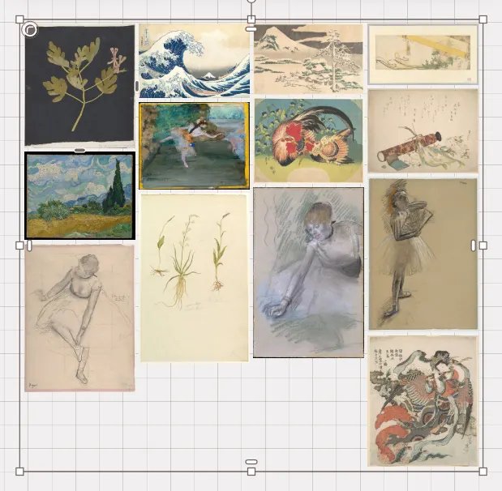

Lay a row of landscapes out as a gallery, each row one height and as wide as the board.

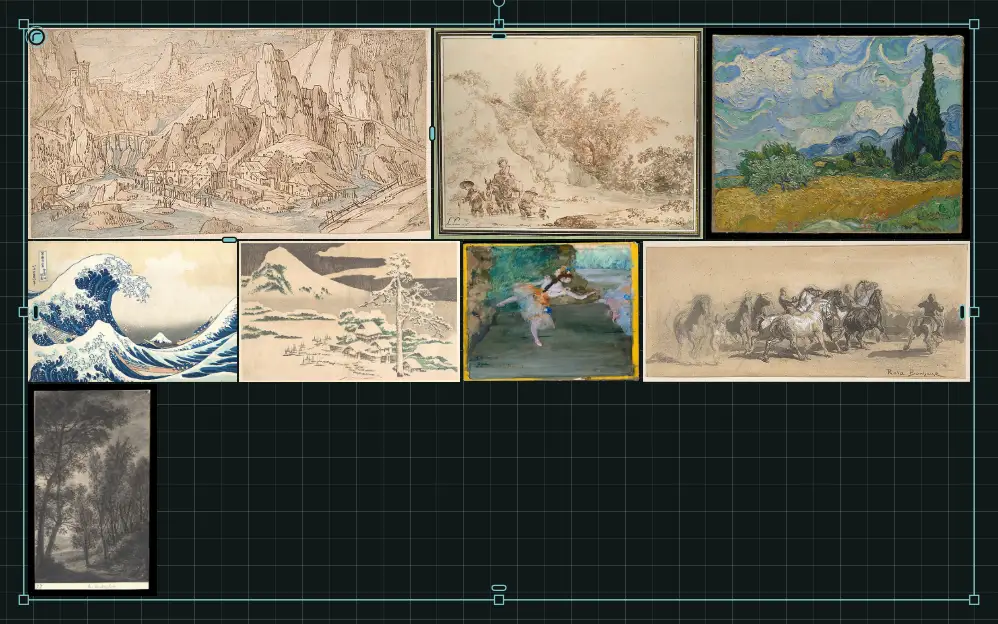

Plan a page: a wide panel across all the columns, the columns sized by rule.

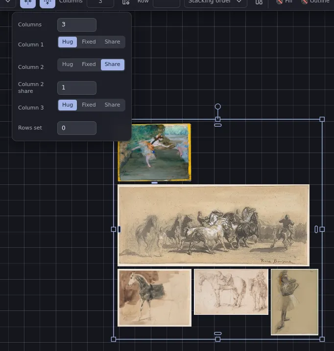

| On a thing on such a sheet | What it does |
| --- | --- |
| **Fill** | Stretches it to the room along an axis: width, height or both. A picture keeps its shape: **Fill the room** makes it as large as its room allows, in the middle of it |
| **Min**, **Max** | For a thing that fills: its least and most size on that axis, in % of the room inside the sheet (0: no limit) |
| **Span** | In a grid: how many columns and rows it covers; the others flow round it |
| **Keep out of the layout** | It stays where it is put; the others flow round it |

| Behaviour | |
| --- | --- |
| Changes | Anything added to, taken off, resized or moved on the sheet lays it out again, in the same undo step; a sheet that fits its contents inside another lays that one out too |
| Order | The stacking order, front first, as Layers lists it, unless an Order rule is set. A thing dropped on the sheet takes the place it is dropped at |
| While dragging | The others make room as you drag over the sheet, closing the gap behind it and opening one where it would land; dragged off the sheet, its place closes; over another sheet with auto layout, that sheet makes room. Nothing is stored until you let go |
| Resizing the sheet by hand | It keeps the width you give it (a column: the height) and the other side goes on fitting, so nothing is cut off. Set size keeps both |

### Arranging and snapping

Put a loose pile of studies into a grid in one step.

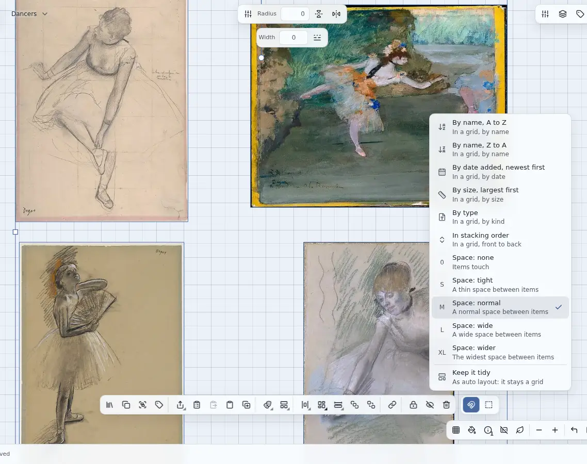

Line studies up along their bottom edges.

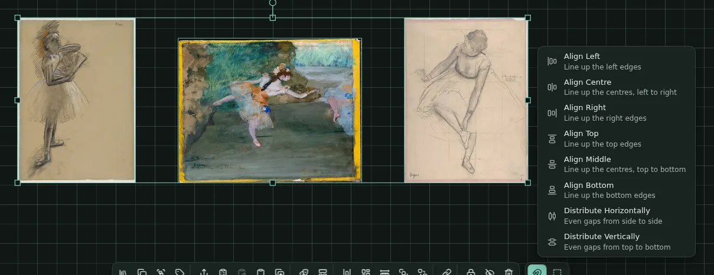

| Feature | What it does |
| --- | --- |
| **Align and distribute** | The Align menu of the Actions bar lines the selection up by its edges or middles, or spaces it evenly. One thing on a sheet aligns with its sheet |
| **Arrange in a grid** | By name, date, size or type, with a gap: once, where they are. With **Keep it tidy** (in the Arrange menu, or Settings > Drawing) the grid is made as a sheet with [auto layout](#auto-layout), its order kept as a rule, so it stays a grid as things are added |
| **On a sheet with auto layout** | The sheet places what is on it: Align and distribute are greyed out (the sheet's own alignment is in the bar), and an Arrange order becomes the sheet's Order rule |
| **Size** menu | Gives the selected pictures, note cards, shapes, strokes and text the width or height of the smallest, the middle or the largest of them, in proportion. **Reset size** puts pictures, videos, GIFs, sounds and note cards back to the size they are placed at, at the current zoom (one pixel of the file for one of the screen; a note card at Settings > Notes > Note tool card size), about their middle. Several selected keep their layout: they move apart only as far as it takes to keep their gaps |
| **Copy, cut, paste, duplicate** | `Ctrl/⌘+C`, `X`, `V`, `D`; `Alt`+drag copies |
| **Groups** | `Ctrl/⌘+G`; a click on a group (also a boolean group) selects all of it; its shapes line up with each other only when you select them one by one (in Layers, or inside the group). A group or several selected move from anywhere in their box, gaps too; press outside it to draw a selection box |
| **Selection box and lasso** | Take what they touch. A group comes whole only when all of it is inside; otherwise only the parts touched (a pencil or ink line, a boolean group and a pattern always come whole). Nothing smaller than 2 pixels on the screen is taken, such as what lies deep inside a dot when zoomed far out |
| **Kind chips** | With a mixed selection, chips at the start of the Actions bar (All, Pictures, Media, Shapes, Strokes, Texts) narrow it to one kind |
| **Hide and lock** | *Show all hidden* and *Unlock all* bring everything back |

**Snapping** (the magnet button turns it off; *Snap to the grid* and *Snap distance* are in Settings > Drawing):

| What snaps | How |
| --- | --- |
| Moving, resizing, turning, a node, a gradient's handles | To other things, with guide lines; also to the grid's lines as shown, and to a group's box and middle as a whole |
| Drawing | A shape, sheet, speech balloon or text box starts on the corner, edge or grid line it is pressed near, and its far corner snaps as a resized one does |
| Boxes | Line up by their sides and middles |
| Moving | Each axis on its own, so a corner can settle on a crossing of two lines, for one object, a group or several selected |
| Shapes | By their geometry: a corner onto another corner or the middle of a side (a ring marks it), a corner onto any side (curves too), a straight side flush along a nearly parallel one (the side is drawn) |
| Turning | Brings a corner round to another, or a side parallel to a nearby one |

### Layers

The **Layers** panel lists everything on the canvas, front first, by name.

Keep a master study in groups: the reference locked, the construction and the line of action on their own.


| Feature | What it does |
| --- | --- |
| **Rows** | Group and nest, rename, hide, lock, re-stack, set opacity and blend mode, rotate. Select with `Ctrl` (toggle) and `Shift` (range) |
| **Dragging rows** | Onto the middle of a group, a boolean group or a sheet to put it inside, or onto the top or bottom edge of a row to put it before or after it at that row's level (out of a group or a sheet too), as deep as groups (16) and sheets (32) go; a line or a highlight shows where it will land |
| **Names** | An item placed from the library takes the file's name at that moment as its layer name, and keeps it when the file is renamed later; a hidden item's name is not stored |
| **What belongs to a shape** | A shape's words and a balloon's connectors are in its row: hiding, locking, moving or grouping the row takes them along. A row partly hidden or locked says so, and its eye or lock shows or unlocks all of it |
| **Sheets** | A sheet's row holds what is on it, with its clip button and its auto layout badge |

### Reveal and the Ctrl list

Find and pick what lies under other things, without moving anything.

Find and pick a print buried under others in a pile.

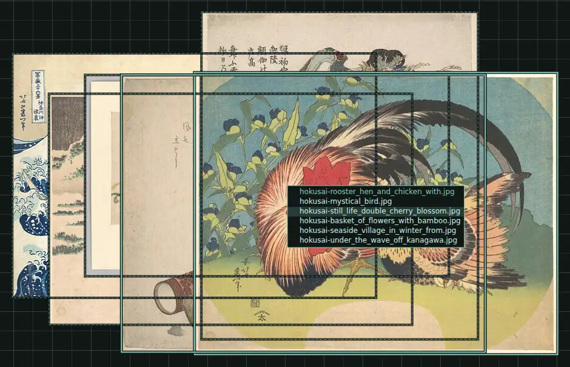

| Do | What happens |
| --- | --- |
| Hold `Ctrl` and move over the canvas | The outline of everything under the pointer shows, with their names in a small list beside it |
| `Ctrl`+click | Selects exactly that thing, even deep inside a group, mask or sheet. On a revealed outline you get the thing it belongs to, even under a filled shape; elsewhere you get the top thing (`Ctrl`+`Alt`+click goes down the stack) |
| In the list, move onto a row | Its outline turns strong; `Ctrl`+click selects it, `Ctrl`+`Shift`+click adds or removes it. Selected ones are ticked |
| Hold `Ctrl` over an empty spot inside the selection | The list holds everything the selection holds, groups by their Layers name with their items indented under them |
| A long list | Up to 16 rows show; the wheel scrolls it while `Ctrl` is held, and with *Scroll the Ctrl list at its ends* on (Settings > Navigation) so does resting the pointer on its top or bottom row or just past it (the list stays open there) |
| `Ctrl`+click where nothing can be picked, or a long press on a touch screen | Opens a menu of the same rows: what is here, hidden and locked things too (pressed, they are shown or unlocked), and what the selection holds |
| Drag from inside a selected thing | It moves, even under other things. A click without moving still selects the top thing |

### Tags on the canvas

Tags label the things on a canvas, to find them with search (`#`) and in the **Tags** panel, which lists every tag and its count. Renaming or deleting a tag applies to every canvas. They are separate from the Library's tags of a file.

Tag the studies on a canvas by what they teach, and find them again.

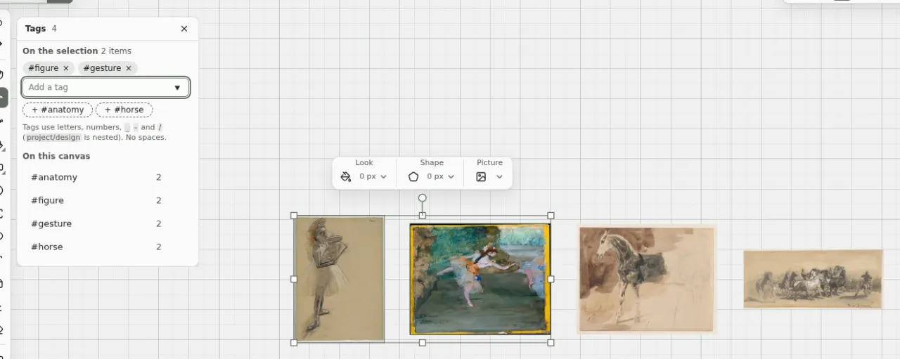

---

## Drawing and vector editing

Everything you draw is vector, so it stays sharp at every magnification.

| Section | What is in it |
| --- | --- |
| [Pen](#pen) | Four pens with pressure, tilt and a stabilizer |
| [Shapes](#shapes) | Rectangles, ellipses, lines, polygons and stars that stay editable |
| [Paths and nodes](#paths-and-nodes) | Bézier curves and node editing |
| [Combining shapes](#combining-shapes) | Boolean shapes, Divide, Shape builder, Fill gaps |
| [Masks](#masks) | Clipping masks, masks by opacity or brightness, brush masks |
| [Fill and outline](#fill-and-outline) | Gradients, pictures and repeated objects as fills; outlines |
| [Pattern and guides](#pattern-and-guides) | 38 pattern generators and 55 composition guides |
| [The colour picker](#the-colour-picker) | One picker for every colour |
| [Styles](#styles) | Saved colours, gradients, palettes and looks that objects stay linked to |
| [More vector tools](#more-vector-tools) | Vector networks, initial state, the eraser, SVG |

### Pen

The **Pen** (`P`) draws strokes with pressure, tilt and a stabilizer, made at the current scale: a 3 px line drawn deep in a zoom is a 3 px line there, and it stays sharp at every magnification.

Find the gesture: draw a line of action over each figure, from the head through the weight to the foot that carries it.

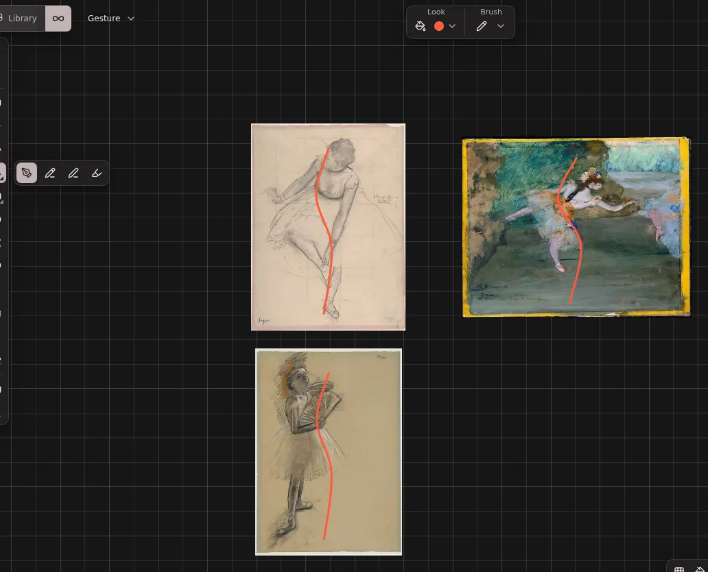

Draw a long, calm contour: the stabilizer smooths the wobble of the hand.

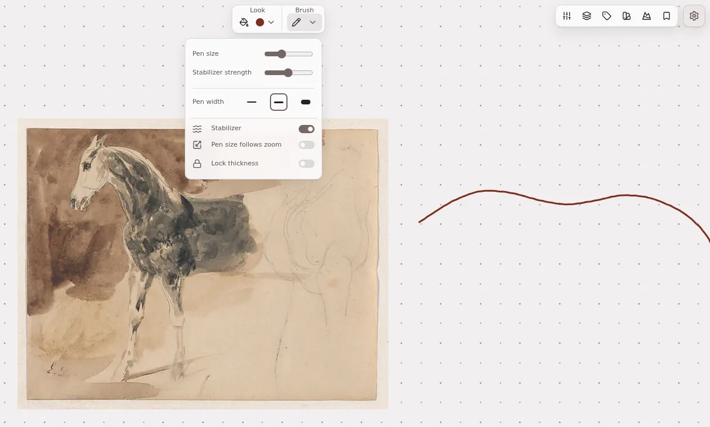

| Setting | What it does |
| --- | --- |
| **Pen** | Four pens: fine, pencil, ink, marker |
| **Size** | 0.5 to 128 px |
| **Thickness lock** | Keeps strokes the same width on screen at any zoom |
| **Colour** | From the colour picker; a selected stroke's colours show as chips in the Properties bar |
| **Stabilizer** | Smooths the line as you draw (Settings > Drawing) |

### Shapes

**Shapes** (`U`): rectangle, ellipse, line, polygon and star. Sides, points, ratio and per-corner radii stay editable after drawing.

Block in a composition as flat value shapes before painting.

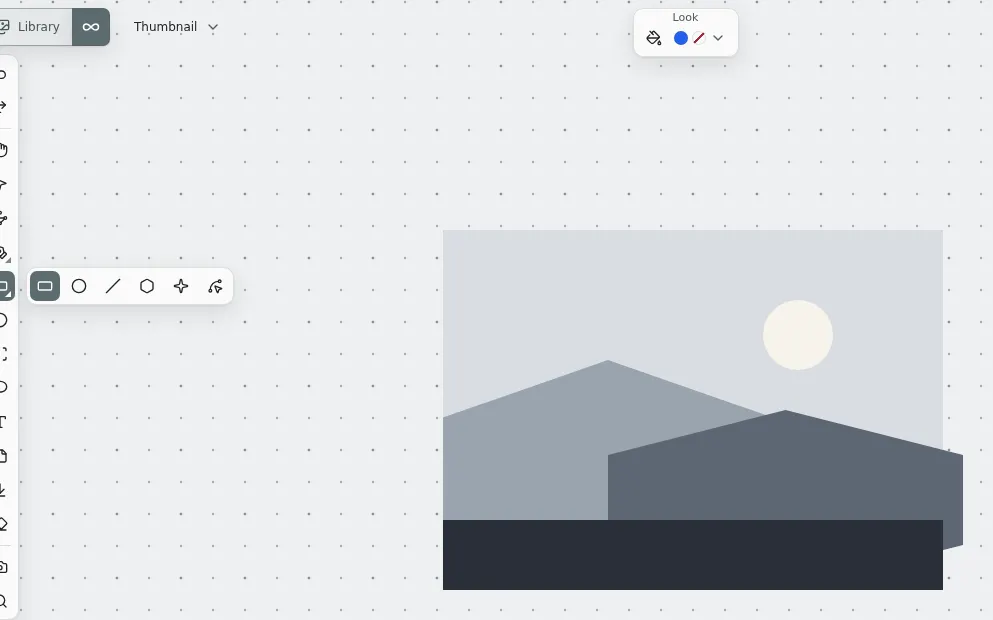

| Feature | What it does |
| --- | --- |
| **Ratio** | The *Ratio* field of one selected shape (not a line) gives it another width to height, keeping its area: typed, a preset, or turned on its side |
| **Corners** | Per-corner radii, and *Corner smoothing* that rounds corners continuously |
| **New shapes** | Start with a fill and no outline (a line and an open path get one, or they would not show): set a width, or move the Outline width slider off its left end, to add one |
| **Default ink** | The pen's ink, those lines' and a first outline's is near-black on a light canvas and light on a dark one, chosen when the object is made and stored with it. *Change the old default ink to the canvas ink* (command palette) updates older drawings |

### Paths and nodes

**Paths** (`B`) draw Bézier curves with handles; **Edit nodes** (`N`) edits them.

Refine a combined shape by its nodes: here the claws of the wave crest.

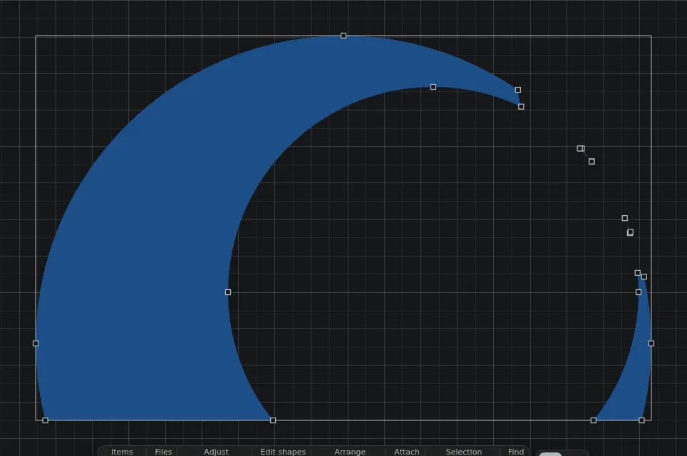

| Feature | What it does |
| --- | --- |
| **Handles and snapping** | Each node's handles, snapping to other things |
| **Several nodes, several paths** | A lasso or a box picks several nodes, across several paths at once |
| **A whole outline** | A double-click in Edit nodes selects a whole closed path with its holes, to move it as one |
| **Split into pieces** | Each outline of a path its own object |
| **Simplify** | Fits a curve to a rough path: fewer nodes, the same shape |
| **Pen stroke to path** | Turns a stroke into an editable path |

### Combining shapes

The **Shapes** menu of the Actions bar combines the selected shapes.

Build an icon from simple shapes: a wave crest is a circle and a block joined, with circles cut out for the curl and the claws.


| Operation | What it does |
| --- | --- |
| **Union, Intersect, Subtract, Exclude** | Stay editable until you **Flatten** them (`Ctrl/⌘+E`); *Add to the group* and *Take out of the group* change what is in it; *Release* takes it apart |
| **Divide**, **Shape builder** | Split overlapping shapes into their regions; the Shape builder merges regions dragged across and deletes them with `Alt` |
| **Fill gaps** | Fills every empty place the selected shapes close in (with the Shape tool's fill, under them); *Fill a gap…* fills the ones you click, one by one. A slit narrower than a few pixels (4 by default, in Settings) counts as closed, and the fill stops at it |
| **Outline stroke** | Turns a line into a shape of its own |
| **Taper** | Gives a line a varying width; it stays editable |

### Masks

The **Masks** menu of the Actions bar: the top thing selected cuts or shows the others.

Frame a reference in an oval, as on a botanical print, without cutting the file.

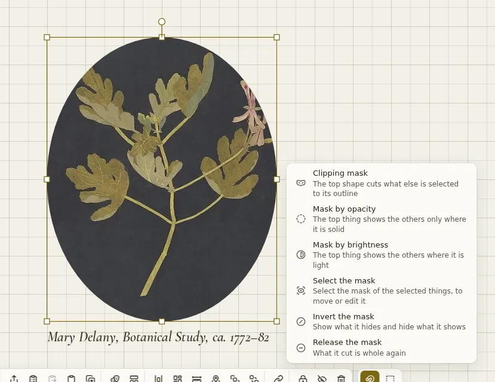

| Mask | What it does |
| --- | --- |
| **Clipping mask** | The top shape cuts what else is selected to its outline. It becomes a sheet of its own shape (no fill, its outline stays, named "Mask n") holding the others |
| **Mask by opacity** | The top thing shows the others only where it is solid |
| **Mask by brightness** | The top thing shows the others where it is light |
| **Brush mask** | Painted in black and white with the Pen |

Masks can be inverted, selected on their own and released. A click on a mask selects it as one unit; a double click goes inside.

### Fill and outline

Paint a sky as a gradient from dusk to dawn colours.

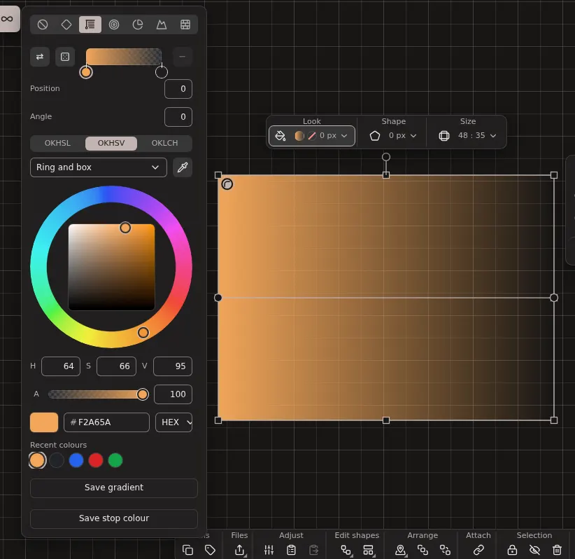

| Fill | What it is |
| --- | --- |
| Colour | Solid, from the colour picker |
| Gradient | Linear, radial or angular, with stops you drag on the canvas |
| Picture | A picture of the library |
| **Objects** | Other objects of the canvas repeated over the shape, following those objects live as you change them |

A repeated fill can **vary each copy**:

| Variation | What it does |
| --- | --- |
| Turn | Up to ± an angle, or in whole steps |
| Size, move in its cell | Each copy its own |
| Mirror, leave out | Some copies mirrored, some cells left empty |
| Order | Each object on its own (in turn or shuffled) or the whole arrangement |
| Seed | The same copies every time; *New seed* gives others |

**Outlines** have a width (the field beside **Outline** in the bar: type it or drag it; also in Outline options), a position (inside, centre, outside), corners, ends, dashes, arrow heads and a sharp-corner limit, and can be a gradient.

### Pattern and guides

The **Pattern** panel (the mountain button) makes vector patterns and composition guides on a sheet or a shape, each with its own settings and seed.

Make an endpaper for a book: a scale pattern made as vectors on a sheet.


Read a composition: lay a golden spiral over the print to see where the eye travels.

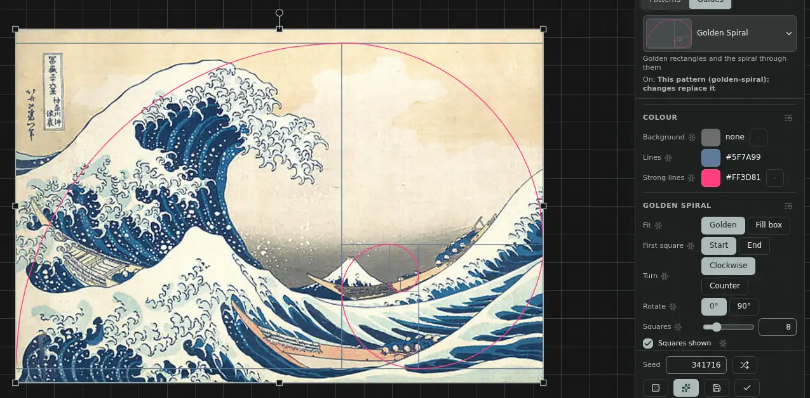

| Patterns (38, in six families) | |
| --- | --- |
| Families | Waves, Blobs, Soft, Lines, Tiles, Fields |
| Some of them | Ripple, Tides, Drift, Bubbles, Glow, Grain, Stripes, Halftone, Tiles, Contours, Cells, Flow, Marble, Maze |
| Settings | Counts, sizes, angles, colours, solid or outline, and a background you can hide |
| **Grid** | Square cells, as many rows as columns, a number of rows of its own, or an exact cell size, and says what the settings come to. Its Layout section adds a margin, a frame, shifts, a dash length and an angle |

The **55 guides** start with no background so they sit over your work, on a sheet with no fill (*Background* is still there). Randomize changes a guide's look and keeps what it is. They are real objects, so lock them to keep them from catching clicks.

| Family | Guides |
| --- | --- |
| Proportion | Golden Ratio, Golden Spiral, Fibonacci Grid, Root Rectangles, Modular Scale, Silver Ratio, Paper Sizes, Aspect Ratio Frames |
| Composition | Rule of Thirds, Dynamic Symmetry, Harmonic Armature, Rabatment, Diagonal Grid, Center and Safe Marks, Golden Triangles, Rule of Odds, Leading Lines, Visual Weight Quadrants |
| Layout | Grid, Column Grid, Modular Grid, Baseline Grid, Van de Graaf Canon, Bleed and Crop Marks, Manuscript Grid, Hierarchical Grid, Bento Grid, Device Frames |
| Perspective | Isometric Grid, Dimetric Grid, Triangle Grid, Perspective, Fisheye Grid, Cabinet and Cavalier, Curvilinear Perspective, Ground Plane, Cube Lattice |
| Geometry | Hex Grid, Polar Grid, Radial Symmetry, Logo Construction Circles, Sacred Circles, Rhombus Grid, Islamic Star Grid, Penrose Tiling, Voronoi Guide, Concentric Polygons, Spirograph Construction |
| Art study | Pixel Grid, Comic Panels, Isometric Pixel Grid, Tile and Sprite Sheet, Storyboard Frames, Value Scale, Color Wheel |

| Using the panel | |
| --- | --- |
| Tabs | **Patterns** and **Guides**; each keeps its last choice, and the panel remembers the tab |
| Where it goes | A selected sheet (the result goes on it) or a closed shape (it becomes the clipping mask that holds the result; its fill and outline come back on *Release*), or a new sheet. With several sheets or shapes selected, it makes one on each |
| Making it | *Generate* makes the result, and every change after that replaces it live. Changes in quick succession, such as dragging a slider, are one undo step; a change after a pause is its own. Undo and redo bring the settings back into the panel and they keep working; if undo removes the whole pattern, *Generate* makes it again |
| Seeds | *Randomize* picks random settings and a new seed (a snowflake on a setting keeps that setting); *New seed* keeps the settings, and says when the seed changes nothing. Type or drag a seed to make a result again. The regular generators (Stripes, Tiles, Halftone and the like) have a *Looseness* setting; at 0 they stay exact. Randomize stays within the usual span; sliders and numbers go far past it (a very high count can make a heavy pattern) |
| Resetting | Double-click a setting's name or slider to reset that one; the Reset button resets them all |
| Afterwards | The result is a group of ordinary editable shapes that remembers its settings. Select it later and the panel shows them; changes replace it in place. Resizing its sheet makes it again to fill the new size (it stretches while you drag) |
| As a style | *Save as a style* keeps a generator with its settings and seed in the Styles panel |

### The colour picker

One colour picker for every colour: fills, outlines, pen strokes, text, gradients' stops.

Match a colour by eye: mix a swatch until it sits beside the Prussian blue of the print.


| Feature | What it does |
| --- | --- |
| **Models** | OKHSL, OKHSV or OKLCH (CSS `oklch()`'s own lightness, chroma and hue) |
| **Layouts** | A ring and box, a plane with a hue bar, sliders, or the ring with sliders under it |
| **Text** | The colour as hex or another format |
| **Eyedropper**, **recent** and **saved** colours | As in any picker |
| **Numbers** | Change by dragging their name left or right; with `Shift` they snap to round steps worked out from the range (steps of 5 for 0–100, 10 for 0–255) |
| **Copy and paste** | A long press (or right click) on a swatch or saved gradient copies it without choosing it. Copying the hex field includes the `#`; pasting one drops it |
| **Pasting CSS** | With shapes selected, a pasted CSS colour (hex, `rgb()`, `hsl()`, `oklch()` and the other notations, or a name such as `rebeccapurple`) or gradient (`linear-gradient(...)`, `radial-gradient(...)`, `conic-gradient(...)`) becomes their fill |
| **Colour chips** | The colours of a selected pen stroke, or of several selected things, show as chips in the Properties bar; changing a chip changes that colour everywhere it is used |

### Styles

The **Styles** panel keeps saved looks that objects stay linked to: change the style and every object painted with it follows.

Take the colours of a reference as a palette to paint with.

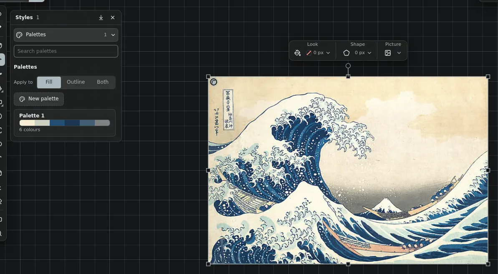

| Kind | What it keeps |
| --- | --- |
| Colours, gradients | Linked: objects painted with one follow when it changes; a change by hand, or *Detach*, unlinks it |
| Palettes | *Palette from a colour* builds harmonies; a palette can be taken from a picture. Imported and exported as `.gpl`, `.ase`, `.aco` and `.ggr` files |
| Text styles | Size, alignment, spacing, colour |
| Adjustments | A whole Adjust stack |
| Patterns | A generator with its settings and seed: pressing its card puts it back in the Pattern panel and makes it on what is selected (on each of several selected shapes) |
| Speech balloons | Size, tails, paint and the look of the words; goes on the selected balloons when you press its card. Not linked: changing the style later does not change them |
| Layouts | A sheet's auto layout: see [Auto layout](#auto-layout) |
| 3D line styles | The line art of a 3D view: see [Line art of a 3D model](#line-art-of-a-3d-model) |
| Custom ratios | See [Sheets](#sheets) |
| Export presets | See [Export…](#export) |

| Using the panel | |
| --- | --- |
| Kinds | The button at its top lists the kinds, each with how many there are; one kind shows at a time |
| Keeping | In the workspace, as many as you like; they go with a backup |
| Copy | A colour, gradient or palette card with a long press or right click (a palette as CSS variables; a colour inside an opened palette as hex), or *Copy hex* / *Copy as CSS* in its More menu. A long press copies without applying |
| Paste | CSS (a colour in any notation, or a gradient) with the pointer over the panel or nothing selected: saved as a new style |
| Gradients | *Randomize*, and a **gradient map** for pictures |

### More vector tools

Set a title along a curve for a cover.

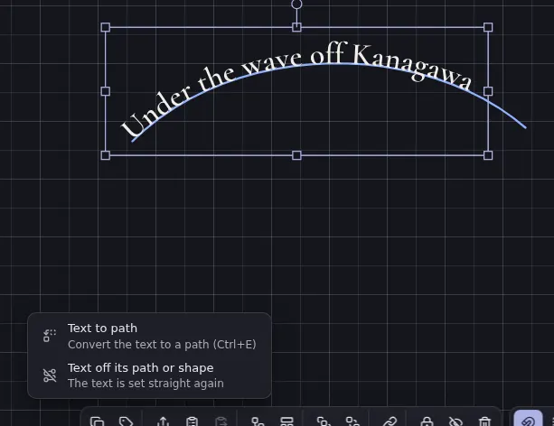

| Tool | What it does |
| --- | --- |
| **Vector networks** | Paths that meet at vertices, with the regions between them filled. Edges are split where they cross |
| **Initial state** | *Set*, *Update* and *Reset to initial state* remember a shape's geometry (and, by default, its fill and outline) so you can experiment and go back. *Apply rotation* makes a shape's current turn its new zero |
| **Eraser** (`E`) | Removes whole objects (optionally whole groups), or trims strokes in scissors mode |
| **SVG in** | Paste SVG text to get editable paths: gradients (including a radial one sized by its own transform, and an angular one written as a CSS conic gradient box), dashes, transforms, `<use>`, symbols and clip paths, which become clipping masks. Or make a vector copy of an SVG picture |
| **SVG out** | Export shapes as SVG, copy them as SVG text (*Copy the selection as SVG*, in the right-click menu), or save them to the library as an SVG picture |

---

## Comics and storyboards

Pages and panels are [sheets](#sheets) with real ratios, laid out by [auto layout](#auto-layout); speech balloons and text tell the story; [Export…](#export) makes the pages.

| Section | What is in it |
| --- | --- |
| [A page of panels](#a-page-of-panels) | Sheets, ratios and auto layout for pages and storyboards |
| [Speech balloons](#speech-balloons) | Bodies, tails, words and connectors |
| [Text](#text) | Rich text, fonts, text on a path and in a shape |

### A page of panels

Lay out a comic page from four pictures and letter it.


| Step | How |
| --- | --- |
| A page | Draw a sheet (`C`) and give it a ratio: `A4 portrait`, `16:9`, a size in px or a saved custom ratio |
| Panels | Each panel a sheet: draw them, or select pictures and choose *Put each on its own sheet* (a picture's sheet is exactly its size) |
| Laying them out | Select the panels and press `Shift+A`: a page that holds them in a grid, with a gap and padding (the **Comic Panels** and **Storyboard Frames** guides of the Pattern panel are there too, as guides to draw over) |
| Words | Speech balloons and captions over the panels; each panel cuts what goes past its edge |
| Out | Export the page, or every panel on its own, to PNG, JPEG, WebP, SVG or a multi-page PDF |

### Speech balloons

Press `K`, drag to draw a balloon, and double-click it to type its words.

Pick the balloon that fits the line: speech, thought, a shout or a caption box.

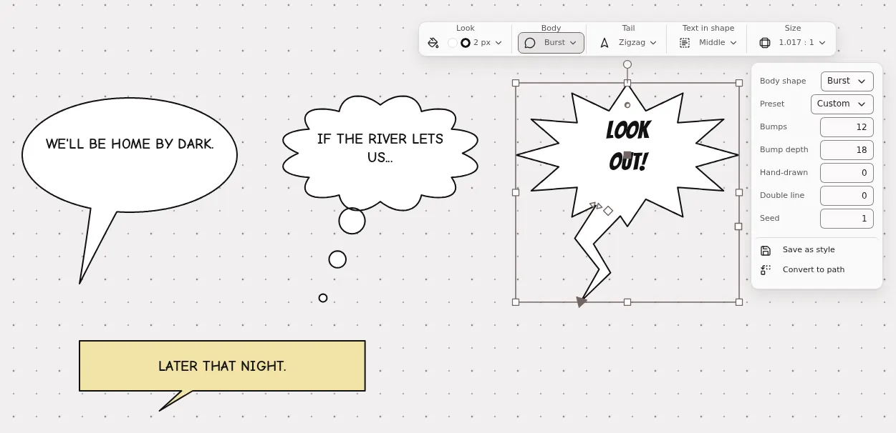

Point a balloon's tail at the speaker.

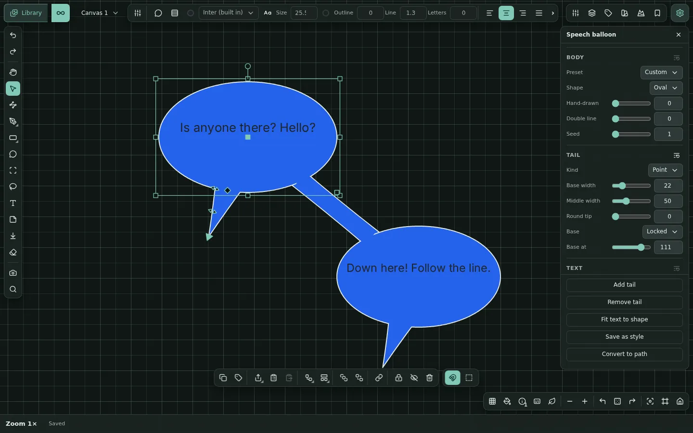

| Part | What you can do |
| --- | --- |
| **Handles** | Set the tail tip, base, width, middle width and bend, the rounding or bump depth, the body's size, and its place while the tail tip stays; they snap when Snap is on |
| **Tails** | Double-click the outline to add one; let a tip go inside the body to remove it |
| **Panel** | Its button is at the start of the Properties bar: twelve bodies, a double line, any number of tails with rounded tips, thought bubbles, presets, and the words (alignment across and down, padding for each side, what happens to words that do not fit, and **Fit text to shape**) |
| **Styles** | *Save as style* keeps size, ratio, tails, paint and the look of the words; its words go only into a balloon that has none |
| **Connectors** | Select two or more balloons and *Connect balloons* joins them, left to right. A connector is a neck, pinch, line or dots, and follows its balloons; its handles set the width, the bend and where each end stands on its balloon |
| **Paint** | The normal fill and outline, including dashes |

| Behaviour | |
| --- | --- |
| The next balloon | Takes the look of the last one changed |
| What belongs to it | A balloon's words, connectors and their cover pieces are in its group and sheet, in front of it, and its row in Layers stands for them. Connect balloons joins balloons on the same sheet |
| Deleting | A balloon removes its connectors and leaves its words as plain text; deleting it with its words removes both |
| Copying | Copy, cut and duplicate take a balloon's words with it, and a connector only when both its balloons go too |
| *Convert to path* | Gives up the balloon's numbers for node editing |

### Text

Press `T`, click and type. Text is stored as Markdown, and you can zoom into a letter as far as you like: the font's real outlines are drawn.

Set a cover's type: a title and a subtitle in fonts of your own.


| Making text | |
| --- | --- |
| Click or drag | A click makes a text as wide as its words; a drag makes a box of that width |
| Editing | Double-click to edit; `Esc` or `Ctrl/⌘+Enter` finishes |
| Resizing | The left and right handles change only the width of the box, and the words wrap again at the same size; the other handles scale the text |

| Feature | What it does |
| --- | --- |
| **Formatting** | Bold, italic, underline, strikethrough, links, colour and size of any range, headings, bulleted, numbered and nested lists (`Tab` nests a list item). The bar over the words keeps them in groups: **Style**, **Words** (the size menu and the font), **Paragraph** (the paragraph and list menus) and **Finish**. **Copy Markdown** is one click away |
| **Look** | Colour or gradient, outline, size, line height, letter spacing, alignment, auto or fixed width, paragraph spacing, indent, case, line limit, a set height, kerning, OpenType features and the axes of variable fonts |
| **Fonts** | Import `.ttf`, `.otf`, `.woff` or `.woff2` into the library, including variable fonts. One text may use several fonts. Right-to-left and mixed-direction text are supported |
| **Paragraph and box** | At the start of the text's bar: the paragraph and card settings (a text can sit on a coloured card; **Make note files** turns such texts into notes) |
| **Text on a path** | *Path tools > Text along a path*: the words follow the path when it moves or changes, in the same undo step, and are plain text again when the path is deleted. *Paragraph and box* sets where they start, their alignment along it, the side and the distance from it |
| **Text in a shape** | Select a text and a closed shape (a boolean shape or a group works too: the words go in its biggest piece), then *Path tools > Text inside the shape*. The shape sets where the words go (see below) |
| **Text to path** | `Ctrl/⌘+E` turns letters into editable outlines |
| **Off its path or shape** | *Text off its path or shape* sets them straight again |

**Text in a shape**, in detail:

| | |
| --- | --- |
| Following | The words follow the shape in the same undo step, and a text moved on its own goes back into it |
| Handles | Its corner handles change its letter size, and each side handle changes the padding on its side |
| Fitting | A long first word moves down to where it fits whole. Words that do not fit go on below it (a note says when some do not). Holes in a shape are avoided |
| While typing | The words sit in a box in the middle of the shape, on its colour, and take the shape's flow when you finish |
| Options | The speech balloon button at the start of the Properties bar: alignment across and down (with Justify), padding for each side, overflow and **Fit text to shape** |
| Deleting the shape | Or the speech balloon: leaves plain text |

---

## The Library

Every file you import, kept once, with folders, tags and search: your collection of references, art files, documents, models, fonts and notes. Switch between **Canvas** and **Library** at the top left. The canvas keeps its view, selection and undo history while you are away; the pictures it had ready are let go meanwhile (drawn again when you are back), so the two do not add up in memory.

Keep every reference once, in folders by subject, and see a print's details beside the grid.


| Section | What is in it |
| --- | --- |
| [The gallery](#the-gallery) | Grid or list, sorting, the status bar |
| [Search](#search) | Words, keywords, operators, saved searches, filters |
| [Folders and tags](#folders-and-tags) | The sidebar's trees, Organize, quick filters |
| [The viewer](#the-viewer) | Filmstrip, zoom, slideshow, players |
| [PDFs and 3D models](#pdfs-and-3d-models) | A reader for PDFs, a lit view of 3D models and their line art |
| [Art files](#art-files) | Pictures from `.kra`, `.psd`, `.procreate` and others |
| [Fonts](#fonts) | Samples of the library's fonts |
| [Similar images](#similar-images) | Duplicates and near-duplicates |
| [Selecting and details](#selecting-and-details) | Several items at once, properties, thumbnails, renaming |
| [Taking files out](#taking-files-out) | The clipboard, real files, other apps, exports |
| [Deleting and Trash](#deleting-and-trash) | Safe deletion, Trash, missing files |
| [The library folder](#the-library-folder) | The browser version's files on your disk |

### The gallery

Every file with its size, type and usage (*4 uses · 3 canvases*). A click selects an item and the details panel shows it.

Read a collection as a list, with each file's size, pixels and tags.


| Feature | What it does |
| --- | --- |
| **Grid or list** | The buttons at the right end of the status bar. In the list, drag a column header's edge to resize it (double-click for its usual width). **List columns** adds any **property** as a column by its name (`status`, `created`); a click on its head sorts by it, as the Sort menu's *Properties* do: dates by date, numbers by number, and items without it last either way. Columns, widths and the thumbnail size are kept |
| **Thumbnail size** | A slider in the same place in both, each with its own size |
| **Sort** | By name, date, size, type, use or a property, either way |
| **Thumbnails** | Made in the background after an import, so the grid fills in on its own |
| **Sections** | The sidebar's sections (Folders, File types, Tags, Canvas tags, Saved searches) and the details panel's (a note's or file's information, Tags and Folder, Properties, Linked from and Links, Where it is used) can be reordered by dragging their heads (the list scrolls when you drag near its top or bottom, or past it) |
| **Dragging items** | Shows up to five of them stacked, with their count. Drop them on a folder, a tag or Favourites in the sidebar to file them, or on the strip across the top to place them on the open canvas (the library stays open) |
| **Back to top** | A button over the bottom of the grid, in the middle (beside the chip of what is filtered when there is one), once you have scrolled down |
| **Status bar** | How many items are listed (*3 of 5 items*), how many are selected and their size, and the size of the whole library. At its right end: the list's columns, grid or list, the thumbnail size, and **Reload the library**, which reads the library again and draws every card anew when something looks out of date |

### Search

The search box over the gallery finds items by name, words, tags and what the files are.

Find the figure drawings in a tall format with one search.

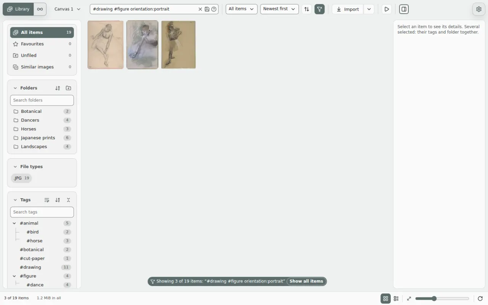

Look up the search words while typing.

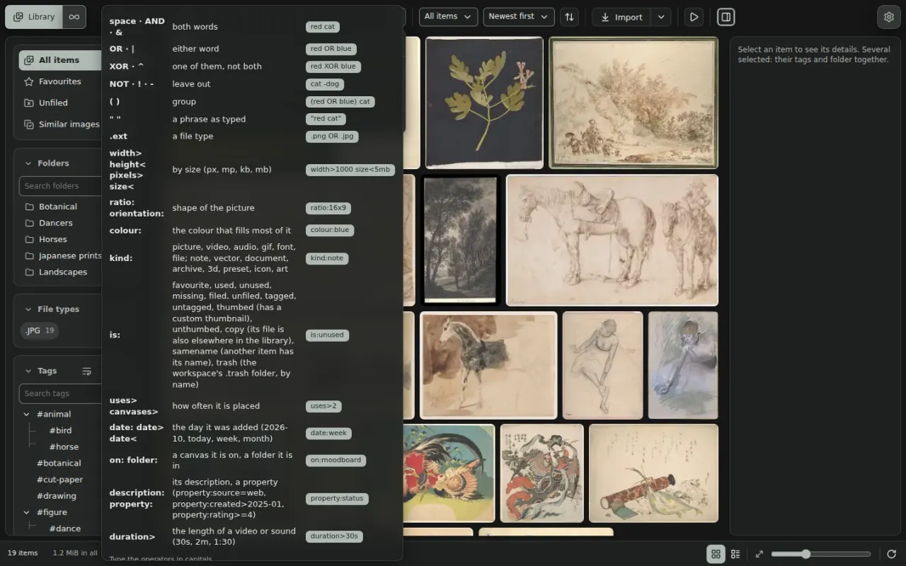

| Write | Finds |
| --- | --- |
| Words | Names, descriptions, properties and the words in notes and PDFs (the desktop app's paged list of a very large library, 20,000 items or more, does not search note words yet) |
| `AND`, `OR`, `XOR`, `NOT`, `-`, parentheses, `"phrases"` | Combinations (operators in capitals) |
| `#tag`, `.png` | A tag, a file type |
| `width>1000`, `height<`, `pixels>2mp`, `size<5mb` | By pixels and size |
| `ratio:16x9`, `orientation:portrait`, `colour:blue` | By shape and colour |
| `kind:` | picture, video, audio, gif, font, file; and by what a file is: note, vector, document, archive, 3d, preset, icon, art |
| `is:` | favourite, used, unused, missing, filed, unfiled, tagged, untagged, thumbed (has a custom thumbnail), unthumbed, copy (its file is also elsewhere in the library, under any name), samename (another item has its name, whatever its content) |
| `uses>2`, `canvases>1` | By how often it is used |
| `date:2026-10` | A month; also a day or a year, `today`, `yesterday`, `week`, `month`, `year`, and `date>` / `date<` for after and before |
| `on:name` | Placed on a canvas or board of that name |
| `folder:`, `description:` | In a folder, by its description |
| `property:source`, `property:source=web`, `property:created>2025-01`, `property:rating>=4`, `property:status>m` | By a property and what it says: dates, numbers, or the alphabet; any item of a list counts; `note:` and `field:` mean the same |
| `duration>30s` | By length (`2m`, `1:30`) |

They combine: `kind:video duration>1m -is:used`. The box's help card lists them, each with an example.

| Feature | What it does |
| --- | --- |
| **Saved searches** | The save button in the box keeps the search typed and, in the Library, the look of the library at that moment (grid or list, columns, sort): listed under **Saved searches** in the sidebar, one click brings back the search and its look, so a saved search works as a view (`kind:note property:status=draft`, sorted by `created`). See [Saved searches](#saved-searches) for the rest |
| **Filters** | Show (all, in use, unused), Sort by and its direction, and the sidebar's list are kept over a restart |
| **What is filtered** | While a search, a section of the sidebar or *In use* / *Unused* hides items, a chip over the bottom of the grid says so (*Showing 12 of 340 items: Unused · Refs*) with **Show all items** |
| **Reset all filters** | The funnel-with-a-cross button beside the sort: it shows while a filter is on or a search is typed, and clears them all (the search too), as **Show all items** does |
| **While typing** | Results are redrawn when typing pauses for a quarter of a second |

### Folders and tags

An item is in one folder and can have many tags. Both show as trees in the sidebar.

Pin the folder you work from most, nest tags by subject and keep the searches you repeat.

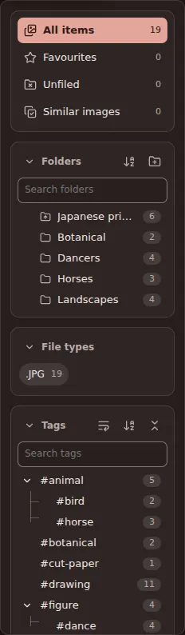

| Sidebar list | What it holds |
| --- | --- |
| **Folders** | An item lives in one folder; folders nest. They fold: a click on a folder that has subfolders opens or closes it (a small branch mark before its count says it has some), or Collapse all on the Folders header; remembered on this device |
| **Tags** | Several per item. A tag with a `/` (`reference/anatomy`) is a branch of a tree, with arrows that fold it and a parent that finds and counts what is nested under it, each item once; or all in a row with their whole names, by the button on the Tags header. Renamed in one dialog, from a tag's ⋯ menu in the sidebar or the Tags panel, or a double-click on it in the details |
| **Favourites**, **File types**, **Canvas tags** | The starred items; each kind of file; the tags of the canvases' objects |
| **Unfiled**, **Missing** | Items in no folder; the items whose file is gone (as `is:missing`), shown while there are some |
| **Similar images** | Duplicates and near-duplicates found by their pixels (see [Similar images](#similar-images)) |
| **Saved searches** | With how many each finds |
| **Trash** | Desktop app (see [Deleting and Trash](#deleting-and-trash)) |
| **Hidden** | Kept out of every list, and listed only in hidden mode (see [Privacy and hidden items](#privacy-and-hidden-items)) |

| Feature | How |
| --- | --- |
| **Rows** | Every list has the same rows: a count chip, a ⋯ that shows under the pointer (always on touch screens). A right click on a folder or tag opens its menu |
| **Search a list** | Folders, Tags and Canvas tags each have a search box for their own list: it finds a folder by name or path, opens what leads to it, and `Esc` empties it. It only narrows that list: the items shown change when you choose a row |
| **Show more** | A long list shows its first rows and **Show N more**, remembered on this device |
| **Sort a list** | The sort button in its head (or `Alt+↑` / `Alt+↓` on a section's name) changes the order at each click, remembered on this device: folders A to Z, Z to A, newest first and oldest first; tags A to Z and Z to A; file types the most first, A to Z, Z to A. Newest and oldest follow the order the library holds its folders in, as folders have no date of their own: one found on the disk counts from when it was found, and one hidden and shown again can count as newer |
| **Pin a folder** | The pin button on a folder's row (it shows when the pointer is on the row, not on small or touch screens; a pinned folder always shows its filled pin), or **Pin to top** in its ⋯ menu or on a right click, puts it first in the Folders list, a subfolder too, with an arrow on its folder icon; **Unpin** puts it back. Pins are kept in the workspace (pins made before on a device move there), and a search shows every folder in its usual place |
| **Conceal a folder** | **Conceal folder** in a folder's ⋯ menu: a view filter. Its items, and its subfolders', are listed only when that folder (or one in it) is opened: not in All items, a search, a file type, a tag, another folder, Similar images, the pickers of the Library and of notes, or a note's link and tag suggestions. Nothing of the folder or its items changes, and they stay on the canvases they are placed on, in exports and on the disk. The folder shows a fog mark; **Reveal folder** lists its items everywhere again. Kept in the workspace, for every device; Settings > Privacy counts them and lists them |
| **Quick filters** | A file type or a tag in the sidebar lists only those items; `Ctrl`+click (`⌘` on a Mac) adds another type or tag to the filter, or takes it out: any of the types chosen and any of the tags chosen |
| **File by dragging** | Drop items onto a folder to move them into it, onto *Unfiled* to take them out of their folders, onto a tag to tag them, onto *Favourites* to mark them; a selected item carries the whole selection |

#### Organize

**Organize…** (`O`, the right-click menu, or the details panel) moves what is selected to a folder and sets its tags from one dialog, with a search, as a tree or in a row. Nothing changes until Apply.

File a reference and tag it in one dialog.

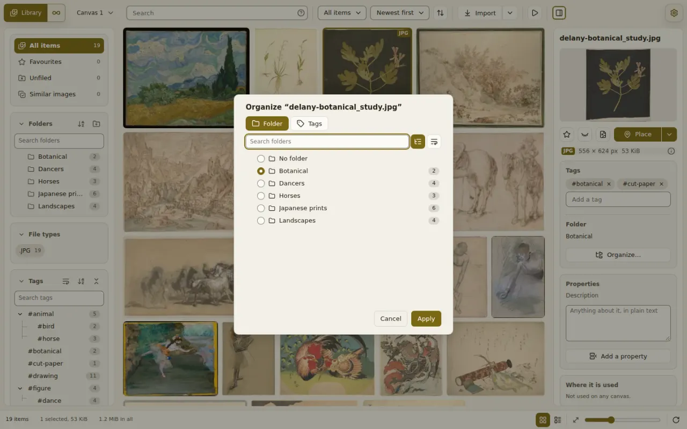

### The viewer

Double-click a card to see it large, with a filmstrip, zoom, pan, a slideshow and the details panel.

Check a print's values: see it in greyscale in the viewer.

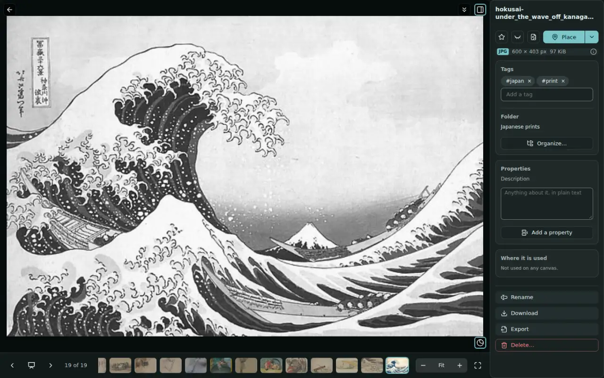

| Feature | How |
| --- | --- |
| **Moving** | The arrows go to the previous and next file; a click on the left or right edge does too (Settings > Media and playback) |
| **Controls** | The button beside the details button (or `F`) hides and shows them; with them hidden, the picture gets their room |
| **Background** | A button switches the background behind the picture: chequered, grey, black, white and the theme's own colour |
| **Greyscale** | Another button shows the picture in greyscale for now (it goes with the next item or on closing, and the file stays as it is) |
| **Where it is used** | The details show where an item is used (*Used on 3 canvases (4 times)*, then each canvas with its own count; past five canvases, **Show all** lists the rest), and the locate button beside one takes you to it on the canvas at any depth |
| **Video and GIFs** | Play with the canvas's player, floating over the bottom of the picture. While the pointer rests, playing or paused, the player fades away (after *Hide the player* in Settings > Library, 1.5 s by default), also with the pointer resting on it; only a move of the mouse, a click or a touch brings it back, never a key. While the focus is in the player (click any part of it, its empty space too; also once it has faded), `Left` and `Right` step the file and `Space` plays or pauses it. A GIF whose frames were never counted (imported long ago, or taken from a workspace folder) gets the player too |
| **Slideshow** | Plays the shown items, or the selected ones, one after another (*Slideshow time* in Settings) |
| **Phones** | A double tap opens it |

### PDFs and 3D models

A PDF or a 3D model shows as its picture in the library and opens in a view of its own: in the viewer, and in the [panel on a canvas](#notes-on-a-canvas) with a double-click on its card.

Read a study handout beside your pictures, without another app.

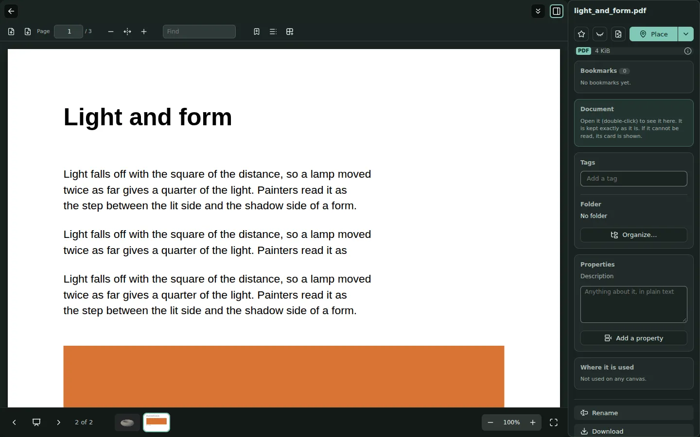

Turn a simple 3D object under a light, as the start of a still-life lighting study.

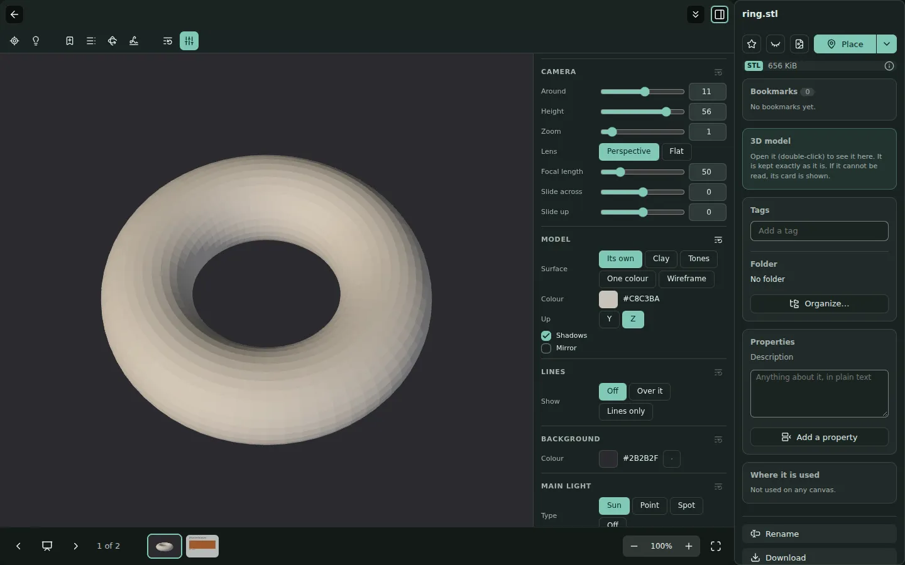

| | PDF | 3D model (GLB, glTF, STL, OBJ, PLY) |
| --- | --- | --- |
| In the library and details | Its first page | Its first view |
| Moving around | Page buttons, a page number, Page Up and Down, Home, End; zoom with its buttons, Ctrl+wheel or Ctrl and + or - | Drag to turn, Shift or right drag to slide, wheel to zoom, double-click for the first view; on a touch screen, two fingers pinch to zoom and move together to slide |
| Remembered | The page it was left at | The view it was left at, with its lights |
| Opened from a card | At the page that card shows | At the view that card shows |
| Bookmarks | Pages, and the contents the PDF carries | Views |
| On a card on a canvas | Its page's shape; **Show this page on the card** | **Show this view on the card** |
| Placed from the view (**Place**) | The page in sight | The view in sight |
| Several cards at once | **Place pages**: a card for each page typed, such as `1-4, 9` | **Place a turnaround**: eight cards, from all around |
| Finding | Ctrl+F in it; the library's search finds its words too | |
| As a picture file | **Extract this page**: the page in sight as a picture in the library, at 150, 300 or 600 dots an inch, named, filed and tagged as an [extracted frame](#video-audio-and-gifs) is (`book-p03.png`); from a card on a canvas it is placed beside the card | The view's lines: **Save the lines as SVG** |

Copy a diagram out of a handout to draw over it, as a picture of its own.

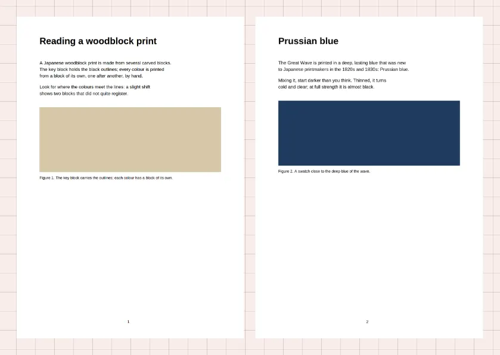

Bookmarks are in the view's bar and in the details, each with a ⋯ to rename or delete it. In the panel on a canvas, Ctrl+S shows the page or view on that card. What a card shows belongs to that card, so copies can show different pages or views; it is one step of undo, and nothing new is stored.

#### The 3D view's settings

The settings are in three tabs: **View** (camera, surface, background, pose), **Lines** and **Light**. In a narrow view, such as a phone or a small panel on a canvas, they are a sheet under the model, and the bar keeps turning, lighting and line styles, with the rest in its ⋯ menu.

| Setting | What it does |
| --- | --- |
| **Camera** | Around, height, zoom, lens and focal length |
| **Surface** | Its own, clay, tones, one colour, wireframe; which way is up; shadows |
| **Mirror** | Flips the picture, to check a drawing against it |
| **Pose** | The animation and moment, when the file has animations |
| **Background** | A colour or none, so a card can be see-through |
| **Lights** | Three lights (sun, point, spot or off, each with a colour, strength and direction), with light all around. They stand still round the model while the camera turns, as lamps in a room. **Lighting** in the bar sets a classic setup: Rembrandt, loop, butterfly, split, rim, three-point, even |
| **Tones** | Shows the light in 2 to 5 flat steps of value, to read shadow shapes |
| **Reset** | Double-click a setting's name for that one, the button on a group for the group, or the one in the bar for all, as in the Pattern panel |

#### Line art of a 3D model

Draw a model as a technical illustration or a print: its outline, creases and the edges behind, with hatching or dots where the light does not fall.

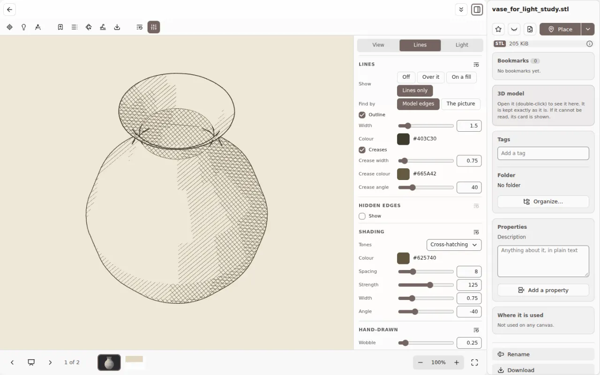

| Setting | What it does |
| --- | --- |
| **Show** | Off, over the model, on a flat fill of one colour, or the lines alone |
| **Find by** | *Model edges*: the lines of its own faces, exact, at any size. *The picture*: lines where the view changes in depth or turn, for scans and very dense models (with its outline, inner detail and reach) |
| **Outline** | Where the surface turns away: the outer shape and its overlaps, with its width and colour |
| **Creases** | Where two faces meet at a sharper turn than the crease angle, with their own width and colour |
| **Hidden edges** | The edges behind, dashed, with their colour, opacity and dash, as a technical drawing shows them |
| **Shading** | The light's shadows as hatching, cross-hatching, halftone dots or stippling, with their colour, spacing, strength, width and angle. They follow the lights of the Light tab |
| **Hand-drawn** | A wobble, as by hand; far lines fading; near lines thicker |

Give a model the look of a blueprint or a comic in one choice, and keep your own looks for other models.

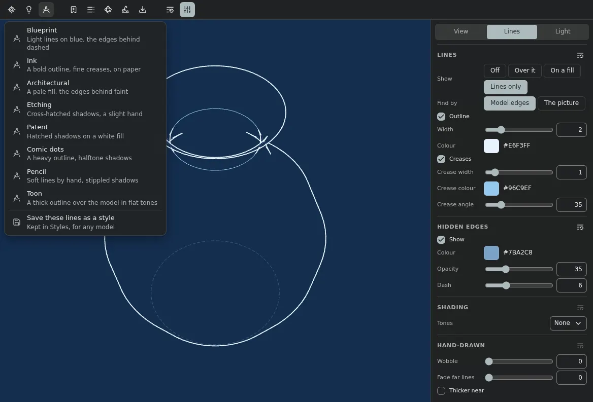

| Line styles (in the bar) | |
| --- | --- |
| Built in | Blueprint, Ink, Architectural, Etching, Patent, Comic dots, Pencil, Toon: each sets all the lines, their fill and the background (Toon also the surface) |
| Your own | *Save these lines as a style* keeps them in the [Styles](#styles) panel as a 3D line style, offered in this menu for any model; pressing its card in the panel gives it to the 3D view in front |

| Using the lines | |
| --- | --- |
| **Place the lines** | Puts this view's line art on the canvas as paths to edit, which copy and export like any shape: from the model's edges, the outline, creases, hidden edges, tones and the fill, each kind in its own paths; from the picture, its lines followed along their middles, as one line width (a dense scan gives many short lines: raise *Min. placed*, the shortest line placed, or lower *Inner detail*) |
| **Save the lines as SVG** | Saves this view's line art as an SVG file with each kind in its own group, on the background; over the model, the picture of the model is under the lines |

Check a figure's pose on a phone: the model above, its settings below.

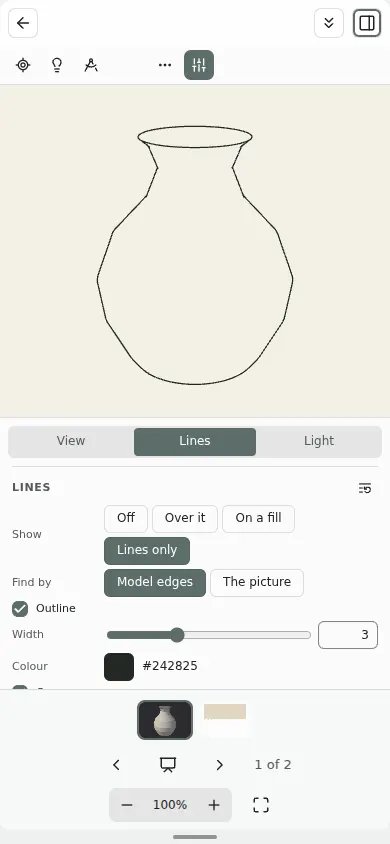

### Art files

`.kra`, `.ora`, `.psd`, `.psb`, `.procreate`, `.sketch`, `.fig`, `.figcraft` and `.clip` show the picture they keep: on their library card and details, in the viewer and on a canvas. The file is only read; its layers stay its program's.

Keep paintings in progress from other apps beside their references: their picture shows without opening them.

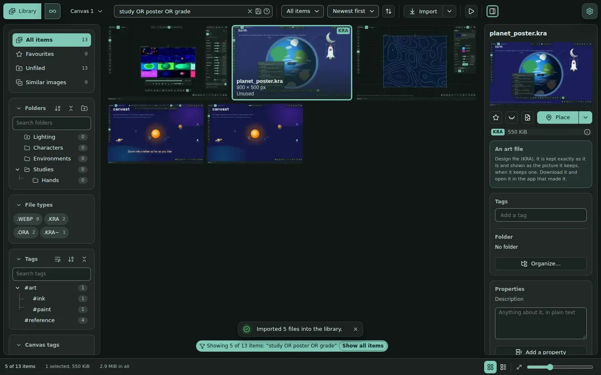

| | |
| --- | --- |
| Backup copies | `a.kra~`, `a-autosave.kra` show their picture too, and say they are automatic backups: on the card and in the details |
| What it shows | A preview as the file was last saved |
| Photoshop | A file without a stored thumbnail shows its merged picture when that is 8-bit RGB or grey; the viewer shows that merged picture too, reduced to 64 megapixels when it is bigger |
| Size | An art file of any size is only read in parts, also one past the import limit that lies in the desktop app's `library/`. A picture stored inside a ZIP-based file (`.kra`, `.ora`, `.procreate`, `.sketch`, `.fig`, `.figcraft`) is used up to 256 MiB unpacked; past that its next, smaller picture is used, or its tile if it has none |
| On a canvas | A newly imported art file has its picture's shape; one imported earlier keeps a 4:3 card, its picture cropped to fit |
| Other art files | `.xcf`, `.ai`, `.sai`, `.afphoto`, `.afdesign` keep their tile |

### Fonts

The library's fonts (`.ttf`, `.otf`, `.woff`, `.woff2`) are the fonts of the canvas's text and of notes.

Keep the fonts of a project with its pictures and see each one set.

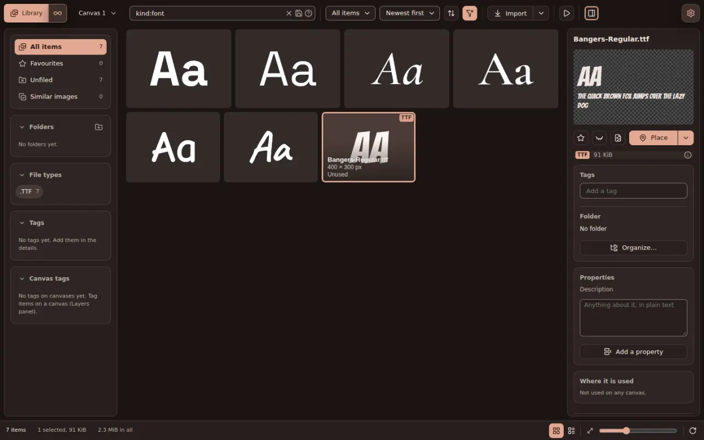

| Where | What shows |
| --- | --- |
| A card | "Aa" in its letters (on the canvas too) |
| The details | A sample sentence |
| The viewer | Four sizes with the alphabet and digits, on the same background as a see-through picture (by the same button); another button changes the sample sentence, and a box under the samples takes your own words. All three are kept, and its preview in the details and its card on a canvas show the same |

### Similar images

**Similar images** in the sidebar groups duplicates and near-duplicates found by their pixels: a scan and its crop, a picture saved twice at two sizes.

Find a second scan of the same print hiding in the collection.

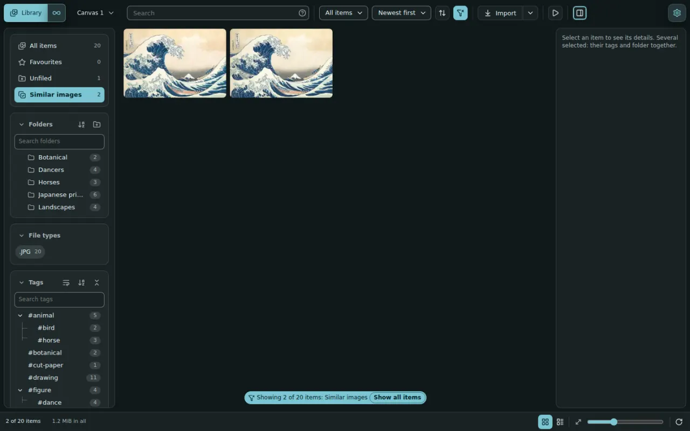

### Selecting and details

Click to select, `Ctrl`+click to add, `Shift`+click for a range. The details panel (`I`) acts on what is selected.

Tag or file several drawings at once.

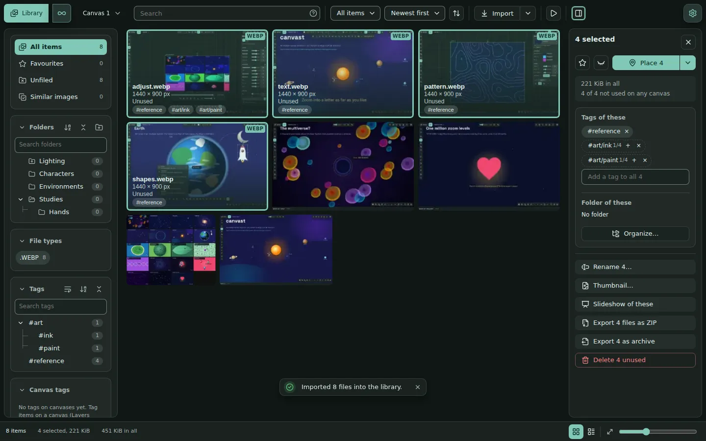

| Selecting | |
| --- | --- |
| A click | Selects an item; the details panel opens and closes with its button (or `I`). A click never moves the grid under the pointer |
| Laid out again | When the grid is laid out again (the panel toggled, the window or thumbnails resized), the selected item stays where it is on the screen |
| `Ctrl+A`, `Ctrl`+click, `Shift`+click | All shown (a plain click then selects one alone), add or remove, a range. A selected item shows a coloured border (no checkboxes) |
| **Select several** | A card's menu (right click, or a long touch on a phone or tablet): from then on each tap or click adds an item or takes it away, until nothing is selected or `Esc`. The way to pick several without a keyboard |
| Hidden by a filter | Selected items hidden by a search or filter are counted in the panel, with a button to keep only the shown ones |
| File details | The file's line in the details panel (its kind, pixels and size, with the info icon at its right end) opens its metadata below, in the same card, and stays open or closed as you left it. A double-click on the name at the top renames the item |

| Several at once | |
| --- | --- |
| Tags | The details panel lists every tag any of them has, with how many have it (*2/4*). **×** takes a tag off all of them; **+** puts it on the rest. The tag field suggests the library's tags and takes several at once, separated by commas |
| Folders | The panel says which folder they are in (for a mixed selection, each with how many). **Organize…** moves them to a folder, makes a new one, and sets tags |
| Speed | Changes to hundreds of items are one write, so they take a moment, not minutes |

#### Properties

Every kind of file has properties, in the details panel of one item. A markdown note's are its YAML (see [Properties](#properties) under Notes), a rich text note's its `<meta>` tags; every other file's stay in the library, and the file itself never changes.

Catalogue a reference with what the museum says of it: artist, date, medium, source.

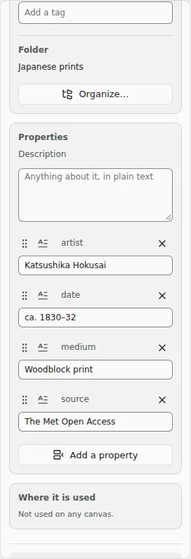

| Part | What it does |
| --- | --- |
| **Description** | A plain-text box (not Markdown) |
| **Add a property** | A row with a name you choose and its value: `link` and an address, `author`, `source`, `licence`… Names already used in the library are suggested, and so are the values others of that name have (the most used first, each item of a list on its own) |
| Saving | Each is saved when you leave it or press `Enter`. **×** removes a property; the grip at its start moves it (drag it, or press `↑` / `↓` on it). `Ctrl+Z` undoes |
| Finding | The library search (All) finds words in descriptions and in properties; see [Search](#search) for the rest |
| Travelling | Descriptions and properties travel in backups and in the library index. Importing keeps an item's own description (the backup's fills an empty one) and adds the properties it does not have yet |

#### Custom thumbnail

The picture button beside ★ and Hide in the details panel (**Thumbnail…** for several selected): what the Library shows for an item instead of its own picture, also for a file with no preview (a font, a 3D file, a document), and what its card shows on a canvas.

Choose the picture a card shows: a detail that tells two studies apart.

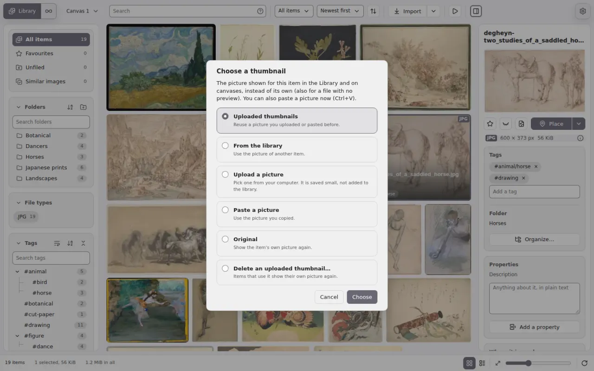

| Choice | What it is |
| --- | --- |
| **Uploaded thumbnails** | One uploaded or pasted before, with how many items use each; **Delete an uploaded thumbnail…** |
| **From the library** | Another item's picture |
| **Upload a picture**, **Paste a picture** | Kept small, 512 px, in its own place: never a library item; `Ctrl`+`V` while the dialog is open pastes at once |
| **Original** | Its own picture again |

Changing it can be undone. In hidden mode an uploaded one is a hidden thumbnail: listed and shown only there (normal mode never sees it), sealed with the hidden items' key in the desktop app. Hiding an item takes its uploaded thumbnail with it (sealed, unless shown items use it too); showing it again makes it normal.

#### Rename

Rename one item or many at once, with a preview: number them, replace text, add text or change the extension. Renaming one item edits only the name before the extension (it stays, so it cannot change by accident); *Change the extension too* opens the whole name.

Give a reference a name you will search for.

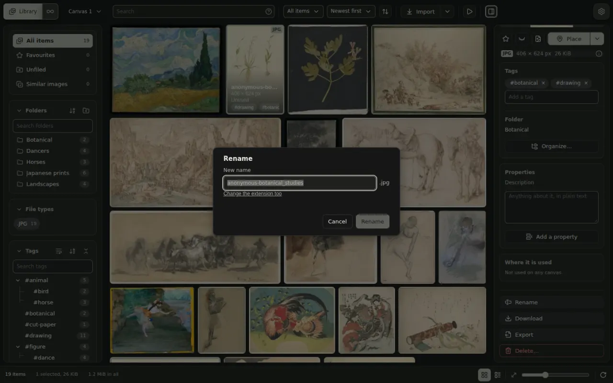

Numbering several items (*Enumerate*) uses a name pattern, the same as Export's file names:

| Write | It becomes |
| --- | --- |
| `#`, `###` | The number, zero-padded to as many digits as `#` (`###` → 001); *starting with* sets the first. No `#`: the number follows a space |
| `{name}` | The item's old name |
| `{date}`, `{date:FORMAT}` | A date, 2026-11-11, or in a format of `YYYY` `YY` `MM` `DD` `HH` `mm` `ss`: `{date:YYYYMMDD}` → 20261111, `{date:DD.MM.YY}` → 11.11.26; any other character stays as written |
| Which date | *Today*, *This date* (a day you set), or *Date added* (each item's own). The Date row shows while the pattern holds a date |

Number the studies of one life class with the day they were drawn:

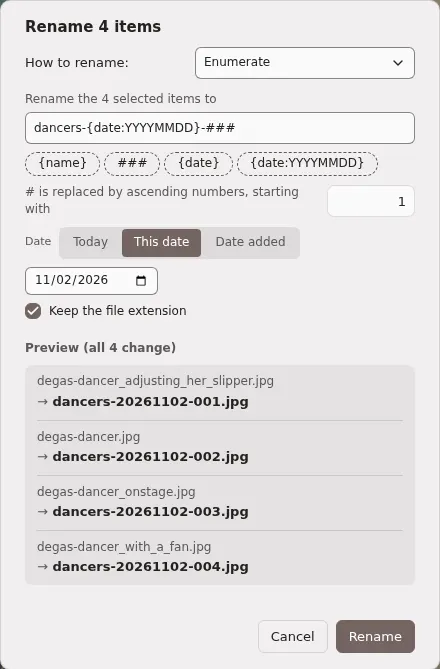

#### Undo in the library

`Ctrl+Z` undoes the last change to tags, favourites, folders or names (`Ctrl+Shift+Z` or `Ctrl+Y` redoes), up to 50 steps; deleting from the library has its own safety (files are kept while undo on a canvas can need them).

### Taking files out

Take items to other apps, as a picture, as words, or as real files.

Take a reference out of the app: download it or export it.

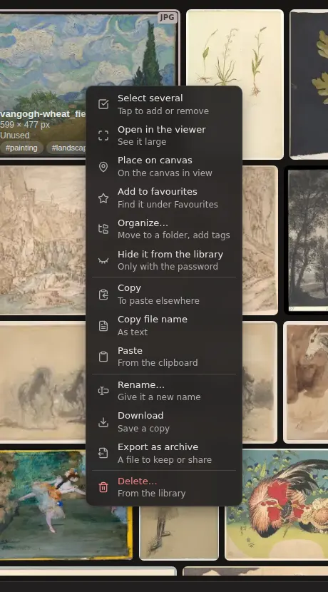

| To | Do this | What arrives |
| --- | --- | --- |
| Paste in an image app or a note | **Copy**, or `Ctrl+C` | A picture as a PNG; a note as its words |
| Paste in a file manager | **Copy file** (desktop app) | The real files, of any kind |
| Drop in another program | Drag the card (desktop app); hold `Alt` if it is refused | The real files |
| Open it elsewhere | **Open in default app** (desktop app) | Your system's app for that file |
| Find it on disk | **Show in file manager** (desktop app) | Its folder, with the file selected |
| A `.canvast` archive, or download files | **Export** | |
| All files as a plain ZIP | **Export**: sorted by file type or by folder | |
| One folder and its subfolders | **Export folder…** (its ⋯ menu): a ZIP, or a folder in the desktop app | |

| In detail | |
| --- | --- |
| **Copy** | `Ctrl+C` in the library and its viewer, or the menu: a picture goes as a PNG, also a GIF's first frame and an SVG drawn, which the message says; only the first of several pictures fits. The PNG goes alone on the clipboard (a name beside it would be pasted instead of the picture by many programs). A markdown or rich text note goes as markdown with its properties on top, a plain text note as its words, several notes joined. A video or sound goes as its library picture. Any other file, or a picture the app cannot draw (TIFF, HEIC, PSD), goes as its name, which the message says. On a canvas, `Ctrl+C` on one note card gives the note's words and pastes back as the card |
| *Copy file name*, *Paste* | The name as text; *Paste* brings a picture from the clipboard in, named by the text beside it when there is one and it is a file name, else `image` |
| **Copy file** | Desktop app; the same menu and a right click on a canvas: puts the real files on the clipboard, of any kind, to paste in a file manager |
| **Dragging out** | Desktop app: drag a card onto a file manager or another program, as a copy; several selected go together, up to 1,000. If a program refuses it, hold `Alt` as you start the drag for a real file drag, which nothing inside the app receives. Hidden items stay in: use **Copy file** |
| **Open in default app** | Desktop app; in the details, the right-click menu, and a file card's Actions bar on a canvas: opens an item's file in your system's app for that kind of file, for a file canvast cannot show, or to edit a picture elsewhere |
| **Show in file manager** | Desktop app; in the details of one item, and its right-click menu: opens the item's folder with its file selected |
| **Export folder…** | Writes the folder's files and those of its subfolders, under their names in the library: as a ZIP, or in the desktop app as a folder where you choose (outside the workspace), either keeping its folders (from the folder itself down) or with all the files together (two of the same name are numbered). Each file written to a folder is read back and checked against its SHA-256. In hidden mode it exports the hidden items in it, written readable after you confirm; outside hidden mode, only the shown ones |
| **Hidden items** | No *Show in file manager*; *Open in default app* (in hidden mode, after asking once per session) opens a readable copy written to the app's own temporary folder, deleted when the hidden items are locked or canvast closes. Copying one to the system's clipboard, or **Copy file**, asks first, once a session: other programs can see and keep what is there. They cannot be dragged out. Outside hidden mode, hidden items' property names and values are never offered as suggestions, columns or sorts |

### Deleting and Trash

**A file is erased only when nothing, undo included, can bring it back.**

Bring back a file deleted by mistake: the workspace folder keeps deleted files in its Trash.

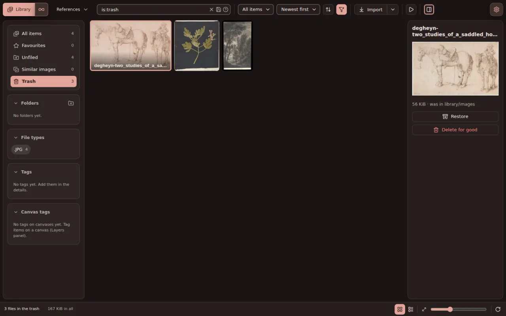

| Action | What happens |
| --- | --- |
| **Delete…** on an unused item | It leaves the library |
| **Delete…** on an item in use | Deleted everywhere, after a confirmation that says where it is used (the first three canvases and how many others). Its instances are removed from every canvas first; a text using it as its font keeps its words in the default font. Undo brings them back on the open canvas, not on the others |
| **Delete everywhere** | A selected item's right-click menu on a canvas, the command palette, and the library's details: the file and every instance of it, after saying where it is used; on a canvas, text and shapes selected with it stay. Outside hidden mode, a hidden item is a padlock: Delete everywhere, Copy file and copying a note card do not reach it, whatever the password state |
| **Trash** (desktop app) | The library's sidebar: puts `is:trash` in the search box and shows the files in this workspace's `.trash` folder as cards in place of the grid, each with the picture the library gives its kind (a note's page, a PDF's, a video's frame, an art file's picture…), not your system's trash; anything else typed filters by name, and anything else in the sidebar goes back to the library. Pick files as in the library (Ctrl, Shift, Ctrl+A): **Restore** and **Delete for good** are in the details panel and the right-click menu. A file comes back where it was, never over another; its tags and folder come back only if the library still remembers it. Delete for good asks first. Hidden files there are listed only in hidden mode with the Hidden items open; outside it they neither show nor count. Boards and canvases in `.trash` are not listed |
| **Missing files** | For example after clearing site data, or a file taken out of the library folder: flagged with their usage; importing the same file again restores every instance |

### The library folder

Browser version, Chromium only: keep the library's files on your disk instead of in the browser's storage, so its size is limited by your disk.

| Step | How |
| --- | --- |
| **Set it up** | Settings > Storage, *Choose library folder…*. Files are named by their content and keep their extension (`a07c9f….png`), so other programs can open them. *Move into folder* and *Move back to browser* move what is already there |
| **The library index** | `.canvast-index`, a hidden file beside the files, is the whole workspace without the files: boards, canvases, objects, names, tags, folders, descriptions, properties, styles, settings. It is saved by itself shortly after each change (a checkbox turns that off; **Save index** saves at once). It is not a backup (a `.canvast` backup holds the files), and not a cache to delete: on another device it is your canvases |
| **On another device** | Choose the same folder: you are offered to open its index (**Open index** does it later). The canvases are added and every file is matched by name. Do this on a device with no canvases of its own yet, or they are added twice |
| **After a restart** | The browser asks for permission again: press *Reconnect folder* |
| **Leave the files alone** | Don't move, rename or edit them, as canvast finds each by its name. Files kept before extensions were added get one with *Add extensions* on the card |

---

## Notes

Markdown, plain text and rich text notes, written in a full editor, in the library and beside the canvas. Each note is a real file, so study plans, scripts and project notes live next to the references they talk about.

Keep study notes on a reference: its facts as properties, the print embedded, a checklist of what to look at and a copy plan.


| Section | What is in it |
| --- | --- |
| [Writing](#writing) | Making a note, the editor, its styles and tools |
| [Notes on a canvas](#notes-on-a-canvas) | Note cards and the Note panel |
| [Saving and what a file can hold](#saving-and-what-a-file-can-hold) | Manual saving, markdown and rich text |
| [Links and tags](#links-and-tags) | `[[links]]`, backlinks, `#tags`, renames that follow |
| [Properties](#properties) | YAML properties, types, automatic ones |
| [Working with Obsidian](#working-with-obsidian) | Pasting from it and copying to it |

### Writing

**New note** (the Import menu) makes a markdown note in the open folder (else in the **Notes** folder, whose name is set in Settings > Notes) and opens it. On a canvas the **Note tool** (`M`) does the same where you click: drag a box to set the card's width; a click makes it as wide as *Note tool card size*.

| Kind of note | Files |
| --- | --- |
| Markdown | `.md`, `.markdown` |
| Plain text | `.txt`, and as plain text the likes of `.json`, `.csv`, `.yaml`, `.xml`, `.log` and code files, up to 5 MiB and in UTF-8 |
| Rich text | The app's own `.note.html` |

| The editor ([SunEditor](https://suneditor.com)) | |
| --- | --- |
| **Editor style** | Settings > Notes: *Document* (pages, every tool; the default), *Classic* (one short toolbar row, the rest behind its **+**), *Bottom* (the same, below), *Balloon* (the toolbar only over selected words), *Notion-like* (a handle beside each block) |
| **The `/` menu** | In every editor style: type `/` at the start of a line or after a space, then words to find a command (headings, lists, quote, code, table, picture, link and more) |
| **Pictures, video, sound and files** | Come from the library: the gallery buttons (Insert ▸ Image gallery, Video gallery, Audio gallery, File gallery, File browser) open the library chooser, and a file uploaded, dropped or pasted into a note is put in the library first. Its own **Import…** button takes files from this device into the library and into the note |
| **Templates** | Insert ▸ Template inserts a block at the cursor: *Meeting notes*, *To-do list*, *Journal entry*, *Reference sheet*, then **your own**: any note in the library tagged `template` is listed by its name, its pictures and links pointing at the same library items. `{{date}}`, `{{time}}` and `{{title}}` in one are filled in: today, now, the note's name |
| **Layouts** | Insert ▸ Layout: *Two columns*, *Three columns*, *Sidebar and main*. A layout takes the place of the whole note (`Ctrl+Z` brings the note back), and markdown cannot hold columns, so a note with one is saved as a rich text note |
| **Task lists** | Click a box to tick it; it is saved as `- [x]`. A task shows its box only (no bullet) |
| **Links from the clipboard** | Select words and paste a web address or a `[[link]]`: those words become the link. The selection's toolbar has the 🔗 link button too |
| **Remove format** | The eraser in the toolbar over selected words, and in the Text menu: takes sizes, fonts and colours off the words chosen, so a heading made bigger or smaller by accident goes back to its own size |
| **Colours in code blocks** | A block with a language is coloured, in any of the 21 languages it offers. The colours are painted over the words, so the note itself does not change. **Colour code in notes** in Settings > Notes turns it off |
| **The word under the cursor** | `Ctrl+B`, `Ctrl+I`, `Ctrl+U` and **Code** with the cursor inside a word format the whole word, or remove the format from text already in it, with nothing selected |
| **Signs round selected words** | Typing `"`, `'`, `(`, `[`, `{`, `<`, `=` or `%` over selected words wraps them, and they stay selected. In a note with formats, `` ` `` makes code, `*` or `_` italic (twice: bold) and `~` strikethrough. **Signs wrap selected words** in Settings > Notes turns it off |
| **Marks typed at a line's start** | `1.` then a space starts a numbered list, and `---` a line, always. With **Markdown marks make formats** on (Settings > Notes; off at first), `-`, `*`, `+`, any number with `.` or `)`, `>` and `#` to `######` then a space do too: the mark goes, the line takes the format, one undo step |
| **Lines with marks into lists** | In the `/` menu. Lines that start with `1.`, `-`, `#` or `>` but are words (pasted as words or typed before marks were read; saved, their marks show as `1\.` or `\-` in the file) become the list, heading or quote they say, in the whole note; one undo step. Nothing changes a note by itself |
| **Markdown and Code views** | Show the note as text; coming back without a change there, the note is as it was (picture sizes, spacing). A change made there is read back from that text, which markdown keeps without sizes or styles |
| **Numbers drag** | The font size and a picture's or video's width and height change by dragging the field left or right, as every number of the app (a picture keeps its proportion when that is on; a dragged font size applies on release) |
| **Zoom** | The viewer's **−**, **+** and percentage work on a note as on a picture, with `+`, `-` and `0`, or `Ctrl` with them while typing, and `Ctrl` + wheel. Only the text grows, so pictures keep their size, as the editor's handles need; the file does not change |
| **Fonts** | *Inter* (built in; *Default* when words have no font of their own) and the library's fonts, by their family names; files of one family (Regular, Bold…) are one entry. A rich text note names them so, and other apps show them where the font is installed |
| **Its look** | The app's font, colours, corners and light or dark theme. A dialog of the editor (Insert image…) opens the library chooser above itself |
| **Not in a note's toolbar** | New document (it would empty the open note), Print, and the page buttons (page break, page number, previous and next page): a note is a file of the library, not a page to print. Document style still shows its pages |

| New notes | |
| --- | --- |
| Name | *New note name* (Settings > Notes; `Note {yyyy}-{mm}-{dd} {hhmmss}` at first), which is also its title |
| From the Note tool | The note goes in the Notes folder, its card is placed where you clicked and it opens in the Note panel |
| From texts on a card | Texts on a card (what the Note tool made before notes were files; a card is also one of a text's box options) become notes with **Make note files** in their Actions bar: the same place, width and stacking, the words in a `.md` file named by its first line |

### Notes on a canvas

Double-click a note's card (or **Edit note** in its Actions bar) and it opens in the **Note** panel, with the canvas still usable beside it: the same editor and saving as in the library, in the style of *Editor style on a canvas* (Settings > Notes).

Keep the notes beside the picture they are about, and edit them there.


| Feature | How |
| --- | --- |
| **Where it opens** | *Files on a canvas* (Settings > Notes): **Panel** (the default) or **Window**, centred over the canvas until it is closed (a click beside it closes it, asking about unsaved changes) |
| **The panel** | A panel like Layers (it never folds): it floats, docks to a side (keeping its own width), its width and height can be dragged. ✕ closes it (asking about unsaved changes); the card shows the saved version at once |
| **Undo** | Saving is no step of the canvas's undo: undo and redo on the canvas keep the saved version (they never bring an older one back) |
| **Renaming** | The rename button in its header (or F2) renames the note with the library's rename dialog; the extension stays as it is, and `.note.html` counts as one extension there and in batch rename |
| **Card size** | A side handle lays the page out at the new width or height, the words keeping their size; dragging a corner evenly (`Shift`) zooms the whole card. A new version keeps the card's width. **Reset size** in a card's Actions bar puts it back to its Note tool card size |
| **Whole note or part** | **Note cards show** (Settings > Notes) applies to every card at once: *Whole note* (the default), the height follows the note, also when it is saved longer; *Part*, you set the height and what does not fit fades out into the page's paper |
| **Labels** | **Note cards show properties** (Settings > Notes) takes names separated by commas (`status, type, tags`): their values show as small labels at the top of each note's card and library picture, at once. They say what the details panel says, written into the file or not, and change as soon as a property does |
| **Hidden notes** | A hidden note opens there only while the hidden items show, and closes (its changes saved) as soon as they no longer do: hidden mode ended, the hidden items locked |

| Previews | |
| --- | --- |
| In the library | A note's card and details show the top of its page (headings, lists, tables, colours). Every note's card has that one shape, however long the note, so its title shows whole |
| On a canvas | Its card is its page, laid out at the card's own size and drawn at twice that so it stays sharp when zoomed in. Shown small, it is drawn from a copy at that size |
| What it shows | The pictures it links to (also Obsidian's `![[picture]]`), a video by its picture with ▶, a sound by its waveform with ♪, a GIF by its first frame; never a hidden item's. Its text is in the system's font in the preview only |
| Light or dark | **Preview look** (Settings > Notes: Auto, the default, follows the app's theme); a change redraws every preview at once, so a note's previews are made when shown, never stored |

### Saving and what a file can hold

**Saving is manual:** `Ctrl+S` or File ▸ Save. Until you save, changes live only in the open editor, and **there is no version history: a saved note replaces the file.**

| Situation | What happens |
| --- | --- |
| Saving | The note's own file is rewritten in place (in the desktop app, the same file in `library/`, so other programs see it); it keeps its name, folder, tags, note and fields |
| Leaving with unsaved changes | It asks: *Save them*, *Don't save* or Cancel (or saves without asking, with **Save notes on close** on); so does closing the desktop app's window, and the browser asks before the page is left |
| Formatting markdown cannot hold | An alignment, a font size, the page layout: it asks **Save as a rich text note** (the note becomes `name.note.html` in its place, keeping everything; its folder, tags, links to it and its cards on canvases follow it, and no markdown file is left beside it) or **Save as plain markdown** (that formatting is dropped). **When a note's formatting does not fit its file** (Settings > Notes) answers it once and for all |
| Changed in another app since it was opened | Saving asks before putting your version in their place |

| What markdown keeps | |
| --- | --- |
| Formatting | Headings, bold and italic, lists and task lists, quotes, code, tables, links, pictures; coloured or styled words as inline HTML |
| Obsidian's syntax | Written as Obsidian writes it: footnotes (`[^1]`), embeds kept as written (`![[picture]]`) and table column alignment (`:---:`) |
| Not formatting | Empty lines and spaces at a line's start: they never make it ask |

| What a save may change by itself (Settings > Notes, all off by default) | |
| --- | --- |
| **Write tags and properties into note files** | Writes what is changed in the library into the file too; off, the file changes only when you save its words, and what its YAML says is still read into the library |
| **Automatic created and modified** | Both properties are always there, not editable or removable in the details panel (also before the first save). A save writes the time into modified, and into created when the note has none (from when it came into the library). Their names (`created-on`, say) and the **Date and time format** (`YYYY-MM-DDTHH:mm`) are settings; sorting and date searches need the numbers in that order |
| **Title** | *First heading*: a save writes the first H1 into the title property, which is then not editable or removable there. With no H1 the title stays. The title shown for a note is the file's name (as in Obsidian); a `title:` property is one of its properties |
| **Rename notes on save** | A save names the file from **File name comes from** (*First heading* or *Title property*), in **File name style**: *Keep as written* (only what a file cannot hold changes: `My Note: Part 1` → `My Note- Part 1.md`) or *Clean* (`my_note-part_1.md`), the two rules of Keep file names. The links to it in other notes follow, and it is a step of the library's undo (the next save renames it again). Turning it on renames nothing until a note is saved. With nothing to name it by (no heading or title, or only marks such as `# ???`) the name stays; when another note has the name first, the file and the item end in `-2`, and stay so until the name wanted changes. In the desktop app with Keep file names off, a note named as written has a tidy file until its name next changes |
| **Pasted notes** | A title or created pasted with a note is kept over what the note had for that save; modified becomes the time of the save. Links rewritten after a rename do not count as a save |

Plain text notes are left alone by all of these.

### Links and tags

Link notes and files as Obsidian does. Renaming or moving an item updates the links to it.

Link notes to each other and see what links to a note.

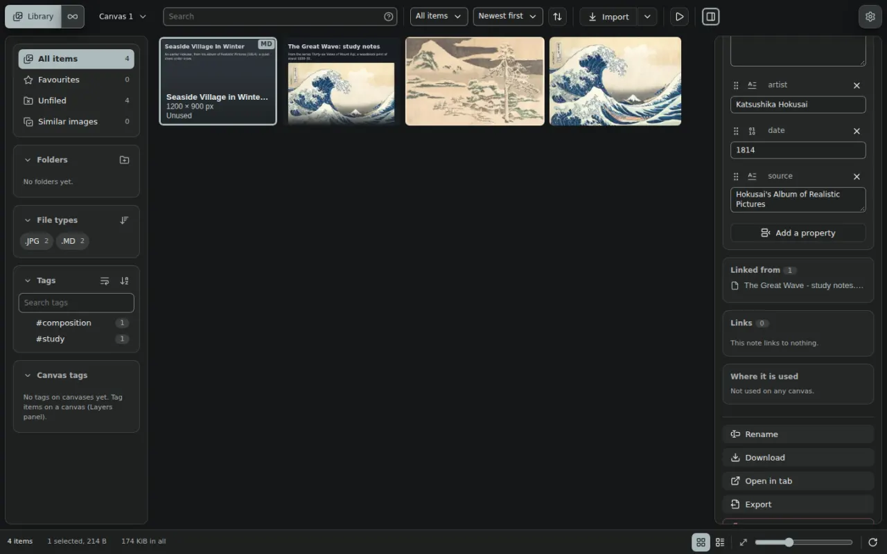

| Write | What it does |
| --- | --- |
| `[[Plan]]`, `[[Plan|shown text]]`, `[[Projects/Plan]]` | A link to a note or file (the last when two items share a name). Type `[[` and the library's notes and files are offered |
| `[[canvas:Characters]]` | A link to a canvas; `[[` offers the workspace's canvases too |
| `#tag` in the words | One of the item's tags; `#` offers the library's |

| Feature | What it does |
| --- | --- |
| **Opening a link** | In the editor a link is an ordinary link: a click puts the cursor in it, **Ctrl+click** (⌘ on a Mac) opens the note or file it points at in the viewer (asking first about unsaved changes), or that canvas. Or click a link, then the arrow on its card, or the link's text there. Links to web addresses are not opened from a note (the app never goes online) |
| **A look before opening** | The pointer resting on a link shows the preview of what it points at (a note's page, a picture) |
| **Linked from and Links** | A note's details list the notes that link to it and what it links to (notes, pictures, any file, each with its folder), each with a count; a link that finds nothing is greyed. Click a row to open it. They follow the saved file, so a new link shows after saving. Plain text files are not tracked |
| **Renaming or moving** | An item in the library writes the links to it in every note again (`[[old name]]` when that name was its alone, a path to its old place), and a note that moved has its own paths written from its new folder; each changed note is saved as a new version |
| **#tags in the words** | As Obsidian reads them: `#` then a word with a letter in it, not in code; `#123` and `# Heading` are none. With a YAML block, the item's tags are exactly its `tags:` and its #tags, and taking a `#tag` out of the words takes the tag away at the next save; tags added in the library go into the YAML, never into the words. A note without YAML only adds its #tags |
| **Search inside notes** | The library search (All) finds a note by the words in it too (read once per version while searching) |

| How links are written | |
| --- | --- |
| A markdown note | Keeps them as `[[…]]`; `![[…]]` (an Obsidian embed) is kept as it is written, and shows its picture in the editor when it is one |
| A rich text note | Writes the path to the item (`../Projects/Plan.md`) |
| Links to library items | Written as their path from the root of the library (`Pictures/cat.png`, brackets and spaces encoded), whichever folder the note is in |
| Finding them | By the file a link names on disk (with **Keep file names** off, a file's name there differs from the item's: `my cat.png` is `my_cat.png`), read from the note's folder, then from the root of the library (`library/Pictures/cat.png` too), then the one item of that name anywhere; so a path relative to the note, written elsewhere, still works, as does `<my cat.png>`, and a copy of an item's file shows that item. The app's own link `canvast:<sha-256>` is read too, and kept as written. The picture dialog shows a picture's link, and a path typed there is found in the library |
| Other apps' folders | A folder whose name starts with a dot in `library/` (Obsidian's `.obsidian/`, say) is never taken into the library |

### Properties

A markdown note's YAML block is its tags, description and properties, and each property has a type, as in Obsidian.

Keep a work's facts (artist, date, medium, series) as properties you can search.

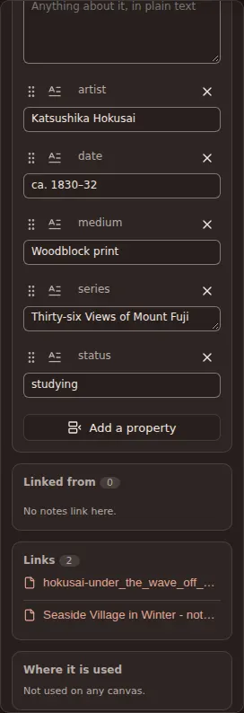

| Part | What it does |
| --- | --- |
| **YAML** | The block at its top (`---` … `---`) is its item's tags (`tags:`), its description (`description:`) and its properties (every other key; a list shows as `a, b`). Importing the note or saving it, here or elsewhere (Obsidian), reads them into the item, and the file wins. Changing them in the library (the details panel, bulk tags, renaming or deleting a tag, undo) stays in the library, unless **Write tags and properties into note files** is on: then it is written into the file too, as a new version |
| Blocks and maps | A `|` or `>` block is read as text with its lines (a value of several lines is edited in a larger box), and written back as it was while it is unchanged. A nested map is kept as written and not shown. The editor shows the note without its YAML |
| Other notes | A rich text note keeps the same properties as `<meta>` in its head (`keywords`, `description`, one per field); a plain text note keeps them in the library only |
| **Types** | The button before a property's name chooses its type: *Text*, *List*, *Number*, *Checkbox*, *Date* or *Date & time*. A type belongs to the name, for every item with that name. A name with no type of its own takes one from its value (`4` a number, `true` a checkbox, `2025-01-31` a date, `2025-01-31T10:30` a date and time; `aliases` and `cssclasses` are lists); editing such a value keeps that type for the name |
| Checkboxes, dates | A checkbox is a box to tick and a date a picker. In the file a checkbox is written as a bare `true` or `false` |
| **Lists** | A row of items, each kept whole (a comma is part of an item): Enter adds what is typed, × or Backspace in the empty box removes, dragging moves one, and it is a real YAML list in the file |
| **A value that does not fit** | **Never changed**: it stays as it is in a plain box, marked in red with what the type expects, also while it is typed |
| `tags`, `description` | Have their own places in the panel and no type button |
| Narrow panel | A property's value has a line of its own under its name, and a long value wraps, so neither is cut |

### Working with Obsidian

| Do this | What you get |
| --- | --- |
| Paste a note copied from Obsidian | A note: its `![[embeds]]` show their pictures when the files are in the library (found by name, wherever they lie; one not there stays as `![[name]]`), and `[[links]]` and footnotes stay as Obsidian writes them. Its properties join the note's own at the next save: tags are added, a key the note does not have (or has empty) is added, and what the note already says stays. Undoing or deleting all that was pasted takes them back; when only properties were pasted, closing the note without saving does |
| Paste markdown copied as words (a chat app's copy button, a `.md` file in a text editor) | Read as markdown: lists, headings, quotes, tables, code, bold and links come in as they are meant. Words with no marks stay words, and in a code block anything pasted stays words |
| `Ctrl+A`, then `Ctrl+C`, in a note (or the editor's Copy; **Copy** on one markdown note in the library) | Its markdown file, with its properties as YAML at the top, as the details panel has them, so pasted at the top of an empty note in another app they arrive as properties. It is plain text. Copying (or cutting) part of a note copies that part as markdown (`# ` on a heading selected whole, `- ` and `1. ` on list items), with the page beside it for apps that take pages; a part of a code block is its words |
| Keep `.obsidian/` in `library/` | Any folder starting with a dot is never taken in |

---

## Exporting and sharing

Copy to other apps, export a page, a picture or selected shapes and get what you see, or let others on your network look at the workspace.

| Section | What is in it |
| --- | --- |
| [Copying to other apps](#copying-to-other-apps) | The system clipboard, pasting back |
| [Export…](#export) | PNG, WebP, JPEG, SVG and PDF at any size |
| [What you export is what you see](#what-you-export-is-what-you-see) | Colours, inks, the one SVG exception |
| [Sharing on the local network](#sharing-on-the-local-network) | Guests in a browser or the desktop app, a folder for file managers |

### Copying to other apps

`Ctrl/⌘+C` keeps the real objects for pasting back here, and also puts a PNG picture on the system clipboard, with the SVG beside it for vector shapes and SVG files, where the browser allows it. Which it takes is up to the program you paste into. In the desktop app the real files go too, of any kind and any number, for a program that takes files (a cropped, flipped or adjusted picture goes as its PNG alone, or among several as a new file; each shape or group is an SVG file of its own).

| You copy | The PNG is |
| --- | --- |
| Shapes | The shapes as drawn (their SVG text is a separate command, *Copy the selection as SVG*, in the right-click menu) |
| A picture | One PNG at full size, as it looks with its crop, flip and adjustments |
| A GIF or video | The frame it shows |
| A shape with a picture or objects fill, or anything mixed | It as drawn, at most 1024 px on the long side |

| | |
| --- | --- |
| The picture alone | It goes with no text beside it (an app offered both often takes the text). Copied texts carry their words too |
| A hidden item | Leaves the clipboard after 30 seconds, or the time set in Settings > Privacy (0 keeps it), and on locking or closing. Something copied since is left alone; a clipboard history of your system may keep its own copy |
| `Ctrl/⌘+X` | Puts the text only (the shape is gone before a picture could be drawn) |
| In a browser | Browsers cannot put files on the clipboard, so there a file goes as its picture or its name, and audio or a PDF stays in canvast |

**Pasting back in canvast** brings the objects back exactly as they were (links, masks, crop, adjustments, their places relative to each other), under the pointer, as long as nothing else was copied in between.

| You paste | What happens |
| --- | --- |
| What was copied here | The objects; shapes and texts come back even from another tab; a picture or GIF only while this window keeps the focus (after switching windows it comes back as a new picture; see [Limitations](#limitations)) |
| An SVG | Shapes |
| An image | A picture |
| A CSS colour or gradient | The fill of the selected shapes |
| Any other words | A new text under the pointer (a long one wrapped) |
| Into a text field, the notes editor, a dialog or a menu | It stays there: nothing is imported or placed |
| A middle click | Ending a pan with the middle button never pastes, on Linux too, where a middle click is a system paste |

### Export…

**Export…** (the Export menu of the Actions bar, or the command palette) works on a sheet, a picture or selected shapes.

Export a comic page at print size, as PNG, WebP, JPEG or PDF.


Export several pictures at once: leave some out, name the files by a pattern, and add a 2× copy of each.


| Choice | What it does |
| --- | --- |
| Size | From the shape: a width or height in px, in, cm or mm at 72–600 ppi, a preset (A4, Full HD, a story, the picture's own pixels), or 1× to 4× its size on screen. The resolution counts for in, cm, mm and PDF; a file in px only records it |
| Padding | Room around it, in px of the file or % of its longer side, in every format |
| Formats | PNG, WebP, JPEG, SVG and PDF. What is on a sheet that clips is cut to the sheet in every format. PNG, JPEG and WebP carry their resolution |
| Background | Transparent, white, black, the canvas colour, or any colour |
| Presets | *Save these as a preset…* keeps the choices (format, quality, background, padding, resolution, size, name pattern, size rule, extra versions) as a saved style; choose one from *Preset*, update it there, or manage them in the Styles panel |
| Again | It opens as you last exported that sheet or selection on this device; *Export again* in the Export menu does it with no dialog. `Enter` exports as last time, `Ctrl+C` copies |
| Result | Download it, copy it, or keep it in the library |
| Several items | Selected sheets, or with *Separate files* any selected items (pictures at their own pixels). A balloon and its words are one item, and a connector is none. Otherwise a selection is one picture |
| What goes | Each item has a tick: click an item anywhere to leave it out (it fades and loses its number) or bring it back; `Ctrl`+click (`⌘` on a Mac) several, `Shift`+click to set a whole run like the last one clicked, or use *All* and *None*. `Space` on an item ticks or unticks it, `Delete` leaves it out. Reorder them with the arrows or by dragging |
| Output | For several items: *Separate files* (one ZIP), *PDF pages* (one PDF, a page for each, in the order shown) or *One picture* (all of them together) |
| Size of each | For several items: *Same width*, *Same height*, *Longest side*, or *Scale* (1× to 4× each one's size on the canvas, so big things stay bigger) |
| Names | A name pattern, the same as the Library's Rename: `###` (the number, as many digits as `#`, from *Starting with*; `{n}` is `##`), `{name}` (without its file's extension; click an item's name to give it another), `{date}` or `{date:YYYYMMDD}` (today or a day you set, see [Rename](#rename)), and Export's own `{w}` `{h}` (pixels), `{canvas}`, `{format}`. The files it makes are listed under it before you export; two alike get `-2`. The ZIP or PDF has its own name |
| Name formats | *Formats…* beside the name: built-in patterns, yours, and *Save it as a name format…*. They are saved styles, managed in the Styles panel, and go with the workspace's backups. Settings > Saving to the library sets the pattern and the size rule a new export starts with |
| Also | Extra versions of each file: *@2x* and *@3x* (twice and three times as big, named `…@2x.png`), and *SVG* beside each picture when it is vectors |
| Vectors | Plain shapes are true vectors in PDF and SVG; masks are SVG masks; picture and pattern fills are embedded pictures clipped to the shape |

### What you export is what you see

| | |
| --- | --- |
| Colours, widths and shapes | The ones stored in the document; the theme never changes them, on the canvas or in an export |
| Ink | The default ink is chosen when an object is made and stored with it (see [Shapes](#shapes)) |
| **SVG has no angular gradient** | The one exception: an SVG then holds a picture of it (a PNG up to 384 px a side, cut to the shape) plus the real gradient, which canvast reads back (so *Make vector copy* or pasting the SVG gives it back editable; other programs show the picture). The Export dialog and the SVG saves warn about it |

### Sharing on the local network

The desktop app can let others on the same network look at the open workspace, in a browser or in their own desktop app (guests), and open its library as a folder in a file manager (the folder). Each is turned on by itself, and *Settings > Sharing* groups them: Guests, Folder for file managers, then Both (starting with the app, the activity).

Show a project on a tablet on the same network, read-only, without copying it there.


| Step | On the computer that shares | On the guest's |
| --- | --- | --- |
| 1 | *Settings > Sharing*: turn on **Share with guests**. It shows an address, a six-digit code and a fingerprint | Open the address in a browser (it warns once about the certificate), or in the desktop app: *Switch workspace > Connect to a shared workspace…* (computers sharing on the network are listed) |
| 2 | | Type the code |
| 3 | You are asked *Let … see this workspace?*: **Allow** | The workspace opens, read-only |

| Guests | |
| --- | --- |
| **What they see** | Every board, canvas and library item, live as you change them, read a part at a time (a big video plays from the middle without the rest) |
| **Follow the host** | In a guest's read-only bar: it goes where you are, on your canvas, as you move; moving the view yourself stops it |
| **Hidden items** | Only with **Share hidden items too**. Their files go out encrypted, as they are in the folder; a guest needs your Hidden password, and its own browser or app opens them. Your computer never decrypts them for a guest |
| **Allowed devices** | Listed in *Settings > Sharing*, with whether each is connected; **Remove** stops one at once. Sharing is off at every start of the app |
| **The code and the folder's password** | Stay the same across starts, until you press **New code**, **New password** or **Set a password…** (at least 8 characters). Devices already allowed stay allowed. Five wrong codes in a row pause pairing for a minute |
| **The desktop app as a guest** | Checks the fingerprint the first time (compare it with the sharing computer's *Settings > Sharing*) and then accepts only that certificate |
| **Start sharing when the app opens** | Off by default. The hidden items are never shared at a start: you turn that on yourself each time |
| **Activity** | *Settings > Sharing* lists what happened (devices allowed or refused, wrong codes, connected and left, the folder's sign-ins and files opened, with time and address) and the apps using the folder; **Open the log file** shows all of it (a file in the app's own settings folder, the latest megabyte and one older file) |

| A folder for file managers | |
| --- | --- |
| **Turning it on** | Its own switch (**Share the folder**): guests, the folder or both can be on. *Settings > Sharing* shows `davs://127.0.0.1:<port>/dav/` and a password (kept until you change it); **Open in the file manager** opens it (Dolphin, Nautilus and others read WebDAV) |
| **What it holds** | *Library*: your library's files in their folders, read-only. While the Hidden items are open here, a *Hidden* folder holds them too (on this computer, and for a device whose login may see them), each decrypted only as it is read. While they are locked, it holds one note saying so; open them here, then refresh the folder |
| **Another device** | Uses the `https://<address>:<port>/dav/` Settings lists for it (as a WebDAV server; Linux file managers write it `davs://…`), with the same password: Dolphin, Nautilus and most file managers on Linux; macOS Finder's *Connect to Server*; on Android, a file app's WebDAV server, such as X-plore's *Web storage*. It accepts the certificate once |
| **Logins** | The shared password only reads (it can be turned off). **Add a device…** gives a device its own user name and password, a name you choose (renamed any time) and its own rights, each a switch: **Add** (on at first), **Edit**, **Move and rename**, **Delete** (into the workspace's `.trash`), **See hidden items** (while they are open here, decrypted on this computer and sent to that device over the encrypted connection). A device's user name signs in with its own password only, never the shared one; a refused sign-in is in the activity with the user name tried. What a device adds or changes is taken in by the app as any file changed in the workspace folder. **Remove** stops its login at once |

⚠️ Anyone on your network with a password can read what is shared (hidden items too, when you share them), and their device may keep copies or thumbnails of what it opened. Stop sharing when you are done.

---

## The endless canvas

There is no edge and no zoom limit, in either direction. A line drawn at one scale stays sharp at any other, and what you drew a thousand zoom levels ago is still there when you come back.

Go anywhere on one canvas: the showcase's Solar System at home.


| Section | What is in it |
| --- | --- |
| [Moving around](#moving-around) | Zoom, pan, return, jump to a level |
| [Boards and canvases](#boards-and-canvases) | The board and canvas menu |
| [Bookmarks and tours](#bookmarks-and-tours) | Saved places, played as a tour |
| [Search on the canvas](#search-on-the-canvas) | By name, tag or bookmark, with keywords; saved searches |
| [Stepping from item to item](#stepping-from-item-to-item) | `W` `A` `S` `D` and `F` |
| [Camera travel](#camera-travel) | How the view gets to a far place |
| [Try the showcase: powers of two](#try-the-showcase-powers-of-two) | A million and one thousand zoom levels on one canvas |

### Moving around

| To | Use |
| --- | --- |
| Zoom | The wheel, a trackpad pinch, `+` and `−` (`Shift` for a 4× step), or the on-screen buttons. The point under the pointer (or between your fingers) stays where it is |
| Pan | The middle button, `Space`+drag, the Hand tool (`H`), two fingers, `Shift`+wheel or the arrow keys |
| Pan while dragging objects | Near an edge of the view it pans too, the nearer the edge the faster, and what is dragged stays in view; only what is bigger than the view, or was already past its edge, goes beyond it. **Pan at the edge while dragging** (Settings > Navigation) turns this off, and **Edge panning speed** sets how fast |
| Go back to the start | `0`, `Home` or the house button |
| Walk back and forth | *Previous view* and *Next view* (`Alt+Shift+←`, `Alt+Shift+→`) go through where you have been; the dice button takes you to a random empty place |
| Jump to a level | Click the zoom in the info bar and type it (`3000`, `2^-500`, `10^900`). One jump can travel up to 2^50 levels |
| Know where you are | A hierarchical grid, the axes and the position in the info bar show it, even very deep |

### Boards and canvases

The board and canvas menu (the name at the top left) switches between them, and holds their commands.

Keep a project's boards and canvases in one place and jump between them.


| | |
| --- | --- |
| Finding one | It and *Place on…* have a search field, *Find a board or canvas* |
| Many boards | With more than four, each is folded to its name except the open one (click a name to unfold it) |
| Commands | New, rename, export, move or delete a board or a canvas, from their ⋯ menus |

### Bookmarks and tours

A bookmark saves a place and a zoom, with a small picture of it, in the **Bookmarks** panel.

Play a canvas's bookmarks as a tour, for a talk or a review.


Bookmark each study on a long reference canvas to go back to it in one click.


| Feature | How |
| --- | --- |
| **Add** | *Add bookmark* saves the view as it is; the check-mark button saves one that brings the selected things into view (the camera stays where it is) |
| **Change** | Rename, update, move or delete one from its ⋯ menu, or drag a card to reorder the list |
| **Go** | `Alt+1`…`Alt+9` go to the first nine; `]` and `[` to the next and previous (changeable in Shortcuts). Getting there is a glide; a far one zooms out from here and in to there (see [Camera travel](#camera-travel)) |
| **Tour** | *Play the bookmarks as a tour*: they play in list order, the bars fade, `→` and `←` step, `Esc` ends it. With *Tour: wait at each stop* (Settings) it moves on by itself. The tour has its own travel speed |

### Search on the canvas

**Search** (`Ctrl+F`) finds objects on the canvas by name, tag or bookmark.

Find the studies tagged #gesture on a busy canvas.


| Write | Finds |
| --- | --- |
| Words | Names, tags and bookmarks, combined with space or `AND`, `OR`, `XOR`, `NOT`, parentheses and `"phrases"` |
| `/`, `#`, `@` at the start | Names only, tags only, bookmarks only |
| `kind:` | picture, video, gif, audio, note (a note's card), text, stroke, shape, sheet |
| `group:name`, `in:name` | In a group of that name, on a sheet of that name |
| `fill:red`, `stroke:#2563eb`, `colour:` | The colour of the fill, of the outline, or either |
| `is:` | locked, masked, offscreen, tagged, named, rotated, grouped |

Searches that found something are remembered, and a help card lists the syntax.

#### Saved searches

The save button in the search box keeps the search typed (pressed while it is saved; press it again to remove it).

| | |
| --- | --- |
| Finding them | With the box empty, the eight used last are listed above the recent ones, with how many more there are; while typing, the saved searches that hold the words typed are offered, so a long list is found by typing. The search box lists them newest first |
| Where they are kept | The canvas search and the library search each keep their own list (up to 200 each), in the workspace (its folder, on desktop), and they travel in a workspace backup with the other settings. With the Hidden items open, the library keeps a separate list on this device only |
| In the Library | A saved search also keeps its layout, columns and sort, in the same list; *Update* in its ⋯ in the sidebar gives it the ones shown now. In the sidebar each row shows how many items it finds (not in a library listed a page at a time) and opens with the look it was saved with (its tooltip says grid or list); its ⋯ renames it (a name of its own, its words stay what it searches for), updates its look, moves it up or down (in your order), or deletes it. The sort button in the section's head lists them in your order, A to Z, Z to A, or the most found first. A new one goes last |

### Stepping from item to item

| Key | What it does |
| --- | --- |
| `W` `A` `S` `D` | Step to the next item: the nearest in view (when you are zoomed in on an item and nothing is near enough on the screen, the nearest of its size that way, however far), the nearest anywhere, by layer or by name A to Z (each either among the items in the window or among all of them; `W` and `A` go back, `S` and `D` on). On arriving, focus on the item or keep the zoom (Settings > Navigation) |
| `F` | Brings the selection into view; press it again to fit everything, a third time to go back to the selection |

### Camera travel

**Camera travel** (Settings > Navigation) is how the view gets to a bookmark or a previous view.

| Style | What it does |
| --- | --- |
| *Fly* | One continuous path. When one place is in view of the other (nested views, a bookmark you can see), it is one zoom in or out at any depth. Farther apart, up to 20,000 zoom levels away, it zooms out until both places are about a view apart, crosses over and zooms in, so you see the way |
| *Glide near only* | Flies to near places and cuts to far ones |
| *Cut* | Always arrives at once |

| | |
| --- | --- |
| Timing | The time can grow with the distance (up to *Longest trip*) or stay fixed; *Travel time (base)* sets a short trip's length. Easing is smooth, linear or ease-out. A key or a drag ends the glide |
| Very far trips | More than a view apart and over 20,000 levels away: it zooms out 24 levels from here and in to there, with a brief dip to dark at the switch (*Fade at the switch*, on by default) |
| Reduced motion | With Animation set to None the view always cuts. When the system asks for reduced motion the view cuts too and says so once, unless *Follow the system's reduced motion* is off |

### Try the showcase: powers of two

[`showcase.canvast`](showcase.canvast) is a journey through **one million and one thousand zoom levels** on a single canvas. Each scene is hidden inside a speck of the one above it, so you can get from one end to the other with nothing but the mouse wheel:

Zoom in past any limit: one million levels below home, everything still works.


Zoom out as far as in: the multiverse a thousand levels above.


| Out (zoom out from home) | In (zoom into Earth) |
| --- | --- |
| The Solar System (home, level 0) | Earth, the Moon and a rocket (+5) |
| The heliosphere and the Voyager probes (−9) | An island with a reef and two boats (+12) |
| The Sun's neighbourhood, every star within 20 light years (−18) | A tree, seen from above (+19) |
| The Milky Way, with *You are here* (−27) | A leaf, its veins and pores (+25) |
| The Local Group: Andromeda, Triangulum, the Magellanic Clouds (−32) | Plant cells and their nuclei (+32) |
| The observable universe and its cosmic web (−40) | DNA (+40), a carbon atom (+47), its nucleus (+54) |
| Other universes, **1,000 levels up** | Inside a proton (+60), the Planck length (+116) |
| | Universes again at **+1,000**, and a last scene **one million levels down** |

To open it: click the save indicator at the bottom left, choose **Import archive…** and choose the file (or drop it on the page). Open the canvas *Powers of two*, then either scroll, or open **Bookmarks** and press **Play the bookmarks as a tour** (`→` and `←` step through its 19 stops).

How the showcase and its pictures are made is in [Releasing and project scripts](#releasing-and-project-scripts).

---

## Your workspace and data

| Section | What is in it |
| --- | --- |
| [Saving](#saving) | Saved as you work, verified |
| [Several tabs](#several-tabs) | One tab edits, the others follow |
| [Backups](#backups) | `.canvast` files of everything, or of what you choose |
| [What can delete data](#what-can-delete-data) | The only actions that remove anything |
| [Where the data lives](#where-the-data-lives) | The browser's storage, or a folder |
| [The workspace folder (desktop app)](#the-workspace-folder-desktop-app) | Your workspace as ordinary files |
| [canvast tools: without the app](#canvast-tools-without-the-app) | Decrypt, encrypt and share with Node.js alone |

### Saving

See that the work is saved and verified, how much space it takes, and make a backup.


| | |
| --- | --- |
| When | Every change is saved automatically within a fraction of a second, with the camera. Only the objects that changed are written, in one atomic transaction, then read back to check |
| The indicator | Shows *Unsaved changes… → Saving… → Saved → Saved (verified)*. Click it to open **Settings > Storage**: space used, whether the browser keeps the data, the library folder, how saving is going (and this tab's role) and backups |
| Reloading | Restores the canvas and the view |
| The desktop app | The workspace folder follows these saves (see [The workspace folder](#the-workspace-folder-desktop-app)) |
| No storage | If storage cannot be opened, canvast keeps working in memory and says so |

### Several tabs

The first tab to open a workspace edits it. Other tabs are read-only, follow its changes live, and offer **Take over**. A stale tab can never overwrite newer data; its save is rejected and reported.

A second tab on the same workspace follows the first and can take over.


### Backups

A backup is one `.canvast` file: a standard, uncompressed ZIP you can open with any unzip tool (do not re-compress it). Backups made in one browser import into another (tested between Chromium and Firefox), and between the browser and the desktop app either way. The browser does not say whether a download finished, so keep your backups somewhere safe.

| Kind | What it holds |
| --- | --- |
| **Export a backup** (Settings > Storage) | Every board, canvas, object and view, plus every file once, and your settings (the workspace's and this device's: theme, shortcuts, panel layout). When you import it, only the settings this device has not set itself are restored; the ones you changed here are kept, and the import dialog says how many it will restore |
| **Export changes** | An incremental backup, after the first full one |
| A board, a canvas, a library item | Exported on its own, with only the files it uses |
| **Advanced export** (Settings > Storage) | Only what you choose (below) |

#### Advanced export

Back up only part of a collection: three prints, ticked.


| | |
| --- | --- |
| Choosing | Search for items and folders and tick them, or tick *Everything*. A folder brings what is inside it, its folders too. The total size is shown as you choose |
| Hidden items | Asked about first, so their password is asked once |
| *Also the canvases* | Every file a canvas shows goes too |
| *Saved styles* | On by default: the styles and the fonts and pictures they use; custom ratios go either way |
| Limits | A partial backup can only be added, never used to update a workspace, and does not count as the last backup for *Export changes*. Links in notes to items left out stay as they are and find nothing until those items are there |

#### Importing a backup

**Import archive…** (or drop a `.canvast` file on the page) verifies every checksum first, asks how to import a workspace backup, shows what it contains and any problems, and only then writes, in a single transaction. Files you already have are not stored twice.

Bring a backup back: update this workspace, or add its boards beside what is here.


| Choice | What happens |
| --- | --- |
| **Update this workspace** | First when the backup holds this workspace's canvases, or this workspace is empty: this workspace is made as the backup is. Its boards and canvases are matched by their ids and replaced; an item's details (name, tags, favourite, folder, note, properties) are the backup's; the saved styles and the workspace's settings are the backup's. A canvas changed here since your last backup is kept beside, as *(conflict …)*; a canvas this workspace had at its last backup that the backup does not have is put on a board *Not in the backup*, never erased; such an item is deleted (on desktop its file goes to `.trash`) |
| **Add as new boards** | Beside what is here; nothing here changes, and an item's details are merged (tags added, a note only filling an empty one) |

**Working elsewhere and coming back:** export a backup at home; elsewhere, import it with *Update* into the browser file or the desktop app (an empty workspace keeps its ids); work; export again; at home import that one with *Update*. Export at home just before leaving, so a change made at home meanwhile is known as one.

| What a backup carries | |
| --- | --- |
| Library folders | Every one, empty ones too, and a hidden one stays hidden (in the browser's backup; the desktop app's are in its sealed key file) |
| Copies (desktop) | A copy of a file elsewhere in the library goes as its first item |
| Older content | Paintings and brush presets in a backup from an older version are left out, and the summary says so |
| Hidden items and passwords | Asked about; by default they stay out (see [Privacy and hidden items](#privacy-and-hidden-items)) |
| Hidden items from the desktop app | Go in **still encrypted**, with their key file: nothing of them is readable in it, and importing it in the desktop app brings them back once the Hidden items are opened with their password |
| Into the browser | It asks their Hidden password when it imports such a backup (stretching it takes a few seconds and about 128 MB of memory there), then brings them in as hidden items in hidden folders of their names; there they are kept as the browser keeps its own hidden items, not encrypted. Without the password they are left out |
| Readable hidden items into the desktop app | Made in a browser with no Hidden password, or by an older version: encrypted by the desktop app in the import itself. It asks for the Hidden password first (the backup's own when it brings one and this workspace has none, else this workspace's, or a new one typed twice), and starts again only when every one is encrypted |
| Hidden items' details | Their date added, tags, note, properties and favourite come too: a backup carries the hidden items' index, sealed with their key, in both apps (a backup from an older version has only their files, names and folders: export it again) |

**Bringing a browser workspace into the desktop app:** export a full backup in the browser and import it in the desktop app. One screen shows the import and how many files are written into the folder; then the app starts again on them and says what was imported, without asking for the workspace password again (it was given before the import).

### What can delete data

Only these remove anything:

Start from scratch, safely: it asks, offers a backup and wants DELETE typed.


| Action | What it removes |
| --- | --- |
| Deleting objects | Those objects (undo brings them back) |
| Deleting a canvas or board | It, after a confirmation; this cannot be undone. Pictures placed there stay in the library |
| *Delete…* in the library | An unused file, once undo can no longer need it |
| **Delete all data** (Settings > Storage, *Start from scratch*) | Everything canvast keeps in this browser. It asks first, offers a backup, an export of the files and the library index, and makes you type `DELETE`. Files on your disk (a library folder) stay where they are |

Damaged objects found when loading are skipped and reported, never silently changed.

### Where the data lives

| Version | Where |
| --- | --- |
| Browser version | The IndexedDB database `canvast`, in the browser's storage for local files (the [online copy](#trying-it-online) has its own, for its web address). Moving the HTML file to another folder keeps your data. A different browser, profile or private window starts empty, and clearing the site data deletes it: this is why regular backups matter. The browser's storage has a size limit, so the browser version suits projects rather than very large collections (see [Limitations](#limitations)) |
| Desktop app | A folder you choose ([below](#the-workspace-folder-desktop-app)) |

### The workspace folder (desktop app)

In the desktop app your workspace is a **folder of ordinary files** that you choose, so any sync tool, backup tool or file manager can see it. It works offline and loads nothing from the network.

Keep a project as a plain folder that any sync or backup tool can carry, and switch between projects.


The same workspace on disk, as a file manager shows it:

```
Illustration studio/
  .canvast/
    boards/
      picture_book/cover.cvst, spread_1.cvst
      references/landscapes.cvst
    devices/<device id>.json
    folder.json
    library/index.json, items-00.json … items-ff.json
    library.json
    workspace.json
  library/
    Japanese prints/hokusai-under_the_wave_off_kanagawa.jpg
    Landscapes/waterloo-wooded_landscape.jpg
    fonts/space_grotesk.ttf
    notes/study_plan.md
```

#### Switching workspaces

*Switch workspace…* is in the board and canvas menu (under *Whole workspace*), in Settings > Storage and in the command palette, with its choices to open a folder or make a new workspace; the lock screen of a workspace with a password has those two as well, and the workspace stays locked. `Ctrl`+`Shift`+`O` opens a workspace folder.

| | |
| --- | --- |
| The list | The open workspace and the five latest ones whose folders still exist, plus **Open a folder…** (an existing workspace, or any folder to start one in) and **New workspace…** (an empty folder you name). **Clear the recent list** keeps only the open one (no folder is touched) |
| A switch | Writes your last edits into the folder, closes the window and starts the app again on the other folder |
| At start-up | The app opens the last workspace. If its folder is gone (moved or deleted), it says so and offers the recent ones, a folder, or a new workspace |
| Opening | A start screen shows what is being done. Each step and its time also go to the developer tools' console (`Ctrl`+`Shift`+`I`) |
| One window | A workspace is open in one window at a time: starting it while it is still closing waits for it, and one open in another window is asked about |
| Closing while files are written | When the app is still writing many files into the folder (an import's), closing asks first: *Close anyway* keeps your work safe in the app and writes the rest the next time you open the workspace |

#### The window's frame

Settings > Appearance > **Window frame**: *System* (the default) is the title bar your desktop draws; *Off* has none, for more room.

| With the frame off | |
| --- | --- |
| The row | Move the pointer to the very top edge and a row comes over the app, with the workspace's name, minimise, maximise and close |
| Moving the window | Drag the row's title, as an app's own title bar (the desktop moves it, on X11 and Wayland alike) |
| When it shows | For a moment at each start, and it goes when the pointer leaves. It stays while the opening, lock and busy screens are up, so the workspace's name and the buttons are always there |
| Applying | At the next start, for every workspace |

#### What is in the folder

| In the folder | What it is |
| --- | --- |
| `.canvast/boards/<board>/` | A board, named after it (lowercase, `_` between words, `-` between parts; `-2` on a clash). Inside the app's own folder, so canvases are not edited by accident |
| `.canvast/boards/<board>/<canvas>.cvst` | A canvas: one JSON file with its objects, frames and bookmarks |
| `library/<folder path>/`, `library/images/`… | The library's files, named after their names in the library: in the folders of their library folders, or when in none, at the top of `library/` or by kind: `images`, `vectors` (svg, eps), `icons` (ico, icns), `art_sources` (psd, kra, xcf, clip, procreate, sai, ai, afphoto, …), `presets` (brushes and swatches: abr, kpp, ase, aco, gpl, …), `3d` (obj, fbx, glb, gltf, stl, blend, …), `video`, `audio`, `fonts`, `notes` (md, markdown, txt, note.html), `documents` (pdf, office files, epub, html, …), `archives` (zip, rar, 7z, tar, gz, …), `other` |
| `.canvast/workspace.json`, `.canvast/library/` | Names, order, styles, the workspace's settings and passwords' kept forms; the library's names, tags, folders, descriptions and properties, in parts so a change rewrites one small file |
| `.canvast/library.json` | A copy of the library in one file, for an older version of the app (kept up to 10,000 items) |
| `.canvast/devices/` | One file per device: its open canvas and cameras |
| `.canvast/folder.json` | This folder's own id, so a new folder at the same place is a new workspace |
| `.hidden/`, `.canvast/hidden.json`, `.canvast/keys/hidden.json` | Hidden items, encrypted, and a spare of their key (see [Hidden items and passwords](#hidden-items-and-passwords)) |
| `.canvast/thumbnails/<hash>.webp`, `.hidden/thumbnails/` | Custom thumbnails uploaded for items, by their SHA-256; hidden ones encrypted, each named so it says nothing of its picture |
| `.trash/` | What canvast deleted, when Settings > Storage says so (the default) |

#### How it saves

| What | How |
| --- | --- |
| **Every edit** | Saved first in the app's own storage on this device, then written to the folder about 2 seconds after editing pauses, and when the window closes |
| **The library on this device** | Its items, names, tags, folders and where each file is: kept in a SQLite database in the app's own data folder (`~/.config/canvast/library-db/`), not in the workspace folder. It is a working copy of the folder's library files, one per workspace folder (not per path: a folder renamed onto the path of another opened before starts its own copy): a new device, or one whose copy was deleted, makes it again from them. Only the parts of the library that changed are read at start-up and written after an edit |
| **Library folders** | Real folders: an item filed in a library folder lives under `library/<folder path>/`; an unfiled one under its kind's folder. **Sort files by kind** (Settings > Saving to the library, off by default) decides what happens to one you put at the top of `library/`: off, it stays there; on, it moves to its kind's folder, keeping its name. Filing or renaming an item moves its file; the library's undo moves it back; an emptied folder of a renamed or deleted library folder is removed |
| **Deleted files** | Deleting a library item, a canvas or a board moves its file at once to where Settings > Storage says: `.trash/` in the workspace folder (the default: it syncs, and you can put things back), the system trash, or away for good. Undo on a canvas can bring back the picture of an item you deleted, but not its file: the picture shows as missing until you put the file back from `.trash/`. **Empty .trash after** (*Never* by default): 30 days, 90 days or a year after something went into `.trash/`, it is deleted for good when the app starts on this device |
| **Sync tools** | Every file is written whole to a temporary name (`….tmp-…`) and then renamed, so a sync tool never copies a half-written file. You can tell it to ignore `*.tmp-*` (and `.trash/`, if deleted files need not travel between your devices) |
| **Hidden items** | Encrypted into `.hidden/` (see [Hidden items and passwords](#hidden-items-and-passwords)). A readable file put there from outside becomes a hidden item and is encrypted (once the Hidden items are opened); a folder put there becomes a hidden library folder of the same name (with the folders inside it), its files are encrypted and the emptied readable folders are removed |
| **Check library files** | Command palette: every file of the library is read and compared with what the library knows of it; the ones changed or damaged, and the ones gone, are named (hidden items are left out: that needs their key). *Check library files (quick)* only looks that each file is there and has the size the library knows, without reading it: seconds on a big library, but it cannot see a change that keeps the size |
| **A password** | On the workspace, it is asked for wherever its folder is opened from |
| **Safety** | An item whose file is still in the folder is never taken as erased, whatever the library's lists say, so an app stopped mid-write or a sync tool bringing files one by one cannot delete anything |
| **The folder's id** | `.canvast/folder.json`: a new folder made where a deleted one was is a new, empty workspace. Nothing of the deleted one comes back, and its copy on this device is cleared |
| **After a crash or a power cut** | The next start clears what the app left: its own half-written files (`.tmp-` and an id, beside the file; once ten minutes old), readable copies of hidden items opened in another app, and a board or canvas left half moved (`.canvast/moving/`), which goes back where `workspace.json` says, or into `.trash` when that place is taken. Your own files are never touched, whatever their names |

#### The library's files

`.canvast/library/` holds `index.json` (the library folders and the list of parts) and the items in **256 parts**, `items-00.json` to `items-ff.json`, each holding the items whose SHA-256 starts with those two characters, one item per line. Items spread evenly, so each part holds about 1/256 of the library; a part with no items is not written. An edit rewrites only the part its item is in, and a start reads only the parts that changed (this device's database holds the rest):

| Items in the library | Parts | Items per part | Size of a part | All parts |
| --- | --- | --- | --- | --- |
| 3,000 | 256 | ~12 | ~3 KB | ~0.8 MB |
| 100,000 | 256 | ~390 | ~105 KB | ~28 MB |
| 1,000,000 | 256 | ~3,900 | ~1.1 MB | ~275 MB |
| 10,000,000 | 256 | ~39,000 | ~11 MB | ~2.8 GB |

So with a sync tool, an edit uploads one part: a few KB for most libraries, about a megabyte past a million items.

| | |
| --- | --- |
| **Library files** (Settings > Storage, in the Workspace folder card) | Splits it another way for the whole workspace: **16 files** (by one character: a tidier folder for a small library), **256** (the default) or **4,096** (by three: each about 16 times smaller, for a very large library or a slow connection); it shows about how big one file is for this library. Changing it writes every part again once and removes the old ones; the split is kept in `index.json`, so every device follows it. Older versions read only 256: update the app on every device first |
| A copy in one file | A library of up to 10,000 items also has a copy of all of it in `.canvast/library.json` (for older versions of the app) |
| If `.canvast/library/` is deleted | All of it or some parts: your files are not in it (they are in `library/` and `.hidden/`), and hidden items keep their own list (`.canvast/hidden.json`). A missing index or part is never taken to mean its items were deleted. Any device that still has its copy of the library (its database) writes every missing part back the next time it saves, with the names, tags, folders, notes and fields; a library of up to 10,000 items is also read back from `.canvast/library.json`. Only if the folder is gone **and** no device has its copy (a new computer, say) are the tags, notes, fields and favourites of the shown items lost: their files come back from `library/` (named and filed by where they are), hidden items come back whole. A `.canvast` backup keeps all of it |

#### Copies of a file

A file with the same content as an item, put in `library/` by you or another program (another folder, any name), is an item of its own: its own card, name, folder, tags and notes, renamed, moved and deleted on its own, and never removed for being a copy. Its details list the other items with the same file (*Same file as …*); `is:copy` finds them. The app itself never makes a second copy: importing a file the library has places the one it has. Placed on a canvas, a copy places its content (as the first item of it). A backup keeps each content once, with the first item's details, not each copy's.

#### Names on disk

| Setting | What the disk gets |
| --- | --- |
| **Keep file names** on (the default; Settings > Saving to the library) | A file keeps its item's name and its folders keep theirs; only characters a system forbids (`<>:"/\|?*`, control characters, dots and spaces at the ends) become `-` or go, a name Windows reserves (`CON`) gets `_file`, and characters no one sees (right-to-left marks, zero-width spaces) go. A note's name also holds none of `# ^ [ ]`, which a link cannot |
| Off | Names on disk are safe versions of the names in the app: lowercase, `_` between words, `-` between parts, `-2` on a clash. `Hand Study (Side).png` becomes `library/images/hand_study-side.png`, and the same file is stored once |

| Rule | |
| --- | --- |
| Names that can bite elsewhere | A leading `-` or `~`, `%`, `&`, `;`, `$`, a backtick, `!`, `'`, or an ending such as `.part` that the library skips when it reads its folder: they work, with a word about it when you choose them |
| Dots | A dot in a name stays part of the name unless it gives a kind of file, so `Scan v2.1` on a picture is `Scan v2.1.png` |
| Endings | The file's ending is never changed or made up: `art.kra~` stays `art.kra~`, and a file with no ending gets none |
| **No newer rule renames what is on your disk** | A file named by an earlier version stays, also on opening a folder |
| Two folders a disk would take for one | `A: B`, `a- b`, `Refs`, `refs`: naming, renaming or unhiding one asks: **Merge** into one folder (a file with the same name gets `-2`, nothing is overwritten, one undo step; later it cannot be split automatically), or **Keep separate** under a numbered name |
| Two items of one name in one place | The later one's file gets `-2` and the item takes that name, so the app says what the disk says |
| Long names | Kept whole in the app (up to 1,000 characters); on disk cut to fit the 255-byte limit of file systems (about 230 letters, fewer in scripts that take more bytes per letter) |

#### Changes made outside the app

By a sync tool, another device or a file manager: canvast watches the folder while it runs and catches up at start-up. A file renamed or moved outside the app, in either case, stays the same item, and the links to it in notes are written again.

| What changed | What canvast does |
| --- | --- |
| A canvas file another device wrote | Reads it in; the open canvas is loaded again with its camera kept |
| The same canvas changed here and there | Keeps both: the folder's version, and this device's beside it as `<name> (conflict <date>)`. A file is never written over another device's newer version |
| A sync tool kept two versions of a canvas file (`heroes (1).cvst`, `heroes.sync-conflict-….cvst`) | Keeps the other version as a canvas of its own on the same board, `<name> (conflict from sync <date>)`, and moves the copy to where deleted files go. The device that saved that version does it at once; another device waits 10 minutes first, so two devices do not both do it. A copy that is the same as the canvas's file is only moved away |
| A canvas file or board folder renamed in `.canvast/boards/` | Renames the canvas or board (its files then take their safe names) |
| A canvas file moved into another board's folder | Moves the canvas to that board |
| A file in `library/` renamed or moved | Finds it again by its content; the item takes its new folder and name, and the links to it in notes follow |
| A file in `library/` saved again by the program it is worked on in (a painting, a scene, a document: any kind of file) | Follows it: the item becomes the new version where it lies, keeping its name, folder, tags, note, fields and favourite, and every picture or card of it on any canvas shows the new version. A file still being saved (its size not yet still) is taken a moment later. The file is never written over or removed by this |
| A new file in `library/` | Imports it where it lies, into the library folder of its folder (made if needed); a batch shows a progress notice |
| A copy of a library file put in another folder (the same content, any name) | Makes it an item of its own, never removed for being a copy; its details list the others, and `is:copy` finds them |
| A library folder deleted from `library/` | Stays deleted: it leaves the library, and its items stay, shown as missing when their files went with it. Only a place this device has seen on disk counts, so a folder from another device is made, and with `library/` itself gone nothing is concluded |
| A file deleted from `library/` | Shows the item as missing. Deleting such an item, or any item, removes its file only when the file still holds what the item does: a file that changed (someone's newer work) is left where it is |
| A file still being written (temporary, partial download) | Leaves it alone |
| A canvas file that does not read whole (damaged, or still arriving) | Opens the workspace anyway, keeps showing this device's copy of that canvas, says so once, and reads the file again when it changes. It never writes over that file: delete it, or put a good copy back, to have this device's version written again |
| The library's files (`.canvast/library/`) on a device with no copy yet | Takes the library from them; a device with no copy at all opens the whole workspace from the folder |
| `library.json` changed by an older version of the app | Takes what it changed; a workspace that has only `library.json` (made by an older version) is read from it and gets the parts |
| Boards or the library changed on two devices at once (the sync tool keeps a copy such as `workspace (1).json`, `.canvast/library/items-3 (1).json`, `library (1).json`) | Takes the canvases, library items and library folders the other device added from the copy (a canvas only when its file is there), then moves the copy to where deleted files go. What this device knew and the kept file no longer has was deleted on the other device, and does not come back |
| The hidden items changed on two devices at once (the sync tool keeps a copy such as `.canvast/hidden (1).json`) | Once the Hidden items are opened, takes the copy's items too, then deletes the copy. A copy made under another Hidden password is joined when that password is the same as this one; otherwise the app says so, and `hidden-items.mjs` opens it with its own password |
| An encrypted file in `.hidden/` that no hidden item names (its entry lost in such a clash), or a sync tool's copy of one (`… (1)`) | A copy of an item's file is deleted. Any other file comes back as a hidden item with the name, folder, tags and note it holds (a file encrypted by an older version holds none, and is named `recovered-<hash>.<ext>`), once it has had no entry for 30 seconds (its entry may still be on its way). An encrypted file is never encrypted a second time |
| A hidden file renamed or moved inside `.hidden/` (a file manager, a sync tool) | Once the Hidden items are opened, finds it by the content hash inside it; the item takes the name and folders its new place says |
| `.canvast/library/` deleted, all of it or some parts | Never taken to mean items were deleted; this device's copy writes every missing part back at the next save (see [The library's files](#how-it-saves)) |
| `.hidden/` has encrypted files but `.canvast/hidden.json` has not arrived yet | Setting a first Hidden password is refused until it arrives: a new key would be a second one, and the files of one device would not open on the other |

### canvast tools: without the app

**`canvast-tools.mjs`** is one file that works on any computer with [Node.js](https://nodejs.org) 20 or later (Linux, macOS, Windows), with nothing to install. Download it from the [latest release](https://github.com/emarpiee/canvast/releases/latest/download/canvast-tools.mjs), open a terminal in its folder and run `node canvast-tools.mjs`: a menu asks what to do, in plain words. Drag a folder or a file into the terminal when it asks for one.

Open your hidden items, hide files or share a folder on any computer with Node.js, without the app.


```
canvast tools
  1) Open my hidden items (decrypt them into a folder)
  2) Hide files into a workspace (encrypt)
  3) Share a folder with another device (phone, laptop)
  4) Saved devices for sharing
  5) Help
  0) Quit
```

| Choice | What it does | Changes your files? |
| --- | --- | --- |
| **Open my hidden items** | Decrypts a workspace's hidden items into a new folder, with their names and library folders (as [Decrypting and encrypting outside the app](#decrypting-and-encrypting-outside-the-app)) | No: it only writes the new folder |
| **Hide files into a workspace** | Encrypts files into the workspace's `.hidden` folder; canvast lists them as hidden items. Close canvast on that workspace first | Yes: only `.hidden` and `hidden.json` |
| **Share a folder** | Shares **any folder** with devices on your network, as a folder their file manager opens (WebDAV over HTTPS): a canvast workspace (its *Library*, and *Hidden* if you choose) or any other folder of yours | Only if you allow changes |
| **Saved devices** | Devices with their own name, user name, password and rights, kept between runs | No |

#### Sharing a folder with the tools

1. Choose **3**, drag the folder in, or press **Enter** to share the folder the tool itself is in (keep `canvast-tools.mjs` in a workspace or any folder to share it in one step). The same goes for opening and hiding hidden items: **Enter** picks the tool's own folder when it fits; **b** goes back.
2. A workspace with hidden items asks whether to share them too (then the Hidden password). A plain folder has no such question.
3. Answer whether other devices may change files (*no* by default).
4. With saved devices, choose who signs in: one login for this run, your saved devices, or both.
5. The tool shows the address for other devices, the user name and password, and the certificate's fingerprint. On the phone, add a WebDAV server with that address (`https://…`), user name and password; accept the certificate once. **Ctrl+C** stops sharing.

| | |
| --- | --- |
| **Read only by default** | With changes allowed, a device can add, replace, move and delete; deleted files go to a `.trash` folder inside the shared folder (a workspace's own `.trash`), never away for good |
| **Hidden items** | Decrypted only as they are read, a part at a time, in the tool's memory: nothing readable is written. Only a login allowed to see them (this run's, when you chose to share them, or a saved device with *See hidden items*) sees *Hidden* |
| **Never shared** | Names starting with a dot (`.git`, settings; `--dotfiles` shares them), links that point outside the folder, and anything outside it |
| **Logins** | One login per run gets a new password each time (`--password` sets your own). **Saved devices** keep theirs; they are kept in your user settings folder (`~/.config/canvast-tools/` on Linux, `~/Library/Application Support/canvast-tools/` on a Mac, `%APPDATA%\canvast-tools` on Windows), readable by you only, never in a shared folder. The certificate is kept there too, so a device trusts it once |
| **The window shows** | Who signed in, from where and with which app, the files opened and changed, and refused sign-ins (with the user name tried, never the password) |
| **The same code** | As the desktop app's *folder for file managers*: what one does, the other does |

#### The tools as one-line commands

```sh
node canvast-tools.mjs decrypt ~/Art/my-workspace ~/decrypted        # --flat: every file at the top
node canvast-tools.mjs encrypt ~/Art/my-workspace ~/decrypted/sketch.png
node canvast-tools.mjs share ~/Photos                                 # read only, a new password
node canvast-tools.mjs share ~/Art/my-workspace --hidden --write      # Hidden too; devices may change files
node canvast-tools.mjs share ~/Photos --devices --port 8484           # saved devices sign in too
node canvast-tools.mjs devices                                        # add, rename, change or delete saved devices
node canvast-tools.mjs --help
```

⚠️ Anyone on your network with a password can read what is shared (hidden items too, when you share them), and their device may keep copies or thumbnails of what it opened. Stop sharing when you are done.

---

## Privacy and hidden items

To report a security problem, see [SECURITY.md](SECURITY.md).

| Section | What is in it |
| --- | --- |
| [What stays on your machine](#what-stays-on-your-machine) | No network, no telemetry |
| [Hidden items and passwords](#hidden-items-and-passwords) | Hiding, hidden mode, the two passwords |
| [In the desktop app, hidden items are encrypted](#in-the-desktop-app-hidden-items-are-encrypted) | How and where |
| [Hidden items: the file format](#hidden-items-the-file-format) | Open, documented files |

### What stays on your machine

| | |
| --- | --- |
| **No network** | The page's Content Security Policy is `default-src 'none'` with `connect-src 'none'`: it cannot make network requests, even if code tried. Only inline script and style are allowed, images come from `blob:` and `data:`, and workers (if any) from `blob:`. WebAssembly may compile (`'wasm-unsafe-eval'`), only for the decoders of scanned PDFs that are inside the file; it runs no text as code |
| **No dependencies at run time** | canvast makes no network requests (the [online copy](#trying-it-online) is fetched once, as the page itself, and then makes none either). The interface font is supplied from memory, so no font source is allowed either. `npm run check:offline` and the end-to-end suite both verify this on every build |
| **The desktop app** | The same page in Electron: it opens no connection either (its updates are fetched by an AppImage updater, not by the app), except while you share the workspace ([Sharing on the local network](#sharing-on-the-local-network)): then it listens on the local network over HTTPS, answers only devices you allowed, and only with reads. The page it gives a browser guest is the same file with its policy opened to that computer only (`connect-src 'self'`) |
| **Imports in a browser** | Limited to files of at most 256 MiB, and each is decoded before being stored; a backup's item past that is skipped, and said. Files that fail to decode are rejected with a message |
| **Big files in the desktop app** | A bigger file comes in as a card (its name, kind and size, and the picture an art file keeps), by import or put into `library/`: it opens in the system's app for its kind and does not play in the app. It is read and written a part at a time, so it needs no memory of its size but room on the disk: hiding it, showing it again or bringing it back from a backup keeps a second copy until the new one is proven (each 1 MiB piece against what was read, and the file's SHA-256, read by the app's main process). Every file past 16 MiB is hidden and shown a part at a time, so memory stays flat whatever the size. A backup or a ZIP with one in it is written where you choose in a save dialog, after being read through once to check it, so it takes as long as reading it three times. A hidden item's card shows no picture while the Hidden items are locked. `scripts/hidden-items.mjs` and the canvast tools open and encrypt hidden files of any size, a part at a time |
| **Archives** | Verified completely (structure, checksums and content hashes) before anything is written |
| **Passwords** | Optional, for the workspace and the Hidden items (below). Only a salted PBKDF2 hash of the workspace password is kept. In the browser, nothing is encrypted; in the desktop app, the hidden items' files and index are encrypted (AES-256-GCM), in a documented format you can [decrypt outside the app](#decrypting-and-encrypting-outside-the-app). The library index on disk, and any export you leave them out of, carry neither hidden items nor passwords |
| **No accounts** | No analytics, no telemetry, no account |

### Hidden items and passwords

For a workspace that is shown in a public place, an item of the Library can be **hidden**, and the workspace or the hidden items can be guarded by a **password**. In the browser both are gates in front of the data, not encryption; in the desktop app hidden files are encrypted (see [below](#in-the-desktop-app-hidden-items-are-encrypted)).

Hide a drawing you must not show (work under NDA, say) before sharing the screen.


#### Hiding

A hidden drawing already placed on a canvas shows a padlock, not its picture.


| | |
| --- | --- |
| Out of every list | A hidden item is left out of *All items*, every folder, tag and file type, the counts and totals, searches and their suggestions, *Similar images*, and the pickers that list the library (a texture fill's picture, the fonts) |
| On a canvas | Where it is already placed, its picture shows a padlock at once (with or without a password) until it is shown again, and it is named *Hidden item* there (its label, the Layers panel): its name shows only with its picture. Canvas files hold no name of a hidden item: the file name a placed item took as its layer name goes when the item is hidden (a name you typed yourself stays). A hidden video or sound does not play |
| Remembered password | With *Remember the Hidden password* on (Settings > Privacy), once the password is given its picture shows on the canvas until the tab or app closes, the hidden items are locked, or remembering is turned off. That is the screen only: exports, copies, pattern fills, baked pictures, screenshots and bookmark pictures still draw the padlock, so nothing readable of it leaves the app |
| The file | Hiding does not move, delete or change the file. In hidden mode, the same button shows the item again |
| **Hide folder** | A library folder's ⋯ menu: hides the folder, its subfolders and every item in them. An item filed into a hidden folder later is hidden with it, and a folder made inside one is hidden too. Showing one item again shows its folder (and the ones above it) again; its other items stay hidden. In the desktop app a hidden folder's name is kept only encrypted, and its real folder leaves `library/` |

#### Hidden mode

Work on the hidden drawings in hidden mode: the Library lists only them.


Set the opening word, remembering, and the two passwords.


A workspace with a password shows nothing until it is given.


| | |
| --- | --- |
| Beginning it | Outside it, nothing hidden is listed, counted or suggested anywhere. Type the **opening word** in the library's search box (`hidden:` by default; change it, or empty it to turn this off, in Settings > Privacy); the password is asked for if there is one |
| In it | The Library is the same view with every function (folders, *Unfiled*, *Favourites*, tags, file types, *Similar images*, search, sorts, layouts, the viewer and slideshow, rename, descriptions and properties, filing, bulk actions), over the hidden items only. The folders listed are the hidden ones and those holding hidden items; the counts are of hidden items |
| The chip | At the start of the status bar: *Hidden mode*, with a pin (filled when on: stay in hidden mode when leaving the library), **Exit** and **Lock** (on a phone, the eye and *Exit*) |
| Folders | A folder made in hidden mode is hidden. **Unhide folder** (a folder's ⋯ menu in hidden mode) shows the folder, its subfolders and every item in them again, also the items in it that were hidden one by one, and the folders above it |
| Ending it | **Exit** on that chip, locking the hidden items, or leaving the library, unless the chip's pin (or *Stay in hidden mode when leaving the library*, Settings > Privacy) keeps it on until then. While hidden mode stays on outside the library, hidden items placed on canvases show their pictures on the screen (files, copies and screenshots keep the padlock). The library is then as it was before (its list, search and scroll), and the hidden items' pictures are dropped from memory. With *Remember the Hidden password until the tab closes* (Settings > Privacy) it begins again without the password until the tab is closed or reloaded |

**Exit and Lock are not the same** (desktop app):

| | Exit (hidden mode) | Lock |
| --- | --- | --- |
| Hidden items on this screen | Leave it | Leave it |
| The key in memory | Kept: the items stay unlocked | Removed |
| Devices they are shared with (Sharing) | Can still open them | Cannot, until the password is typed again |
| Where | **Exit** on the hidden mode chip | **Lock** on that chip, **Lock now** in Settings > Privacy, *Lock hidden items* (command palette), or closing the app |

*Remember the Hidden password* only spares typing it again when hidden mode begins; it never locks or unlocks.

**Two passwords, set separately** in Settings > Privacy (each is typed twice; changing or removing one asks for the old one). Every password field has an eye button at its end that shows what was typed, and hides it again:

| Password | Asked | Guards |
| --- | --- | --- |
| **Workspace** | Every time the app opens or is reloaded, before anything of the workspace is read. Escape does not close the screen | The whole workspace |
| **Hidden items** | When the opening word is typed (unless the tab remembers it), and before an export that includes hidden items | Hidden mode and exporting hidden items |

#### Exports and backups ask

Decide whether a backup carries the hidden items.


| Export | What is asked | If you leave it out |
| --- | --- | --- |
| Any export with hidden items in it (backup, board, canvas, files as ZIP) | *Include them, with their files and names, or leave them out?* Including asks the Hidden password first | The file has no trace of them; pictures on a canvas that use them show as missing when it is imported |
| A workspace backup, when a password or a changed privacy setting exists | *Include the passwords and the privacy settings (the opening word, keeping the list open)?* Each password is asked first, unless it was typed a moment ago | A copy restored from it starts with no password and the default settings |
| The library index kept in the library folder | Nothing: it is written by itself, so it always leaves hidden items and passwords out | |

Whether an item is hidden is data of the item, so it travels in any export that includes it and the item comes back hidden. Importing a backup that carries a password sets it only on a device that has none, and the import dialog says so.

#### What this is not (browser version)

| | |
| --- | --- |
| Gates | The passwords are asked by the app; the files are stored as they are. They keep out people at your screen, not someone who can open this browser's storage or who has an exported file with hidden items in it |
| What is kept | Only a salted hash of each password: in this browser, and in an archive only if you include it |
| ⚠️ Forgotten passwords | Cannot be recovered. The only way back into a locked workspace is to clear this site's data in the browser, which deletes it, so keep a backup (one made without the password opens without one) |
| Encryption | In the browser, hidden files are not encrypted in its storage (in the desktop app they are, below); a backup made there encrypts them with the Hidden password, as the desktop app's do, so either app opens it with that password |

### In the desktop app, hidden items are encrypted

| | |
| --- | --- |
| **Hiding** | Asks for a Hidden password first, and warns that a lost password means lost files. Hiding several files at once shows *Encrypting N of M files* from five files on |
| **The file** | Encrypted (AES-GCM) into `.hidden/`, read back to prove it, and the readable file is deleted (not moved to `.trash/`). As encrypting sync tools do (rclone's crypt, for one), its place says what it is: it is kept in the folders of its library folder's path, each folder's name encrypted, and named by its own name encrypted (`Hidden Art/Items/Study.png` becomes three runs of letters and digits). Renaming or moving it, or its folder, renames on disk; changing its tags, note, fields or favourite changes only the encrypted index (`.canvast/hidden.json`). A file is encrypted again only when its content is new, so a sync tool sees renames, not new files. What stays visible: how many folders and files there are, how deep they go and their sizes; never a name or a picture |
| **Its details** | Its name, tags, note and fields are kept only in an encrypted index (`.canvast/hidden.json`); its thumbnail is stored only encrypted with the same key, in the app's own cache on each device (made once there, so the Library does not open the whole file again each time), and opened only while the hidden items are |
| **The password** | Stretched with **scrypt** (128 MiB of memory for each guess, so guessing it on many machines at once is costly), it wraps one random key, so changing the password never re-encrypts a file. ⚠️ So copies of `.canvast/hidden.json` from before a change (in backups, a sync tool's history) still open the hidden items with the old password, as in other tools that work this way (VeraCrypt, Cryptomator, LUKS); changing the password says so. It is checked only by its vault: no cheaper form of it is written into the workspace folder |
| **New key** | Settings > Privacy, under the Hidden password: a new random key under the same password, and every hidden file encrypted again with it, in the background, one at a time, each checked before the old one goes (their encrypted names too). Afterwards, old copies of `hidden.json` and the old password open nothing: make a new backup. Stopped half-way (the app closed), it goes on the next time the hidden items are opened. It takes about as long as hiding them. It cannot be removed while any item is hidden. A workspace from an older version (PBKDF2) is upgraded the next time the password is given |
| **The key in memory** | Once given (to begin hidden mode, or when hiding), the key stays in memory until the app closes or you lock them (**Lock** in hidden mode, **Lock now** in Settings > Privacy, or *Lock hidden items* in the command palette); leaving hidden mode does not lock them. It is held so that no code in the page can read it out; changing the password therefore asks for the current one |
| **A spare of the key** | Kept in `.canvast/keys/hidden.json`: if `hidden.json` is lost or damaged, the same password still opens every hidden file, and the app writes `hidden.json` again |
| **Standing on their own** | `.hidden/` copied anywhere, with the key file and the password, gives back every file with its name and folders (`scripts/hidden-items.mjs decrypt`), even with the index lost; only the tags, notes, fields and favourites are in the index. A file renamed or moved inside `.hidden/` outside the app (a file manager, a sync tool) is found again by the content hash inside it, and its item takes the name and folder its new place says |
| **Interrupted** | If the app stops while a file is being encrypted, the next start checks the encrypted file opens before the readable one is deleted (otherwise the readable one stays, and is encrypted again) |
| **On a canvas, on other devices** | A hidden picture placed on a canvas shows a padlock (on the screen, its picture while the password is remembered). Another device on the same folder learns of hidden items only when the password is given there |
| **Showing it again** | Decrypts it back to its place in `library/` |

### Hidden items: the file format

In a desktop workspace folder the hidden items are open, documented files, so they can be read without canvast. Everything is standard WebCrypto (or any crypto library):

| Part | Where | What it is |
| --- | --- | --- |
| The vault | `.canvast/hidden.json` | JSON: `format: "canvast-hidden"`, `version: 2`, `kdf: { name: "scrypt", N, r, p, salt }` (N = 131072, r = 8, p = 1, a 16-byte random salt), `key`, `check` and `index`. Version 1, from older versions, has `kdf: { name: "PBKDF2", hash: "SHA-256", iterations, salt }` instead, and is still read |
| The data key | `key` in the vault | A random 256-bit AES-GCM key, wrapped (AES-KW, RFC 3394) by the 32-byte key scrypt (RFC 7914; PBKDF2-SHA-256 in version 1) makes from the Hidden password (UTF-8) and the salt. A wrong password fails to unwrap it. Changing the password wraps the same key again, so no file is encrypted again |
| A hidden file | `.hidden/<encrypted folder>/…/<encrypted name>` (its library folder's path, at the top when it is in none; its name, encrypted like a folder's, `-2`, `-3`… before the extension when two share one; a long one `0…` with the name in `<that>.name` beside it). Files sealed by older versions are `<32 random hex digits>.bin` until they are next placed (renamed, never encrypted again) | Version 2: the 8 bytes `CVSTHID2`; the header's 12-byte IV; the header's length (4 bytes, little-endian); the header, sealed with AES-256-GCM under the data key (with `CVSTHID2` as associated data): JSON `{ v: 2, chunk, prefix, item }`, where `item` is `{ hash }`, the SHA-256 of the content, which ties the file to its entry in the index (older files hold the whole entry there, which is no longer read when the place says it), `chunk` is 1048576 and `prefix` 7 random bytes (base64). Then the file's bytes in chunks of `chunk` bytes, each sealed on its own with AES-256-GCM (its 16-byte tag after it) under the nonce `prefix` + the chunk's number (4 bytes, big-endian) + 1 for the last chunk or 0, so a chunk cut off, moved or changed does not open. An empty file is one empty chunk. The name says nothing about the item. A file of version 1 (12 bytes of IV, then the whole file as one AES-256-GCM ciphertext) is still read, and left as it is (its place gives its name) |
| An encrypted folder name | a folder of `.hidden/` | The library folder's name (UTF-8, NFC) under keys made from the data key: AES-256-GCM of the text `canvast hidden folder names v1` under a 12-byte IV of zeros, its first 32 bytes put through HKDF-SHA-256 (no salt) with the info `mac` (an HMAC-SHA-256 key) and `enc` (an AES-256-CTR key). The folder is the lowercase base32 (no padding) of the name's HMAC (its first 16 bytes, also the CTR counter, 64-bit) followed by the name under AES-CTR: one name always gives the same folder. A name too long for that (a folder of more than 240 letters) is `0` and the base32 of its HMAC's first 20 bytes, with the name sealed beside its files in `.name` (a hidden file's format, item `{ kind: "folderName" }`) |
| The spare | `.canvast/keys/hidden.json` | The same `format`, `version`, `kdf`, `key` and `check` as the vault, without the index |
| The key check | `check` in the vault: `{ iv, data }` | The text `canvast-hidden` sealed with the data key, so the app knows whether a vault holds its key without the password (an older vault may lack it) |
| The index | `index` in the vault: `{ iv, data }` | A JSON list sealed the same way (`iv` and `data`, base64): one entry per hidden item as in `library.json` (its `hash`, `file`, `name`, `type`, `size`, `tags`, `note`, `fields`, …), which names each item's `.hidden/` file |

All binary values in the vault are base64. The SHA-256 of a decrypted file is its `hash` in the index.

### Decrypting and encrypting outside the app

The [canvast tools](#canvast-tools-without-the-app) do this from a menu. `scripts/hidden-items.mjs`, the same code as a script of its own, does both with nothing but Node.js 20 or later (no install step, no dependencies). Close canvast on that workspace first. It asks for the Hidden password without showing it (or reads it from a pipe).

#### The simple way to decrypt

1. Put three things in one folder: the script `hidden-items.mjs`, the `.hidden` folder, and `hidden.json` (from `.canvast/`, put loose beside `.hidden`). Folders starting with a dot are hidden in file managers: `Ctrl+H` shows them.
2. Open a terminal in that folder (in most file managers: right-click, *Open Terminal Here*).
3. Run `node hidden-items.mjs` and type the Hidden items password (nothing shows as you type).

Your files come out in `output/` in the same folder, with their names and library folders; nothing else is changed. If something is missing, the script lists what it found and what it did not.

```
my-folder/
├── hidden-items.mjs
├── .hidden/
└── hidden.json
```

#### With folders named

```sh
# Every hidden item's file, under its name in the library and in its library folders, with hidden-items.json (names, tags, notes,
# fields, where each was written) at the top; --flat puts every file at the top instead
node scripts/hidden-items.mjs decrypt ~/Art/my-workspace ~/decrypted

# Seal files into .hidden/ and the index: the app then lists them as hidden items
node scripts/hidden-items.mjs encrypt ~/Art/my-workspace ~/decrypted/sketch.png
```

`decrypt` changes nothing in the workspace. The folder tree comes from the encrypted folders of `.hidden/` (opened with the password; a file at the top uses the library folders its own encrypted header names), so copying `.hidden/` and `.canvast/hidden.json` (or its spare, `.canvast/keys/hidden.json`) to another machine is enough to get the files back with their names and folders; tags, notes and fields are in `hidden-items.json`. It also reads copies of `hidden.json` that a sync tool left beside it (each opened with the password given), and writes any encrypted file of `.hidden/` that no entry names under the name it holds (`recovered-<hash>.<ext>` for one encrypted by an older version); with `hidden.json` lost, the spare of its key opens the files. `encrypt` writes files that stand on their own too. `encrypt` takes back files that came out of `decrypt` with their names, tags, notes and fields (it finds them in the `hidden-items.json` beside them or in a folder above them), and new PNG or JPEG pictures (it reads their size). For any other new file, put it in `.hidden/` while canvast runs with the Hidden items open: the app reads it, encrypts it and lists it. `encrypt` leaves the readable files where they are, so delete them yourself when you no longer need them.

---

## The interface, settings and keys

| Section | What is in it |
| --- | --- |
| [The interface](#the-interface) | The bars, panels and menus |
| [The command palette](#the-command-palette) | Any command by name, and macros |
| [Context menus](#context-menus) | What fits where you are |
| [The info bar](#the-info-bar) | Zoom, position, saving, and what the app is doing |
| [Settings](#settings) | Where each is kept, and the groups |
| [Accessibility](#accessibility) | Keyboard, screen readers, motion, contrast |
| [Keyboard and pointer reference](#keyboard-and-pointer-reference) | Every default shortcut |

### The interface

| Part | Where | What it does |
| --- | --- | --- |
| **Tool rail** | Left | Undo and Redo, the tools (Import after Note), then Screenshot and Search |
| **Properties bar** | Top, or by the selection | The options of the tool or of what is selected. With *Properties* set to *Near the selection* (Settings > Appearance) they are named chips just above what is selected, each showing its first value; a chip opens its options as a short form, one named option a row. With nothing selected, or another tool picked, the chips stand at the top. On a small window the chips scroll sideways |
| **Actions bar** | Bottom, or with the selection | What can be done with the selection, in named groups (Items, Files, Adjust, Edit shapes, Arrange, Attach, Selection, Find), always in that order, some of them menus (Align, Arrange, Shapes, Masks, Path tools, Sheets, Export, Initial state) that list only what applies. The names show under or over the buttons, or only on hover, floating over or under the bar without moving it (not offered on a touch screen), or not at all (Settings > Appearance). It sits at the bottom or follows the selection (Settings). When wider than the window it shows a fade and an arrow; the mouse wheel scrolls it sideways |
| **Panels** | Either side, or floating | Layers, Bookmarks, Tags, Styles, Adjust, Pattern, Speech balloon: they float or dock to either side, are resizable, and can minimize when inactive. *Reset the panel layout* puts them back |
| **Zen mode** | `Z`, or the leaf button | Fades the bars and panels until the pointer is over them |
| **Screenshot** | The camera button | Saves the selection, or the whole view, to the library. Settings choose the format, quality, name, folder and tags, and whether to include the canvas pattern and the interface, a transparent background, and a copy on the clipboard |
| **Hint line** | Bottom | What the tool does, and what each key does over a handle |
| **Notices** | Above the Actions bar | Report results, often with a *View* button that opens what was made. They fade after a time that fits their length (an error stays to be read), and stack above the Actions bar, never over it |
| **Long work** | A notice | Exporting, importing, opening a library, moving files, deleting everything: a notice with a progress bar and its current stage, which stays until the work ends and then says the result |
| **Layouts** | | Adapt to large, medium and phone-sized screens, with scroll cues on bars that scroll. The panels keep their place when the options at the top come and go |
| **Lists** | Every dropdown | One list in the app's look, placed off the selection. The arrow keys move through it, and a choice rested on for a moment is taken with the list still open (a font can be tried at once); `Enter` or a click takes it and closes the list, `Esc` closes it, typing jumps to a choice |

### The command palette

`Ctrl/⌘+K` runs any command by name, takes a value where one is needed (`@kind` narrows the list), and records and replays **macros**. `/` on the canvas opens it too.

Run any command by name: typing flip finds the flip commands for the selected print.


### Context menus

A right click, the menu key, or a long press on a touch screen opens a menu at the pointer (to its left when there is no room), of what fits where you are.

Reach what fits the thing under the pointer with a right click.


| Where | What it offers |
| --- | --- |
| On something on the canvas | The commands for it. On a picture, *Rename* renames its file in the library (a layer with a name of its own takes the new name) |
| On empty canvas | The canvas commands. A long touch first lists what is under the finger |
| On a library item | Its details-panel actions, plus *Copy*, *Copy file name* and *Paste* |
| In the viewer (the picture, or a picture of the filmstrip) | The same as on a library item, for the one shown (or that picture of the filmstrip) |
| On empty library ground | *Select everything*, *Paste*, the imports, *New folder*, *Slideshow* and the details panel |
| In Settings | A setting's reset; a shortcut's key actions |

### The info bar

The bottom left shows the zoom, position and save state; the bottom-right buttons cycle the canvas pattern (grid and others) and the item names (always, when selected, hidden). *Information shown* (the ⓘ button) switches between simple, more and technical.

See what the app is doing: zoom, frame times and memory, with Information shown set to Technical.


| Technical shows | |
| --- | --- |
| Zoom and frames | The exact zoom as a power of two, the frame rate and frame times |
| Memory | What the pictures, tiles, undo history (at most 64 MiB: big edits keep fewer steps), the Library's thumbnails and the JS heap hold; in the desktop app, each of its processes (the app, the page, the GPU) as the system's own list shows them |
| Stops | How long the Library took to open and its slowest steps; the longest time the page could not answer in the last minute (Chromium and the desktop app) |
| A long row | It scrolls sideways with the wheel, with a fade at the end that has more |

### Settings

Open Settings with the gear button. Each setting says what it is on one line; **More** under it has the whole explanation, and the search box finds words in both. Each says where it is kept, at the end of its row: *This device* or *This workspace*. On a wide screen a tab's cards sit in two columns. Settings can be reset one by one (the undo-arrow icon at the end of a row) or together. Every group has an icon in the list on the left, and the groups are indented under their heading. All of them travel in a workspace backup (see [Backups](#backups)).

Make the app yours: theme, theme colour, density and the canvas.


| Kept in | Settings |
| --- | --- |
| This workspace (in its folder, `.canvast/workspace.json`, on desktop) | How notes are written and named (properties, dates, names, titles, saving, their folder) and what their cards show; file names and placement (keep file names, sort files, the folder, name, tags, format and quality of saved edits, frames, screenshots, exports, patterns and SVGs); where deleted files go and for how long; property types; saved searches; pinned folders |
| This device | Everything else: theme, density, panels, shortcuts, tools, colours, motion, media, the Hidden items' privacy settings, memory and indexing |

| Workspace settings | |
| --- | --- |
| Shared | Every device that opens the workspace folder uses its settings, and a change on one is read by the others, as canvases are. Deleting the app's own data on a device keeps them |
| The first time | A workspace that has none yet takes those of the device that opens it, so nothing changes. A folder written by an older version keeps the settings each device had |
| Hidden items | Saved searches made with the Hidden items open stay on the device, in their own list, and out of a backup unless *privacy settings* are included; nothing of them is written to the folder |
| Limits | Saved searches made with the Hidden items open in an older version are in the workspace's list, as they cannot be told apart: remove those you do not want in the folder. When a sync tool keeps two copies of `workspace.json`, one device's settings are kept |

| Group | What it holds |
| --- | --- |
| Drawing and selection | Pen, colour picker model and layout, pen width and stabilizer, lasso filter, snapping, align to the selection box, grid spacing for Arrange, initial shape and paint, the distance Fill gaps closes openings by, eraser |
| Navigation | How `W` `A` `S` `D` choose the next item (nearest in view or anywhere, by layer or by name A to Z, in view or anywhere); focus on the item or keep the zoom; camera travel (style, time, longest trip, easing) and the wait at each tour stop; whether dragging near an edge pans the view, and how fast (Pan at the edge while dragging, Edge panning speed) |
| Shortcuts | Rebind any shortcut to a key or a chord; the full list is also on `?` |
| Notes | The notes editor's style in the library and on a canvas (each its own, Document at first); on a canvas, Panel or Window; a new note's name (a pattern, as screenshots have) and the width of the Note tool's card; the Notes folder new notes are filed in; light or dark previews (Preview look); whether note cards show the whole note or a part (Note cards show), and which properties they show (Note cards show properties); Write tags and properties into note files; whether typed markdown marks make formats (Markdown marks make formats); Save notes on close; what to do when a note's formatting does not fit its file |
| Media and playback | Players: starting volume and step sizes. The library viewer: its edges (a click on the left or right goes to the previous or next item), how long the player stays while a video plays, slideshow time |
| Saving to the library | Extracted frames and PDF pages (format, quality, a page's resolution, folder, name, tags) and edited pictures (format, quality, folder, name, tags), and the folder and tags of what is saved to the library from the canvas, one pair for each kind: pictures from Export… (*Exports*, `export`), patterns (*Patterns*, `pattern`) and shapes saved as SVG (*Shapes*, `shape`); screenshots have theirs in the Screenshot group. In the desktop app, Keep file names and Sort files by kind |
| Screenshot | Format, quality, pattern, transparency, interface, clipboard, folder, name and tags |
| Appearance | Theme (system, light, dark), theme colour (or adaptive, from the canvas background), colourfulness, information shown, hints and tooltips, canvas pattern, Actions bar place and its group names, *Properties* (in the bar at the top, or near the selection), item names, density (comfortable, compact, dense), round or sharp corners, Zen mode; panels: minimize inactive ones, how many stay open |
| Performance | Adaptive quality, fixed quality level, memory for pictures, animation and its speed |
| Storage | Space used and whether the browser keeps the data; the library folder (choose it, move files in and out, the library index and its automatic saving); how saving is going; backups (export, Advanced export, changes only, files as ZIP, import); in the desktop app, where deleted files go and when `.trash` is emptied; *Start from scratch* (delete all data, after a warning with a backup offered first) |
| Privacy | The word that begins hidden mode, remembering the Hidden password until the tab closes, the passwords of the workspace and of the Hidden items, Lock now and New key; what stays on your machine |
| About and diagnostics | Version and diagnostics |
| Develop | Developer tools (see [Building from source](#building-from-source)) |

### Accessibility

| | |
| --- | --- |
| Keyboard | Controls are keyboard reachable with visible focus; panels have title bars that work by keyboard |
| Screen readers | Status changes are announced; what is under the pointer while `Ctrl` is held is said through the hint line |
| Motion | The system's reduced-motion preference is honoured, and animation can be turned off |
| Contrast | Colour contrast is audited automatically, in both themes |

### Keyboard and pointer reference

Every shortcut can be changed in **Settings > Shortcuts**: a single key or a chord, with several keys per command, and warnings when a key clashes with another command or the browser. `?` opens the full list. Defaults:

Change any shortcut, with a warning when two clash.


| Action | Input |
| --- | --- |
| Zoom at pointer | Wheel · trackpad pinch · `Ctrl`+wheel |
| Zoom at centre | `+` / `−` (`Shift` = 4× step) |
| Pan | Middle-drag · `Space`+drag · Hand tool · two fingers · `Shift`+wheel · arrow keys |
| Return to origin | `0` · `Home` |
| Tools | `V` select · `P` pen · `L` lasso · `H` hand · `T` text · `M` note · `U` shape · `K` speech balloon · `B` path · `N` nodes · `C` sheet · `E` eraser |
| Undo · redo | `Ctrl/⌘+Z` · `Ctrl/⌘+Shift+Z` or `Ctrl+Y` |
| Copy · cut · paste · duplicate | `Ctrl/⌘+C` · `X` · `V` · `D` |
| Select all · clear · cancel a gesture | `Ctrl/⌘+A` · `Esc` |
| Delete | `Delete` · `Backspace` |
| Group · ungroup | `Ctrl/⌘+G` · `Ctrl/⌘+Shift+G` |
| Put the selection on a sheet · flatten | `Ctrl+Alt+G` · `Ctrl/⌘+E` (text to paths, a boolean group to one path) |
| Auto layout on or off (picked sheets), or a new sheet that lays out the picked things | `Shift+A` |
| Bring to front · send to back | `Ctrl/⌘+]` · `Ctrl/⌘+[` |
| Bookmarks | `[` previous · `]` next · `Alt+1` … `Alt+9` go to bookmark 1 to 9 |
| Previous view · next view | `Alt+Shift+←` · `Alt+Shift+→` |
| Command palette | `Ctrl/⌘+K`, or **Find** at the end of the Actions bar (`@kind` narrows it; commands can take a value; macros record and replay) |
| Context menu | Right-click the canvas |
| Search | `Ctrl+F` (library: `Ctrl+Shift+F`); on the canvas `#` searches tags, `@` bookmarks, `/` is the command palette and `?` the shortcut list |
| Focus on selection · fit everything | `F` · `F` again |
| Step to next item | `W` `A` `S` `D` |
| Zen mode | `Z` (bars fade out until the pointer is over them) |
| Text editing | `Ctrl/⌘+B` · `Ctrl/⌘+I` · `Tab` nests a list item · `Esc` or `Ctrl/⌘+Enter` finishes |
| Resize | Drag a handle; `Shift` keeps proportions, `Alt` resizes about the middle, `Ctrl` turns snapping off. A box stops at a small size and never flips |
| Same size | The **Size** menu in the Actions bar gives the selected pictures, note cards, shapes, strokes and text the width or height of the smallest, the middle or the largest of them, in proportion |
| Reset size | Several selected keep their layout: they move apart only as far as it takes to keep their gaps. **Reset size** in the Size menu on the Actions bar puts the selected pictures, videos, GIFs, sounds and note cards back to the size they are placed at, at the current zoom (one pixel of the file for one of the screen; a note card at Settings > Notes > Note tool card size), about their middle |
| Copy by dragging | `Alt` as the drag starts |
| Layer selection | `Ctrl`+click toggles · `Shift`+click selects a range |
| Jump to a zoom level | Click the zoom in the info bar, type `3000`, `2^-500` or `10^900`, Enter |

**Touch:** two-finger drag pans and pinches zooms; a two-finger tap is undo and a three-finger tap is redo; a long press on Select lists what is under the finger; a resting finger while another drags acts as `Shift`, two as `Alt`. Number fields change by dragging their name.

---

## Limitations

What canvast does not do today, for both versions, then each. **The limits that can cost you data or privacy are marked ⚠️.** None of the others is promised to change.

### Both versions

#### Content

| Area | Limitation |
| --- | --- |
| PDF | Forms are shown but not filled; links to the web are not opened; a password is asked each time and a card shows no picture of such a PDF; a font a PDF does not carry comes from the system, and East Asian text that needs one may not show |
| 3D | GLB, glTF, STL, OBJ and PLY only, one file each: what lies in another file (an OBJ's materials, a glTF's textures) and compressed glTF are not read; a model over 1 GB does not open, and over 512 MB has a plain card |
| 3D line art | On a model of millions of triangles, lines from its edges come a moment after the view; placed lines are paths only, without the model's surface |
| Text | No Indic shaping; other computers can wrap missing characters differently |
| Partial backups | ⚠️ An Advanced export can only be added, never used to update a workspace. Links in notes to items left out find nothing until those items are there |
| Concealed folders | A view filter, not privacy: no password, nothing encrypted, the files stay readable on the disk. The canvas's font list and texture picker still offer their items |
| Adjustment shapes | In an SVG, what is under one is written again through its filter; made into shapes again, it comes back as a plain path |
| Blur types, pixelate | An SVG writes a motion, zoom or spin blur as a soft one (its advanced settings with it) and leaves out pixelate; a playing video or GIF shows a soft blur and no pixelate |
| Text in a shape | While typing, the lines are straight, in a box in the shape; they take the shape's flow when you finish |
| Text in a shape | A text moved on its own goes back into its shape; on a turned balloon the words stay upright |
| Text on a path | A text set along a path by an older version does not follow it until it is set again |
| Speech balloons | Connectors join balloons in the same frame; two far apart in zoom may not connect |
| Vector networks | One fill for the whole network |
| ⚠️ Notes | No autosave and no version history: a saved note replaces the file |
| Notes | Markdown cannot hold fonts, sizes, alignment or layout; no math, embeds or PDF export |
| Angular gradient in SVG | Exported as a picture, not vectors, with a warning |
| Varied fills | Repeat after 16 to 31 cells |
| Pattern | No rotated sheets; at most 600 shapes |
| Auto layout | A masonry and justified rows resize the items; a turned sheet has none; a sort rule cannot order by colour |
| SVG import | No text, patterns or masks from inside an SVG |
| Adjustments and shadows | Not on a playing video or GIF; only shapes keep them in SVG |
| Boolean groups | No per-corner radii |
| Fill gaps | Only closed places, or slits under the closing distance |
| Eraser | Trims strokes, not vector paths |
| Files | 256 MiB per file in a browser; no such limit on desktop |
| Clipboard | Pasting back needs nothing else copied since; Cut puts text only |
| Video | Only what the built-in engine plays: HEVC does not, on desktop or in most browsers |

#### Content limits, in full

| Area | Limitation |
| --- | --- |
| PDF | Forms are shown but not filled, and links to the web are not opened (links inside a PDF are followed). A PDF's password is asked each time it opens and kept nowhere, and its card shows no picture. A font a PDF does not carry comes from the system, and East Asian text that needs one may not show. The library's search reads PDFs up to 128 MB and 2000 pages |
| 3D | Only GLB, glTF, STL, OBJ and PLY are read, one file each: an OBJ's materials, a glTF's textures in other files and compressed glTF are not. A model over 1 GB does not open, and one over 512 MB has a plain card. Without 3D graphics in the browser or machine a model stays a card |
| 3D line art | Lines from a model's edges are worked out off the page, a view at a time: on a model of millions of triangles they come a moment after the view, and coarser while it turns (*The picture* keeps up with any model). Placed lines are paths only: the model's own surface is not placed, and an SVG holds it as a picture only when the lines are over the model. Hidden edges, shading and hand-drawn lines come only from the model's edges |
| Text | Complex scripts that need Indic shaping are not supported; OpenType positioning goes no further than kerning. Characters missing from the interface font fall back to a system font: their width then comes from the browser, so such text can wrap differently on another computer and pixelates at extreme depth |
| Vector networks | One fill for the whole network (no fill per region) |
| Note zoom | Only a note's text grows; pictures keep their size |
| Size menu | Locked items, sheets and a flat line on the side it has no size are left out. Items at different depths of the canvas keep their layout separately, so they could overlap |
| Notes | Markdown cannot hold fonts, sizes, alignment, table styles or the page layout: such a note is saved as a rich text note (or that formatting is dropped). Math, embedded web pages (YouTube, posts) and PDF export are not in the editor: they need a server or another library the app does not ship. A save changes only the blocks that were edited; those are written in one spelling (`- ` for lists, `**` for bold, ` ``` ` for code, an underlined heading as `#`). Obsidian's `![[embed]]` shows its picture in the editor when it is one, and stays as written when it is another kind of file. Saving is manual (no autosave while you work; **Save notes on close** saves on leaving a note) and there is no version history: a saved note replaces the file |
| Angular gradient in SVG | SVG has no sweep gradient, so an SVG holds a picture of it (up to 384 px a side, about 300 KB), not vectors; the Export dialog, Save as SVG and Copy as SVG warn. A PDF of such a shape is made as a picture, and picture exports are exact |
| Varied fills | The copies of a varied texture repeat after a block of 16 to 31 cells |
| Pattern | A rotated sheet or shape is refused. A result is at most 600 shapes. Ungrouping a pattern, or moving one of its shapes out of its group, ends its link with the panel (the shapes stay as ordinary ones). Resizing the sheet makes the pattern again at the new size from its settings and seed, so a generator whose layout depends on the size (how many waves fit, say) can place its shapes differently |
| Auto layout | A turned sheet cannot have one. A masonry and justified rows resize the items to their places: a pen stroke and a turned thing are scaled as a whole, words only get wider (they wrap again). A grid places spanning items row by row in order, so a hole a big item leaves is not filled by a later small one. A sort rule orders by what the canvas holds (a picture's name as placed and when its file came into the library, a text's first words, size, kind), not by colour; a picture placed before it kept its date gets it from the library when a date order is chosen. Lengths of a saved layout style are px as seen when it was saved |
| SVG import | Text, patterns and masks inside an SVG are not imported; a dropped SVG file is placed as a picture (make a vector copy to edit it) |
| Adjustments and shadows | Shadows are not shown on a video or GIF while it plays. Adjustments (and shadows) are written to an exported SVG only for shapes (not pen strokes or text), as an SVG filter that matches the canvas closely but not exactly (curves, levels and the gradient map are sampled; grain differs). A shape bigger than about 8 million pixels on screen is drawn unadjusted. Grain on a shape is fixed to the screen pixels, not to the shape |
| Boolean groups | Per-corner radii on a boolean result are not available |
| Fill gaps | Only places closed in on every side, or by slits narrower than the closing distance (on the screen, at the zoom you are at), are gaps; a wider opening leaves the place unfilled |
| Eraser | Trimming works on strokes, not on vector paths |
| Files | In a browser, imports are limited to 256 MiB per file; the desktop app has no such limit |
| Concealed folders | Concealing is a view filter, not privacy: there is no password and nothing is encrypted, so the files stay readable on the disk and in exports, and the items still show on the canvases they are placed on. The canvas's font list and texture picker still offer a concealed folder's fonts and pictures. Hide (see [Privacy and hidden items](#privacy-and-hidden-items)) keeps items out of view for real |
| Adjustment shapes | SVG cannot read what lies behind a shape: an exported SVG writes what is under an adjustment shape again, through its adjustments, cut by its outline (other programs show it as on the canvas). Made into shapes again in this app, the copy is left out and the adjustment shape comes back as a plain path, which cannot be one. A blur over a large, busy area is drawn again whenever what is under it changes |
| Blur types, pixelate | SVG has only a soft blur: a motion, zoom or spin blur is written as a soft one of the same width, and pixelate is left out (the exported picture formats draw both). A playing video or GIF is adjusted by the browser's own filter, which has a soft blur only and no pixelate; its paused frame shows them |
| Clipboard | Ctrl+C keeps the real objects for pasting back only while nothing else was copied: a picture copied for other apps pastes back as the objects only if the window kept the focus and the app copied nothing else in between (otherwise it comes back as a new picture, and shapes as an SVG import or a picture). A copy of a single picture, GIF or video is one PNG (a GIF or video is its current frame); files such as audio and PDF cannot be put on the system clipboard by a web page; Cut puts text only |
| Video | Only what the built-in browser engine plays: HEVC (H.265) video, the format of many phones, does not play in the desktop app or in most browsers (the viewer says so; *Open in default app* plays it in the system's player), and shows as a card on Firefox for Android (it still plays from the player) |

#### Scale and precision

| Area | Limitation |
| --- | --- |
| Far trips | Over 20,000 levels and a view apart, the camera switches instead of flying |
| Camera precision | Within 2^-96 px after zooming out 4,096 levels past the deepest point and back |
| Very deep views | No limit, but each level costs more CPU per frame |
| Dense scenes | Zooming shows a scaled image, exact about 150 ms after you stop |
| Far zoom-out | Too-small content is a soft mark you cannot select |
| Very large documents | A million objects: about 940 MB and 6 s to load |
| Undo on a canvas | The last 500 steps, or about 64 MiB of them if that comes first: big edits (pictures, patterns) keep fewer steps |
| Large libraries | From 20,000 items on desktop, listed in pages; no *Similar images*, no counts on saved searches, no list of an item's copies in its details |
| Copies of a file (desktop) | A copy found in another folder is an item of its own on desktop only; placed on a canvas it is its first item, and a backup carries it as its first item (not its own name, folder or tags) |
| Frame rate | Measured on one desktop machine only |

#### Scale and precision limits, in full

| Area | Limitation |
| --- | --- |
| Far trips | A trip to a bookmark that is more than a view apart and more than 20,000 levels of zoom away is not flown: it zooms out 24 levels from here and in to there, switching where both are tiny (with a brief dip to dark, unless turned off). A trip to a place within a view, however deep, is flown |
| Camera precision | After zooming out more than 4,096 levels beyond the deepest point and back in, the view returns to within 2^-96 px of the file rather than exactly |
| Very deep views | Magnification has no limit, but each level of depth enlarges the numbers involved, so extreme depths cost more CPU per frame |
| Dense scenes | With hundreds to thousands of objects visible at once, zooming shows a briefly scaled image of the last exact frame and snaps to the exact picture about 150 ms after you stop. Zooming out before the next level out has been prepared (it is made while the view rests, in a fraction of a second), the edge the scaled image does not reach is drawn exactly, so those frames are slower but the view is never cut off. While the wheel keeps turning, the exact picture waits until the zoom holds still; past what is prepared, it is built a few tiles a frame over the scaled one (the part that does not reach drawn exactly), so no frame waits for all of it. A drawing where thousands of long strokes all cross the same small area can still take one slow frame (about half a second) for one tile |
| Far zoom-out | Content too small to draw is shown as a soft mark in its own colour (pictures as grey). Marks cannot be selected; zoom in to edit |
| Very large documents | A board of one million objects needs about 940 MB of memory and about 6 s to build its index on load |
| Large libraries | The Library draws only the cards near the view, so scrolling stays smooth however deep you go (measured with 20,000 items: opening about 1 s, wheel scrolling at 60 frames a second at the top and at the end, no stall while typing a search). Search results are redrawn when typing pauses for a quarter of a second. A thumbnail missing from storage is made from its file, three at a time. Backups of many gigabytes have not been measured; an import holds about one 128 MiB batch of files in memory at a time, and each canvas is read whole. In the desktop app a library of 20,000 items or more is listed a page at a time: only the cards near the view are read, and search, sort and counts are worked out where the library is kept; *Similar images* is then not offered (it reads how every picture looks), and a selection of more than 5,000 items shows its count but not its size. Measured on a GitHub runner with a million files: the app opens in about 8 s and the Library shows them all about 2 s later (about 500 MB); the first open on a new device takes about 2 minutes; a file put into `library/` from outside is listed in about 3 s |
| Frame rate | Measured on one desktop machine, and panning and zooming on GitHub's Linux machines in Chromium ([the pan and zoom standard](#the-pan-and-zoom-standard)); no results exist for Firefox, phones, tablets or other device classes |

#### Platform

| Area | Limitation |
| --- | --- |
| Rendering | The canvas is Canvas 2D only, on the main thread; no GPU or WebGL path, no workers (a 3D model draws with WebGL in its own view) |
| Collaboration | Only looking: the desktop app shares a workspace read-only on the local network. Nobody can edit together; the single file never connects anywhere |

### The browser version

| Area | Limitation |
| --- | --- |
| ⚠️ Storage | Browsers cap it; when full, imports are refused and edits wait. **Export backups regularly** |
| Library size | Not for a very large archive; a Chromium library folder removes the limit |
| What to do about it | Keep long-term collections in your own folders |
| ⚠️ Library folder | Files removed there show as missing, outside the browser's protection |
| ⚠️ Origin | Data belongs to the browser profile: another browser, profile or private window starts empty |
| Browsers | Tested in Chromium and Firefox on Linux; Safari is untested; touch by emulation |
| ⚠️ Passwords | Gates, not encryption: they do not stop someone with access to the storage or an export, and cannot be recovered |

#### Browser limits, in full

| Area | Limitation |
| --- | --- |
| Library size | The Library manages the files your projects use. It is not meant to hold a very large archive. Files are stored in the browser's storage for local files, whose size limit depends on the browser and on the free disk space, so a library that grows past it stops accepting new files, says so in plain words and loses nothing already stored. canvast asks the browser once to keep the data under storage pressure, and warns once when 80% of the browser's quota is used. In Chromium a *library folder* removes the limit (see Library); Firefox cannot offer one |
| What to do about it | Keep working files in canvast and long-term collections in your own folders. Use `.canvast` backups to move finished projects out, and *Delete…* in the library to free space |
| Storage | Browsers cap local storage, and the cap grows once the browser agrees to keep the data (*Protect it*, Settings > Storage): Firefox allows at most 10 GiB (or 10% of the disk, if smaller) before that and up to half the disk after, Chromium about 10 GiB (a Chromium library folder is not counted). Settings > Storage shows the current figure. With a library folder, files in it are outside the browser's protection: files removed there show as missing, and each session needs one click to allow access again. When the browser's storage is full, an import is refused with a notice that points to the backup and to *Delete from library*; edits stay queued and the indicator shows the error. Export backups regularly |
| Origin | Data belongs to the browser profile. Another browser, profile or private window starts empty |
| Browsers | Tested on Chromium and Firefox on one Linux machine. Safari has not been tested. Touch is tested by emulation |
| Passwords | In the browser the workspace and Hidden passwords are gates, not encryption: the data is stored as it is, so they do not stop someone with access to the browser's storage or to an exported file that includes hidden items. They cannot be recovered. The workspace password is asked at every open and reload |

### The desktop app

| Area | Limitation |
| --- | --- |
| Sharing | Read-only, on the local network only (no internet, no relay). A browser guest sees a certificate warning once: the sharing computer makes its own certificate |
| Sharing | ⚠️ Anyone with the code still needs your Allow, but an allowed device sees the whole workspace until you remove it. Hidden items are shared only when you turn that on, and stay encrypted on the way |
| Sharing | ⚠️ A file manager showing the *Hidden* folder may keep its own thumbnails of what it shows (outside canvast, unencrypted, often in `~/.cache/thumbnails`); turn thumbnails off for remote folders in it, or clear them |
| Sharing | Through the folder, only a device with its own login and the right for it can add, change, move or delete, and only in *Library*; *Hidden* is never written there. A file put there is at most 256 MiB. Apps that need WebDAV locks to write (some versions of macOS Finder, Windows) can only read |
| Sharing | Finding shared computers uses one UDP broadcast (port 47321); a network that blocks it needs the address typed. A guest's browser keeps what it saw in its own storage, like any site |
| Platform | Linux only; other systems are out of scope for now |
| Outside changes | Watching the folder is verified on Linux only; a `.cvst` copied in is not taken in |
| ⚠️ Canvas files | Written about 2 s after editing pauses; another device waits for that |
| ⚠️ Hidden items: deleted file | Deleting the readable file does not overwrite its disk blocks |
| ⚠️ Hidden items: while locked | An item hidden while locked stays readable until the password is given |
| ⚠️ Hidden items: this device | The app's cache keeps names and tags, unless *Keep hidden items' names off this device while locked* is on |
| ⚠️ Hidden items: what shows | Canvas files and backups name content hashes; how many, how deep and how big can be seen in `.hidden/` |
| ⚠️ Hidden items: browser backups | A backup made in the browser includes hidden items encrypted with its Hidden password (as the desktop app's); with no Hidden password set there, they go in readable |
| ⚠️ Hidden items: lost keys | Losing both `.canvast/hidden.json` and its spare loses every hidden item: keep backups |
| Sync tools | Tested with their copy names, not live; the same canvas changed on two devices stays two canvases |
| Copy file | Tried in KDE's file manager; a workflow tries five on X11 |
| Dragging out | Not hidden items, which are encrypted: use **Copy file**. At most 1,000 at once |
| Window frame off | No desktop window menu; the row comes only from the very top edge; while a dialog is open its title does not move the window |
| Packages | x86_64 and aarch64; only the AppImage updates itself |

#### Desktop limits, in full

| Area | Limitation |
| --- | --- |
| Platform | Built for Linux: Windows, macOS and other systems are out of scope for now, with no packages for them or a Flatpak; watching the folder for outside changes is verified on Linux only. A `.cvst` copied in from another workspace is not taken in. A file changed in `library/` outside the app is looked at alone; a folder added or removed there makes canvast look through the whole of `library/` again. At start-up only the files that changed since the last look on this device are looked at (all of them the first time). A canvas file is written about 2 seconds after editing pauses: until then the edit is safe in the app's own storage on this device, but another device does not see it yet |
| Hidden items in the desktop app | The files and index are encrypted, but: deleting the readable file does not overwrite the disk blocks it used; an item hidden while the key is locked stays a readable file until the password is given; the app's own cache on the device keeps hidden items' names and tags (their thumbnails only encrypted), unless *Keep hidden items' names off this device while locked* (Settings > Privacy) is on; a canvas file names the content hash of each picture placed on it (and a backup, the content hash of each hidden item); a backup made in the browser with no Hidden password set carries its hidden items readable. The names of `.hidden/`'s folders and files are encrypted, but how many there are, how deep they go and their sizes can be seen (as with other encrypting sync tools), and one name always gives the same encrypted name, so two hidden files or folders of the same name in one place can be told to share it. A name too long to encrypt into a file name (more than about 140 bytes) is kept, encrypted, in a small `.name` file beside it |
| Hiding speed | ⚠️ Hiding a file checks it fully before the original goes, so it takes time: about 40 MB/s and showing about 50 MB/s on a GitHub test machine, up to 2 GB a file. A faster disk helps |
| Sync tools | Tested with the copy names sync tools use (`name (1).ext`, `name.sync-conflict-….ext`), not live with each tool. The same canvas changed on two devices at once is kept as two canvases, not merged; the same library item changed on both keeps the kept file's version. A canvas copy saved by another device waits 10 minutes before this device takes it. A copy of the hidden items under another Hidden password is opened only with `hidden-items.mjs`, and a hidden file encrypted by an older version whose entry was lost comes back without its name (`recovered-…`) if it was not sealed again first. Losing both `.canvast/hidden.json` and its spare `.canvast/keys/hidden.json` loses every hidden item: keep backups |
| Copy file | The paste has been tried in KDE's file manager on a desktop; the `File managers` workflow tries it on a virtual screen (X11) in five Linux file managers. |
| Dragging out of the app | Hidden items cannot be dragged out: their files are encrypted, and a drag cannot stop to ask before a readable copy leaves the app, as **Copy file** does. At most 1,000 items at once. Which programs take the plain drag depends on the program. |
| Window frame off | No title bar, so the desktop's window menu on it is gone; the row comes only from the very top edge, and the window moves by its row's title: a drag area while the row shows, the row being the page's own element then (in the top layer, a drag area once took the mouse from the whole app on KDE Wayland); in a dialog it has none. On a touch screen, tap the top edge. Its look and feel on a real desktop or Wayland are checked by hand, not by a test. |
| Packages | Linux only, for x86_64 and aarch64. The `.deb` and `.rpm` are not in a package repository, so the system's updates do not include them; only the AppImage updates itself. The `.deb` and `.rpm` are checked for their contents before a release, not installed on every distribution they name |

#### How firm these limits are

These are canvast's current limits: first those of both versions, then those of the browser version and of the desktop app. They describe the app as it is today. Some of them, such as fuller support for PDF and 3D files, may be lifted in later versions, but none is promised and there is no schedule: if one matters to you, plan around it as it stands.

---

# For developers

How canvast is made, and how to build, test and change it.

## How it works

This part is for readers who want to know why canvast behaves as it does.

### Exact coordinates

The algorithms behind the pens and deep zoom are described in [Pen and deep-zoom algorithms](docs/reference/pen-and-depth-algorithms.md), and the nested frames in [Nested frames](docs/reference/nested-frames.md).

Positions are not floating-point numbers. Each coordinate is a **dyadic number**: a `BigInt` mantissa times 2^exponent, so any position at any distance from the origin is stored exactly. The camera is a centre plus an integer-quantized log2 zoom, which makes zooming and panning exactly reversible. Plain doubles appear only when drawing, and only relative to the camera or to a cell, never as stored world positions.

When the view is very deep inside an object, drawing and selecting switch to exact arithmetic for that object; sizes in the numbers grow with depth, but nothing is clamped. Nested coordinate frames keep the cost per frame flat however deep you go.

### Rendering

Rendering is CPU-first **Canvas 2D**.

| | |
| --- | --- |
| Shared projection | Drawing and hit-testing use the same object-to-screen projection, so what you see is what you select. |
| Spatial index | A multi-scale index (levels × `BigInt` cells) with no world bounds returns the visible objects. Off-screen content costs almost nothing, even when it is 2^5000 away. |
| Level of detail | Content far below a pixel is skipped or summarized; identical opaque strokes are drawn in one call. |
| Raster tile cache | For drawn objects: keeps panning and drawing over dense scenes near 2–3 ms per frame, and a bounded **zoom preview** keeps zooming responsive (the levels one out and one in are prepared while the view rests, the outer one first; zooming out past what is prepared, the edge is drawn exactly). A pan by a fraction of a pixel (a pointer between pixels, as Wayland, scaled screens and touchpads give) keeps the tiles, drawn at the nearest whole pixel, and builds them exactly once the view rests. On a dense canvas a zoom past the preview, or a view coming to rest, builds the new tiles a few a frame over the old ones drawn scaled, so no frame waits for a whole set; while the wheel keeps turning, a new set waits until the zoom holds still, and a view that costs less drawn directly than as tiles (a large picture is drawn once in each tile it covers) is drawn directly until then. |
| Pictures at their shown size | A big picture (a photo, a long note's page) is drawn from a 512 px copy when it is small on the screen and from a 1024 px copy at a middle size; all its pixels are read only when it is shown big. Each copy is made once, then kept while memory allows. |
| Deep zoom into any kind of object | Every kind has a sampler so its colour never disappears when the view is inside it. |
| Text | Uses the browser's glyphs normally and the font's exact outlines past about 2,000 px per letter. |
| 3D models | Drawn with WebGL (three.js) in their own view, not on the canvas, where a card shows a picture of a view. Their line art from the model's edges is worked out in a worker, a view at a time, and laid over the picture; the same drawing becomes placed paths and SVG files. |

Measured on a CPU-only configuration with about 500 visible objects: 1.7 ms per frame (p50) with 10 thousand objects in the document, 2.2 ms with 100 thousand, 7.7–9.6 ms with one million.

### Editing model

1. Input produces a transient preview, which is never stored.
2. On pointer-up the gesture becomes one validated transaction.
3. The document store applies it and reports the changed ids; the spatial index and undo history are updated, and the canvas redraws.
4. After a 150 ms debounce the changed objects are written in one atomic, revision-checked IndexedDB commit, then read back to verify it.

Every object is validated before it enters the document or is loaded: finite numbers, known kinds, well-formed ids and hashes.

### Storage

| | |
| --- | --- |
| One boundary | The app reaches storage only through the interfaces in `src/storage/store.ts` (the workspace, backups, the library's entries and its files). The browser's IndexedDB is one implementation (`src/storage/idb-storage.ts`), the workspace folder the other; `npm run check:storage` keeps IndexedDB out of the rest of the code. |
| The desktop library is SQLite | In the desktop app the library's entries and the records of its files are in a SQLite database ([better-sqlite3](https://github.com/WiseLibs/better-sqlite3), in the main process: `desktop/library-db.ts`), one per workspace in the app's data folder; the page reaches it through the preload bridge (`src/storage/desktop-library.ts`), never with SQL. The main process reads and writes the library's part files itself, so a million items never pass through the page to open or save. The page's IndexedDB keeps the canvases, thumbnails and passwords. The database is a working copy: the part files in the workspace folder stay what the devices share. |
| Layout | Workspace → Boards → Canvases. The IndexedDB schema (version 13) has stores for workspaces, boards, canvases, objects (one record each), per-canvas views, frames, bookmarks, thumbnails, assets, the asset catalog and metadata. |
| Files | Are content-addressed by SHA-256 and stored once; objects on the canvas reference them. They are removed only by reference-checked garbage collection. |
| Several tabs | A writer lease guarantees a stale tab cannot overwrite newer data. |
| Library folder | A file is named `<sha256>.<ext>`; it is written, read back and compared before the browser keeps a stub of it (an `assets` record with an empty blob and `ext: 1`), so every rule keyed by hash is unchanged. |

**Archives.** A `.canvast` archive holds a versioned `manifest.json`, one JSON file per canvas, and each file once under `assets/<sha256>`, with a CRC on every entry. It is an uncompressed ZIP (ZIP64 beyond 4 GiB or 65,535 files), always one file however big.

| Archive import step | |
| --- | --- |
| Verify | Import is verified completely before anything is written. |
| Files | Files are then written a batch at a time (up to 128 MiB each), so an import needs about that much memory whatever the backup's size. |
| Everything else | Everything else (boards, canvases, library entries) is written in one transaction: it shows all at once or not at all. |
| Unfinished | Files written by an import that did not finish are erased at once, or when the app next opens. |

### Source layout

```
src/
  core/          exact numbers (dyadic) and the camera
  doc/           objects, transactions, document store, undo/redo, groups, clipboard
  render/        projection, drawing, hit-testing, tile cache, density preview
  scene/         multi-scale spatial index
  text/          font reading, Markdown model, layout
  interaction/   navigation, tools, snapping, pens, item stepping
  assets/        content addressing, decoding, catalog, garbage collection, 3D models and their line art
  storage/       IndexedDB, workspace repository, persistence, writer lease, ZIP, archives
  search/        boolean query parser and evaluator, canvas search keywords, recent and saved searches
  settings/      declared settings, scopes, rebindable shortcuts
  commands/      command registry, palette providers, macros
  gen/           the pattern generators, a standalone module that imports nothing from the app: seeded random, geometry helpers, one pure function per pattern, an SVG writer
  colour-picker/ the colour picker, a standalone module that imports nothing from the app
  ui/            toolbars, panels, library, settings view, menus, player
  app/           bootstrap, editor state, actions, debug hook
scripts/         single-file build, offline check, naming and token checks
tests/           unit (Vitest) and end-to-end (Playwright)
docs/            reference notes, test logs, status
```

The colour picker can be built alone with `npm run build:picker`, and the pattern generators with `npm run build:patterns` (a script with the global `CanvastPatterns`, an ES module, TypeScript declarations and a demo page in `dist-patterns/`; see [src/gen/README.md](src/gen/README.md) for the API). Both are made to be published as packages of their own.

---

## API and file formats

canvast has no network API: it never opens a connection, apart from the desktop app's read-only sharing while you turn it on. Other programs work with it through its files, which are documented and versioned, and through the entry points below. Each format names itself (`format`) and its `version`; a newer version than an app reads is refused, never half-read.

### File formats

| File | Format | What is in it |
| --- | --- | --- |
| `.canvast` backup | `canvast-archive`, version 7 | An uncompressed ZIP (ZIP64 when large): `manifest.json` (format, version, scope, the boards and canvases, the list of files), `canvases/<id>.json` (`objects`, `frames`, `view`) and each library file once as `assets/<sha256>`, with a CRC on every entry. From the desktop app, hidden items it includes are `sealed/<sha256>.bin` (each file as it is in `.hidden/`, listed in the manifest's `sealed` by content hash only) with `hidden-key.json` (the key file), and their hidden custom thumbnails as `sealed-thumbnails/<name>.bin` (each as it is in `.hidden/thumbnails/`, listed in `sealedThumbnails` by its file name only). Any unzip tool opens it; do not re-compress it |
| `.canvast/boards/<board>/<canvas>.cvst` | `canvast-canvas`, version 1 | One canvas as JSON: a header (`format`, `version`, `id`, `revision`, `savedAt`, `savedBy`) and the same canvas data a backup holds |
| `.canvast/workspace.json` | `canvast-workspace` | The boards and canvases (names, order, ids), styles, and the workspace password's kept form (a salted PBKDF2 hash; the Hidden password's is not written there); `deleted`: the ids of canvases and boards deleted lately, so another device deletes only those |
| `.canvast/library/index.json` | `canvast-library`, version 3 | The library folders (`folders`) and the parts there are (`parts`: `00` to `ff`). Version 2, from older versions, had 16 parts, `0` to `f`, and is still read. Version 4: another split than 256, `split` 1 (16 parts, `0` to `f`) or 3 (4,096, `000` to `fff`); an older app reads neither as parts, so never takes its items for erased |
| `.canvast/library/items-<xx>.json` | `canvast-library-items`, version 2 | The items whose hash starts with `xx`, one per line: `hash` (SHA-256), `file` (its path under `library/`), `name`, `type`, `size`, `pixelW`, `pixelH`, `importedAt`, `tags`, `favorite`, `folderId`, `note`, `fields`, `state`. A value that only says nothing (no tags, not a favourite, in no folder, no note, no fields, `active`) is left out of the line, about a quarter shorter; a reader takes it as that empty value |
| `.canvast/library.json` | `canvast-library`, version 1 | The same library in one file (`folders`, `items`), kept for older versions of the app while the library has up to 10,000 items. The app's own copy says `"copyOf": ".canvast/library"`; one without it was written by an older version and what it changed is taken |
| `.canvast/devices/<id>.json` | `canvast-device`, version 1 | One device's open canvas and camera per canvas |
| `.canvast/hidden.json`, `.hidden/…` | `canvast-hidden`, version 2 | The encrypted hidden items: see [Hidden items: the file format](#hidden-items-the-file-format) |
| `library/…` | The files themselves | Each library file under its own name, as you would expect to find it |

Object positions are exact: a coordinate is a dyadic number (an integer mantissa and a power-of-two exponent), written as text, so nothing is lost at any depth (see [Exact coordinates](#exact-coordinates)).

### Desktop command line

| Option | What it does |
| --- | --- |
| `--workspace=<folder>` | Open that workspace folder (an empty folder starts a new one), instead of the last one opened |

Any other option is passed to Electron (for example `--user-data-dir=<folder>` to keep the app's own copy and settings elsewhere).

### Standalone modules

Two parts of canvast are made to be used on their own, with no dependency on the app:

| Module | Build | Documentation |
| --- | --- | --- |
| The colour picker | `npm run build:picker` | [src/colour-picker/README.md](src/colour-picker/README.md) |
| The pattern generators | `npm run build:patterns` (a script with the global `CanvastPatterns`, an ES module, TypeScript declarations and a demo page in `dist-patterns/`) | [src/gen/README.md](src/gen/README.md) |

### Automation hook

Opening the app with `#debug` at the end of its address (or turning on Settings → Develop) adds `window.__canvastDebug`, which the test suite uses to drive the app: the camera, the document, storage, the library and the clipboard. It is made for tests and changes with them; it is not a stable API.

---

## Building from source

```sh
git clone https://github.com/emarpiee/canvast.git
cd canvast
npm ci               # Node.js 26.4 (see .nvmrc) and npm
npm run build        # → dist/canvast.html
npm run build:all    # also the desktop packages in dist-package/ (needs zsyncmake and rpmbuild)
npm run build:appimage   # or only the AppImage (needs zsyncmake)
```

Requires Node.js 26.4 (see `.nvmrc`) and npm. Packaging the desktop app also needs `zsyncmake` (the `zsync` package) and `rpmbuild` (`rpm-build` on Fedora, `rpm` on Debian and Ubuntu), and the network once (electron-builder fetches its packaging tools).

Open `dist/canvast.html` directly. Developer tools (frame times, camera internals, jump buttons, auto-zoom, the test hook) are in *Settings → Develop*, or add `#debug` to the address.

| Command | Purpose |
| --- | --- |
| `npm run build` | The single file, `dist/canvast.html` |
| `npm run desktop` | Build the app and run it in the desktop shell (Electron) on a workspace folder: `--workspace=<path>` after `electron dist-desktop`, else the last one opened, else a folder dialog |
| `npm run package:desktop` | Package the desktop app for this machine's architecture into `dist-package/` (emptied first): `canvast-X.Y.Z-<arch>.AppImage`, `.deb`, `.rpm` and `.tar.gz`, each with its SHA-256; the AppImage with its update address written in and its `.zsync` beside it. The AppImage and the tarball are started on a fresh workspace folder and must write it; the `.deb` and `.rpm` must hold the app and its menu entry; a package that fails is deleted. Name formats to make only those: `node scripts/package-desktop.mjs appimage deb` |
| `npm run package:appimage`, `package:deb`, `package:rpm`, `package:tar` | One format only, checked the same way (the AppImage needs `zsyncmake`, the `.rpm` needs `rpmbuild`) |
| `npm run build:all` | Everything a person can try: the single file, the desktop shell and all the packages |
| `npm run build:appimage` | The single file and the AppImage only |
| `npm run build:tools` | The standalone tools, `dist-tools/canvast-tools.mjs` (from `scripts/tools/`, with the app's sharing code) |
| `npm run build:picker` · `npm run build:patterns` | The standalone modules (see [Standalone modules](#standalone-modules)) |

### Reproducible build

The build is deterministic: the same source produces the same `canvast.html`, and `npm run build` prints its SHA-256. Dependencies are pinned to exact versions and line endings to LF. `npm run check:repro` builds twice in different folders, time zones and locales and compares the SHA-256.

---

## Testing

| Command | Purpose |
| --- | --- |
| `npm run typecheck` | TypeScript check |
| `npm run test:unit` | Unit tests (seconds) |
| `npm test` | Typecheck, unit tests, the end-to-end **groups the changes need** (`test:affected`), token, storage, picker and pattern-generator checks |
| `npm run test:affected` | Only the end-to-end groups needed by what changed since `origin/main` (`-- --dry` shows which, and how long); `npm run test:group -- <group…>` runs named groups; `npm run test:all` every group (about an hour). Groups and the change map: [docs/testing/README.md](docs/testing/README.md) |
| `npm run check:patterns` | Fail if the pattern generators import from, or touch, anything outside their folder |
| `npm run test:full` | The full suite with long stress loops (about 1.5 hours) |
| `npm run test:snap -- <files or -g pattern>` | Run chosen end-to-end specs |
| `npm run test:status` | List test builds with their result and how far each is behind the source |
| `npm run bench` | Scale and tile-cache benchmarks |
| `node scripts/bench-library.mjs <N> --dir <folder>` | The desktop app on a workspace folder of N library files (made in `--dir`, outside any synced folder): first and second open, a file put in from outside, one rename |
| `node scripts/bench-pan.mjs [strokes \| file.canvast] [--check]` | Panning and wheel zooming a drawing of long hatching strokes (or the *Powers of two* canvas of a `.canvast` file, at a bookmark) with real mouse input: frames per second, frame and draw times, tiles built and thrown away, and a CPU profile of where the time goes (the `Bench pan` workflow runs it). `--check` holds the runs to the [pan and zoom standard](#the-pan-and-zoom-standard) |
| `node scripts/stress-hidden.mjs --dir <folder>` | Hidden items under load and crashes, in the desktop app: 10,000 items hidden, locked, opened, shown and hidden again, decrypted by the outside tool (times, CPU, peak memory, every file checked by SHA-256); then rounds where the app is killed at a random moment during a hide, show, move or lock, each checked for lost or damaged files. `--big 1` puts about 15 GB of files from 50 KB to 2 GB beside the small ones instead of the first part: each size hidden, read back through the folder for file managers (its first megabyte, a part in the middle, the whole file), shown again or decrypted by the outside tool, with its time, speed, peak memory and the disk used beyond the files. The `Stress hidden` workflow runs it on GitHub; it also opens, reads and writes big files on a new device |
| `npm run check:offline` | Fail if the built file references anything outside itself |
| `npm run check:name-rules` | Fail if file and folder name rules are written outside their module |
| `npm run check:components` | Fail if a shared interface component is copied instead of used |
| `npm run check:picker` | Fail if the colour picker imports from outside its folder |
| `npm run check:tokens` | Fail on a hard-coded colour, size, space or radius in the CSS |
| `npm run check:storage` | Fail if code outside the storage implementation uses IndexedDB instead of the storage interfaces |
| `npm run check:names` | Fail if certain other products' names appear in the app's source or the built file |
| `npm run check:groups` | Fail if an end-to-end spec is in no test group |
| `npm run check:shots` | Fail if the README shows a picture no shot declares, or a declared shot is not shown (`tests/shots/manifest.ts`) |
| `npm run check:repro` | Build twice in different folders, time zones and locales and compare (see [Reproducible build](#reproducible-build)) |

**How the tests work**

| | |
| --- | --- |
| Own build | Every end-to-end run builds its own copy of the app into `test-builds/` and tests that copy, so `dist/` can be rebuilt while tests run. |
| In a browser | Tests open the built file from `file://`, drive it through a debug hook, and fail on any network request. They run in Chromium (three set-ups) and Firefox; the desktop app has its own project, which runs the Electron build on a fresh workspace folder. |
| Fixtures | Fixtures are generated in code; no binary fixtures are committed. |
| Limits | Performance limits are fixed in advance and never loosened. |
| Logs | Test logs with environments and timings are in [docs/testing/](docs/testing/); [docs/status.md](docs/status.md) is the status record. |

**On GitHub** (every push to `main` and every pull request; `CI` and `Tests` can also be run on another branch by hand)

| Workflow | What it runs |
| --- | --- |
| `CI` (`.github/workflows/ci.yml`) | Typecheck, unit tests, the build, the offline, naming, token, storage, picker and pattern checks, and the reproducible-build check; keeps the built file as an artifact |
| `Tests` (`.github/workflows/tests.yml`) | The whole end-to-end suite, one job per test group and browser set-up (Chromium, Chromium CPU-only, Chromium at pixel ratio 2 with touch, Firefox) plus the desktop app under a virtual display, all at once. The full suite every Sunday and on request; on request with a *spec*, only those tests, run many times in one browser set-up with their traces kept, to chase a failure that comes now and then |
| `Pan and zoom` (`.github/workflows/pan-zoom.yml`) | The [pan and zoom standard](#the-pan-and-zoom-standard): panning and wheel zooming the showcase, held to a fixed budget |

Shared machines vary in speed, so a failure there in a test that measures time is checked again on the reference machine before it counts.

#### The pan and zoom standard

Every change is held to how smoothly the canvas pans and zooms. The `Pan and zoom` workflow draws the *Powers of two* showcase (about 7,000 objects), opens it at its first bookmark, and pans and wheel-zooms it with real mouse input in Chromium. A change that breaks the budget in `scripts/lib/pan-zoom-budget.mjs` has made the canvas view slower, and `npm run release` refuses a commit where it has not passed.

| Run | What it does |
| --- | --- |
| Pan at a whole zoom | Mouse drags at 60 moves a second, a fast mouse (4 a frame), and a pointer between pixels (as Wayland, scaled screens and touchpads report it) |
| Pan at a fraction of a zoom level | The same at 2^-0.3, where a pan is not a whole number of pixels |
| Wheel zoom | In and out over two levels, a notch a frame and four a frame |

| Measure (each run) | At most |
| --- | --- |
| Frame time, 95th percentile | 25 ms (smooth: 17 ms, one frame at 60 Hz) |
| Longest frame | 500 ms |
| The app's own drawing, 95th percentile | 16 ms |
| Tiles drawn | 150 in a pan, 300 in a wheel zoom |
| Tile sets thrown away | 2 for a pan not of whole pixels, 2 for a pan or 12 for a wheel zoom from a change of zoom |

The budget is never loosened to let a change pass. A time over it once is run again before it counts (shared machines vary); the counts of tiles and sets do not depend on the machine.

---

## Releasing and project scripts

### Releasing

`npm run release` publishes a version. Run it after the version is bumped, `CHANGELOG.md` has its `## X.Y.Z — Title (date)` section, and everything is pushed.

1. It builds and checks `dist/canvast.html`, and checks that the [pan and zoom standard](#the-pan-and-zoom-standard) passed on the commit.
2. It creates (or updates) the GitHub release `vX.Y.Z` with the file and its SHA-256, and the [canvast tools](#canvast-tools-without-the-app) built from the same commit (`canvast-tools.mjs`), and marks it **Latest**.
3. It reads the release back to confirm it is the latest and serves the same file, then closes the GitHub issues the release fixes (see below).
4. Publishing starts the `Release packages` workflow (`.github/workflows/release-packages.yml`). On an x86_64 and an ARM machine it builds the app from the tag, checks that its single file is the one released (the build is reproducible), makes the packages with `npm run package:desktop` (which checks each), and adds them with their SHA-256 and the AppImage's `.zsync`. No package is uploaded from the developer's machine; the workflow can also be run by hand for a tag.
5. When `Release packages` ends, the `Try it online` workflow (`.github/workflows/pages.yml`) checks the released `canvast.html` against its SHA-256 and puts it on GitHub Pages as the [online copy](#trying-it-online). It can be run by hand to publish the latest release again.

`npm run release -- --dry-run` does everything but publish and prints the notes, and which issues it would close. The notes are split into **Features** and **Fixes** from the CHANGELOG: a bullet starting with `**Fixed:**` is a fix; `**Added:**`, `**Changed:**` and `**Removed:**` are features.

**Issues close on release**, not on commit: a patch is not something people can download, a release is.

| When | What happens |
| --- | --- |
| A fix is committed | Its CHANGELOG bullet names the issue as `issue #N`; the issue gets the label `fixed: next release` and a comment that the fix is on `main` and ships in the next release. It stays open |
| The release is published | `npm run release` finds every `issue #N` in the release's notes, comments on each with the release's link, takes the label off and closes it. One already closed is left alone; one it cannot reach is named, and the release stands |

Only `issue #N` (or `issues #N`) counts, never a bare `#N`, which could be a colour.

### The showcase and the screenshots

Every picture in this README is made by code: each one is a Playwright test in `tests/shots/`, written like the end-to-end tests, that builds a real piece of work in the app and takes the picture of the feature in use.

| Part | How it is made |
| --- | --- |
| The showcase | `scripts/showcase/build.mjs` draws it by driving the app like a person: it pastes SVG, combines shapes, draws with the Pen, writes the labels and adds the bookmarks. The labels are in **Space Grotesk** (SIL Open Font License 1.1, in `scripts/showcase/fonts/`), imported into the library and chosen in the Text tool, so the two font files travel inside `showcase.canvast`. On the bright scenes (the island, the tree, the cells, DNA, the proton) the text sits on a dark plate; the script measures every label's contrast against the pixels behind it (WCAG 2: 4.5 : 1 under 24 px, 3 : 1 from 24 px), and the last build had none below (the tightest is 4.69 : 1) |
| The artworks | `scripts/showcase/art/`: public-domain works from The Met Open Access (CC0), about 600 px wide (the size The Met gives for the web), with `art.json` giving each one's artist, title, date, source and licence. [CREDITS.md](docs/screenshots/CREDITS.md) lists them, and which picture shows which |
| The fonts | `scripts/showcase/fonts/`: Comic Neue (lettering), Bangers (shouts and titles), Caveat (handwritten notes), Cormorant Garamond (labels and titles) and Space Grotesk, all under the SIL Open Font License, each with its licence |
| A picture | A test in `tests/shots/<area>.shot.ts` on the end-to-end harness (a fresh page of the built app, input that must land where it says, waits on the app's own state) with the helpers of `tests/shots/scene.ts`: the art and fonts into the library, SVG pasted, text set in a font, the camera fitted, the theme and theme colour chosen, and the picture cropped round the feature |
| Its words | `tests/shots/manifest.ts` gives each picture its section, the use it shows and its alt text; `npm run check:shots` fails when the README and the manifest disagree |
| On GitHub | The `Screenshots` workflow (*Run workflow*; *grep* picks pictures by name) takes them all in parallel and gives them as WebP (`cwebp -q 78`, at most 1280 px wide); a picture that fails leaves its trace and its last screen in a second artifact |
| The desktop app | `tests/shots/desktop.shot.ts` starts the desktop build (`npm run build:desktop`) in Electron on a new workspace folder: the folder with Switch workspace, its Trash and Sharing |
| The animation at the top | `canvast-60s.gif` is a one-minute video of the app in use: each clip recorded frame by frame with Playwright on the shot harness, laid out with HTML, CSS and GSAP, with a soundtrack synthesized in code. The GIF is 720 px wide at 12 frames a second with its own 128-colour palette made from what changes between frames (`ffmpeg … palettegen=stats_mode=diff`, `paletteuse=dither=bayer:diff_mode=rectangle`), then `gifsicle -O3 --lossy=120`, about 20 MB |

| Area | Its pictures (`tests/shots/`) |
| --- | --- |
| `boards.shot.ts` | A board of three masters, importing, crop, flip, corners, a value study, shadows, an A4 sheet, auto layout, arrange and align, a master study in layers, reveal, canvas tags, a clip |
| `drawing.shot.ts` | Lines of action, a thumbnail of shapes, a crest built from shapes and its nodes, a vignette mask, a gradient, an endpaper pattern, a golden spiral, a palette from a print, colour matching, text on a curve |
| `comics.shot.ts` | A lettered comic page, the balloon kinds, a balloon's tail, a cover's type |
| `library.shot.ts` | The gallery, the list, the sidebar, search and its help, greyscale in the viewer, Organize, several selected, similar images, art files, a font, properties, rename, a thumbnail, taking a file out |
| `notes.shot.ts` | Study notes in the editor, their links and properties, the note beside its print |
| `views.shot.ts` | A PDF handout and a page extracted from it, a 3D vase, its line art, its line styles and the 3D view on a phone, the *How to import* question |
| `privacy.shot.ts` | The context menu, hiding, hidden mode, the padlock, the backup question, Settings > Privacy, the lock screen |
| `workspace.shot.ts` | The showcase (home, deep, far out, a tour), boards and canvases, bookmarks, search on the canvas, the command palette, Settings, Shortcuts, the info bar, Storage, Advanced export, Delete all, a second tab, Export |
| `tools.shot.ts` | The canvast tools' menu in a terminal |
| `desktop.shot.ts` | The desktop app: a project's folder, its Trash, Sharing |

```sh
npm run build && npm run build:tools
node scripts/showcase/build.mjs showcase.canvast        # the showcase, for the pictures of the endless canvas
CANVAST_BUILD_DIR=dist npx playwright test -c playwright.shots.config.ts -g flip   # pictures by name, into shots/
```

A new picture is a test in the area's file and an entry in `manifest.ts`; its name is the file the README links.

The `File managers` workflow (`scripts/file-manager-paste.mjs`, every week and by hand) pastes a **Copy file** in five Linux file managers on a virtual screen and compares the file.

### The logo and its guidelines

```sh
npm run build
node scripts/brand/build.mjs docs/brand/canvast-brand-guidelines.canvast docs/brand/previews/   # draws the brand board in the app and exports the canvas (PNG of each page in previews/)
node scripts/brand/icons.mjs docs/brand/icons/      # the logo files: SVG masters, PNG 16–512 px, favicon.ico
node scripts/brand/preview.mjs preview/ 1,3         # a quick look at pages without the app
node scripts/brand/cover.mjs docs/brand/cover.webp  # the cover at the top of this README (cwebp -q 85)
node scripts/brand/cover.mjs social.png 800         # the same cover at 2:1, scaled to 1280 × 640 for docs/brand/social-preview.png
node scripts/brand/header.mjs docs/brand/            # the README's header: the logo with the wordmark (dark and light)
```

The made files are kept in `docs/brand/`: the board (`canvast-brand-guidelines.canvast`, open it with **Import archive…**), the logo files in `icons/`, the page pictures in `previews/`, the cover and `social-preview.png` (the cover drawn at 2:1 and scaled to 1280 × 640 for the repository).

| | |
| --- | --- |
| Defined in | `scripts/brand/pages.mjs`: the logo (a frame, a window cut from it a little low and to the right, and a dot in the window's middle), its colours (the default theme's Stone, a warm grey, in light mode, with an orange dot) and the nine guideline pages. |
| Drawn in the app | The build draws the pages on one canvas as nine sheets with bookmarks. The construction glyph is made with the Shape tool and *Subtract*, the crosses with the Path tool, the labels with the Text tool in Space Grotesk. The cover's dot holds the mark again at 1/64, twenty times over (121 zoom levels). The scripts work on a copy of `dist/canvast.html` in the system's temp folder. |
| Every size | One drawing, the favicon too |
| In the app | The full-colour logo is only the favicon (inline in `src/index.html`). Everywhere else (over the lock screen, beside the name in Settings > About and diagnostics) the app shows the one-colour mark in the theme's text colour, so it follows light, dark and the theme colour (`src/ui/brand.ts`, the same geometry as `pages.mjs`). |
| The README cover | `docs/brand/cover.webp`, made by `cover.mjs`, is drawn as a canvas in the default light theme: the grid and the orange origin axes, the tile selected with its dot on the origin, the wordmark on the x axis, and the status bar along the bottom. |

---

## Contributing and support

| You want to | How |
| --- | --- |
| **Report a bug** or **ask for a feature** | [Open an issue](https://github.com/emarpiee/canvast/issues/new/choose) with its form; [CONTRIBUTING.md](CONTRIBUTING.md) says what helps |
| **Send a change** | Pull requests are welcome: [CONTRIBUTING.md](CONTRIBUTING.md) has the steps and the project's rules |
| **Report a security problem** | Privately, as [SECURITY.md](SECURITY.md) says, not in a public issue |
| **Support the developer** | If canvast helps your work, you can support its development through [PayPal](https://paypal.me/emarpiee) |

Everyone taking part follows the [code of conduct](CODE_OF_CONDUCT.md).

---

## Licence

canvast is free software: you can redistribute it and/or modify it under the terms of the **GNU General Public License** as published by the Free Software Foundation, either **version 3** of the License, or (at your option) any later version. It is distributed in the hope that it will be useful, but without any warranty; see [LICENSE](LICENSE) for the full text. Copyright (C) 2026 emarpiee.

The colour picker in `src/colour-picker/` is also published on its own and keeps its own MIT licence ([src/colour-picker/LICENSE](src/colour-picker/LICENSE)), with Björn Ottosson's notice for the OKHSL and OKHSV code.

| Part | Licence |
| --- | --- |
| Lucide icons, in the built file | ISC |
| Inter font, in the built file | SIL Open Font License 1.1 |
| SunEditor (the notes editor), in the built file | MIT |
| pdf.js (draws PDFs), in the built file | Apache-2.0 |
| three.js (draws 3D models), in the built file | MIT |
| Electron and Chromium, in the desktop packages | MIT and Chromium's licences (inside the packaged app) |
| Space Grotesk, two library files in `showcase.canvast` | SIL Open Font License 1.1, copyright 2020 The Space Grotesk Project Authors ([OFL.txt](scripts/showcase/fonts/OFL.txt)) |
| The artworks in `scripts/showcase/art/`, shown in the README's pictures | Public domain (The Met Open Access, CC0); see [CREDITS.md](docs/screenshots/CREDITS.md) |

The notices of what the built file bundles are embedded at its top, with canvast's own licence, and listed in [THIRD_PARTY_NOTICES.md](THIRD_PARTY_NOTICES.md). Development-only tools, which are not shipped: TypeScript, esbuild, Vitest, Playwright and electron-builder.

A history of changes is in [CHANGELOG.md](CHANGELOG.md).
