# canvast

**An offline-first endless canvas.** Pan in any direction and zoom in or out without ever reaching an edge or a zoom limit. Draw, write, place pictures, video and audio, and edit at whatever scale you reach. canvast is **one self-contained HTML file** that runs from your disk: no server, no account, no network connection.

- **Endless in every direction.** There is no minimum or maximum zoom and no border. A line drawn at one scale stays sharp at any other, and what you drew a thousand zoom levels ago is still there when you come back.
- **Yours, on your machine.** Everything is saved in your browser's own storage while you work. Nothing is uploaded, ever. Back up to a single `.canvast` file whenever you like.
- **Made for projects, with a Library for what they use.** Storyboards, mood boards, references, sketches: from a small board to a very large one. Pictures, video and files you place are kept in the Library, where you can tag, sort into folders, search and reuse them. canvast is not a warehouse for tens of thousands of files, because everything lives in your browser's storage, which has a size limit (see [Limitations](#limitations)).
- **One file.** Copy `canvast.html` anywhere (a folder, a USB stick) and open it.

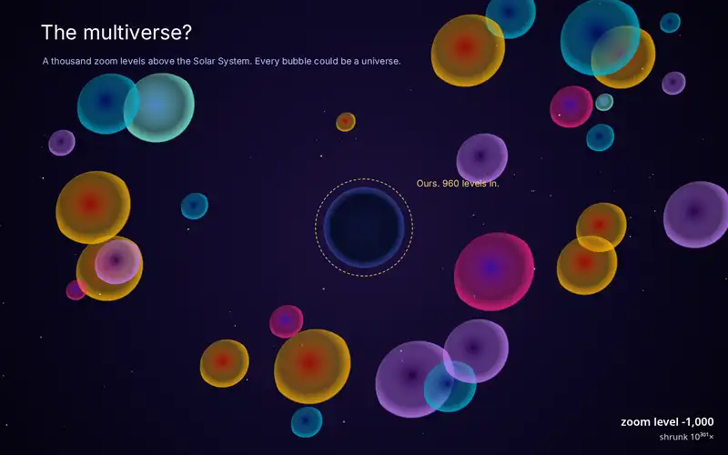

*One continuous zoom in canvast, about 100 levels from the observable universe into a proton, followed by jumps to 1,000 and 1,000,000 levels down. Nothing is faked: every frame is the app drawing the showcase file below.*

### Try the showcase: powers of two

[`showcase.canvast`](showcase.canvast) is a journey through **one million and one thousand zoom levels** on a single canvas. Each scene is hidden inside a speck of the one above it, so you can get from one end to the other with nothing but the mouse wheel:

| Out (zoom out from home) | In (zoom into Earth) |
| --- | --- |
| The Solar System (home, level 0) | Earth, the Moon and a rocket (+5) |
| The heliosphere and the Voyager probes (−9) | An island with a reef and two boats (+12) |
| The Sun's neighbourhood, every star within 20 light years (−18) | A tree, seen from above (+19) |
| The Milky Way, with *You are here* (−27) | A leaf, its veins and pores (+25) |
| The Local Group: Andromeda, Triangulum, the Magellanic Clouds (−32) | Plant cells and their nuclei (+32) |
| The observable universe and its cosmic web (−40) | DNA (+40), a carbon atom (+47), its nucleus (+54) |
| Other universes, **1,000 levels up** | Inside a proton (+60), the Planck length (+116) |
| | Universes again at **+1,000**, and a last scene **one million levels down** |

To open it: click the save indicator at the bottom left, choose **Import archive…** and pick the file (or drop it on the page). Open the canvas *Powers of two*, then either scroll, or open **Bookmarks** and press **Play the bookmarks as a tour** (`→` and `←` step through its 19 stops).

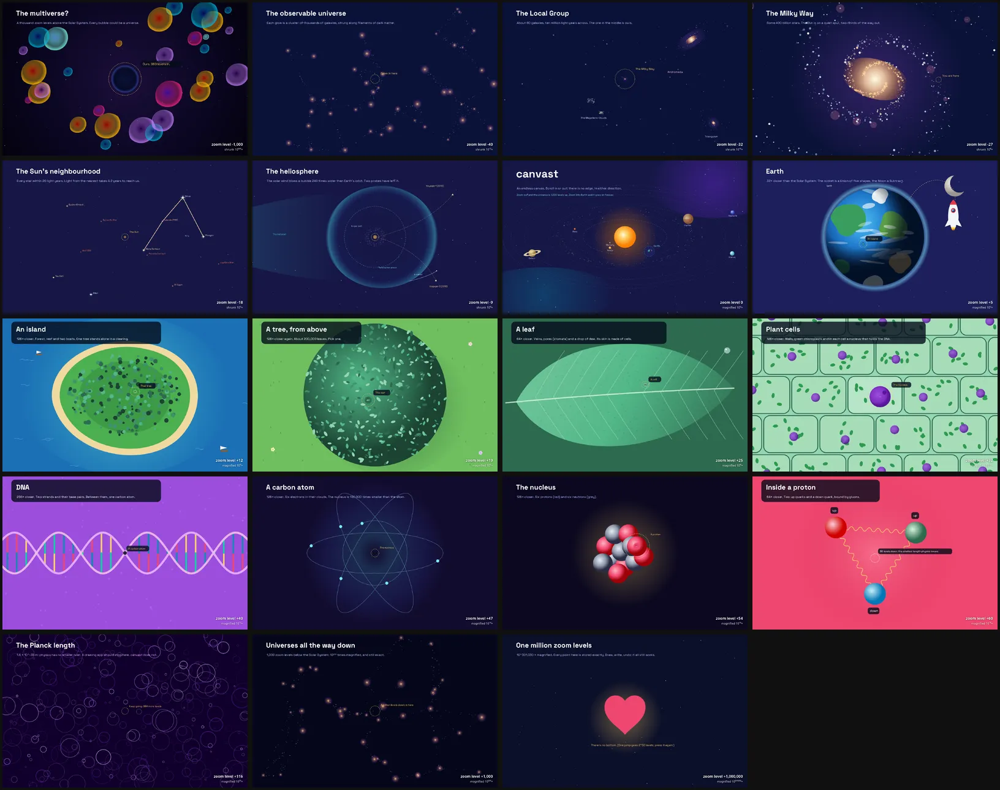

| | |
| --- | --- |
| 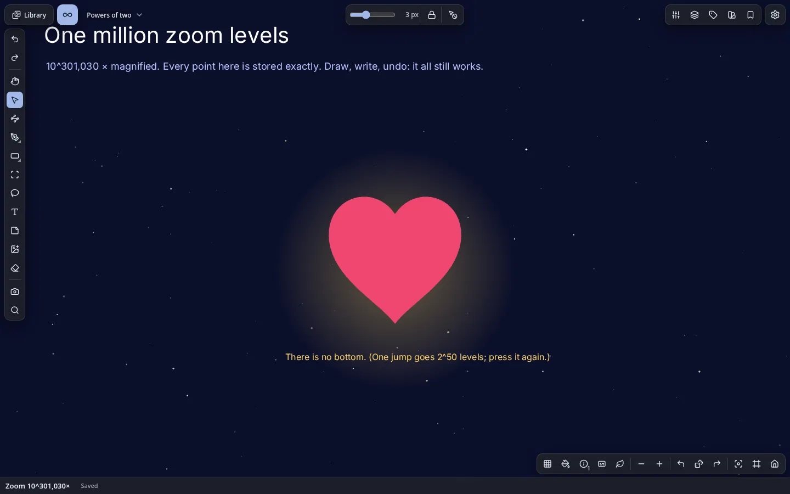 | 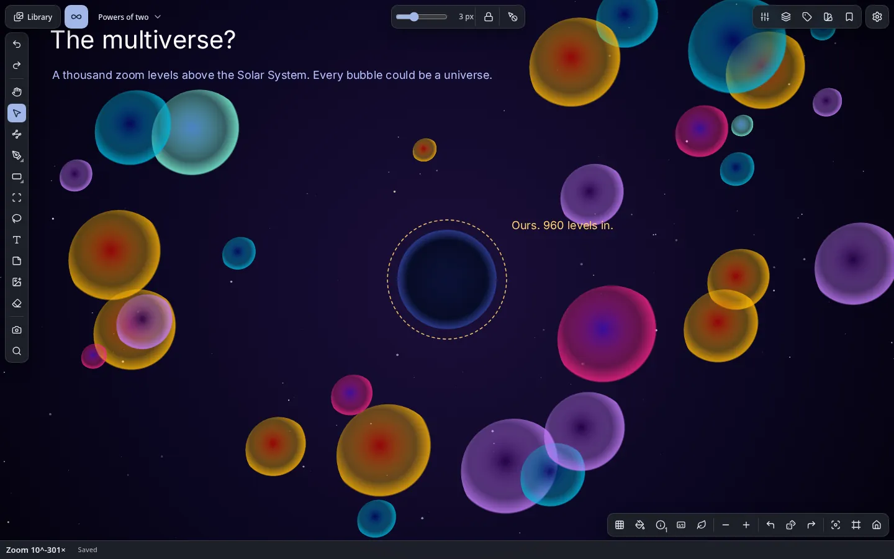 |
| One million levels down: 10^301,030× magnified, still exact and editable | 1,000 levels up: our universe is the ringed bubble |

The showcase is drawn by `scripts/showcase/build.mjs`, which drives the app like a person would: it pastes SVG, combines shapes, draws with the Pen, writes the labels and adds the bookmarks. `scripts/showcase/dive.mjs` renders the animation, and `scripts/showcase/shots.mjs` takes the screenshots in the dark theme with the *Ultramarine* theme colour (Settings → Appearance).

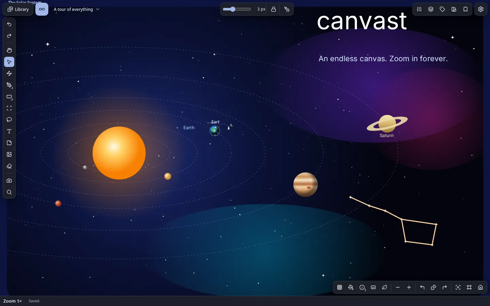

## Contents

1. [Getting started](#getting-started)
2. [Using canvast](#using-canvast)
3. [Keyboard and pointer reference](#keyboard-and-pointer-reference)
4. [Your data: saving, backups, export](#your-data-saving-backups-export)
5. [Settings and accessibility](#settings-and-accessibility)
6. [Limitations](#limitations)
7. [How it works](#how-it-works)
8. [Browser support](#browser-support)
9. [Building and testing](#building-and-testing)
10. [Security and privacy](#security-and-privacy)
11. [Licences](#licences)

---

## Getting started

### Open it

Open `canvast.html` in a modern browser: double-click it, or use *File → Open*. No installation and no web server are needed. To build the file from source, see [Building and testing](#building-and-testing).

### Your first minutes

| To do this | Do this |
| --- | --- |
| Draw | Press `P` and drag |
| Add a shape | Press `U`, pick a shape, drag on the canvas |
| Write | Press `T`, click, type |
| Add a picture, video or audio | Drag the file onto the page, paste it, or use the Import button |
| Move around | Drag with the middle button, hold `Space` and drag, or use two fingers; scroll the wheel to zoom |
| Go back to the start | Press `0` or `Home` |
| Find any command | Press `Ctrl/⌘+K` |
| Undo | `Ctrl/⌘+Z` |

A small read-out shows the zoom level and position. Click it, type a level (`3000`, `2^-500`, `10^900`) and press Enter to jump there.

### Terms

| Term | Meaning |
| --- | --- |
| Canvas | One endless surface you draw on |
| Board | A group of canvases (a project, a topic) |
| Workspace | Everything you have: all boards, canvases and the library |
| Object | Anything placed on a canvas: a stroke, shape, path, text, picture, video, audio, GIF or file card |
| Library | The shared store of every imported file. Each file is stored once, and objects on any canvas are *instances* of it |
| Sheet | A shape that holds other objects and cuts them at its edge; the unit you export |
| Zoom level | `z` means 2^z screen pixels per world unit. Level 0 is the starting scale |

---

## Using canvast

### Navigating

- **Zoom** with the wheel, a trackpad pinch, `+` and `−`, or the on-screen buttons. The point under the pointer (or between your fingers) stays where it is.
- **Pan** with the middle button, `Space`+drag, the Hand tool (`H`), two fingers, `Shift`+wheel or the arrow keys.
- **Return** to the origin with `0`, `Home` or the house button. *Previous view* and *Next view* walk back and forth through where you have been; the dice button takes you to a random empty place.
- **Orientation aids:** a hierarchical grid, the axes and a live position read-out show where you are, even very deep.
- **Bookmarks** save a place and a zoom, with a small picture of it. Rename, update or delete them from their ⋯ menu. A **tour** plays them in order: the bars fade, `→` and `←` step, `Esc` ends it.
- **Search** (`Ctrl+F`) finds objects by name, tag or bookmark. Combine words with space or `AND`, `OR`, `XOR`, `NOT`, parentheses and `"phrases"`. `/` searches names only, `#` tags only, `@` bookmarks only. Searches that found something are remembered, and a help card lists the syntax.
- **Step through items** with `W` `A` `S` `D` (nearest in view, nearest anywhere, or by layer; focus on the item or keep the zoom). `F` brings the selection into view; press it again to fit everything.
- **Jump anywhere:** click the zoom read-out and type a level. One jump can travel up to 2^50 levels.

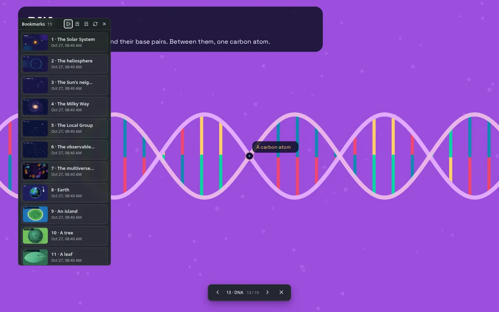

### Drawing

- **Pen** (`P`): four pens (fine, pencil, ink, marker) with pressure, tilt and a stabilizer. Size is 0.5–128 px. A stroke is made at the current scale, so a 3 px line drawn deep in a zoom is a 3 px line there, and it stays vector-sharp at every magnification. *Thickness lock* keeps strokes the same width on screen at any zoom.
- **Shapes** (`U`): rectangle, ellipse, line, polygon and star. Sides, points, ratio and per-corner radii stay editable after drawing.
- **Paths** (`B`) and **Edit nodes** (`N`): Bézier curves with handles, snapping, a lasso for several nodes, and node editing across several paths at once. *Simplify* fits a curve to a rough path; *Pen stroke to path* converts a stroke.
- **Fill and outline:** solid colour, linear, radial or angular gradient, a picture, or other objects of the canvas repeated over the shape (*Objects*). Outlines have a position (inside, centre, outside), corners, ends, dashes, arrow heads and a sharp-corner limit; the outline can be a gradient too.
- **Combine shapes:** union, intersect, subtract and exclude stay editable until you flatten them; *Divide* and the *Shape builder* split overlapping shapes; *Outline stroke* turns a line into a shape; *Taper* gives a line a variable width; *Corner smoothing* rounds corners continuously.
- **Vector networks:** paths that meet at vertices, with the regions between them filled. Edges are split where they cross.
- **Initial state:** *Set*, *Update* and *Reset to initial state* remember a shape's geometry (and, by default, its fill and outline) so you can experiment and go back. *Apply rotation* makes a shape's current turn its new zero.
- **Eraser** (`E`): removes whole objects (optionally whole groups), or trims strokes in scissors mode.
- **Pattern** (panel, mountain button): 39 generators of vector patterns, grouped as Waves, Blobs, Soft, Lines, Tiles and Fields and shown as a grid of small pictures (Ripple, Tides, Drift, Bubbles, Glow, Grain, Stripes, Halftone, Tiles, Contours, Cells, Flow, Marble, Maze and more). Each has the settings of its own (counts, sizes, angles, colours, solid or outline), and a background you can hide. Pick a sheet or a closed shape first (the shape cuts the result to its outline) or let it make a new sheet; *Generate* makes the result, every change after that replaces it live, and the whole session is one undo step until *Done*. *Randomize* picks random settings and a new seed (a snowflake on a setting keeps it); the seed can be typed to make a result again. The result is a group of ordinary editable shapes that remembers its settings: pick it later and the panel shows them, and changes replace it where it is.
- **SVG:** paste SVG text to get editable paths (gradients, including a radial one sized by its own transform and an angular one written as a CSS conic gradient box, dashes, transforms, `<use>`, symbols and clip paths, which become clipping masks), or make a vector copy of an SVG picture. Export shapes as SVG, copy them as SVG text, or save them to the library as an SVG picture.

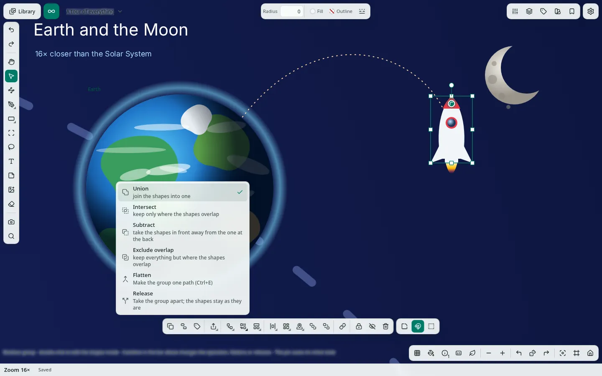

### Colour and styles

- **Colour picker:** one picker for every colour. Choose OKHSL, OKHSV or OKHCL; a ring and box, a plane with a hue bar, or sliders; text as hex or another format. It also has an eyedropper, recent colours and saved colours. Number fields change by dragging the field.
- **Gradients:** linear, radial and angular, with stops you drag on the canvas, a *Randomize* button and a gradient map for pictures.
- **Palettes:** *Palette from a colour* builds harmonies, and a palette can be taken from a picture. Palettes and gradients can be imported and exported as `.gpl`, `.ase`, `.aco` and `.ggr` files.
- **Styles panel:** saved colours, gradients, text styles and adjustment stacks. An object painted with a saved style is **linked** to it and follows when the style changes. A change by hand, or *Detach*, unlinks it.

### Text

- **Text** (`T`): click and type. A click makes a text as wide as its words; a drag makes a box of that width. Double-click to edit.
- **Formatting:** bold, italic, underline, strikethrough, links, colour and size of any range, headings, bulleted, numbered and nested lists. Text is stored as Markdown; **Copy Markdown** is one click away.
- **Look:** colour or gradient, outline, size, line height, letter spacing, alignment, auto or fixed width, paragraph spacing, indent, case, line limit, a set height, kerning, OpenType features and the axes of variable fonts.
- **Fonts:** import `.ttf`, `.otf`, `.woff` or `.woff2` into the library, including variable fonts. One text may use several fonts. Right-to-left and mixed-direction text are supported.
- **Text on a path**, and **Text to path** (`Ctrl+E`) to turn letters into editable outlines.
- **Notes** (`M`): a text on a coloured card.
- **No zoom limit:** zoom into a letter as far as you like; the font's real outlines are drawn.

### Pictures, video, audio and other files

- **Pictures** are placed one source pixel to one screen pixel. Zooming in shows real pixels; nothing is invented and the original is never altered.
- **Adjustments** are non-destructive stacks you can reorder, hide and copy between pictures, video and GIFs: exposure, contrast, highlights, shadows, temperature, tint, saturation, vibrance, red/green/blue, levels, curves, gradient map, blur, sharpen and grain.
- **Crop**, rounded corners and an outline work on pictures, video and GIFs. A picture can be masked by a shape, by opacity or by brightness, or by a brush mask painted with the Pen.
- **Make a new picture** bakes the crop and adjustments into a new library item; **Copy as picture** puts the result on the clipboard. **Copy** and **Paste adjustments** move a whole stack between items. An SVG picture can be turned into editable shapes with **Make vector copy**. **Show in library** opens the Library with the original picked.
- **Media player:** videos, audio and animated GIFs play on the canvas with a player right under the item. It has play and pause, a seek bar, step back and forward (seconds for video and audio, frames for GIFs), repeat, playback speed, volume, a waveform for audio, and a start and end to play only part of a file. The paused frame is saved. Playback continues when the item scrolls out of view.
- **Extract frame** turns the current frame of a video or GIF into a picture in the library (PNG, WebP or JPEG). Settings name it, file it in a folder and tag it, optionally placing it on the canvas.
- **File details:** EXIF, colour profile and codec information are shown. STL and OBJ 3D models and PDFs are kept as cards with a preview; any other file is kept as a card with its extension and can be downloaded again.
- **Import** by button, drag and drop, paste, or a whole folder. Files up to 256 MiB are accepted and decoded before being stored.

### Organizing

- **Layers panel:** group and nest, rename, hide, lock, re-stack, set opacity and blend mode, rotate. Select with `Ctrl` (toggle) and `Shift` (range).
- **Sheets and masks:** a *sheet* clips what it holds and has a ratio rather than a size; a *clipping mask* is a sheet of any shape. See [Shapes, sheets and masks](docs/reference/shapes-sheets-masks.md).
- **Snapping and arranging:** moving things, dragging a node and dragging the handles of a gradient snap to others with guide lines (the magnet toggle turns it off). A group, and a boolean group, counts as one thing for Align, distribute and Arrange; its shapes are lined up with each other only when you pick them one by one (in Layers, or inside the group). Align, distribute, arrange in a grid (by name, date, size or type), copy, cut, paste, duplicate; `Alt`+drag copies.
- **Tags** on the selection, with a Tags panel listing every tag and its count. Renaming or deleting a tag applies to every canvas.
- **Reveal:** hold `Ctrl` and move over the canvas to see the outline of everything under the pointer; `Ctrl`+click picks exactly that thing, even deep inside a group, mask or sheet. Click on a revealed outline and you get the thing the outline belongs to, even when a filled shape covers it; click anywhere else and you get the top thing there (`Ctrl`+`Alt`+click goes down the stack). A thing you have picked can then be moved by dragging its outline, even under a filled shape; a click that does not move still picks what is on top.
- **Sheets:** drawing a sheet (`C`) over objects puts the ones wholly inside it on the sheet (one undo step; ones it only crosses stay out); *Put the selection on a sheet*, *Fit to contents*, *Release*, ratio presets (`16:9`, `A4 portrait`, a number) and *Turn on its side*. Each object on a sheet has pins (left, right, both, centre or scale, per axis) that decide what it does when the sheet is resized, and *Scale contents* resizes everything with it.
- **Masks:** a clipping mask of any shape, a mask by opacity or brightness, or a brush mask painted in black and white with the Pen. Masks can be inverted, picked on their own and released. A click on a mask picks it as one unit; a double click goes inside.
- **Hide and lock:** *Show all hidden* and *Unlock all* bring everything back.
- **Kind chips:** with a mixed selection, chips at the start of the Actions bar (All, Pictures, Media, Shapes, Strokes, Texts) narrow it to one kind.

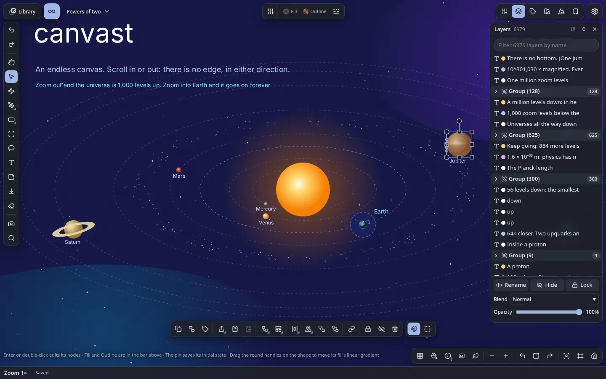

### The interface

- **Tool rail** on the left: the tools, then Screenshot, Search, Import, Undo and Redo. **Properties bar** at the top: the options of the tool or of what is picked. A picked pen stroke, or several picked things, show their colours there as chips; a chip changes that colour everywhere it is used. **Actions bar**: what can be done with the selection, grouped in menus (Align, Arrange, Shapes, Masks, Path tools, Sheets, Export, Initial state) that list only what applies. It sits at the bottom or follows the selection.
- **Panels** (Layers, Bookmarks, Tags, Styles, Adjust, Pattern) float or dock to either side, are resizable, and can minimize when inactive. *Reset the panel layout* puts them back.
- **Command palette** (`Ctrl/⌘+K`) runs any command by name, takes a value where one is needed (`@kind` narrows the list), and records and replays **macros**. A right click on the canvas opens a menu of what fits.
- **Zen mode** (`Z`, or the leaf button) fades the bars and panels until the pointer is over them.
- **Screenshot** (camera button) saves the selection, or the whole view, to the library. Settings choose the format, quality, name, folder and tags. They also choose whether to include the canvas pattern and the interface, a transparent background, and a copy on the clipboard.
- **Previous view** and **Next view** walk your camera history; the **dice** goes to a random empty place.
- **Read-outs:** the bottom left shows the zoom, position and save state. *Information shown* switches between simple and technical (exact zoom as a power of two, frame rate, diagnostics). The bottom-right buttons cycle the canvas pattern (grid and others) and the item names (always, when picked, hidden).
- **Hint line** at the bottom says what the tool does and what each key does over a handle. **Notices** report results, often with a *View* button that opens what was made; they stack above the Actions bar, never over it. Anything that makes you wait (exporting, importing, opening a library, moving files, deleting everything) shows a notice with a bar and the stage it is at, which stays until the work ends and then says the result.

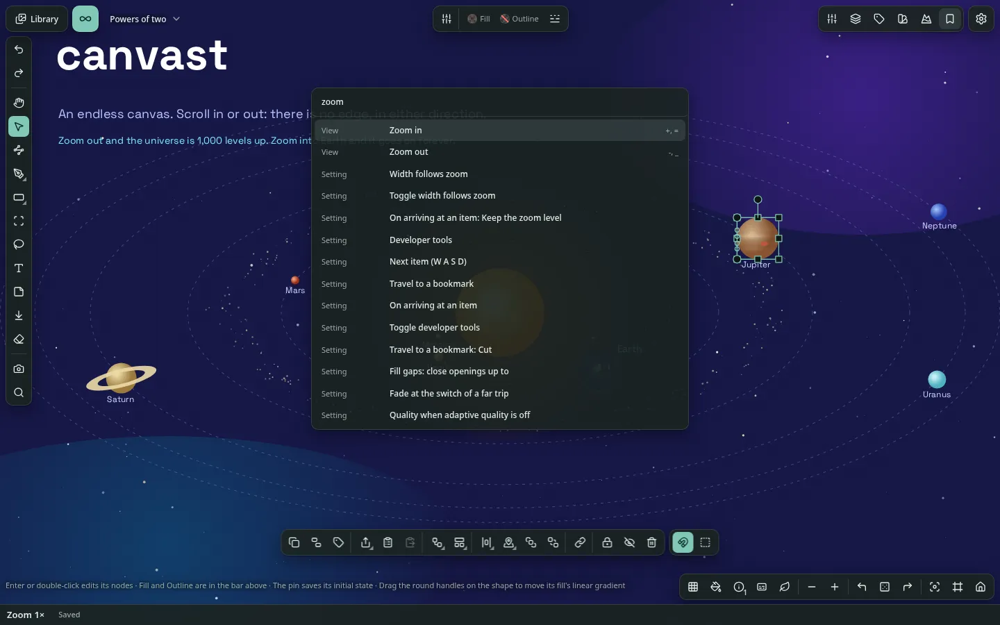

### The Library

Switch between **Canvas** and **Library** at the top left. The canvas keeps its view, selection and undo history while you are away.

- A gallery of every imported file with its size, type and usage ("4 uses · 3 canvases"), with search, filters by file type, sorting, list or grid layouts and adjustable thumbnails.
- A **viewer** with filmstrip, zoom, pan, slideshow and a details panel. The details show where an item is used, and **Show** takes you to it on the canvas at any depth. A button switches the background behind the picture, the controls can be hidden, and a double tap opens it on phones.
- **Folders** (an item lives in one folder, folders nest), **tags** (several per item, renamable), **favourites**, file types, and **Similar images** (duplicates and near-duplicates found by their pixels).
- **Rename** one item or many at once, with a preview: number them, replace text, add text or change the extension.
- **Export** items as a `.canvast` archive, download originals, or export all files as a plain ZIP sorted by file type or by folder.
- **Safe deletion:** an item in use cannot be deleted from the library. An original is erased only when nothing, including undo, can bring it back.
- **Missing originals** (for example after clearing site data, or a file taken out of the library folder) are flagged with their usage; importing the same file again restores every instance.
- **Library folder** (Chromium): in **Settings > Storage**, *Choose library folder…* keeps your files as plain files in a folder of your disk, named by their content and keeping their extension (`a07c9f….png`, so other programs can open them), instead of in the browser's storage, so the library is limited by your disk and not by the browser. *Move into folder* and *Move back to browser* move what is already there. The library index is kept up to date by itself a little after each change (a checkbox turns it off; **Save index** writes it at once). It is the hidden file `.canvast-index` beside the files: the whole workspace (boards, canvases, objects, names, tags, folders, styles, settings) without the files themselves. It is not a backup, and not a cache to delete: on another device it is your canvases (a backup, `.canvast`, is a different file and holds the files). On another device, choose the same folder: when it holds a library index you are offered to open it at once (**Open index** does the same later); the canvases are added and every file is matched by its name. Do this on a device that has no canvases of its own yet, or they are added a second time. After a restart the browser asks permission once more: press *Reconnect folder*. Do not move, rename or edit the files in that folder (canvast finds each one by its name); files kept before extensions were added get one with the *Add extensions* button on the card; backups (`.canvast`) hold their bytes as always.

| | |
| --- | --- |
| 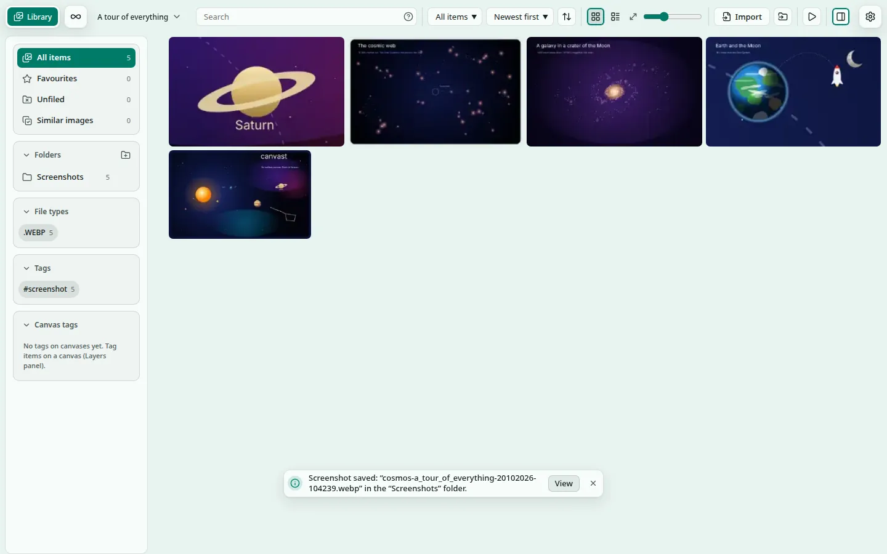 | 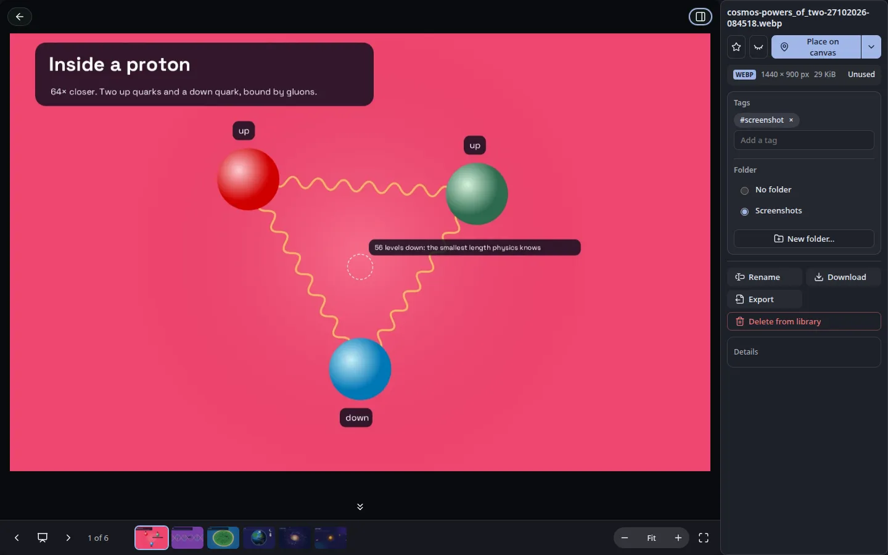 |
| The Library, filled by six screenshots of the showcase | The viewer with its filmstrip and details |

### Exporting

**What you export is what you see.** Colours, widths and shapes are the ones stored in the document: nothing is changed by the theme when drawing or exporting. The default pen and outline colour is near-black on a light canvas and a light ink on a dark one, chosen when the shape is made and stored with it (*Change the old default ink to the canvas ink* in the command palette gives it to older drawings). Exports match the canvas in every format; the one thing SVG cannot say is an angular gradient: an SVG holds a picture of it (a PNG of up to 384 px a side, cut to the shape or the line) and, on the element, the real gradient: canvast reads it back, so *Make vector copy* or pasting the SVG gives the editable angular gradient again (other programs show the picture). The Export dialog and the SVG saves warn when a shape has one.

**Export…** works on a sheet, a picture or selected shapes. The size comes from the shape: type a width or height in px, in, cm or mm at 72–600 ppi, or choose a preset (A4, Full HD, a story, the picture's own pixels). Formats: PNG, WebP, JPEG, SVG and PDF (what is on a sheet that clips is cut to the sheet in every format, and the picture is framed by the part that shows), with a transparent, white or black background; download it, copy it or keep it in the library. PNG, JPEG and WebP carry their resolution. Several sheets export together as a ZIP or as one multi-page PDF whose pages you can reorder. Plain shapes export to PDF and SVG as true vectors, masks as SVG masks, and picture or pattern fills as embedded pictures clipped to the shape.

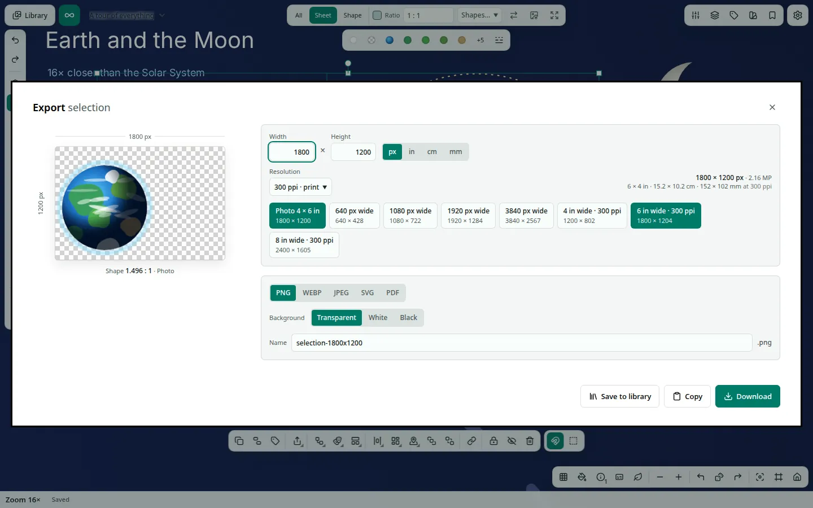

---

## Keyboard and pointer reference

Every shortcut can be changed in **Settings → Shortcuts**: a single key or a chord, with several keys per command, and warnings when a key clashes with another command or the browser. Defaults:

| Action | Input |
| --- | --- |
| Zoom at pointer | Wheel · trackpad pinch · `Ctrl`+wheel |
| Zoom at centre | `+` / `−` (`Shift` = 4× step) |
| Pan | Middle-drag · `Space`+drag · Hand tool · two fingers · `Shift`+wheel · arrow keys |
| Return to origin | `0` · `Home` |
| Tools | `V` select · `P` pen · `L` lasso · `H` hand · `T` text · `M` note · `U` shape · `B` path · `N` nodes · `C` sheet · `E` eraser |
| Undo · redo | `Ctrl/⌘+Z` · `Ctrl/⌘+Shift+Z` or `Ctrl+Y` |
| Copy · cut · paste · duplicate | `Ctrl/⌘+C` · `X` · `V` · `D` |
| Select all · clear · cancel a gesture | `Ctrl/⌘+A` · `Esc` |
| Delete | `Delete` · `Backspace` |
| Command palette | `Ctrl/⌘+K` (`@kind` narrows it; commands can take a value; macros record and replay) |
| Context menu | Right-click the canvas |
| Search | `Ctrl+F` (library: `Ctrl+Shift+F`) |
| Focus on selection · fit everything | `F` · `F` again |
| Step to next item | `W` `A` `S` `D` |
| Zen mode | `Z` (bars fade out until the pointer is over them) |
| Text editing | `Ctrl/⌘+B` · `Ctrl/⌘+I` · `Tab` nests a list item · `Esc` or `Ctrl/⌘+Enter` finishes |
| Resize | Drag a handle; `Shift` keeps proportions, `Alt` resizes about the middle, `Ctrl` turns snapping off |
| Copy by dragging | `Alt` as the drag starts |
| Layer selection | `Ctrl`+click toggles · `Shift`+click selects a range |
| Jump to a zoom level | Click the zoom read-out, type `3000`, `2^-500` or `10^900`, Enter |

**Touch:** two-finger drag pans and pinches zooms; a two-finger tap is undo and a three-finger tap is redo; a long press on Select lists what is under the finger; a resting finger while another drags acts as `Shift`, two as `Alt`. Number fields change by dragging the field itself.

---

## Your data: saving, backups, export

### Saving

Every change is saved automatically within a fraction of a second, together with the camera, in your browser's IndexedDB. Only the objects that changed are written, in one atomic transaction, and then read back to check. The indicator shows *Unsaved changes… → Saving… → Saved → Saved (verified)*; click it to open **Settings > Storage**: space used, whether the browser keeps the data, the library folder, how saving is going (and the role of this tab) and backups. Reloading restores the canvas and the view.

If storage cannot be opened, canvast keeps working in memory and says so.

### Several tabs

The first tab to open a workspace edits it. Other tabs are read-only, follow its changes live, and offer **Take over**. A stale tab can never overwrite newer data; its save is rejected and reported.

### Backups

- **Export a backup** (Settings > Storage) downloads one `.canvast` file holding every board, canvas, object and view, plus every original once, and your device settings (theme, shortcuts, panel layout). When you import it, only the settings this device has not set itself are restored; the ones you changed here are kept, and the import dialog says how many it will restore.
- A board, a canvas or a single library item can be exported on its own, with only the originals it uses.
- **Import archive…** (or drop a `.canvast` file on the page) verifies every checksum first, shows what it contains and any problems, and only then adds the boards and canvases in a single transaction. Nothing existing is replaced and originals you already have are not stored twice.
- A `.canvast` file is a standard, uncompressed ZIP you can open with any unzip tool. Do not re-compress it.
- Backups made in one browser import into another (tested between Chromium and Firefox).
- Incremental backups are available after the first full one.

The browser does not say whether a download finished, so keep your backups somewhere safe.

### What can delete data

Deleting objects; deleting a canvas or board (confirmed, cannot be undone; pictures placed there stay in the library); *Delete from library*, which erases an unused original once undo can no longer need it; and **Delete all data** (Settings > Storage, *Start from scratch*), which asks first, offers a backup, an export of the files and the library index, makes you type `DELETE`, and then removes everything canvast keeps in this browser. It never deletes files from your disk: the files in a library folder stay where they are. Nothing else removes anything. Damaged objects found on load are skipped and reported, never silently changed.

### Where the data lives

IndexedDB database `canvast`, in the browser's storage for local files. Moving the HTML file to another folder keeps your data. Opening it in a different browser, profile or private window does not, and clearing site data deletes it. This is why regular backups matter. The browser's storage has a size limit, so canvast suits projects rather than very large collections of files; see [Limitations](#limitations).

---

## Settings and accessibility

Open Settings with the gear button. Settings have a *device* scope and a *canvas* scope, can be searched, and reset individually (the undo-arrow icon at the end of a row) or together. Every group has an icon in the list on the left, and the groups are indented under their heading. Device settings travel in a workspace backup and in the library index (see Backups).

| Group | What it holds |
| --- | --- |
| Drawing and selection | Pen, colour picker model and layout, pen width and stabilizer, lasso filter, snapping, align to the selection box, grid spacing for Arrange, initial shape and paint, eraser |
| Navigation | How `W` `A` `S` `D` choose the next item; focus on the item or keep the zoom |
| Shortcuts | Rebind any shortcut to a key or a chord; the full list is also on `?` |
| Media and playback | Viewer edges, slideshow time, starting volume, step sizes, extracted frames and edited pictures (format, quality, folder, name, tags), and the folder and tags of what is saved to the library from the canvas, one pair for each kind: pictures from Export… (*Exports*, `export`), patterns (*Patterns*, `pattern`) and shapes saved as SVG (*Shapes*, `shape`); screenshots, extracted frames and edited pictures have their own in their own groups |
| Screenshot | Format, quality, pattern, transparency, interface, clipboard, folder, name and tags |
| Appearance | Theme (system, light, dark), theme colour (or adaptive, from the canvas background), colourfulness, information shown, hints and tooltips, canvas pattern, Actions bar place, item names, density (comfortable, compact, dense), round or sharp corners, Zen mode |
| Panels | Minimize inactive panels, panels kept open |
| Performance | Adaptive quality, fixed quality level, memory for pictures, animation and its speed |
| Storage | Space used and whether the browser keeps the data; the library folder (choose it, move files in and out, the library index and its automatic saving); how saving is going; backups (export, changes only, files as ZIP, import); *Start from scratch* (delete all data, after a warning with a backup offered first) |
| Privacy, Collaboration | What stays on your machine; collaboration (none) |
| About and diagnostics | Version and diagnostics |
| Develop | Developer tools (see below) |

- **Accessibility:** controls are keyboard reachable with visible focus; panels have title bars that work by keyboard; status changes are announced to screen readers; the system's reduced-motion preference is honoured and animation can be turned off; colour contrast is audited automatically.
- **Layouts** adapt to large, medium and phone-sized screens, with scroll cues on bars that scroll.

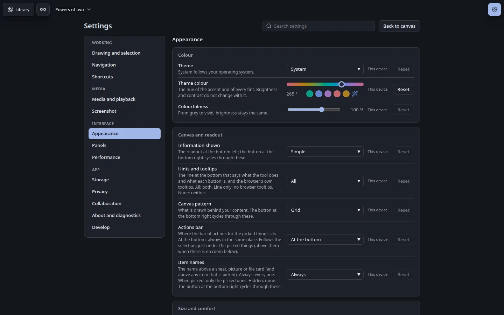

---

## Limitations

canvast describes only what it does. These are the current limits.

**Scale**

| Area | Limitation |
| --- | --- |
| Library size | The Library manages the files your projects use. It is not meant to hold a very large archive. Files are stored in the browser's storage for local files, whose size limit depends on the browser and on the free disk space, so a library that grows past it stops accepting new files, says so in plain words and loses nothing already stored. canvast asks the browser once to keep the data under storage pressure, and warns once when 80% of the browser's quota is used. In Chromium a *library folder* removes the limit (see Library); Firefox cannot offer one |
| What to do about it | Keep working files in canvast and long-term collections in your own folders. Use `.canvast` backups to move finished projects out, and *Delete from library* to free space |

**Content**

| Area | Limitation |
| --- | --- |
| PDF | A PDF is kept as a card with its page count; its pages are not rendered as pictures |
| 3D | Only STL and OBJ are read, and only as a preview card |
| Text | Complex scripts that need Indic shaping are not supported; OpenType positioning goes no further than kerning. Characters missing from the interface font fall back to a system font: their width then comes from the browser, so such text can wrap differently on another computer and pixelates at extreme depth |
| Vector networks | One fill for the whole network (no fill per region) |
| Angular gradient in SVG | SVG has no sweep gradient, so an SVG holds a picture of it (up to 384 px a side, about 300 KB), not vectors; the Export dialog, Save as SVG and Copy as SVG warn. A PDF of such a shape is made as a picture, and picture exports are exact |
| Pattern | A rotated sheet or shape is refused. A result is at most 600 shapes. Ungrouping a pattern, or moving one of its shapes out of its group, ends its link with the panel (the shapes stay as ordinary ones). Resizing the sheet scales the pattern as it does any content; it is not made again at the new size |
| SVG import | Text, patterns and masks inside an SVG are not imported; a dropped SVG file is placed as a picture (make a vector copy to edit it) |
| Boolean groups | Per-corner radii on a boolean result are not available |
| Eraser | Trimming works on strokes, not on vector paths |
| Files | Imports are limited to 256 MiB per file |
| Video | H.265 video from phones shows as a card on Firefox for Android (it still plays from the player) |

**Scale and precision**

| Area | Limitation |
| --- | --- |
| Camera precision | After zooming out more than 4,096 levels beyond the deepest point and back in, the view returns to within 2^-96 px of the original rather than exactly |
| Very deep views | Magnification has no limit, but each level of depth enlarges the numbers involved, so extreme depths cost more CPU per frame |
| Dense scenes | With thousands of strokes visible at once, zooming shows a briefly scaled image of the last exact frame and snaps to the exact picture about 150 ms after you stop |
| Far zoom-out | Content too small to draw is shown as a soft mark in its own colour (pictures as grey). Marks cannot be selected; zoom in to edit |
| Very large documents | A board of one million objects needs about 940 MB of memory and about 6 s to build its index on load |
| Large libraries | Libraries of many thousands of items, and backups of many gigabytes, have not been measured |
| Frame rate | Measured on one desktop machine; no results exist for other device classes |

**Platform**

| Area | Limitation |
| --- | --- |
| Storage | Browsers cap local storage: Firefox gives a local file about 790 MiB, Chromium about 10 GiB (a Chromium library folder is not counted). With a library folder, files in it are outside the browser's protection: files removed there show as missing, and each session needs one click to allow access again. When the browser's storage is full, an import is refused with a notice that points to the backup and to *Delete from library*; edits stay queued and the indicator shows the error. Export backups regularly |
| Origin | Data belongs to the browser profile. Another browser, profile or private window starts empty |
| Rendering | Canvas 2D only, on the main thread; no GPU or WebGL path, no workers |
| Browsers | Tested on Chromium and Firefox on one Linux machine. Safari has not been tested. Touch is tested by emulation |
| Collaboration | None. There is no network by design |

**Left out on purpose:** ratings, saved searches, a minimap (there are no bounds to map).

---

## How it works

This part is for readers who want to know why canvast behaves as it does.

### Exact coordinates

Positions are not floating-point numbers. Each coordinate is a **dyadic number**: a `BigInt` mantissa times 2^exponent, so any position at any distance from the origin is stored exactly. The camera is a centre plus an integer-quantized log2 zoom, which makes zooming and panning exactly reversible. Plain doubles appear only when drawing, and only relative to the camera or to a cell, never as stored world positions.

When the view is very deep inside an object, drawing and picking switch to exact arithmetic for that object; sizes in the numbers grow with depth, but nothing is clamped. Nested coordinate frames keep the cost per frame flat however deep you go.

### Rendering

Rendering is CPU-first **Canvas 2D**.

- **Shared projection:** drawing and hit-testing use the same object-to-screen projection, so what you see is what you pick.
- **Spatial index:** a multi-scale index (levels × `BigInt` cells) with no world bounds returns the visible objects. Off-screen content costs almost nothing, even when it is 2^5000 away.
- **Level of detail:** content far below a pixel is skipped or summarized; identical opaque strokes are drawn in one call.
- **Raster tile cache** for committed objects keeps panning and drawing over dense scenes near 2–3 ms per frame, and a bounded **zoom preview** keeps zooming responsive.
- **Deep zoom into any kind of object:** every kind has a sampler so its colour never disappears when the view is inside it.
- **Text** uses the browser's glyphs normally and the font's exact outlines past about 2,000 px per letter.

Measured on a CPU-only configuration with about 500 visible objects: 1.7 ms per frame (p50) with 10 thousand objects in the document, 2.2 ms with 100 thousand, 7.7–9.6 ms with one million.

### Editing model

1. Input produces a transient preview, which is never stored.
2. On pointer-up the gesture becomes one validated transaction.
3. The document store applies it and reports the changed ids; the spatial index and undo history are updated, and the canvas redraws.
4. After a 150 ms debounce the changed objects are written in one atomic, revision-checked IndexedDB commit, then read back to verify it.

Every object is validated before it enters the document or is loaded: finite numbers, known kinds, well-formed ids and hashes.

### Storage

Hierarchy: Workspace → Boards → Canvases. The IndexedDB schema (version 10) has stores for workspaces, boards, canvases, objects (one record each), per-canvas views, frames, bookmarks, thumbnails, assets, the asset catalog and metadata. Assets are content-addressed by SHA-256 and stored once; objects on the canvas reference them. A multi-tab **writer lease** guarantees a stale tab cannot overwrite newer data. Originals are removed only by reference-checked garbage collection. With a library folder an original is a file named `<sha256>.<ext>` (written, read back and compared before the browser keeps a stub of it: an `assets` record with an empty blob and `ext: 1`), so every rule keyed by hash is unchanged.

A `.canvast` archive holds a versioned `manifest.json`, one JSON file per canvas and each original once under `assets/<sha256>`, with a CRC on every entry. It is an uncompressed ZIP (ZIP64 beyond 4 GiB or 65,535 files). Import is verified completely before one transaction writes it.

### Source layout

```
src/
  core/          exact numbers (dyadic) and the camera
  doc/           objects, transactions, document store, undo/redo, groups, clipboard
  render/        projection, drawing, hit-testing, tile cache, density preview
  scene/         multi-scale spatial index
  text/          font reading, Markdown model, layout
  interaction/   navigation, tools, snapping, pens, item stepping
  assets/        content addressing, decoding, catalog, garbage collection
  storage/       IndexedDB, workspace repository, persistence, writer lease, ZIP, archives
  search/        boolean query parser and evaluator
  settings/      declared settings, scopes, rebindable shortcuts
  commands/      command registry, palette providers, macros
  gen/           the pattern generators, a standalone module that imports nothing from the app: seeded random, geometry helpers, one pure function per pattern, an SVG writer
  colour-picker/ the colour picker, a standalone module that imports nothing from the app
  ui/            toolbars, panels, library, settings view, menus, player
  app/           bootstrap, editor state, actions, debug hook
scripts/         single-file build, offline check, naming and token checks
tests/           unit (Vitest) and end-to-end (Playwright)
docs/            reference notes, test logs, status
```

The colour picker can be built alone with `npm run build:picker`, and the pattern generators with `npm run build:patterns` (a script with the global `CanvastPatterns`, an ES module, TypeScript declarations and a demo page in `dist-patterns/`; see [src/gen/README.md](src/gen/README.md) for the API). Both are made to be published as packages of their own.

---

## Browser support

- Requires `BigInt`, Pointer Events, `ResizeObserver`, Canvas 2D and IndexedDB. Roughly Chromium 67+, Firefox 68+, Safari 14+.
- **Tested** in Chromium 156 (default, CPU-only, and devicePixelRatio 2 with touch) and Firefox 157 on Linux. **Not tested** in Safari.
- Firefox on `file://` supports everything canvast uses (IndexedDB, Web Locks, BroadcastChannel) with frame times close to Chromium's.

---

## Building and testing

Requires Node.js 26.4 (see `.nvmrc`) and npm.

```sh
npm ci            # install pinned dev dependencies
npm run build     # → dist/canvast.html (minified, single file)
```

Open `dist/canvast.html` directly. Developer tools (frame times, camera internals, jump buttons, auto-zoom, the test hook) are in *Settings → Develop*, or add `#debug` to the address.

| Command | Purpose |
| --- | --- |
| `npm run typecheck` | TypeScript check |
| `npm run test:unit` | Unit tests (seconds) |
| `npm test` | Typecheck, unit, quick end-to-end suite, token, picker and pattern-generator checks (about 16 min) |
| `npm run build:patterns` | Build the pattern generators alone into `dist-patterns/` (script, module, types, demo page); `npm run check:patterns` fails if they import from, or touch, anything outside their folder |
| `npm run test:full` | The full suite with long stress loops (about 50 min) |
| `npm run test:snap -- <files or -g pattern>` | Run chosen end-to-end specs |
| `npm run test:status` | List test builds with their result and how far each is behind the source |
| `npm run bench` | Scale and tile-cache benchmarks |
| `npm run check:offline` | Fail if the built file references anything outside itself |
| `npm run check:tokens` | Fail on a hard-coded colour, size, space or radius in the CSS |
| `npm run check:repro` | Build twice in different folders, time zones and locales and compare the SHA-256 |

Every end-to-end run builds its own copy of the app into `test-builds/` and tests that copy, so `dist/` can be rebuilt while tests run. Tests open the built file from `file://`, drive it through a debug hook, run in Chromium (three configurations) and Firefox, and fail on any network request. Test fixtures are generated in code; no binary fixtures are committed. Performance thresholds are fixed in advance and never loosened. Test logs with environments and timings are in [docs/testing/](docs/testing/); [docs/status.md](docs/status.md) is the status record.

### The showcase and the screenshots

```sh
npm run build
node scripts/showcase/build.mjs showcase.canvast            # draws the showcase in the app and exports it
node scripts/showcase/shots.mjs showcase.canvast shots/     # imports it in a fresh profile and takes the README pictures (PNG)
node scripts/showcase/dive.mjs showcase.canvast frames/     # renders the dive, frame by frame (PNG and frames.txt)
```

The README pictures are those PNGs converted to WebP (`cwebp -q 80`) in `docs/screenshots/`. The dive is the frames scaled to 800 px and joined with `img2webp` (`frames.txt` holds each frame's duration); the journey sheet is the frames where the dive pauses, set in a grid with ImageMagick `montage`.

### Reproducible build

The build is deterministic: the same source produces the same `canvast.html`, and `npm run build` prints its SHA-256. Dependencies are pinned to exact versions and line endings to LF.

---

## Security and privacy

- The page's Content Security Policy is `default-src 'none'` with no `connect-src`: it cannot make network requests, even if code tried. Only inline script and style are allowed, images come from `blob:` and `data:`, and workers (if any) from `blob:`.
- canvast has no runtime dependencies and makes no network requests. The interface font is supplied from memory, so no font source is allowed either. `npm run check:offline` and the end-to-end suite both verify this on every build.
- Imports are limited to files of at most 256 MiB, and each is decoded before being stored. Files that fail to decode are rejected with a message.
- Archives are verified completely (structure, checksums and content hashes) before anything is written.
- No analytics, no telemetry, no account.

---

## Licences

canvast is released under the [MIT licence](LICENSE), copyright (c) 2026 emarpiee. The built file bundles the Lucide icons (ISC) and the Inter font (SIL Open Font License 1.1); their notices are embedded at the top of `canvast.html` and listed in [THIRD_PARTY_NOTICES.md](THIRD_PARTY_NOTICES.md). Development-only dependencies, which are not shipped: TypeScript, esbuild, Vitest and Playwright.

A history of changes is in [CHANGELOG.md](CHANGELOG.md).
