<p align="center">
  <picture>
    <source media="(prefers-color-scheme: dark)" srcset="docs/brand/header-logo-dark.png">
    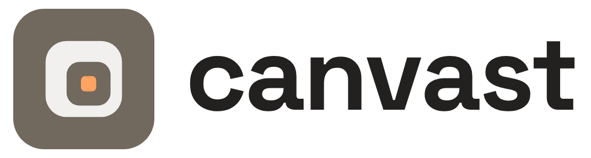
  </picture>
</p>

<h3 align="center">An endless canvas for drawing and references</h3>

<p align="center">One HTML file, or a desktop app for Linux. It works offline, with no account.</p>

<p align="center"><a href="https://emarpiee.github.io/canvast/"><b>Try it in your browser</b></a> · <a href="https://github.com/emarpiee/canvast/releases/latest/download/canvast.html">Download canvast.html</a></p>

<p align="center">
  <a href="https://github.com/emarpiee/canvast/actions/workflows/tests.yml"></a>
  <a href="https://github.com/emarpiee/canvast/actions/workflows/ci.yml"></a>
  <a href="https://github.com/emarpiee/canvast/releases/latest"></a>
  <a href="LICENSE"></a>
  <a href="#installation"></a>
</p>


*Thirty seconds of canvast: the zoom through the showcase file below, from 30 levels out to one million levels in, recorded in the app, then a few of its features.*

**An offline-first endless canvas.** Pan in any direction and zoom in or out without ever reaching an edge or a zoom limit. Draw, write, place pictures, video and audio, and edit at whatever scale you reach. canvast is **one self-contained HTML file** that runs from your disk, and a **Linux desktop app** whose workspace is a folder of ordinary files: no server, no account, no network connection.

- **Endless in every direction.** There is no minimum or maximum zoom and no border. A line drawn at one scale stays sharp at any other, and what you drew a thousand zoom levels ago is still there when you come back.
- **Yours, on your machine.** In the browser everything is saved in the browser's own storage; in the desktop app, in a folder you choose, as plain files any sync or backup tool can see. Nothing is uploaded, ever. Back up to a single `.canvast` file whenever you like.
- **Made for projects, with a Library for what they use.** Storyboards, mood boards, references, sketches: from a small board to a very large one. Pictures, video and files you place are kept in the Library, where you can tag, sort into folders, search and reuse them. In the browser the library lives in the browser's storage, which has a size limit; the desktop app keeps it on your disk (see [Limitations](#limitations)).
- **One file, or a desktop app.** Copy `canvast.html` anywhere (a folder, a USB stick) and open it, or install the desktop app on Linux (see [Installation](#installation)).

## Contents

**Using canvast**

1. [Features at a glance](#features-at-a-glance)
2. [Installation](#installation)
3. [Getting started](#getting-started)
4. [Try the showcase](#try-the-showcase-powers-of-two)
5. [User guide](#user-guide)
6. [Keyboard and pointer reference](#keyboard-and-pointer-reference)
7. [Settings and accessibility](#settings-and-accessibility)
8. [Your data: saving, backups, the workspace folder](#your-data-saving-backups-the-workspace-folder)
9. [Privacy and security](#privacy-and-security)
10. [Limitations](#limitations)

**For developers**

11. [How it works](#how-it-works)
12. [API and file formats](#api-and-file-formats)
13. [Building from source](#building-from-source)
14. [Testing](#testing)
15. [Releasing and project scripts](#releasing-and-project-scripts)

**Project**

16. [Platform support](#platform-support)
17. [Contributing and support](#contributing-and-support)
18. [Notes from the developer](#notes-from-the-developer)
19. [Licence](#licence)

---

## Features at a glance

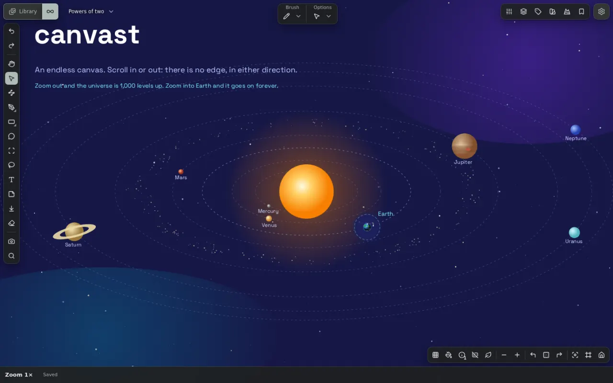

| Area | What you get |
| --- | --- |
| **Endless canvas** | No edge and no zoom limit in either direction; exact positions at any depth; bookmarks, tours, camera travel between far places, search, and stepping from item to item. [Navigating](#navigating) |
| **Drawing** | Pressure pens, shapes, Bézier paths, node editing, vector networks, boolean shapes, fills (gradients, pictures, repeated objects with variation), outlines, 39 pattern generators, SVG in and out. [Drawing](#drawing) |
| **Colour** | One OKHSL / OKHSV / OKLCH colour picker for everything, gradients, palettes (`.gpl`, `.ase`, `.aco`, `.ggr`) and linked styles. [Colour and styles](#colour-and-styles) |
| **Text** | Rich text stored as Markdown, imported fonts (variable fonts too), text on a path, notes, sharp letters at any zoom. [Text](#text) |
| **Pictures and media** | Pixel-exact pictures, non-destructive adjustments and shadows, crop, flip and masks; video, audio and GIFs play on the canvas. [Pictures, video, audio and other files](#pictures-video-audio-and-other-files) |
| **Organizing** | Layers, groups, sheets that clip, masks, snapping, align and arrange, tags, Reveal for things under others. [Organizing](#organizing) |
| **Notes** | A notes editor for markdown, text and rich text notes, in the library and beside the canvas: Obsidian-style `[[links]]`, properties and `#tags` that can be searched, sorted and shown as columns, templates, layouts, cards on a canvas that lay out their page at the size you give them. [The Library](#the-library) |
| **Library** | Every imported file once, with folders, tags, favourites, descriptions and properties, similar-image search, a viewer and safe deletion. [The Library](#the-library) |
| **Privacy** | Hidden items and passwords; in the desktop app hidden files are encrypted, and can be decrypted outside the app. [Privacy and security](#privacy-and-security) |
| **Export** | PNG, WebP, JPEG, SVG and PDF from sheets and selections; `.canvast` backups of everything. [Exporting](#exporting), [Backups](#backups) |
| **Your data** | Saved as you work, verified, never uploaded; in the desktop app a plain folder that any sync tool can carry. [Your data](#your-data-saving-backups-the-workspace-folder) |

---

## Installation

canvast comes in two forms. Both are the same app; they differ in where your work is kept.

| | Browser version | Desktop app (Linux) |
| --- | --- | --- |
| What you download | `canvast.html`, one file | A package: AppImage, `.deb`, `.rpm` or `.tar.gz` |
| Where your work is kept | The browser's own storage (IndexedDB) | A folder you choose, as ordinary files |
| Library size | Limited by the browser's storage quota | Limited by your disk; a library of a million files opens (its index on this device is a SQLite database) |
| Hidden items | Hidden behind a password, not encrypted | Encrypted on disk |
| Updates | Download the new file | The AppImage updates itself; see [Updating](#updating) |

To look around first, [try it in your browser](https://emarpiee.github.io/canvast/) (see [Trying it online](#trying-it-online)). Everything to download is on the [latest release](https://github.com/emarpiee/canvast/releases/latest). Each release's notes list its **Features** and its **Fixes** separately, and every file has its SHA-256 beside it.

### The browser version

Download [`canvast.html`](https://github.com/emarpiee/canvast/releases/latest/download/canvast.html) and open it in a modern browser: double-click it, or use *File → Open*. No installation and no web server are needed, and it works with no network connection. Keep the file wherever you like; moving it to another folder keeps your data (see [Where the data lives](#where-the-data-lives)).

### Trying it online

[emarpiee.github.io/canvast](https://emarpiee.github.io/canvast/) opens the same single file as the latest release, so you can try canvast without downloading anything. Once loaded it makes no network requests, like the downloaded file.

- Your work is kept in this browser's storage for that web address, apart from the work of a downloaded `canvast.html`. To move it to the downloaded file (or back), export a backup in one and import it in the other (see [Backups](#backups)).
- The online copy changes to each new release by itself. For work you want to keep, use the downloaded file or the desktop app and make backups.

### The desktop app (Linux)

canvast is **Linux-first**: Linux is where the desktop app is made, tested and shipped. There are no Windows, macOS or Flatpak builds and none is planned for now; the desktop shell is Electron and keeps platform details in one place, so other platforms remain possible later.

Each release has these packages, for 64-bit PCs (`x86_64`) and ARM64 machines (`aarch64`), named `canvast-X.Y.Z-<arch>.<format>`:

| Format | For | Install | Updates |
| --- | --- | --- | --- |
| **AppImage** | Any distribution | `chmod +x canvast-X.Y.Z-x86_64.AppImage`, then run it (or add it with an AppImage manager such as Gear Lever) | By itself, through an AppImage updater (below) |
| **`.deb`** | Debian, Ubuntu, Linux Mint and others | `sudo apt install ./canvast-X.Y.Z-x86_64.deb` | Install the new `.deb` the same way |
| **`.rpm`** | Fedora, RHEL, openSUSE and others | `sudo dnf install ./canvast-X.Y.Z-x86_64.rpm` (openSUSE: `sudo zypper install`) | Install the new `.rpm` the same way |
| **`.tar.gz`** | Anywhere, without installing | `tar -xzf canvast-X.Y.Z-x86_64.tar.gz`, then run `canvast` in the unpacked folder | Unpack the new one in its place |

The `.deb` and `.rpm` install the app under `/opt/canvast` with a menu entry, the command `canvast` and its icon. Every package is started on a fresh workspace folder before it is released (the `.deb` and `.rpm` are checked for their files and menu entry), and the `aarch64` packages are built and started on an ARM machine. On first start the app asks for a workspace folder: an empty folder starts a new workspace, a folder with `.canvast/` in it opens that one.

### Checking a download

Each file has a `.sha256` beside it. With both in one folder:

```sh
sha256sum -c canvast-X.Y.Z-x86_64.AppImage.sha256
```

### Updating

| You use | To update |
| --- | --- |
| The browser version | Download the new `canvast.html` and open it from the same place. Your work stays: it is in the browser, not in the file |
| The AppImage | It carries its update address, so an AppImage updater (Gear Lever, AppImageUpdate, or AppImageLauncher's update) finds a newer release by itself and downloads only the parts that changed (zsync). The app never checks for updates or goes online itself |
| The `.deb`, `.rpm` or `.tar.gz` | Install or unpack the new release's package. There is no package repository yet, so the system's own updates do not include canvast |

Your workspace folder is never touched by an update.

### Uninstalling

Remove the app the way you installed it (`sudo apt remove canvast`, `sudo dnf remove canvast`, or delete the AppImage or the unpacked folder). Your workspace folders stay where they are. The app's own working copy and settings on this device are in `~/.config/canvast/` (`%APPDATA%\canvast` on Windows, `~/Library/Application Support/canvast` on a Mac); removing the app never deletes it, so delete that folder too to remove everything. An AppImage also may leave an entry in your launcher if an AppImage manager added one. Readable copies of hidden items opened in another app (`canvast-opened-…` in the temporary folder) are deleted when the app closes; a crash leaves them until the next start, or until the system clears its temporary folder. The app removes, by itself, the working copies of workspaces it no longer opens once they are a month old. For the browser version, delete the file and clear the site data of `file://` pages in the browser (for the online copy, the site data of `emarpiee.github.io`); this deletes the work kept there, so export a backup first.

### What the desktop app keeps on this computer

Outside your workspace folders, in the app's data folder (above):

| What | Where | Holds |
| --- | --- | --- |
| A working copy of each workspace | `Partitions/`, `library-db/`, `library-looks/` | Boards, canvases and the library, so the app opens fast. Hidden items' pictures and thumbnails are encrypted there; their names, tags and notes are readable there unless *Keep hidden items' names off this device while locked* is on (Settings > Privacy) |
| Recent workspaces | `workspaces.json`, `partitions.json` | Their folders' paths |
| Hidden items opened in another app | the system's temporary folder, `canvast-opened-…` | Readable copies, deleted when the hidden items are locked, when the app closes, and at the next start |

**For full privacy:** turn on *Keep hidden items' names off this device while locked*; leave *Remember the Hidden password* off; lock the hidden items before leaving the computer (closing the app locks them); avoid *Open in default app* for hidden items (the other app may keep its own copy or recent-files entry); use your system's disk encryption; and remember that a backup keeps hidden items encrypted while a ZIP of files or an exported folder does not. Settings > Privacy shows the same list.

### Building from source

```sh
git clone https://github.com/emarpiee/canvast.git
cd canvast
npm ci               # Node.js 26.4 (see .nvmrc) and npm
npm run build        # → dist/canvast.html
npm run build:all    # also the desktop packages in dist-package/ (needs zsyncmake and rpmbuild)
npm run build:appimage   # or only the AppImage (needs zsyncmake)
```

See [Building from source](#building-from-source) for what each step needs and makes.

---

## Getting started

### Your first minutes

| To do this | Do this |
| --- | --- |
| Draw | Press `P` and drag |
| Add a shape | Press `U`, choose a shape, drag on the canvas |
| Write | Press `T`, click, type |
| Add a picture, video or audio | Drag the file onto the page, paste it, or use the Import button |
| Move around | Drag with the middle button, hold `Space` and drag, or use two fingers; scroll the wheel to zoom |
| Go back to the start | Press `0` or `Home` |
| Find any command | Press `Ctrl/⌘+K` |
| Undo | `Ctrl/⌘+Z` (undoing a delete brings the items back selected) |

The info bar at the bottom left shows the zoom level and position. Click the zoom, type a level (`3000`, `2^-500`, `10^900`) and press Enter to jump there.

### Terms

| Term | Meaning |
| --- | --- |
| Canvas | One endless surface you draw on |
| Board | A group of canvases (a project, a topic). The board and canvas menu (the name at the top left) switches between them |
| Workspace | Everything you have: all boards, canvases and the library |
| Object | Anything placed on a canvas: a stroke, shape, path, text, picture, video, audio, GIF or file card |
| Library | The shared store of every imported file. Each file is stored once, and objects on any canvas are *instances* of it |
| Sheet | A shape that holds other objects and cuts them at its edge; the unit you export |
| Zoom level | `z` means 2^z screen pixels per world unit. Level 0 is the starting scale |

---

## Try the showcase: powers of two

[`showcase.canvast`](showcase.canvast) is a journey through **one million and one thousand zoom levels** on a single canvas. Each scene is hidden inside a speck of the one above it, so you can get from one end to the other with nothing but the mouse wheel:

| Out (zoom out from home) | In (zoom into Earth) |
| --- | --- |
| The Solar System (home, level 0) | Earth, the Moon and a rocket (+5) |
| The heliosphere and the Voyager probes (−9) | An island with a reef and two boats (+12) |
| The Sun's neighbourhood, every star within 20 light years (−18) | A tree, seen from above (+19) |
| The Milky Way, with *You are here* (−27) | A leaf, its veins and pores (+25) |
| The Local Group: Andromeda, Triangulum, the Magellanic Clouds (−32) | Plant cells and their nuclei (+32) |
| The observable universe and its cosmic web (−40) | DNA (+40), a carbon atom (+47), its nucleus (+54) |
| Other universes, **1,000 levels up** | Inside a proton (+60), the Planck length (+116) |
| | Universes again at **+1,000**, and a last scene **one million levels down** |

To open it: click the save indicator at the bottom left, choose **Import archive…** and choose the file (or drop it on the page). Open the canvas *Powers of two*, then either scroll, or open **Bookmarks** and press **Play the bookmarks as a tour** (`→` and `←` step through its 19 stops).

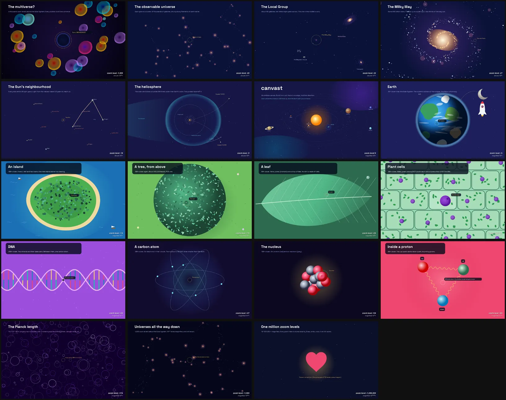

| | |
| --- | --- |
| 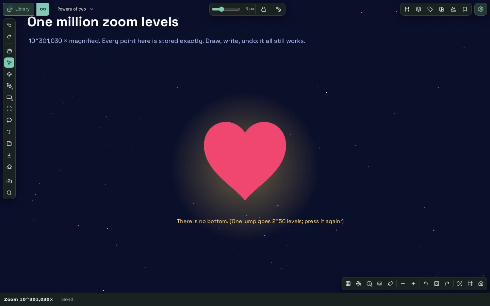 | 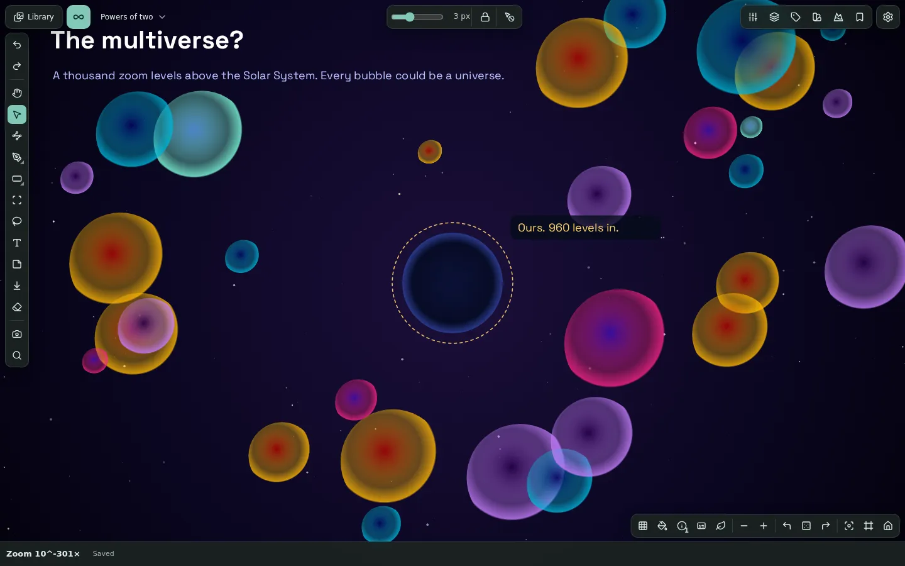 |
| One million levels down: 10^301,030× magnified, still exact and editable | 1,000 levels up: our universe is the ringed bubble |

How the showcase and its pictures are made is in [Releasing and project scripts](#releasing-and-project-scripts).

---

## User guide

### Navigating

- **Zoom** with the wheel, a trackpad pinch, `+` and `−`, or the on-screen buttons. The point under the pointer (or between your fingers) stays where it is.
- **Pan** with the middle button, `Space`+drag, the Hand tool (`H`), two fingers, `Shift`+wheel or the arrow keys. Dragging objects near an edge of the view pans it too, the nearer the edge the faster, and what is dragged stays in view; only what is bigger than the view, or was already past its edge, goes beyond it (**Pan at the edge while dragging** in Settings > Navigation turns this off, and **Edge panning speed** sets how fast).
- **Boards and canvases:** the board and canvas menu (the name at the top left) switches between them. It and *Place on…* have a search field, *Find a board or canvas*; with more than four boards, each is folded to its name except the open one (click a name to unfold it).
- **Return** to the origin with `0`, `Home` or the house button. *Previous view* and *Next view* walk back and forth through where you have been; the dice button takes you to a random empty place.
- **Orientation aids:** a hierarchical grid, the axes and the position in the info bar show where you are, even very deep.
- **Bookmarks** save a place and a zoom, with a small picture of it.
  - Rename, update, move or delete one from its ⋯ menu, or drag a card to reorder the list.
  - The check-mark button saves a bookmark that brings the selected things into view (the camera stays where it is).
  - `Alt+1`…`Alt+9` go to the first nine; `]` and `[` to the next and previous (changeable in Shortcuts).
  - A **tour** plays them in list order: the bars fade, `→` and `←` step, `Esc` ends it. With *Tour: wait at each stop* (Settings) it moves on by itself.
  - Getting to a bookmark is a glide; a far one zooms out from here and in to there (see *Camera travel* below).
- **Search** (`Ctrl+F`) finds objects by name, tag or bookmark. Combine words with space or `AND`, `OR`, `XOR`, `NOT`, parentheses and `"phrases"`. `/` searches names only, `#` tags only, `@` bookmarks only. Searches that found something are remembered, and a help card lists the syntax.
  - **Saved searches:** the save button in the box keeps the search typed (pressed while it is saved; press it again to remove it). In the library a saved search also keeps its layout, columns and sort, in the same list; its update button in the sidebar gives it the ones shown now. With the box empty, the eight used last are listed above the recent ones, with how many more there are; while typing, the saved searches that hold the words typed are offered, so a long list is found by typing. The canvas search and the library search each keep their own list (up to 200 each), on this device, and it travels in a workspace backup with the other settings.
  - **Keywords:** `kind:` (picture, video, gif, audio, note (a note's card), text, stroke, shape, sheet), `group:name` (in a group of that name), `in:name` (on a sheet of that name), `fill:red` and `stroke:#2563eb` (the colour of the fill or the outline; `colour:` either), and `is:locked`, `is:masked`, `is:offscreen`, `is:tagged`, `is:named`, `is:rotated`, `is:grouped`.
- **Step through items** with `W` `A` `S` `D`: the nearest in view (when you are zoomed in on an item and nothing is near enough on the screen, the nearest of its size that way, however far), the nearest anywhere, by layer or by name A to Z (each either among the items in the window or among all of them; `W` and `A` go back, `S` and `D` on). On arriving, focus on the item or keep the zoom. `F` brings the selection into view; press it again to fit everything.
- **Jump anywhere:** click the zoom in the info bar and type a level. One jump can travel up to 2^50 levels.
- **Camera travel** (Settings → Navigation) is how the view gets to a bookmark or a previous view.

  | Style | What it does |
  | --- | --- |
  | *Fly* | One continuous path. When one place is in view of the other (nested views, a bookmark you can see), it is one zoom in or out at any depth. Farther apart, up to 20,000 zoom levels away, it zooms out until both places are about a view apart, crosses over and zooms in, so you see the way |
  | *Glide near only* | Flies to near places and cuts to far ones |
  | *Cut* | Always arrives at once |

  - **Timing:** the time can grow with the distance (up to *Longest trip*) or stay fixed; *Travel time (base)* sets a short trip's length. Easing is smooth, linear or ease-out. A key or a drag ends the glide.
  - **Very far trips** (more than a view apart and over 20,000 levels away) zoom out 24 levels from here and in to there, with a brief dip to dark at the switch (*Fade at the switch*, on by default).
  - The tour has its own travel speed.
  - **Reduced motion:** with Animation set to None the view always cuts. When the system asks for reduced motion the view cuts too and says so once, unless *Follow the system's reduced motion* is off.

| | |
| --- | --- |
| 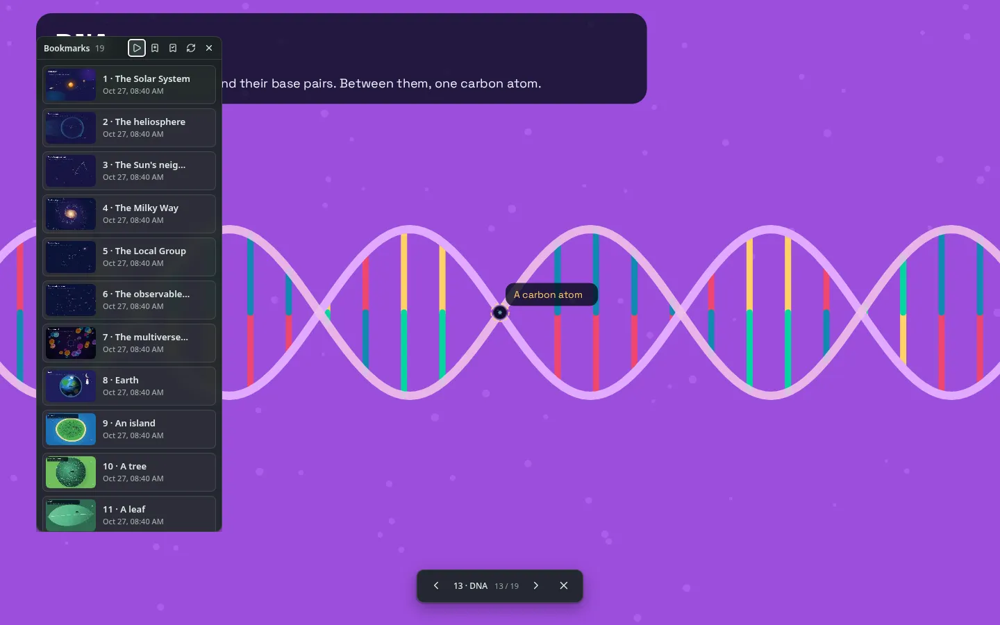 | 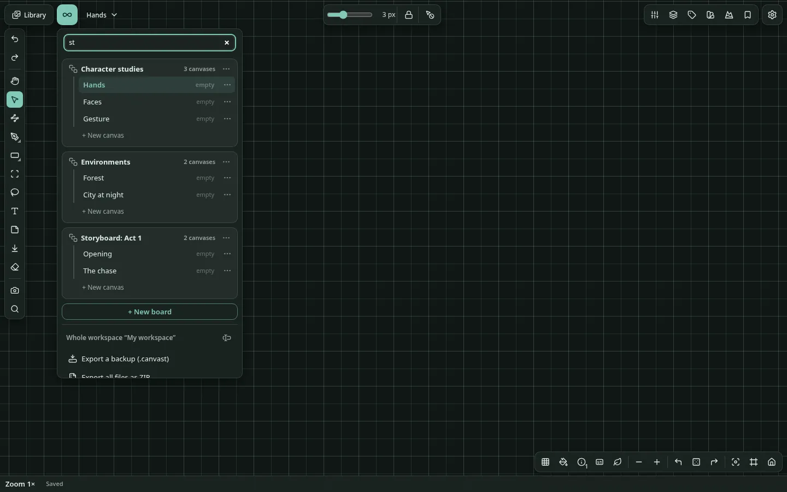 |
| A tour of the bookmarks | The board and canvas menu, searched |

### Drawing

- **Pen** (`P`): four pens (fine, pencil, ink, marker) with pressure, tilt and a stabilizer. Size is 0.5–128 px. A stroke is made at the current scale, so a 3 px line drawn deep in a zoom is a 3 px line there, and it stays vector-sharp at every magnification. *Thickness lock* keeps strokes the same width on screen at any zoom.
- **Shapes** (`U`): rectangle, ellipse, line, polygon and star. Sides, points, ratio and per-corner radii stay editable after drawing.
- **Paths** (`B`) and **Edit nodes** (`N`): Bézier curves with handles, snapping, a lasso for several nodes, and node editing across several paths at once. *Simplify* fits a curve to a rough path; *Pen stroke to path* converts a stroke.
- **Fill and outline**
  - Fills: solid colour; linear, radial or angular gradient; a picture; or other objects of the canvas repeated over the shape (*Objects*, which follows those objects live as you change them).
  - A repeated fill can **vary each copy**: turn it (up to ± an angle, or in whole steps), size it, move it in its cell, mirror some, leave some cells out, and copy each object on its own (in turn or shuffled) or the whole arrangement. A seed gives the same copies every time; *New seed* gives others.
  - New shapes have no outline: set a width (or move the Outline width slider off its left end) to add one.
  - Outlines have a position (inside, centre, outside), corners, ends, dashes, arrow heads and a sharp-corner limit, and can be a gradient.
- **Combine shapes**
  - Union, intersect, subtract and exclude stay editable until you flatten them.
  - *Divide* and the *Shape builder* split overlapping shapes.
  - *Fill gaps* fills every empty place the selected shapes close in (with the Shape tool's fill, under them); *Fill a gap…* fills the ones you click, one by one. A slit narrower than a few pixels (4 by default, in Settings) counts as closed, and the fill stops at it.
  - *Outline stroke* turns a line into a shape, *Taper* gives a line a varying width, and *Corner smoothing* rounds corners continuously.
- **Vector networks:** paths that meet at vertices, with the regions between them filled. Edges are split where they cross.
- **Initial state:** *Set*, *Update* and *Reset to initial state* remember a shape's geometry (and, by default, its fill and outline) so you can experiment and go back. *Apply rotation* makes a shape's current turn its new zero.
- **Eraser** (`E`): removes whole objects (optionally whole groups), or trims strokes in scissors mode.
- **Names on the canvas:** a sheet, picture, video or file card shows its name above its top-left corner; any other item shows its layer name while selected. Where the names of selected items would overlap (a group selected whole, a sheet and what is on it), only the outermost is written, as design tools write the name of a frame or group and not of every layer in it.
- **Pattern** (the mountain button) makes vector patterns.
  - **39 generators** in six families (Waves, Blobs, Soft, Lines, Tiles, Fields), shown as small pictures: Ripple, Tides, Drift, Bubbles, Glow, Grain, Stripes, Halftone, Tiles, Contours, Cells, Flow, Marble, Maze and more. Each has its own settings (counts, sizes, angles, colours, solid or outline) and a background you can hide.
  - **Where it goes:** select a sheet (the result goes on it) or a closed shape (it becomes the clipping mask that holds the result; its fill and outline come back on *Release*), or let it make a new sheet. With several sheets or shapes selected, it makes one pattern on each.
  - **Making it:** *Generate* makes the result, and every change after that replaces it live. The whole session is one undo step until *Done*.
  - **Seeds:** *Randomize* picks random settings and a new seed (a snowflake on a setting keeps that setting); *New seed* keeps the settings, and says when the seed changes nothing. Type or drag a seed to make a result again. The regular generators (Stripes, Tiles, Halftone and the like) have a *Looseness* setting; at 0 they stay exact.
  - **Afterwards:** the result is a group of ordinary editable shapes that remembers its settings. Select it later and the panel shows them; changes replace it in place. Resizing its sheet makes it again to fill the new size (it stretches while you drag).
- **SVG:** paste SVG text to get editable paths (gradients, including a radial one sized by its own transform and an angular one written as a CSS conic gradient box, dashes, transforms, `<use>`, symbols and clip paths, which become clipping masks), or make a vector copy of an SVG picture. Export shapes as SVG, copy them as SVG text, or save them to the library as an SVG picture.

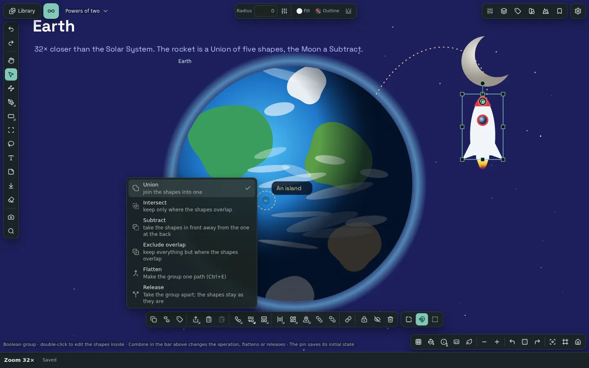

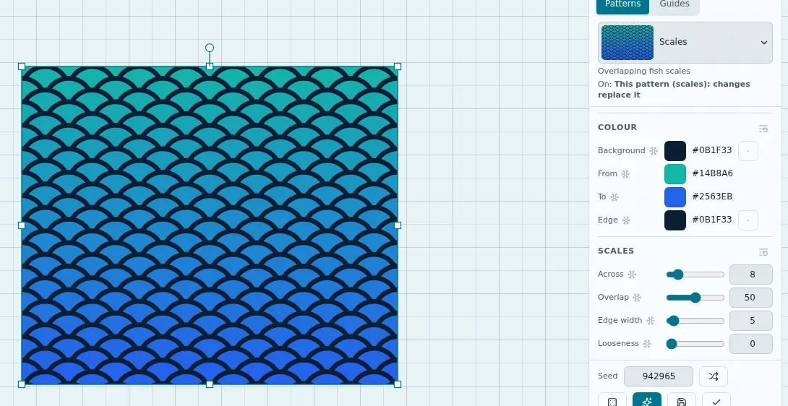

### Colour and styles

- **Colour picker:** one picker for every colour. Choose OKHSL, OKHSV or OKLCH (CSS `oklch()`'s own lightness, chroma and hue); a ring and box, a plane with a hue bar, or sliders; text as hex or another format. It also has an eyedropper, recent colours and saved colours. A number changes by dragging its name left or right; with `Shift` it snaps to round steps worked out from its range (steps of 5 for 0–100, 10 for 0–255).
- **Gradients:** linear, radial and angular, with stops you drag on the canvas, a *Randomize* button and a gradient map for pictures.
- **Palettes:** *Palette from a colour* builds harmonies, and a palette can be taken from a picture. Palettes and gradients can be imported and exported as `.gpl`, `.ase`, `.aco` and `.ggr` files.
- **Styles panel:** saved colours, gradients, text styles, adjustment stacks and patterns.
  - An object painted with a saved style is **linked** to it and follows when the style changes. A change by hand, or *Detach*, unlinks it.
  - A pattern style keeps a generator with its settings and seed (*Save as a style* in the Pattern panel saves or updates it). Pressing its card puts it back in the Pattern panel and makes it on what is selected (on each of several selected shapes).
  - **Copy** a colour, gradient or palette card with a long press or right click (a palette as CSS variables; a colour inside an opened palette as hex), or with *Copy hex* / *Copy as CSS* in its More menu. A long press copies without applying.
  - **Paste** CSS (a colour in any notation, or a gradient) with the pointer over the panel or nothing selected, and it is saved as a new style.

| | |
| --- | --- |
| 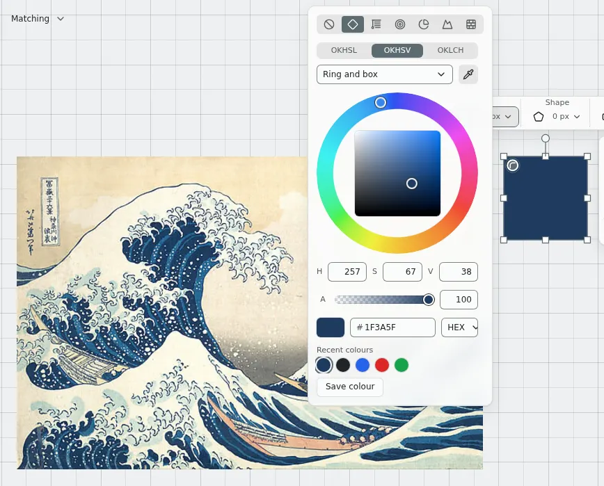 | 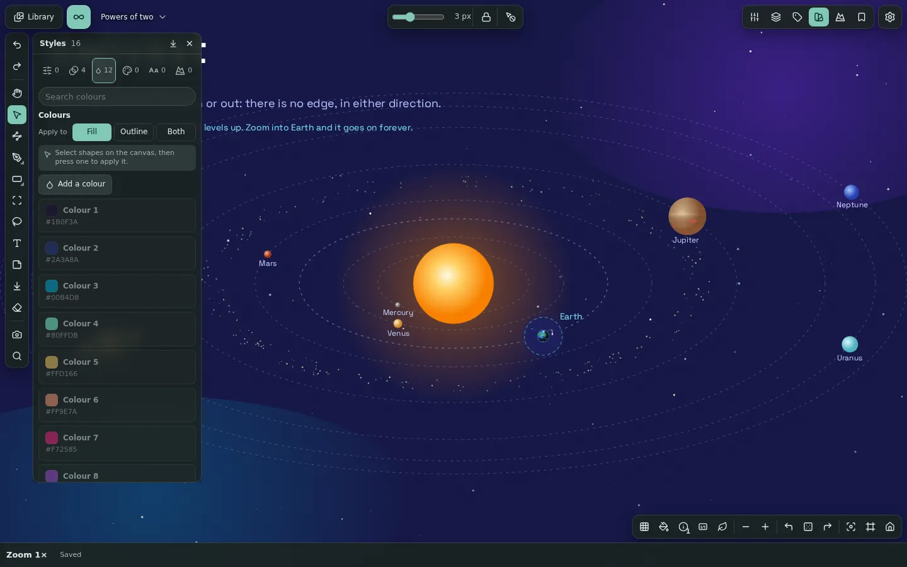 |
| The colour picker, opened from a fill | The Styles panel: saved colours, gradients, text styles, adjustments and patterns |

### Text

- **Text** (`T`): click and type. A click makes a text as wide as its words; a drag makes a box of that width. Double-click to edit.
- **Formatting:** bold, italic, underline, strikethrough, links, colour and size of any range, headings, bulleted, numbered and nested lists. Text is stored as Markdown; **Copy Markdown** is one click away.
- **Look:** colour or gradient, outline, size, line height, letter spacing, alignment, auto or fixed width, paragraph spacing, indent, case, line limit, a set height, kerning, OpenType features and the axes of variable fonts.
- **Fonts:** import `.ttf`, `.otf`, `.woff` or `.woff2` into the library, including variable fonts. One text may use several fonts. Right-to-left and mixed-direction text are supported.
- **Text on a path**, and **Text to path** (`Ctrl+E`) to turn letters into editable outlines.
- **Notes** (`M`): the Note tool makes a markdown note in the library's Notes folder, places its card where you click and opens it in the Note panel (see [Notes](#the-library) in the Library). A text can still sit on a coloured card (its box options); **Make note files** turns such texts into notes.
- **No zoom limit:** zoom into a letter as far as you like; the font's real outlines are drawn.

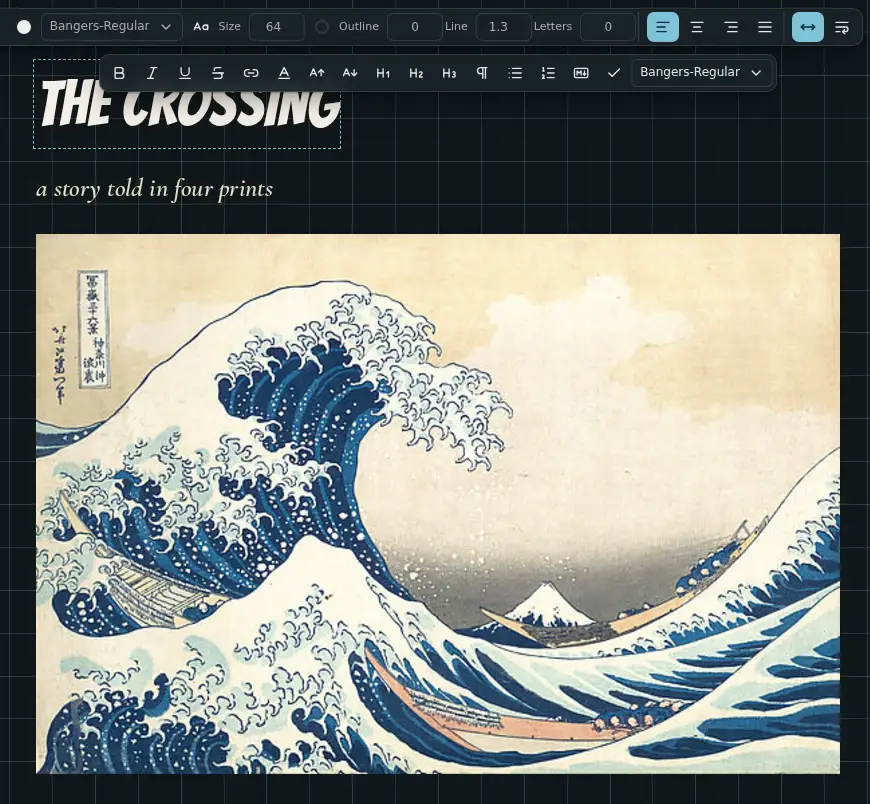

### Pictures, video, audio and other files

- **Pictures** are placed one source pixel to one screen pixel. Zooming in shows real pixels; nothing is invented and the file is never altered.
- **Adjustments** are non-destructive stacks you can reorder, hide and copy between pictures, video, GIFs, shapes, pen strokes and texts: exposure, contrast, highlights, shadows, temperature, tint, saturation, vibrance, red/green/blue, levels, curves, gradient map, blur, sharpen and grain.
- **Crop**, **Flip horizontally** and **Flip vertically** (mirrored in the same box; **Reset flip** turns it back), rounded corners and an outline work on pictures, video and GIFs. On a flipped picture, crop cuts the side you drag. A picture can be masked by a shape, by opacity or by brightness, or by a brush mask painted with the Pen.
- **Drop shadow and inner shadow** (Adjust panel), for pictures, shapes, strokes and texts: opacity, across, down, blur, spread and a colour each.
  - A new shadow starts soft and a little below. Each group of adjustments has a *Reset* button.
  - Offset and blur are shares of the object's own size (an offset of 100 is a tenth of it), so a shadow looks the same at any zoom.
  - A picture's pixels are not touched; its shadow is drawn beside it. A playing video shows no shadow (its paused frame does).
- **Adjustments on shapes, strokes and text** apply to the object as drawn (fill, outline, gradient and texture together).
  - A blur is a share of the object's size, so it does not change with zoom (far inside an object it stays at most about 330 px wide).
  - Exporting a selection leaves room for a blur or a drop shadow.
  - An exported SVG carries them as a filter on the shape, and making the SVG into shapes again brings them back. A vector PDF draws such a shape as a picture instead (see Limitations).
- **Make a new picture** bakes the crop, flip and adjustments into a new library item; **Copy as picture** puts the result on the clipboard. **Copy** and **Paste adjustments** move a whole stack between items. **Make vector copy** turns an SVG picture into editable shapes in its place, at its size, turn and layer (one undo step; the file stays in the library). **Show in library** opens the Library with the file selected.
- **Media player:** videos, audio and animated GIFs play on the canvas with a player right under the item. It has play and pause, a seek bar, step back and forward (seconds for video and audio, frames for GIFs), repeat, playback speed, volume, a waveform for audio, and a start and end to play only part of a file. The paused frame is saved. Playback continues when the item scrolls out of view.
- **Extract frame** turns the current frame of a video or GIF into a picture in the library (PNG, WebP or JPEG). Settings name it, file it in a folder and tag it, optionally placing it on the canvas.
- **File details:** EXIF, colour profile and codec information are shown. STL and OBJ 3D models and PDFs are kept as cards with a preview; any other file is kept as a card with its extension and can be downloaded again.
- **Import** by button (in the Library the Import button has a menu for files or for a whole folder), drag and drop, paste, or a whole folder. Files up to 256 MiB are accepted and decoded before being stored. A file the library already has is not stored again; imported into the Library under another name, the app lists the old and new names and offers to rename (in hidden mode, for hidden items only). Importing your originals again this way brings back names that were cut short; Undo puts the old names back.

| | |
| --- | --- |
| 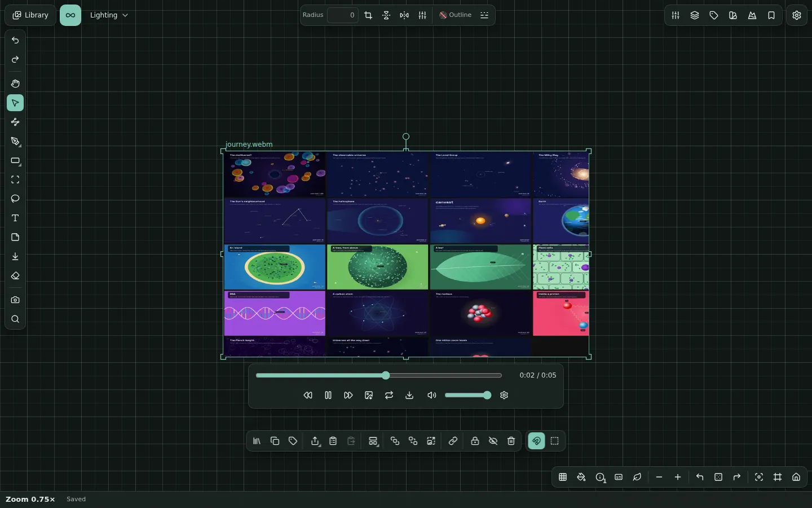 | 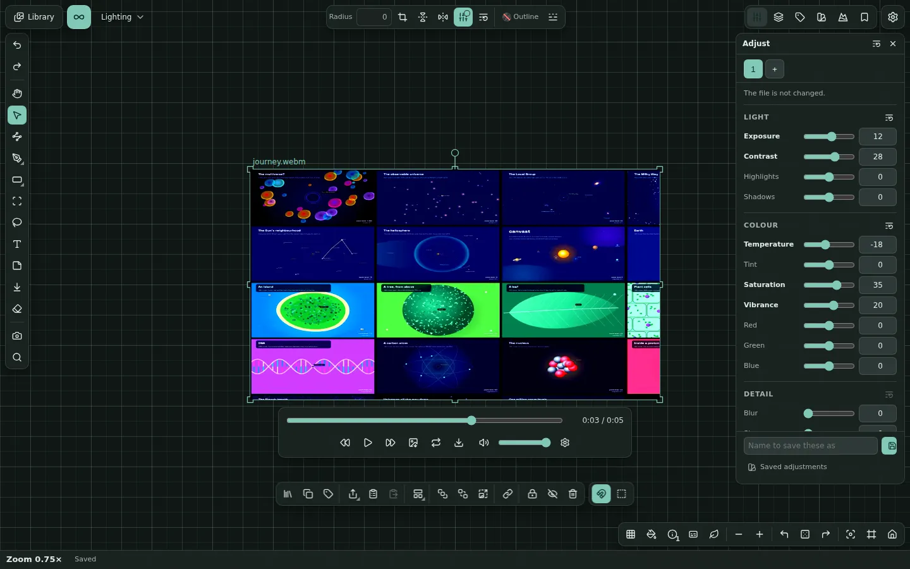 |
| A video playing on the canvas, with its player | The Adjust panel: the file itself is not changed |

### Organizing

- **Layers panel:** group and nest, rename, hide, lock, re-stack, set opacity and blend mode, rotate. Select with `Ctrl` (toggle) and `Shift` (range).
- **Sheets** (`C`): a sheet clips what it holds and has a ratio rather than a size (see [Shapes, sheets and masks](docs/reference/shapes-sheets-masks.md)).
  - Drawing a sheet over objects puts the ones wholly inside it on the sheet, in one undo step (ones it only crosses stay out).
  - *Put the selection on a sheet*, *Fit to contents*, *Release* and *Turn on its side*.
  - Ratio presets: `16:9`, `A4 portrait`, a number, or a size in px (`2000 x 1920` becomes `25 : 24`).
  - Each object on a sheet has pins per axis (left, right, both, centre or scale) that decide what it does when the sheet is resized; *Scale contents* resizes everything with it.
- **Masks:** a clipping mask (a sheet of any shape), a mask by opacity or brightness, or a brush mask painted in black and white with the Pen. Masks can be inverted, selected on their own and released. A click on a mask selects it as one unit; a double click goes inside.
- **Snapping:** moving, resizing, turning, dragging a node and dragging a gradient's handles snap to other things, with guide lines (the magnet button turns it off).
  - Boxes line up by their sides and middles.
  - Shapes snap by their geometry: a corner onto another corner or the middle of a side (a ring marks it), a corner onto any side (curves too), a straight side flush along a nearly parallel one (the side is drawn).
  - Turning brings a corner round to another, or a side parallel to a nearby one.
- **Arranging:** align, distribute, arrange in a grid (by name, date, size or type), copy, cut, paste, duplicate; `Alt`+drag copies. A group (also a boolean group) counts as one thing; its shapes line up with each other only when you select them one by one (in Layers, or inside the group).
- **Tags** on the selection, with a Tags panel listing every tag and its count. Renaming or deleting a tag applies to every canvas.
- **Reveal** finds things hidden under others.
  - Hold `Ctrl` and move over the canvas: the outline of everything under the pointer shows, with their names in a list beside it.
  - `Ctrl`+click selects exactly that thing, even deep inside a group, mask or sheet. On a revealed outline you get the thing it belongs to, even under a filled shape; elsewhere you get the top thing (`Ctrl`+`Alt`+click goes down the stack).
  - In the list of names, move onto a row (its outline turns strong): `Ctrl`+click selects it, `Ctrl`+`Shift`+click adds or removes it. Selected ones are ticked.
  - A selected thing moves when you drag from anywhere inside it, even under other things. A click without moving still selects the top thing.
  - A sheet is ground: dragging on a selected sheet draws a selection box (hold `Ctrl` to move the sheet).
- **Hide and lock:** *Show all hidden* and *Unlock all* bring everything back.
- **Kind chips:** with a mixed selection, chips at the start of the Actions bar (All, Pictures, Media, Shapes, Strokes, Texts) narrow it to one kind.

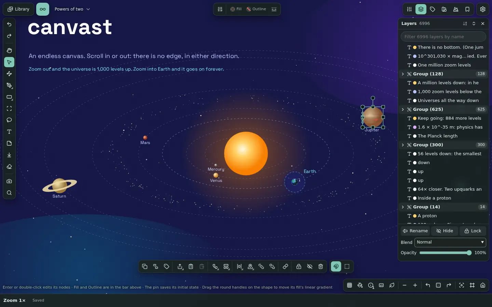

### The interface

- **Tool rail** (left): Undo and Redo, the tools (Import after Note), then Screenshot and Search.
- **Properties bar** (top): the options of the tool or of what is selected.
  - The colours of a selected pen stroke, or of several selected things, show as chips; changing a chip changes that colour everywhere it is used.
  - Pasting CSS with shapes selected sets their fill: a gradient (`linear-gradient(...)`, `radial-gradient(...)`, `conic-gradient(...)`) or a colour (hex, `rgb()`, `hsl()`, `oklch()` and the other CSS notations, or a name such as `rebeccapurple`).
  - In the colour picker, a long press (or right click) on a swatch or saved gradient copies it without choosing it. Copying the hex field includes the `#`; pasting one drops it. The Styles panel copies the same text (a colour as hex, a gradient as CSS).
- **Actions bar:** what can be done with the selection, grouped in menus (Align, Arrange, Shapes, Masks, Path tools, Sheets, Export, Initial state) that list only what applies.
  - It sits at the bottom or follows the selection (Settings).
  - When wider than the window it shows a fade and an arrow; the mouse wheel scrolls it sideways.
- **Panels** (Layers, Bookmarks, Tags, Styles, Adjust, Pattern) float or dock to either side, are resizable, and can minimize when inactive. *Reset the panel layout* puts them back.
- **Command palette** (`Ctrl/⌘+K`) runs any command by name, takes a value where one is needed (`@kind` narrows the list), and records and replays **macros**.
- **Context menus** open with a right click, the menu key, or a long press on a touch screen, at the pointer (to its left when there is no room), and list what fits where you are:

  | Where | What it offers |
  | --- | --- |
  | On something on the canvas | The commands for it. On a picture, *Rename* renames its file in the library (a layer with a name of its own takes the new name) |
  | On empty canvas | The canvas commands. A long touch first lists what is under the finger |
  | On a library item | Its details-panel actions, plus *Copy*, *Copy file name* and *Paste* |
  | In the viewer (the picture, or a picture of the filmstrip) | The same as on a library item, for the one shown (or that picture of the filmstrip) |
  | On empty library ground | *Select everything*, *Paste*, the imports, *New folder*, *Slideshow* and the details panel |
  | In Settings | A setting's reset; a shortcut's key actions |

  The viewer has no context menu.
- **Zen mode** (`Z`, or the leaf button) fades the bars and panels until the pointer is over them.
- **Screenshot** (camera button) saves the selection, or the whole view, to the library. Settings choose the format, quality, name, folder and tags. They also choose whether to include the canvas pattern and the interface, a transparent background, and a copy on the clipboard.
- **Info bar** (bottom left): the zoom, position and save state. *Information shown* switches between simple and technical (exact zoom as a power of two, frame rate, diagnostics). The bottom-right buttons cycle the canvas pattern (grid and others) and the item names (always, when selected, hidden).
- **Hint line** (bottom): what the tool does, and what each key does over a handle.
- **Notices** report results, often with a *View* button that opens what was made. They fade after a time that fits their length (an error stays to be read), and stack above the Actions bar, never over it.
- **Long work** (exporting, importing, opening a library, moving files, deleting everything) shows a notice with a progress bar and its current stage, which stays until the work ends and then says the result.

| | |
| --- | --- |
| 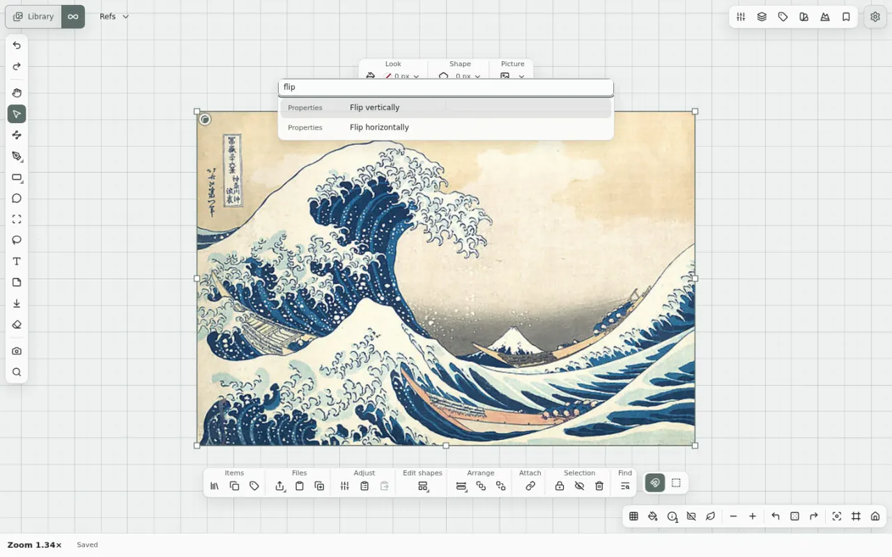 | 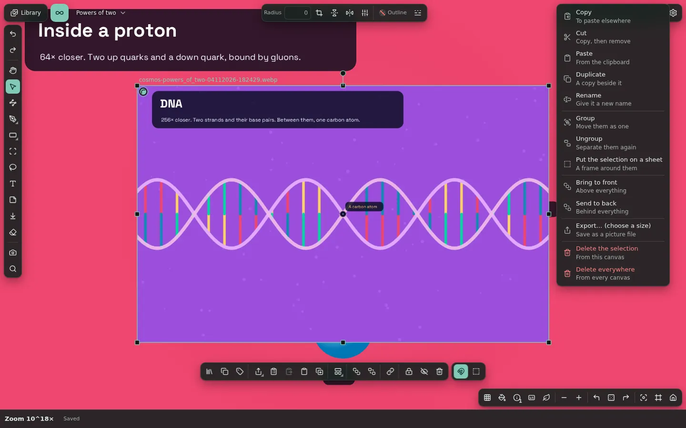 |
| The command palette | The context menu of a selected picture: its commands in groups, with *Rename* for the file in the Library |

### The Library

Switch between **Canvas** and **Library** at the top left. The canvas keeps its view, selection and undo history while you are away.

- **The gallery:** every imported file with its size, type and usage (*4 uses · 3 canvases*), with search, filters by file type, and sorting.
  - **Grid or list.** In the list, drag a column header's edge to resize it (double-click for its usual width). **List columns** also adds any **property** as a column by its name (`status`, `created`); a click on its head sorts by it, as the Sort menu's *Properties* do: dates by date, numbers by number, and items without it last either way. Columns, widths and the thumbnail size are kept.
  - **The sidebar's sections** (Folders, File types, Tags, Canvas tags, Saved searches) and **the details panel's** (a note's or file's information, Tags and Folder, Properties, Linked from, Where it is used) can be reordered by dragging their heads, or with `Alt+↑` / `Alt+↓` on a section's name. A double-click on the name at the top of the details panel renames the item.
  - **Filters** (Show, Sort by and its direction, the sidebar's list) are kept over a restart; the funnel-with-a-cross button resets them, and it is coloured while one is on. While a search or a filter hides items, a chip over the grid says what and how many are shown, with **Show all items**.
  - **Thumbnails** are made in the background after an import, so the grid fills in on its own. A font shows "Aa" in its letters (on the canvas too); selected, its details show a sample sentence, and the viewer shows it at four sizes with the alphabet and digits.
  - **Search keywords** (the help card beside the box lists them, each with an example): `width>1000`, `height<`, `pixels>2mp`, `size<5mb`, `ratio:16x9`, `orientation:portrait`, `colour:blue`; `kind:` (picture, video, audio, gif, font, file; and by what a file is: note, vector, document, archive, 3d, preset, icon, art); `is:` favourite, used, unused, missing, filed, unfiled, tagged, untagged, thumbed (has a custom thumbnail), unthumbed; `uses>2` and `canvases>1`; `date:2026-10` (also a day or a year, `today`, `yesterday`, `week`, `month`, `year`, and `date>` / `date<` for after and before); `on:name` (placed on a canvas or board of that name); `folder:`, `description:`, `property:source` or `property:source=web`, and by what a property says: `property:created>2025-01`, `property:rating>=4`, `property:status>m` (dates, numbers, or the alphabet; any item of a list counts; `note:` and `field:` mean the same); `duration>30s` (`2m`, `1:30`). They combine with words and operators: `kind:video duration>1m -is:used`. A search can be saved with the button in the box (see *Saved searches* under Navigating); in the Library it also keeps the look of the library at that moment (grid or list, columns, sort), is listed under **Saved searches** in the sidebar, and one click brings back the search and its look, so a saved search works as a view: `kind:note property:type=Zettel`, sorted by `created`. While a search, a section of the side panel or *In use* / *Unused* hides items, a chip over the bottom of the grid says so (*Showing 12 of 340 items: Unused · Refs*); its **Show all items** clears them all, as does the coloured reset button beside the sort while any filter is on.
  - **Back to top:** the arrow in the status bar, once you have scrolled down.
- **Dragging items** shows up to five of them stacked, with their count. Drop them on a folder, a tag or Favourites in the sidebar to file them, or on the strip across the top to place them on the open canvas (the library stays open).
- **The status bar** along the bottom (the same as the canvas's) shows how many items are listed (*3 of 5 items*), how many are selected and their size, and the size of the whole library. At its right end: grid or list, the list's columns, and the thumbnail size.
- **Open in default app** (desktop app; in the details, the right-click menu, and a file card's Actions bar on a canvas) opens an item's file in your system's app for that kind of file: for a file canvast cannot show, or to edit a picture elsewhere.
- **Copy** (`Ctrl+C` in the library and its viewer, or the menu): a picture goes as a PNG, also a GIF's first frame and an SVG drawn, which the message says; only the first of several pictures fits. A markdown or rich text note goes as markdown with its properties on top, a plain text note as its words, several notes joined. A video or sound goes as its library picture. Any other file, or a picture the app cannot draw (TIFF, HEIC, PSD), goes as its name, which the message says. **Copy file** (desktop app; the same menu and a right click on a canvas) puts the real files on the clipboard, of any kind, to paste in a file manager. On a canvas, `Ctrl+C` on one note card gives the note's words and pastes back as the card; other objects give a picture of them, as ever, and paste back as themselves.
- **Show in file manager** (desktop app; in the details of one item, and its right-click menu) opens the item's folder in your system's file manager with its file selected. A hidden item has no *Show in file manager*; *Open in default app* (in hidden mode, after asking once per session) opens a readable copy written to the app's own temporary folder, deleted when the hidden items are locked or canvast closes. Copying a hidden item to the system's clipboard asks first, once a session: other programs can see and keep what is there. Outside hidden mode, hidden items' property names and values are never offered as suggestions, columns or sorts.
- A **viewer** with filmstrip, zoom, pan, slideshow and a details panel. The details show where an item is used (*Used on 3 canvases (4 times)*, then each canvas with its own count; past five canvases, **Show all** lists the rest), and **Show** takes you to it on the canvas at any depth. A button switches the background behind the picture, the controls can be hidden, and a double tap opens it on phones. The button beside the details button (or `F`) hides and shows the controls; with them hidden, the picture gets their room. A video or GIF plays with the canvas's player, floating over the bottom of the picture: while the pointer rests, playing or paused, the player fades away (after *Hide the player* in Settings > Library, 1.5 s by default), also with the pointer resting on it; only a move of the mouse, a click or a touch brings it back, never a key. While the focus is in the player (click any part of it, its empty space too; also once it has faded), `Left` and `Right` step the file and `Space` plays or pauses it; elsewhere in the viewer the arrows go to the previous and next file. A GIF whose frames were never counted (imported long ago, or taken from a workspace folder) gets the player too.
- **Notes** open in the viewer in a full notes editor ([SunEditor](https://suneditor.com)): markdown (`.md`, `.markdown`), plain text (`.txt`) and the app's own **rich text notes** (`.note.html`). **New note** (the Import menu) makes a markdown note in the open folder (else in the **Notes** folder, whose name is set in Settings > Notes) and opens it. On a canvas, the **Note tool** (`M`) does the same where you click (drag a box to set the card's width; a click makes it as wide as *Note tool card size*). A new note is named by *New note name* (Settings > Notes; `Note {yyyy}-{mm}-{dd} {hhmmss}` at first), which is also its title: the note goes in the Notes folder, its card is placed there and it opens in the Note panel. Texts on a card (what the Note tool made before notes were files; a card is also one of a text's box options) become notes with **Make note files** in their Actions bar: the same place, width and stacking, the words in a `.md` file named by its first line.
  - **The `/` menu**, in every editor style: type `/` at the start of a line or after a space, then words to find a command (headings, lists, quote, code, table, picture, link and more).
  - **Editor style** (Settings > Notes): *Document* (pages, every tool; the default), *Classic* (one short toolbar row, the rest behind its **+**), *Bottom* (the same, below), *Balloon* (the toolbar only over selected words), *Notion-like* (a handle beside each block).
  - **On a canvas:** double-click a note's card (or **Edit note** in its Actions bar) and the note opens in the **Note** panel: the same editor and saving as in the library, in the style of *Editor style on a canvas* (Settings > Notes). *Note editor on a canvas* chooses where: **Panel** (the default) or **Window**, centred over the canvas until it is closed (a click beside it closes it, asking about unsaved changes). The panel is a panel like Layers (it never folds): it floats, docks to a side (keeping its own width), its width and height can be dragged, and the canvas stays usable beside it. ✕ closes it (asking about unsaved changes); the card shows the saved version at once. Saving is no step of the canvas's undo: undo and redo on the canvas keep the saved version (they never bring an older one back). The rename button in its header (or F2) renames the note with the library's rename dialog; the extension stays as it is, and `.note.html` counts as one extension there and in batch rename. A hidden note opens there only while the hidden items show, and closes (its changes saved) as soon as they no longer do: hidden mode ended, the hidden items locked.
  - **Pasting from Obsidian:** a note copied from Obsidian comes in as a note: its `![[embeds]]` show their pictures when the files are in the library (found by name, wherever they lie; one not there stays as `![[name]]`), and `[[links]]` and footnotes stay as Obsidian writes them. Its properties join the note's own at the next save: tags are added, a key the note does not have (or has empty) is added, and what the note already says stays. Undoing or deleting all that was pasted takes them back; when only properties were pasted, closing the note without saving does.
  - **Links from the clipboard:** select words and paste a web address or a `[[link]]`: those words become the link. The selection's toolbar has the 🔗 link button too.
  - **Remove format** (the eraser in the toolbar over selected words, and in Text ▾) takes sizes, fonts and colours off the words chosen: a heading made bigger or smaller by accident goes back to its own size.
  - **Markdown and Code views** show the note as text; coming back without a change there, the note is as it was (picture sizes, spacing). A change made there is read back from that text, which markdown keeps without sizes or styles.
  - **Numbers drag:** the font size and a picture's or video's width and height change by dragging the field left or right, as every number of the app (a picture keeps its proportion when that is on; a dragged font size applies on release).
  - **Saving is manual** (no autosave while you work): `Ctrl+S` or File ▸ Save. Until you save, your changes live only in the open editor. The note's own file is rewritten in place (in the desktop app, the same file in `library/`, so other programs see it); it keeps its name, folder, tags, note and fields. Leaving a note with unsaved changes asks: *Save them*, *Don't save* or Cancel (or saves without asking, with **Save notes on close** on); so does closing the desktop app's window, and the browser asks before the page is left.
  - **Markdown keeps what markdown can hold:** headings, bold and italic, lists and task lists, quotes, code, tables, links, pictures; coloured or styled words are kept as inline HTML. When a note has formatting a markdown or text file cannot hold (an alignment, a font size, the page layout), saving asks: **Save as a rich text note** (the note becomes `name.note.html` in its place, keeping everything; its folder, tags, links to it and its cards on canvases follow it, and no markdown file is left beside it) or **Save as plain markdown** (that formatting is dropped). Obsidian's own syntax is written as Obsidian writes it: footnotes (`[^1]`), embeds kept as written (`![[picture]]`) and table column alignment (`:---:`). Empty lines and spaces at a line's start are no formatting: they never make it ask.
  - **Settings > Notes:** **Write tags and properties into note files** (off by default) writes what is changed in the library into the file too; off, the file changes only when you save its words, and what its YAML says is still read into the library. **Save notes on close** saves a note's changes on leaving it without asking. **When a note's formatting does not fit its file** answers the question above once and for all: keep its file (`.md`, `.txt`, dropping that formatting) or rich text (`.note.html`). A note whose formatting fits stays as it is.
  - **Pictures, video, sound and files come from the library:** the gallery buttons (Insert ▸ Image gallery, Video gallery, Audio gallery, File gallery, File browser) open the library chooser, and a file uploaded, dropped or pasted into a note is put in the library first. Its own **Import…** button takes files from this device into the library and into the note.
  - **Links** to library items are written as their path from the root of the library (`Pictures/cat.png`, brackets and spaces encoded), whichever folder the note is in. A link is found by the file it names on disk (with **Keep file names** off, a file's name there differs from the item's: `my cat.png` is `my_cat.png`), read from the note's folder, then from the root of the library (`library/Pictures/cat.png` too), then the one item of that name anywhere; so a path relative to the note, written elsewhere, still works, as does `<my cat.png>`, and a copy of an item's file shows that item. The app's own link `canvast:<sha-256>` is read too, and kept as written. The picture dialog shows a picture's link, and a path typed there is found in the library.
  - **Links between notes** (as Obsidian writes them): `[[Plan]]`, `[[Plan|shown text]]`, and `[[Projects/Plan]]` when two items share a name. Type `[[` and the library's notes and files are offered; the one chosen goes in as a link. In the editor a link is an ordinary link: a click puts the cursor in it, **Ctrl+click** (⌘ on a Mac) opens the note or file it points at in the viewer (asking first about unsaved changes). A markdown note keeps them as `[[…]]`; a rich text note writes the path to the item (`../Projects/Plan.md`). Links to web addresses are not opened from a note (the app never goes online). `![[…]]` (an Obsidian embed) is kept as it is written, not shown.
  - **Canvas links:** `[[canvas:Characters]]` (`[[` offers the workspace's canvases too); Ctrl+click opens that canvas.
  - **A look before opening:** the pointer resting on a link shows the preview of what it points at (a note's page, a picture).
  - **Search inside notes:** the library search (All) finds a note by the words in it too (read once per version while searching). The desktop app's paged list of a very large library (20,000 items or more) does not search note words yet.
  - **Linked from:** an item's details list the notes that link to it (by `[[name]]`, a path or `canvast:` link); a name there opens that note. **Renaming or moving** an item in the library writes the links to it in every note again (`[[old name]]` when that name was its alone, a path to its old place), and a note that moved has its own paths written from its new folder; each changed note is saved as a new version.
  - **Properties** (as Obsidian writes them): a markdown note's YAML block at its top (`---` … `---`) is its item's tags (`tags:`), its description (`description:`) and its properties (every other key; a list shows as `a, b`). Importing the note or saving it, here or elsewhere (Obsidian), reads them into the item, and the file wins. Changing its tags, description or properties in the library (the details panel, bulk tags, renaming or deleting a tag, undo) stays in the library, unless **Write tags and properties into note files** is on: then it is written into the file too, as a new version. A `|` or `>` block is read as text with its lines (a value of several lines is edited in a larger box), and written back as it was while it is unchanged. A nested map is kept as written and not shown. The editor shows the note without its YAML. A rich text note keeps the same properties as `<meta>` in its head (`keywords`, `description`, one per field); a plain text note keeps them in the library only.
  - **Property types** (as Obsidian has them): the button before a property's name chooses its type: *Text*, *List*, *Number*, *Checkbox*, *Date* or *Date & time*. A type belongs to the name, for every item with that name. A name with no type of its own takes one from its value (`4` a number, `true` a checkbox, `2025-01-31` a date, `2025-01-31T10:30` a date and time; `aliases` and `cssclasses` are lists); editing such a value keeps that type for the name. A checkbox is a box to tick and a date a picker. A **list** is a row of items, each kept whole (a comma is part of an item): Enter adds what is typed, × or Backspace in the empty box removes, dragging moves one, and it is a real YAML list in the file. A value that does not fit its type is **never changed**: it stays as it is in a plain box, marked in red with what the type expects, also while it is typed. In the file (with **Write tags and properties into note files**, when a value changes) a checkbox is written as a bare `true` or `false`. `tags` and `description` have their own places in the panel and no type button. In a narrow panel a property's value has a line of its own under its name, and a long value wraps, so neither is cut.
  - **What a save may change by itself** (Settings > Notes), all off by default, so a note changes only as you change it; plain text notes are left alone:
    - **Automatic created and modified:** both properties are always there, not editable or removable in the details panel (also before the first save). A save writes the time into modified, and into created when the note has none (from when it came into the library). Their names (`created-on`, say) and the **Date and time format** (`YYYY-MM-DDTHH:mm`) are settings; sorting and date searches need the numbers in that order.
    - **Title:** *First heading*: a save writes the first H1 into the title property, which is then not editable or removable there. With no H1 the title stays.
    - **Rename notes on save:** a save names the file from **File name comes from** (*First heading* or *Title property*), in **File name style**: *Keep as written* (only what a file cannot hold changes: `My Note: Part 1` → `My Note- Part 1.md`) or *Clean* (`my_note-part_1.md`), the two rules of Keep file names, used for these notes in its place. The links to it in other notes follow, and it is a step of the library's undo (the next save renames it again). Turning it on renames nothing until a note is saved. With nothing to name it by (no heading or title, or only marks such as `# ???`) the name stays; when another note has the name first, the file and the item end in `-2`, and stay so until the name wanted changes. In the desktop app with Keep file names off, a note named as written has a tidy file until its name next changes. It happens when a note is saved in its editor.
    - **Pasted notes:** a title or created pasted with a note is kept over what the note had for that save; modified becomes the time of the save. Links rewritten after a rename do not count as a save.
  - **Copying a whole note** (`Ctrl+A` then `Ctrl+C` or the editor's Copy; **Copy** on one markdown note in the library) copies it as its markdown file, with its properties as YAML at the top, as the details panel has them, so pasted at the top of an empty note in another app they arrive as properties. It is plain text. Copying part of a note copies that part as before.
  - **#tags in the words** (as Obsidian reads them: `#` then a word with a letter in it, not in code, `#123` and `# Heading` are none) are the item's tags too; typing `#` offers the library's tags. With a YAML block, the item's tags are exactly its `tags:` and its #tags, and taking a `#tag` out of the words takes the tag away at the next save; tags added in the library go into the YAML, never into the words. A note without YAML only adds its #tags.
  - **Changed elsewhere:** if a note's words were changed in another app since it was opened here, saving asks before putting your version in their place.
  - **Task lists:** click a box to tick it; it is saved as `- [x]`. A task shows its box only (no bullet).
  - **Templates** (Insert ▸ Template; `{{date}}`, `{{time}}` and `{{title}}` in one are filled in: today, now, the note's name) insert a block at the cursor: *Meeting notes*, *To-do list*, *Journal entry*, *Reference sheet*, then **your own**: any note in the library tagged `template` (an existing note, or a New note you write for it) is listed by its name, its pictures and links pointing at the same library items.
  - **Layouts** (Insert ▸ Layout): *Two columns*, *Three columns*, *Sidebar and main*. A layout takes the place of the whole note (`Ctrl+Z` brings the note back), and markdown cannot hold columns, so a note with one is saved as a rich text note.
  - **Labels on cards:** **Note cards show properties** (Settings > Notes) takes names separated by commas (`status, type, tags`): their values show as small labels at the top of each note's card and library picture, at once. They say what the details panel says, written into the file or not, and change as soon as a property does.
  - **Previews:** a note's library card and details show the top of its page (headings, lists, tables, colours); its card on a canvas is its page, laid out at the card's own size and drawn at twice that so it stays sharp when zoomed in. A side handle lays the page out at the new width or height, the words keeping their size; dragging a corner evenly (`Shift`) zooms the whole card. **Note cards show** (Settings > Notes) applies to every card at once: *Whole note* (the default), the height follows the note, also when it is saved longer; *Part*, you set the height and what does not fit fades out into the page's paper. A new version keeps the card's width. **Reset size** in a card's Actions bar puts it back to its Note tool card size. The pictures it links to show in it (also Obsidian's `![[picture]]`), a video by its picture with ▶, a sound by its waveform with ♪, a GIF by its first frame; never a hidden item's. Its text is in the system's font in the preview only. The paper is light or dark as **Preview look** says (Settings > Notes: Auto, the default, follows the app's theme; a change redraws every preview at once, so a note's previews are made when shown, never stored). Shown small on a canvas, a note's card is drawn from a copy at that size.
  - **The title** shown for a note is the file's name (as in Obsidian); a `title:` property is one of its properties (see Automatic properties).
  - **Other apps' folders:** a folder whose name starts with a dot in `library/` (Obsidian's `.obsidian/`, say) is never taken into the library.
  - **Its look is the app's:** the app's font, colours, corners and light or dark theme. A dialog of the editor (Insert image…) opens the library chooser above itself.
  - **Fonts:** the font list is *Inter* (built in; *Default* when words have no font of their own) and the library's fonts (the ones the canvas's text uses), by their family names; files of one family (Regular, Bold…) are one entry. A rich text note names them so, and other apps show them where the font is installed.
  - **Not in a note's toolbar:** New document (it would empty the open note), Print, and the page buttons (page break, page number, previous and next page): a note is a file of the library, not a page to print. Document style still shows its pages.

| | |
| --- | --- |
| 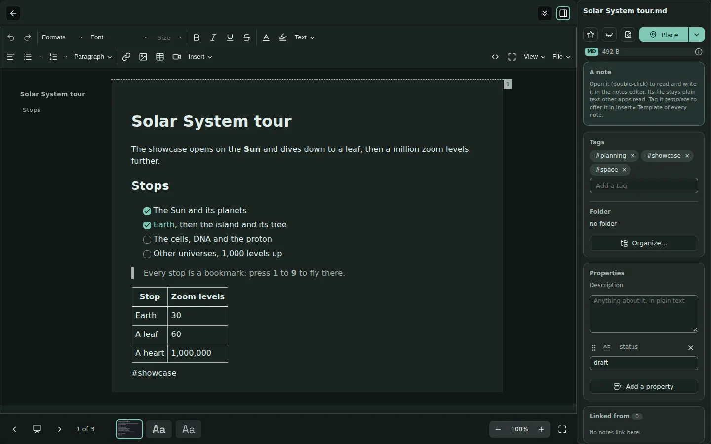 | 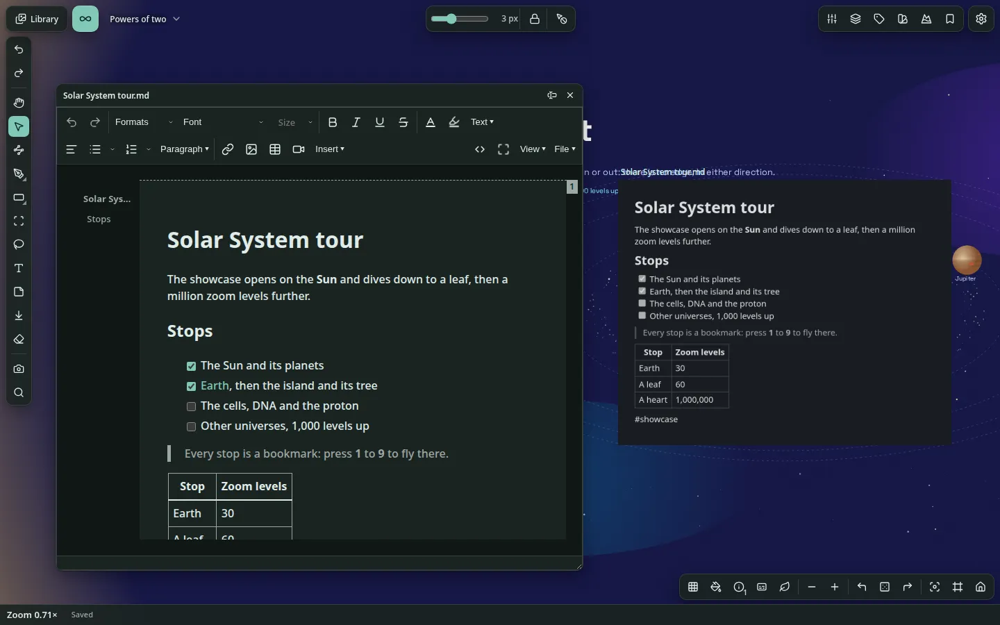 |
| A note in the library's notes editor, its YAML properties as tags and properties | Its card on a canvas and the Note panel |

- **Folders** (an item lives in one folder, folders nest; a long list in the sidebar shows its first rows and **Show N more**, remembered on this device), **tags** (several per item; renamed in one dialog, from a tag's ⋯ menu in the sidebar or a double-click on it in the details), **favourites**, file types, **Similar images** (duplicates and near-duplicates found by their pixels) and **hidden** items, which are kept out of every list and listed only in hidden mode (see [Hidden items and passwords](#hidden-items-and-passwords)).
- **Quick filters:** a file type or a tag in the sidebar lists only those items; `Ctrl`+click (`⌘` on a Mac) adds another type or tag to the filter, or takes it out: any of the types chosen and any of the tags chosen.
- **Custom thumbnail** (the picture button beside ★ and Hide in the details panel; **Thumbnail…** for several selected): what the Library shows for an item instead of its own picture, also for a file with no preview (a font, a 3D file, a document), and what its card shows on a canvas. Choose one uploaded or pasted before (**Uploaded thumbnails**, with how many items use each, and **Delete an uploaded thumbnail…**), another item's picture (**From the library**), **Upload a picture** or **Paste a picture** (kept small, 512 px, in its own place: never a library item; `Ctrl`+`V` while the dialog is open pastes at once), or **Original** (its own picture again). Changing it can be undone. In hidden mode an uploaded one is a hidden thumbnail: listed and shown only there (normal mode never sees it), sealed with the hidden items' key in the desktop app. Hiding an item takes its uploaded thumbnail with it (sealed, unless shown items use it too); showing it again makes it normal.
- **Export folder…** (a folder's ⋯ menu) writes the folder's files and those of its subfolders, under their names in the library: as a ZIP, or in the desktop app as a folder where you choose (outside the workspace), either keeping its folders (from the folder itself down) or with all the files together (two of the same name are numbered). Each file written to a folder is read back and checked against its SHA-256. In hidden mode it exports the hidden items in it, written readable after you confirm; outside hidden mode, only the shown ones.
- **Selecting and the details panel**
  - A click selects an item. The details panel opens and closes with its button (or `I`) and shows what is selected (for several: their tags and folder together). A click never moves the grid under the pointer.
  - When the grid is laid out again (the panel toggled, the window or thumbnails resized), the selected item stays where it is on the screen.
  - `Ctrl+A` selects all shown; a plain click then selects one alone. `Ctrl`+click adds or removes, `Shift`+click takes a range. A selected item shows a coloured border (no checkboxes).
  - **Select several** (a card's menu: right click, or a long touch on a phone or tablet): from then on each tap or click adds an item or takes it away, until nothing is selected or `Esc`. The way to pick several without a keyboard.
  - Selected items hidden by a search or filter are counted in the panel, with a button to keep only the shown ones.
  - The *Details* fold (the file's own metadata) stays open or closed as you left it.
- **Drag items onto the sidebar:** onto a folder to move them into it, onto *Unfiled* to take them out of their folders, onto a tag to tag them, onto *Favourites* to mark them; a selected item carries the whole select.
- **Undo in the library:** `Ctrl+Z` undoes the last change to tags, favourites, folders or names (`Ctrl+Shift+Z` or `Ctrl+Y` redoes), up to 50 steps; deleting from the library has its own safety (files are kept while undo on a canvas can need them).
- **Tags and folders of several items at once**
  - The details panel lists every tag any of them has, with how many have it (*2/4*). **×** takes a tag off all of them; **+** puts it on the rest.
  - The tag field suggests the library's tags and takes several at once, separated by commas.
  - Each folder shows how many of them it holds (a mixed selection has none ticked); *New folder for these…* makes one and moves them into it.
  - Changes to hundreds of items are one write, so they take a moment, not minutes.
- **Properties** (the details panel of one item): every kind of file has them. A markdown note's are its YAML (see *Properties* under Notes), a rich text note's its `<meta>` tags; every other file's stay in the library, and the file itself never changes.
  - **Description:** a plain-text box (not Markdown).
  - **Add a property** adds a row with a name you choose and its value: `link` and an address, `author`, `source`, `licence`… Names already used in the library are suggested, and so are the values others of that name have (the most used first, each item of a list on its own).
  - Each is saved when you leave it or press `Enter`. **×** removes a property; the grip at its start moves it (drag it, or press `↑` / `↓` on it). `Ctrl+Z` undoes.
  - The library search (All) finds words in descriptions and in properties; see *Search keywords* for the rest.
  - Descriptions and properties travel in backups and in the library index. Importing keeps an item's own description (the backup's fills an empty one) and adds the properties it does not have yet.
- **Rename** one item or many at once, with a preview: number them, replace text, add text or change the extension. Renaming one item edits only the name before the extension (it stays, so it cannot change by accident); *Change the extension too* opens the whole name.
- **Copy and paste** with the system clipboard: *Copy* (the menu, or `Ctrl`+`C` over the library) puts the picture, as a PNG, alone on the clipboard (a name beside it would be pasted instead of the picture by many programs); *Copy file name* puts the name as text; a file that is not a picture is copied as its name. *Paste* brings a picture from the clipboard in, named by the text beside it when there is one and it is a file name, else `image`.
- **Export** items as a `.canvast` archive, download files, or export all files as a plain ZIP sorted by file type or by folder.
- **Safe deletion:** the details panel has one **Delete…** button.
  - An unused item is deleted from the library.
  - An item in use is deleted everywhere, after a confirmation that says where it is used (the first three canvases and how many others). Its instances are removed from every canvas first; a text using it as its font keeps its words in the default font.
  - Undo brings them back on the open canvas, not on the others.
  - A file is erased only when nothing, undo included, can bring it back.
- **Missing files** (for example after clearing site data, or a file taken out of the library folder) are flagged with their usage; importing the same file again restores every instance.
- **Library folder** (browser version, Chromium only): keep the library's files on your disk instead of in the browser's storage, so its size is limited by your disk.
  - **Set it up** in Settings > Storage with *Choose library folder…*. Files are named by their content and keep their extension (`a07c9f….png`), so other programs can open them. *Move into folder* and *Move back to browser* move what is already there.
  - **The library index** (`.canvast-index`, a hidden file beside the files) is the whole workspace without the files: boards, canvases, objects, names, tags, folders, descriptions, properties, styles, settings. It is saved by itself shortly after each change (a checkbox turns that off; **Save index** saves at once). It is not a backup (a `.canvast` backup holds the files), and not a cache to delete: on another device it is your canvases.
  - **On another device**, choose the same folder: you are offered to open its index (**Open index** does it later). The canvases are added and every file is matched by name. Do this on a device with no canvases of its own yet, or they are added twice.
  - **After a restart** the browser asks for permission again: press *Reconnect folder*.
  - **Leave the files alone:** don't move, rename or edit them, as canvast finds each by its name. Files kept before extensions were added get one with *Add extensions* on the card.

| | |
| --- | --- |
| 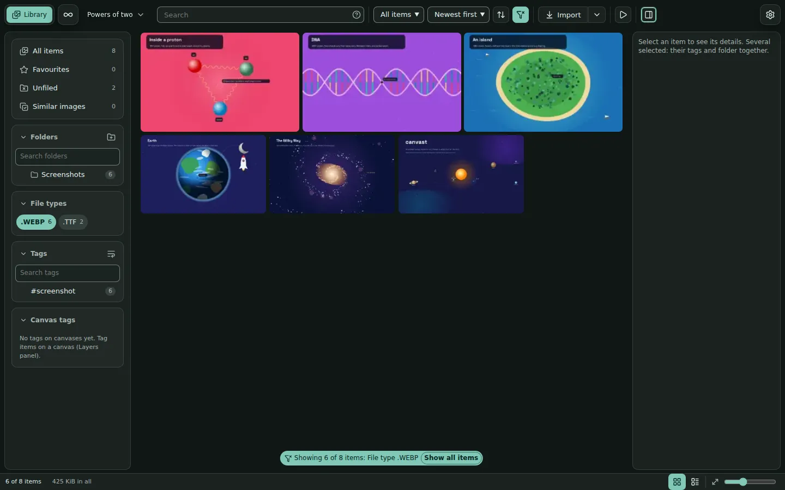 | 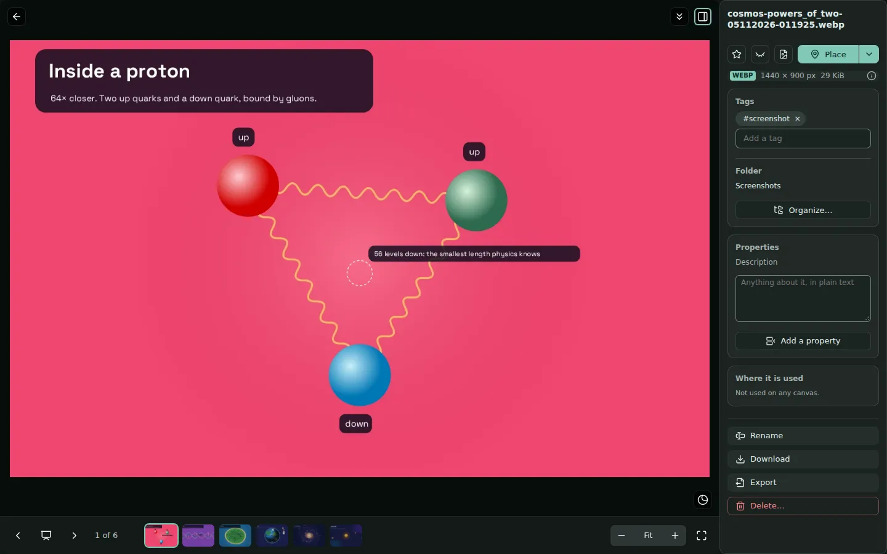 |
| The Library, filled by six screenshots of the showcase (shown by file type: the showcase also carries its two font files) | The viewer with its filmstrip and details |

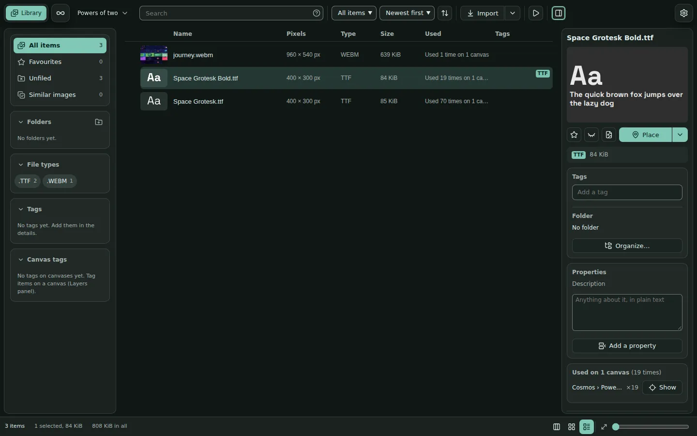

*The list layout with its columns, and a font's sample in the details panel.*

### Exporting

**Copy to other apps.** `Ctrl/⌘+C` keeps the real objects for pasting back here, and also puts a PNG picture on the system clipboard:

| You copy | The PNG is |
| --- | --- |
| Shapes | The shapes as drawn (their SVG text is a separate command, *Copy the selection as SVG*, in the right-click menu) |
| A picture | One PNG at full size, as it looks with its crop, flip and adjustments |
| A GIF or video | The frame it shows |
| A shape with a picture or objects fill, or anything mixed | It as drawn, at most 1024 px on the long side |

- The picture goes alone, with no text beside it (an app offered both often takes the text). Copied texts carry their words too.
- `Ctrl/⌘+X` puts the text only (the shape is gone before a picture could be drawn).
- Browsers cannot put files (audio, PDF) on the clipboard, so those stay in canvast.

**Pasting back in canvast** brings the objects back exactly as they were (links, masks, crop, adjustments, their places relative to each other), under the pointer, as long as nothing else was copied in between. Ending a pan with the middle button never pastes, on Linux too, where a middle click is a system paste. Shapes and texts come back even from another tab; a picture or GIF only while this window keeps the focus (after switching windows it comes back as a new picture; see Limitations). Anything copied in another app is imported as usual: an SVG as shapes, an image as a picture. A paste into a text field, the notes editor, a dialog or a menu stays there: nothing is imported or placed.

**What you export is what you see.**

- Colours, widths and shapes are the ones stored in the document; the theme never changes them, on the canvas or in an export.
- A new shape starts with a fill and no outline (a line and an open path get one, or they would not show). The default ink (for the pen, those lines and a first outline) is near-black on a light canvas and light on a dark one, chosen when the object is made and stored with it. *Change the old default ink to the canvas ink* (command palette) updates older drawings.
- Exports match the canvas in every format, with one exception: **SVG has no angular gradient.** An SVG then holds a picture of it (a PNG up to 384 px a side, cut to the shape) plus the real gradient, which canvast reads back (so *Make vector copy* or pasting the SVG gives it back editable; other programs show the picture). The Export dialog and the SVG saves warn about it.

**Export…** works on a sheet, a picture or selected shapes.

| | |
| --- | --- |
| Size | From the shape: a width or height in px, in, cm or mm at 72–600 ppi, or a preset (A4, Full HD, a story, the picture's own pixels) |
| Formats | PNG, WebP, JPEG, SVG and PDF. What is on a sheet that clips is cut to the sheet in every format. PNG, JPEG and WebP carry their resolution |
| Background | Transparent, white or black |
| Result | Download it, copy it, or keep it in the library |
| Several sheets | One ZIP, or one multi-page PDF whose pages you can reorder |
| Vectors | Plain shapes are true vectors in PDF and SVG; masks are SVG masks; picture and pattern fills are embedded pictures clipped to the shape |

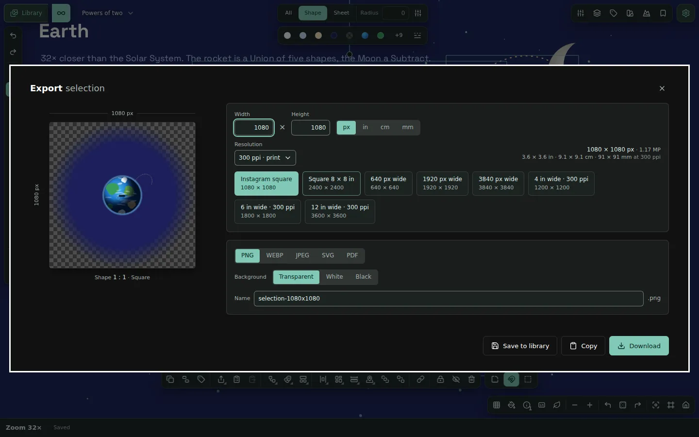

---

## Keyboard and pointer reference

Every shortcut can be changed in **Settings → Shortcuts**: a single key or a chord, with several keys per command, and warnings when a key clashes with another command or the browser. Defaults:

| Action | Input |
| --- | --- |
| Zoom at pointer | Wheel · trackpad pinch · `Ctrl`+wheel |
| Zoom at centre | `+` / `−` (`Shift` = 4× step) |
| Pan | Middle-drag · `Space`+drag · Hand tool · two fingers · `Shift`+wheel · arrow keys |
| Return to origin | `0` · `Home` |
| Tools | `V` select · `P` pen · `L` lasso · `H` hand · `T` text · `M` note · `U` shape · `B` path · `N` nodes · `C` sheet · `E` eraser |
| Undo · redo | `Ctrl/⌘+Z` · `Ctrl/⌘+Shift+Z` or `Ctrl+Y` |
| Copy · cut · paste · duplicate | `Ctrl/⌘+C` · `X` · `V` · `D` |
| Select all · clear · cancel a gesture | `Ctrl/⌘+A` · `Esc` |
| Delete | `Delete` · `Backspace` |
| Group · ungroup | `Ctrl/⌘+G` · `Ctrl/⌘+Shift+G` |
| Put the selection on a sheet · flatten | `Ctrl+Alt+G` · `Ctrl/⌘+E` (text to paths, a boolean group to one path) |
| Bring to front · send to back | `Ctrl/⌘+]` · `Ctrl/⌘+[` |
| Bookmarks | `[` previous · `]` next · `Alt+1` … `Alt+9` go to bookmark 1 to 9 |
| Previous view · next view | `Alt+Shift+←` · `Alt+Shift+→` |
| Command palette | `Ctrl/⌘+K` (`@kind` narrows it; commands can take a value; macros record and replay) |
| Context menu | Right-click the canvas |
| Search | `Ctrl+F` (library: `Ctrl+Shift+F`); on the canvas `#` searches tags, `@` bookmarks, `/` is the command palette and `?` the shortcut list |
| Focus on selection · fit everything | `F` · `F` again |
| Step to next item | `W` `A` `S` `D` |
| Zen mode | `Z` (bars fade out until the pointer is over them) |
| Text editing | `Ctrl/⌘+B` · `Ctrl/⌘+I` · `Tab` nests a list item · `Esc` or `Ctrl/⌘+Enter` finishes |
| Resize | Drag a handle; `Shift` keeps proportions, `Alt` resizes about the middle, `Ctrl` turns snapping off |
| Reset size | **Reset size** in the Actions bar puts the selected pictures, videos, GIFs, sounds and note cards back to the size they are placed at, at the current zoom (one pixel of the file for one of the screen; a note card at Settings > Notes > Note tool card size), about their middle |
| Copy by dragging | `Alt` as the drag starts |
| Layer selection | `Ctrl`+click toggles · `Shift`+click selects a range |
| Jump to a zoom level | Click the zoom in the info bar, type `3000`, `2^-500` or `10^900`, Enter |

**Touch:** two-finger drag pans and pinches zooms; a two-finger tap is undo and a three-finger tap is redo; a long press on Select lists what is under the finger; a resting finger while another drags acts as `Shift`, two as `Alt`. Number fields change by dragging their name.

---

## Settings and accessibility

Open Settings with the gear button. Settings have a *device* scope and a *canvas* scope, can be searched, and reset individually (the undo-arrow icon at the end of a row) or together. Every group has an icon in the list on the left, and the groups are indented under their heading. Device settings travel in a workspace backup and in the library index (see Backups).

Each setting says what it is on one line; **More** under it has the whole explanation, and the search box finds words in both.

| Group | What it holds |
| --- | --- |
| Drawing and selection | Pen, colour picker model and layout, pen width and stabilizer, lasso filter, snapping, align to the selection box, grid spacing for Arrange, initial shape and paint, the distance Fill gaps closes openings by, eraser |
| Navigation | How `W` `A` `S` `D` choose the next item (nearest in view or anywhere, by layer or by name A to Z, in view or anywhere); focus on the item or keep the zoom; camera travel (style, time, longest trip, easing) and the wait at each tour stop; whether dragging near an edge pans the view, and how fast (Pan at the edge while dragging, Edge panning speed) |
| Shortcuts | Rebind any shortcut to a key or a chord; the full list is also on `?` |
| Library | The library viewer: its edges (a click on the left or right goes to the previous or next item), how long the player stays while a video plays, slideshow time |
| Notes | The notes editor's style in the library and on a canvas (each its own, Document at first); on a canvas, Panel or Window; a new note's name (a pattern, as screenshots have) and the width of the Note tool's card; the Notes folder new notes are filed in; light or dark previews (Preview look); whether note cards show the whole note or a part (Note cards show), and which properties they show (Note cards show properties); Write tags and properties into note files; Save notes on close; what to do when a note's formatting does not fit its file |
| Media and playback | Players: starting volume and step sizes |
| Saving to the library | Extracted frames and edited pictures (format, quality, folder, name, tags), and the folder and tags of what is saved to the library from the canvas, one pair for each kind: pictures from Export… (*Exports*, `export`), patterns (*Patterns*, `pattern`) and shapes saved as SVG (*Shapes*, `shape`); screenshots have theirs in the Screenshot group. In the desktop app, Keep file names and Sort files by kind |
| Screenshot | Format, quality, pattern, transparency, interface, clipboard, folder, name and tags |
| Appearance | Theme (system, light, dark), theme colour (or adaptive, from the canvas background), colourfulness, information shown, hints and tooltips, canvas pattern, Actions bar place, item names, density (comfortable, compact, dense), round or sharp corners, Zen mode |
| Panels | Minimize inactive panels, panels kept open |
| Performance | Adaptive quality, fixed quality level, memory for pictures, animation and its speed |
| Storage | Space used and whether the browser keeps the data; the library folder (choose it, move files in and out, the library index and its automatic saving); how saving is going; backups (export, changes only, files as ZIP, import); in the desktop app, where deleted files go and *Delete library files at once*; *Start from scratch* (delete all data, after a warning with a backup offered first) |
| Privacy | The word that begins hidden mode, remembering the Hidden password until the tab closes, and the passwords of the workspace and of the Hidden items; what stays on your machine |
| About and diagnostics | Version and diagnostics |
| Develop | Developer tools (see [Building from source](#building-from-source)) |

- **Accessibility:** controls are keyboard reachable with visible focus; panels have title bars that work by keyboard; status changes are announced to screen readers; the system's reduced-motion preference is honoured and animation can be turned off; colour contrast is audited automatically.
- **Layouts** adapt to large, medium and phone-sized screens, with scroll cues on bars that scroll.

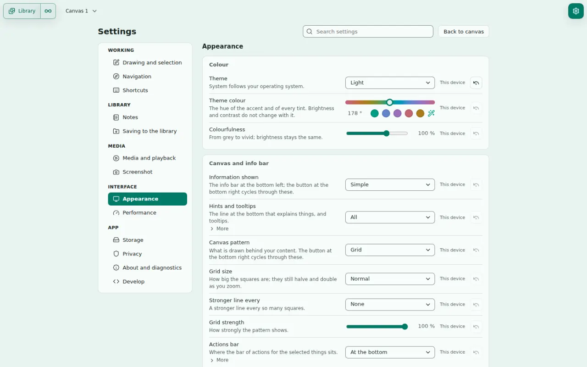

---

## Your data: saving, backups, the workspace folder

### Saving

- Every change is saved automatically within a fraction of a second, with the camera. Only the objects that changed are written, in one atomic transaction, then read back to check.
- The indicator shows *Unsaved changes… → Saving… → Saved → Saved (verified)*. Click it to open **Settings > Storage**: space used, whether the browser keeps the data, the library folder, how saving is going (and this tab's role) and backups.
- Reloading restores the canvas and the view.
- In the desktop app, the workspace folder follows these saves (see [The workspace folder](#the-workspace-folder-desktop-app)).

If storage cannot be opened, canvast keeps working in memory and says so.

### Several tabs

The first tab to open a workspace edits it. Other tabs are read-only, follow its changes live, and offer **Take over**. A stale tab can never overwrite newer data; its save is rejected and reported.

### Backups

- **Export a backup** (Settings > Storage) downloads one `.canvast` file holding every board, canvas, object and view, plus every file once, and your device settings (theme, shortcuts, panel layout). When you import it, only the settings this device has not set itself are restored; the ones you changed here are kept, and the import dialog says how many it will restore.
- A board, a canvas or a single library item can be exported on its own, with only the files it uses.
- **Import archive…** (or drop a `.canvast` file on the page) verifies every checksum first, shows what it contains and any problems, and only then adds the boards and canvases in a single transaction. Nothing existing is replaced and files you already have are not stored twice. Paintings and brush presets in a backup from an older version are left out, and the summary says so.
- A `.canvast` file is a standard, uncompressed ZIP you can open with any unzip tool. Do not re-compress it.
- Backups made in one browser import into another (tested between Chromium and Firefox).
- Incremental backups are available after the first full one.
- A backup asks what to do with hidden items and with the passwords and privacy settings (see [Hidden items and passwords](#hidden-items-and-passwords)); by default they stay out of it. In the desktop app, hidden items included in a backup go into it **still encrypted**, with their key file: nothing of them is readable in it, and importing it in the desktop app brings them back once the Hidden items are opened with their password (the browser leaves them out).

The browser does not say whether a download finished, so keep your backups somewhere safe.

### What can delete data

Only these remove anything:

| Action | What it removes |
| --- | --- |
| Deleting objects | Those objects (undo brings them back) |
| Deleting a canvas or board | It, after a confirmation; this cannot be undone. Pictures placed there stay in the library |
| *Delete…* in the library | An unused file, once undo can no longer need it |
| **Delete all data** (Settings > Storage, *Start from scratch*) | Everything canvast keeps in this browser. It asks first, offers a backup, an export of the files and the library index, and makes you type `DELETE`. Files on your disk (a library folder) stay where they are |

Damaged objects found when loading are skipped and reported, never silently changed.

### Where the data lives

- **Browser version:** the IndexedDB database `canvast`, in the browser's storage for local files (the [online copy](#trying-it-online) has its own, for its web address).
  - Moving the HTML file to another folder keeps your data.
  - A different browser, profile or private window starts empty, and clearing the site data deletes it. This is why regular backups matter.
  - The browser's storage has a size limit, so the browser version suits projects rather than very large collections (see [Limitations](#limitations)).
- **Desktop app:** a folder you choose ([below](#the-workspace-folder-desktop-app)).

### The workspace folder (desktop app)

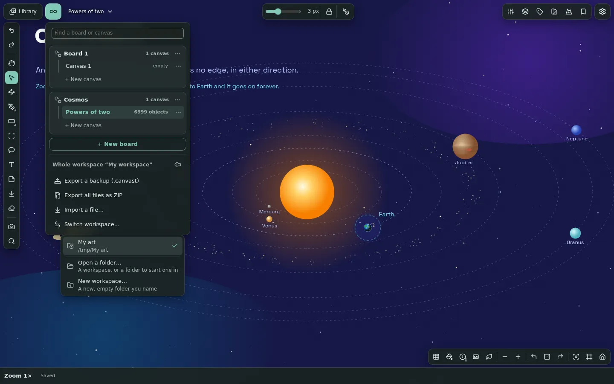

The same workspace on disk, as a file manager shows it:

```
My art/
  .canvast/
    boards/
      board_1/canvas_1.cvst
      cosmos/powers_of_two.cvst
    devices/<device id>.json
    folder.json
    library/index.json, items-00.json … items-ff.json
    library.json
    workspace.json
  library/
    fonts/space_grotesk.ttf, space_grotesk_bold.ttf
    images/deep-zoom.webp, hero.webp, journey.webp
```

In the desktop app your workspace is a **folder of ordinary files** that you choose, so any sync tool, backup tool or file manager can see it. It works offline and loads nothing from the network.

**Switching workspaces.** *Switch workspace…* is in the board and canvas menu (under *Whole workspace*), in Settings > Storage and in the command palette; *File > Open workspace folder…* and *File > New workspace…* do the same.

- It lists the open workspace and the five latest ones whose folders still exist, plus **Open a folder…** (an existing workspace, or any folder to start one in) and **New workspace…** (an empty folder you name). **Clear the recent list** keeps only the open one (no folder is touched).
- A switch writes your last edits into the folder, closes the window and starts the app again on the other folder.
- At start-up the app opens the last workspace. If its folder is gone (moved or deleted), it says so and offers the recent ones, a folder, or a new workspace.
- While a workspace opens, a start screen shows what is being done. Each step and its time also go to the developer tools' console (*View > Toggle Developer Tools*).
- A workspace is open in one window at a time: starting it while it is still closing waits for it, and one open in another window is asked about.

**Closing while files are written.** When the app is still writing many files into the folder (an import's), closing asks first: *Close anyway* keeps your work safe in the app and writes the rest the next time you open the workspace.

| In the folder | What it is |
| --- | --- |
| `.canvast/boards/<board>/` | A board, named after it (lowercase, `_` between words, `-` between parts; `-2` on a clash). Inside the app's own folder, so canvases are not edited by accident |
| `.canvast/boards/<board>/<canvas>.cvst` | A canvas: one JSON file with its objects, frames and bookmarks |
| `library/<folder path>/`, `library/images/`… | The library's files, named after their names in the library: in the folders of their library folders, or when in none, at the top of `library/` or by kind: `images`, `vectors` (svg, eps), `icons` (ico, icns), `art_sources` (psd, kra, xcf, clip, procreate, sai, ai, afphoto, …), `presets` (brushes and swatches: abr, kpp, ase, aco, gpl, …), `3d` (obj, fbx, glb, gltf, stl, blend, …), `video`, `audio`, `fonts`, `notes` (md, markdown, txt, note.html), `documents` (pdf, office files, epub, html, …), `archives` (zip, rar, 7z, tar, gz, …), `other` |
| `.canvast/workspace.json`, `.canvast/library/` | Names, order, styles and passwords' kept forms; the library's names, tags, folders, descriptions and properties, in parts so a change rewrites one small file |
| `.canvast/library.json` | A copy of the library in one file, for an older version of the app (kept up to 10,000 items) |
| `.canvast/devices/` | One file per device: its open canvas and cameras |
| `.canvast/folder.json` | This folder's own id, so a new folder at the same place is a new workspace |
| `.hidden/`, `.canvast/hidden.json`, `.canvast/keys/hidden.json` | Hidden items, encrypted, and a spare of their key (see [Hidden items and passwords](#hidden-items-and-passwords)) |
| `.canvast/thumbnails/<hash>.webp`, `.hidden/thumbnails/` | Custom thumbnails uploaded for items, by their SHA-256; hidden ones encrypted, each named so it says nothing of its picture |
| `.trash/` | What canvast deleted, when Settings > Storage says so (the default) |

**How it saves**

- **Every edit** is saved first in the app's own storage on this device, then written to the folder about 2 seconds after editing pauses, and when the window closes.
- **The library on this device** (its items, names, tags, folders and where each file is) is kept in a SQLite database in the app's own data folder (`~/.config/canvast/library-db/`), not in the workspace folder. It is a working copy of the folder's library files, one per workspace folder (not per path: a folder renamed onto the path of another opened before starts its own copy): a new device, or one whose copy was deleted, makes it again from them. Only the parts of the library that changed are read at start-up and written after an edit.
- **The library's files** (`.canvast/library/`): `index.json` (the library folders and the list of parts) and the items in **256 parts**, `items-00.json` to `items-ff.json`, each holding the items whose SHA-256 starts with those two characters, one item per line. Items spread evenly, so each part holds about 1/256 of the library; a part with no items is not written. An edit rewrites only the part its item is in, and a start reads only the parts that changed (this device's database holds the rest):

  | Items in the library | Parts | Items per part | Size of a part | All parts |
  | --- | --- | --- | --- | --- |
  | 3,000 | 256 | ~12 | ~3 KB | ~0.8 MB |
  | 100,000 | 256 | ~390 | ~105 KB | ~28 MB |
  | 1,000,000 | 256 | ~3,900 | ~1.1 MB | ~275 MB |
  | 10,000,000 | 256 | ~39,000 | ~11 MB | ~2.8 GB |

  So with a sync tool, an edit uploads one part: a few KB for most libraries, about a megabyte past a million items. **Library files** (Settings > Storage, in the Workspace folder card) splits it another way for the whole workspace: **16 files** (by one character: a tidier folder for a small library), **256** (the default) or **4,096** (by three: each about 16 times smaller, for a very large library or a slow connection); it shows about how big one file is for this library. Changing it writes every part again once and removes the old ones; the split is kept in `index.json`, so every device follows it. Versions before 0.52.4 read only 256: update the app on every device first. A library of up to 10,000 items also has a copy of all of it in `.canvast/library.json` (for older versions of the app).
- **If `.canvast/library/` is deleted** (all of it, or some parts): your files are not in it (they are in `library/` and `.hidden/`), and hidden items keep their own list (`.canvast/hidden.json`). A missing index or part is never taken to mean its items were deleted. Any device that still has its copy of the library (its database, above) writes every missing part back the next time it saves, with the names, tags, folders, notes and fields; a library of up to 10,000 items is also read back from `.canvast/library.json`. Only if the folder is gone **and** no device has its copy (a new computer, say) are the tags, notes, fields and favourites of the shown items lost: their files come back from `library/` (named and filed by where they are), hidden items come back whole. A `.canvast` backup (Settings > Storage) keeps all of it.
- **Names on disk:** with **Keep file names** on, the default (Settings > Saving to the library), a file keeps its item's name and its folders keep theirs; only characters a system forbids (`<>:"/\|?*`, control characters, dots and spaces at the ends) become `-` or go, a name Windows reserves (`CON`) gets `_file`, and characters no one sees (right-to-left marks, zero-width spaces) go. A note's name also holds none of `# ^ [ ]`, which a link cannot. Names that can bite elsewhere (a leading `-` or `~`, `%`, `&`, `;`, `$`, a backtick, `!`, `'`, or an ending such as `.part` that the library skips when it reads its folder) work, with a word about it when you choose them. A dot in a name stays part of the name unless it gives a kind of file, so `Scan v2.1` on a picture is `Scan v2.1.png`. **No newer rule renames what is on your disk:** a file named by an earlier version stays, also on opening a folder, and **Repair library file names** (the command palette) gives such files today's names, when you ask, with links in notes following. Two library folders side by side that a disk would take for one (`A: B`, `a- b`, `Refs`, `refs`) are refused when named. Two items of one name in one place: the later one's file gets `-2` and the item takes that name, so the app says what the disk says. Off, names on disk are safe versions of the names in the app: lowercase, `_` between words, `-` between parts, `-2` on a clash. `Hand Study (Loomis).png` becomes `library/images/hand_study-loomis.png`, and the same file is stored once. A long name is kept whole in the app (up to 1,000 characters); on disk it is cut to fit the 255-byte limit of file systems (about 230 letters, fewer in scripts that take more bytes per letter).
- **Library folders are real folders.** An item filed in a library folder lives under `library/<folder path>/`; an unfiled one under its kind's folder. **Sort files by kind** (Settings > Saving to the library, off by default) decides what happens to one you put at the top of `library/`: off, it stays there; on, it moves to its kind's folder, keeping its name. It has nothing to do with names, as **Keep file names** has nothing to do with places. Filing or renaming an item moves its file; the library's undo moves it back; an emptied folder of a renamed or deleted library folder is removed.
- **Deleted files** (one undo no longer needs, a deleted canvas or board) go where Settings > Storage says: into `.trash/` in the workspace folder (the default, so it syncs and can be put back by hand), into the system trash, or away for good.
  - **Empty .trash after** (Settings > Storage, *Never* by default): 30 days, 90 days or a year after something went into `.trash/`, it is deleted for good when the app starts on this device.
- **Sync tools:** every file is written whole to a temporary name (`….tmp-…`) and then renamed, so a sync tool never copies a half-written file. You can tell it to ignore `*.tmp-*` (and `.trash/`, if deleted files need not travel between your devices).
  - **Delete library files at once** (Settings > Storage, off by default): a file deleted from the library goes at once, even while undo on the open canvas could still put a picture of it back. Undoing then shows that picture as missing until its file is back in `library/` (from `.trash/`, it is found again by its content).
- **Hidden items** are encrypted into `.hidden/` (see [Hidden items and passwords](#hidden-items-and-passwords)). A readable file put there from outside becomes a hidden item and is encrypted (once the Hidden items are opened); a folder put there becomes a hidden library folder of the same name (with the folders inside it), its files are encrypted and the emptied readable folders are removed.
- **Check library files** (command palette): every file of the library is read and compared with what the library knows of it; the ones changed or damaged, and the ones gone, are named (hidden items are left out: that needs their key). *Check library files (quick)* only looks that each file is there and has the size the library knows, without reading it: seconds on a big library, but it cannot see a change that keeps the size.
- **A password** on the workspace is asked for wherever its folder is opened from.
- **Each folder has its own id** (`.canvast/folder.json`): a new folder made where a deleted one was is a new, empty workspace. Nothing of the deleted one comes back, and its copy on this device is cleared.

**Changes made outside the app** (by a sync tool, another device or a file manager). canvast watches the folder while it runs and catches up at start-up. A file renamed or moved outside the app, in either case, stays the same item, and the links to it in notes are written again.

| What changed | What canvast does |
| --- | --- |
| A canvas file another device wrote | Reads it in; the open canvas is loaded again with its camera kept |
| The same canvas changed here and there | Keeps both: the folder's version, and this device's beside it as `<name> (conflict <date>)`. A file is never written over another device's newer version |
| A sync tool kept two versions of a canvas file (`heroes (1).cvst`, `heroes.sync-conflict-….cvst`) | Keeps the other version as a canvas of its own on the same board, `<name> (conflict from sync <date>)`, and moves the copy to where deleted files go. The device that saved that version does it at once; another device waits 10 minutes first, so two devices do not both do it. A copy that is the same as the canvas's file is only moved away |
| A canvas file or board folder renamed in `.canvast/boards/` | Renames the canvas or board (its files then take their safe names) |
| A canvas file moved into another board's folder | Moves the canvas to that board |
| A file in `library/` renamed or moved | Finds it again by its content; the item takes its new folder and name, and the links to it in notes follow |
| A file in `library/` saved again by the program it is worked on in (a painting, a scene, a document: any kind of file) | Follows it: the item becomes the new version where it lies, keeping its name, folder, tags, note, fields and favourite, and every picture or card of it on any canvas shows the new version. A file still being saved (its size not yet still) is taken a moment later. The file is never written over or removed by this |
| A new file in `library/` | Imports it where it lies, into the library folder of its folder (made if needed) |
| A file deleted from `library/` | Shows the item as missing. Deleting such an item, or any item, removes its file only when the file still holds what the item does: a file that changed (someone's newer work) is left where it is |
| A file still being written (temporary, partial download) | Leaves it alone |
| A canvas file that does not read whole (damaged, or still arriving) | Opens the workspace anyway, keeps showing this device's copy of that canvas, says so once, and reads the file again when it changes. It never writes over that file: delete it, or put a good copy back, to have this device's version written again |
| The library's files (`.canvast/library/`) on a device with no copy yet | Takes the library from them; a device with no copy at all opens the whole workspace from the folder |
| `library.json` changed by an older version of the app | Takes what it changed; a workspace that has only `library.json` (made by an older version) is read from it and gets the parts |
| Boards or the library changed on two devices at once (the sync tool keeps a copy such as `workspace (1).json`, `.canvast/library/items-3 (1).json`, `library (1).json`) | Takes the canvases, library items and library folders the other device added from the copy (a canvas only when its file is there), then moves the copy to where deleted files go. What this device knew and the kept file no longer has was deleted on the other device, and does not come back |
| The hidden items changed on two devices at once (the sync tool keeps a copy such as `.canvast/hidden (1).json`) | Once the Hidden items are opened, takes the copy's items too, then deletes the copy. A copy made under another Hidden password is joined when that password is the same as this one; otherwise the app says so, and `hidden-items.mjs` opens it with its own password |
| An encrypted file in `.hidden/` that no hidden item names (its entry lost in such a clash), or a sync tool's copy of one (`… (1)`) | A copy of an item's file is deleted. Any other file comes back as a hidden item with the name, folder, tags and note it holds (a file encrypted before 0.50.53 holds none, and is named `recovered-<hash>.<ext>`), once it has had no entry for 30 seconds (its entry may still be on its way). An encrypted file is never encrypted a second time |
| A hidden file renamed or moved inside `.hidden/` (a file manager, a sync tool) | Once the Hidden items are opened, finds it by the content hash inside it; the item takes the name and folders its new place says |
| `.canvast/library/` deleted, all of it or some parts | Never taken to mean items were deleted; this device's copy writes every missing part back at the next save (see [The library's files](#how-it-saves)) |
| `.hidden/` has encrypted files but `.canvast/hidden.json` has not arrived yet | Setting a first Hidden password is refused until it arrives: a new key would be a second one, and the files of one device would not open on the other |

**Bringing a browser workspace in:** export a full backup in the browser and import it in the desktop app. One screen shows the import and how many files are written into the folder; then the app starts again on them and says what was imported, without asking for the workspace password again (it was given before the import).

---

## Privacy and security

### What stays on your machine

To report a security problem, see [SECURITY.md](SECURITY.md).

- The page's Content Security Policy is `default-src 'none'` with `connect-src 'none'`: it cannot make network requests, even if code tried. Only inline script and style are allowed, images come from `blob:` and `data:`, and workers (if any) from `blob:`.
- canvast has no runtime dependencies and makes no network requests (the [online copy](#trying-it-online) is fetched once, as the page itself, and then makes none either). The interface font is supplied from memory, so no font source is allowed either. `npm run check:offline` and the end-to-end suite both verify this on every build. The desktop app is the same page in Electron: it opens no connection either (its updates are fetched by an AppImage updater, not by the app).
- Imports are limited to files of at most 256 MiB, and each is decoded before being stored. Files that fail to decode are rejected with a message. In the desktop app, a bigger file put into `library/` is taken in where it lies as a card (its name, kind and size; read only to check it, in the background): it opens in the system's app for its kind, and is left out of backups and ZIP exports (the folder itself holds it).
- Archives are verified completely (structure, checksums and content hashes) before anything is written.
- Optional passwords for the workspace and the Hidden items (see [Hidden items and passwords](#hidden-items-and-passwords)). Only a salted PBKDF2 hash of the workspace password is kept.
  - In the browser, nothing is encrypted.
  - In the desktop app, the hidden items' files and index are encrypted (AES-256-GCM), in a documented format you can [decrypt outside the app](#decrypting-and-encrypting-outside-the-app).
  - The library index on disk, and any export you leave them out of, carry neither hidden items nor passwords.
- No analytics, no telemetry, no account.

### Hidden items and passwords

For a workspace that is shown in a public place, an item of the Library can be **hidden**, and the workspace or the hidden items can be guarded by a **password**. In the browser both are gates in front of the data, not encryption; in the desktop app hidden files are encrypted (see the end of this section).

| | |
| --- | --- |
| 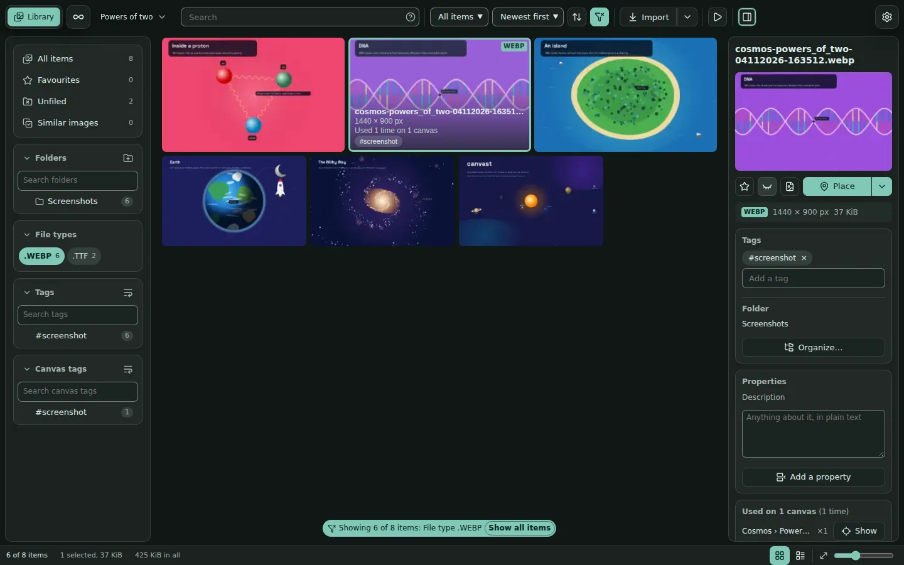 | 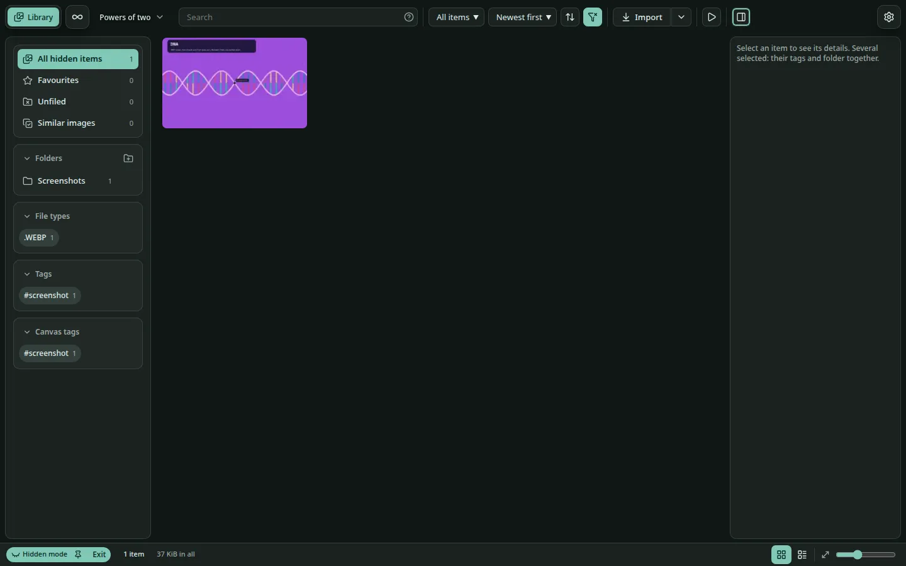 |
| **Hide** is the eye button beside the star in the details panel (also in the bulk bar of several selected items, and in the library's context menu) | **Hidden mode**: the Library listing the hidden items only |

**Hiding**

- A hidden item is left out of *All items*, every folder, tag and file type, the counts and totals, searches and their suggestions, *Similar images*, and the pickers that list the library (a texture fill's picture, the fonts).
- Where it is already placed on a canvas, its picture shows a padlock at once (with or without a password) until it is shown again, and it is named *Hidden item* there (its label, the Layers panel): its name shows only with its picture. Canvas files never hold an item's name. A hidden video or sound does not play. With *Remember the Hidden password* on (Settings > Privacy), once the password is given its picture shows on the canvas until the tab or app closes, the hidden items are locked, or remembering is turned off. That is the screen only: exports, copies, pattern fills, baked pictures, screenshots and bookmark pictures still draw the padlock, so nothing readable of it leaves the app.
- Hiding does not move, delete or change the file. In hidden mode, the same button shows the item again.
- **Hide folder** (a library folder's ⋯ menu) hides the folder, its subfolders and every item in them. An item filed into a hidden folder later is hidden with it, and a folder made inside one is hidden too. Showing one item again shows its folder (and the ones above it) again; its other items stay hidden. In the desktop app a hidden folder's name is kept only encrypted, and its real folder leaves `library/`.

**Hidden mode**

- Outside it, nothing hidden is listed, counted or suggested anywhere. To begin it, type the **opening word** in the library's search box (`hidden:` by default; change it, or empty it to turn this off, in Settings > Privacy); the password is asked for if there is one.
- In hidden mode the Library is the same view with every function (folders, *Unfiled*, *Favourites*, tags, file types, *Similar images*, search, sorts, layouts, the viewer and slideshow, rename, descriptions and properties, filing, bulk actions), over the hidden items only. The folders listed are the hidden ones and those holding hidden items; the counts are of hidden items. A chip at the start of the status bar (*Hidden mode*, with a pin and *Exit*; on a phone, the eye and *Exit*) says it is on.
- A folder made in hidden mode is hidden. **Unhide folder** (a folder's ⋯ menu in hidden mode) shows the folder, its subfolders and every item in them again, also the items in it that were hidden one by one, and the folders above it.
- It ends with **Exit** on that chip, when the hidden items are locked, or when you leave the library, unless the chip's pin (or *Stay in hidden mode when leaving the library*, Settings > Privacy) keeps it on until then. While hidden mode stays on outside the library, hidden items placed on canvases show their pictures on the screen (files, copies and screenshots keep the padlock). The library is then as it was before (its list, search and scroll), and the hidden items' pictures are dropped from memory. With *Remember the Hidden password until the tab closes* (Settings > Privacy) it begins again without the password until the tab is closed or reloaded.

| | |
| --- | --- |
| 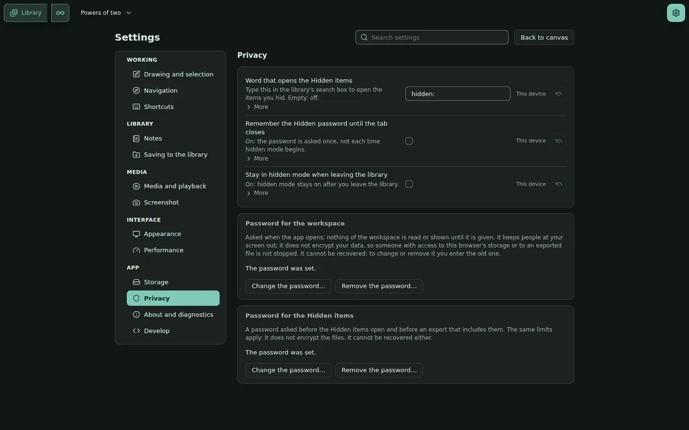 | 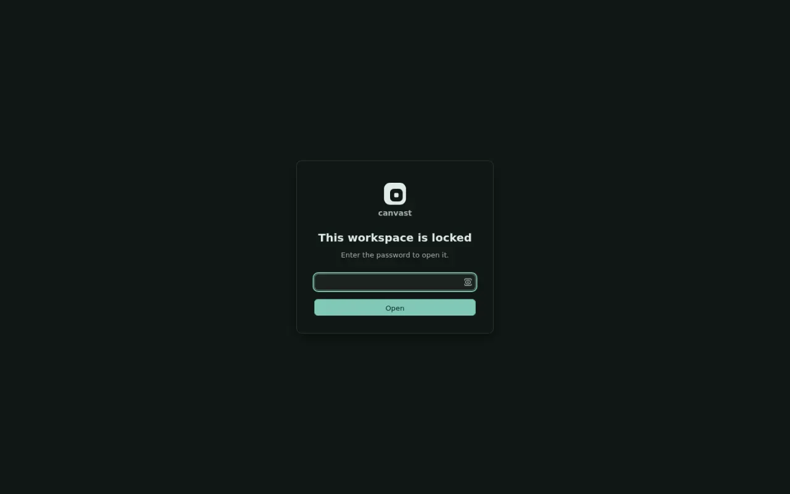 |
| **Settings > Privacy**: the opening word, remembering the Hidden password and the two passwords | The **lock screen**: with a workspace password set, nothing is read or drawn until it is given |

**Two passwords, set separately** in Settings > Privacy (each is typed twice; changing or removing one asks for the old one). Every password field has an eye button at its end that shows what was typed, and hides it again:

| Password | Asked | Guards |
| --- | --- | --- |
| **Workspace** | Every time the app opens or is reloaded, before anything of the workspace is read. Escape does not close the screen | The whole workspace |
| **Hidden items** | When the opening word is typed (unless the tab remembers it), and before an export that includes hidden items | Hidden mode and exporting hidden items |

**Exports and backups ask.**

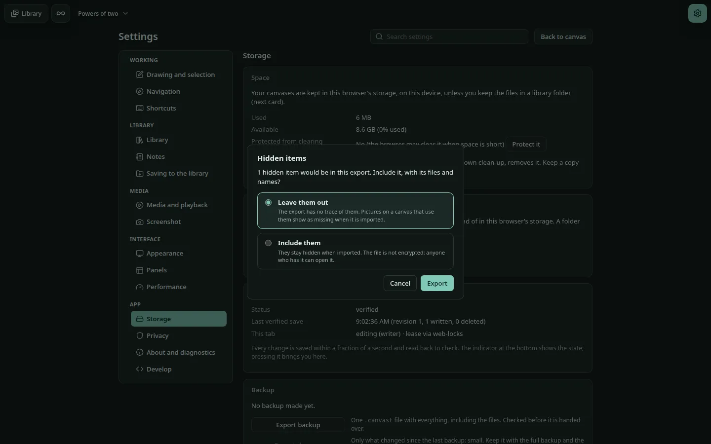

| Export | What is asked | If you leave it out |
| --- | --- | --- |
| Any export with hidden items in it (backup, board, canvas, files as ZIP) | *Include them, with their files and names, or leave them out?* Including asks the Hidden password first | The file has no trace of them; pictures on a canvas that use them show as missing when it is imported |
| A workspace backup, when a password or a changed privacy setting exists | *Include the passwords and the privacy settings (the opening word, keeping the list open)?* Each password is asked first, unless it was typed a moment ago | A copy restored from it starts with no password and the default settings |
| The library index kept in the library folder | Nothing: it is written by itself, so it always leaves hidden items and passwords out | |

Whether an item is hidden is data of the item, so it travels in any export that includes it and the item comes back hidden. Importing a backup that carries a password sets it only on a device that has none, and the import dialog says so.

**What this is not (browser version).**

- The passwords are asked by the app; the files are stored as they are. They keep out people at your screen, not someone who can open this browser's storage or who has an exported file with hidden items in it.
- Only a salted hash of each password is kept: in this browser, and in an archive only if you include it.
- A forgotten password cannot be recovered. The only way back into a locked workspace is to clear this site's data in the browser, which deletes it, so keep a backup (one made without the password opens without one).
- In the browser, hidden files are not encrypted (in the desktop app they are, below).

**In the desktop app, hidden items are encrypted.**

- Hiding asks for a Hidden password first, and warns that a lost password means lost files.
- The file is encrypted (AES-GCM) into `.hidden/`, read back to prove it, and the readable file is deleted (not moved to `.trash/`). As encrypting sync tools do (rclone's crypt, for one), its place says what it is: it is kept in the folders of its library folder's path, each folder's name encrypted, and named by its own name encrypted (`Hidden Art/Items/Study.png` becomes three runs of letters and digits). Renaming or moving it, or its folder, renames on disk; changing its tags, note, fields or favourite changes only the encrypted index (`.canvast/hidden.json`). A file is encrypted again only when its content is new, so a sync tool sees renames, not new files. What stays visible: how many folders and files there are, how deep they go and their sizes; never a name or a picture.
- Its name, tags, note and fields are kept only in an encrypted index (`.canvast/hidden.json`); its thumbnail is stored only encrypted with the same key, in the app's own cache on each device (made once there, so the Library does not open the whole file again each time), and opened only while the hidden items are.
- The password, stretched with **scrypt** (128 MiB of memory for each guess, so guessing it on many machines at once is costly), wraps one random key, so changing the password never re-encrypts a file. It cannot be removed while any item is hidden. A workspace from before 0.50.52 (PBKDF2) is upgraded the next time the password is given.
- The Hidden password is checked only by its vault: no cheaper form of it is written into the workspace folder.
- Once given (to begin hidden mode, or when hiding), the key stays in memory until the app closes or you choose **Lock hidden items** (command palette). It is held so that no code in the page can read it out; changing the password therefore asks for the current one.
- A spare of the wrapped key is kept in `.canvast/keys/hidden.json`: if `hidden.json` is lost or damaged, the same password still opens every hidden file, and the app writes `hidden.json` again.
- The files and folders stand on their own: `.hidden/` copied anywhere, with the key file and the password, gives back every file with its name and folders (`scripts/hidden-items.mjs decrypt`), even with the index lost; only the tags, notes, fields and favourites are in the index. A file renamed or moved inside `.hidden/` outside the app (a file manager, a sync tool) is found again by the content hash inside it, and its item takes the name and folder its new place says.
- Hiding several files at once shows *Encrypting N of M files* from five files on.
- If the app stops while a file is being encrypted, the next start checks the encrypted file opens before the readable one is deleted (otherwise the readable one stays, and is encrypted again).
- A hidden picture placed on a canvas shows a padlock (on the screen, its picture while the password is remembered, see above). Another device on the same folder learns of hidden items only when the password is given there.
- Showing an item again decrypts it back to its place in `library/`.
- The format is documented below, and the files can be decrypted outside the app.

### Hidden items: the file format

In a desktop workspace folder the hidden items are open, documented files, so they can be read without canvast. Everything is standard WebCrypto (or any crypto library):

| Part | Where | What it is |
| --- | --- | --- |
| The vault | `.canvast/hidden.json` | JSON: `format: "canvast-hidden"`, `version: 2`, `kdf: { name: "scrypt", N, r, p, salt }` (N = 131072, r = 8, p = 1, a 16-byte random salt), `key`, `check` and `index`. Version 1 (written before 0.50.52) has `kdf: { name: "PBKDF2", hash: "SHA-256", iterations, salt }` instead, and is still read |
| The data key | `key` in the vault | A random 256-bit AES-GCM key, wrapped (AES-KW, RFC 3394) by the 32-byte key scrypt (RFC 7914; PBKDF2-SHA-256 in version 1) makes from the Hidden password (UTF-8) and the salt. A wrong password fails to unwrap it. Changing the password wraps the same key again, so no file is encrypted again |
| A hidden file | `.hidden/<encrypted folder>/…/<encrypted name>` (its library folder's path, at the top when it is in none; its name, encrypted like a folder's, `-2`, `-3`… before the extension when two share one; a long one `0…` with the name in `<that>.name` beside it). Files sealed before 0.52.4 are `<32 random hex digits>.bin` until they are next placed (renamed, never encrypted again) | Version 2: the 8 bytes `CVSTHID2`; the header's 12-byte IV; the header's length (4 bytes, little-endian); the header, sealed with AES-256-GCM under the data key (with `CVSTHID2` as associated data): JSON `{ v: 2, chunk, prefix, item }`, where `item` is `{ hash }`, the SHA-256 of the content, which ties the file to its entry in the index (files sealed before 0.52.4 hold the whole entry there, which is no longer read when the place says it), `chunk` is 1048576 and `prefix` 7 random bytes (base64). Then the file's bytes in chunks of `chunk` bytes, each sealed on its own with AES-256-GCM (its 16-byte tag after it) under the nonce `prefix` + the chunk's number (4 bytes, big-endian) + 1 for the last chunk or 0, so a chunk cut off, moved or changed does not open. An empty file is one empty chunk. The name says nothing about the item. A file of version 1 (sealed before 0.50.53: 12 bytes of IV, then the whole file as one AES-256-GCM ciphertext) is still read, and left as it is (its place gives its name) |
| An encrypted folder name | a folder of `.hidden/` | The library folder's name (UTF-8, NFC) under keys made from the data key: AES-256-GCM of the text `canvast hidden folder names v1` under a 12-byte IV of zeros, its first 32 bytes put through HKDF-SHA-256 (no salt) with the info `mac` (an HMAC-SHA-256 key) and `enc` (an AES-256-CTR key). The folder is the lowercase base32 (no padding) of the name's HMAC (its first 16 bytes, also the CTR counter, 64-bit) followed by the name under AES-CTR: one name always gives the same folder. A name too long for that (a folder of more than 240 letters) is `0` and the base32 of its HMAC's first 20 bytes, with the name sealed beside its files in `.name` (a hidden file's format, item `{ kind: "folderName" }`) |
| The spare | `.canvast/keys/hidden.json` | The same `format`, `version`, `kdf`, `key` and `check` as the vault, without the index |
| The key check | `check` in the vault: `{ iv, data }` | The text `canvast-hidden` sealed with the data key, so the app knows whether a vault holds its key without the password (a vault written before 0.50.47 may lack it) |
| The index | `index` in the vault: `{ iv, data }` | A JSON list sealed the same way (`iv` and `data`, base64): one entry per hidden item as in `library.json` (its `hash`, `file`, `name`, `type`, `size`, `tags`, `note`, `fields`, …), which names each item's `.hidden/` file |

All binary values in the vault are base64. The SHA-256 of a decrypted file is its `hash` in the index.

### Decrypting and encrypting outside the app

`scripts/hidden-items.mjs` does both with nothing but Node.js 20 or later (no install step, no dependencies). Close canvast on that workspace first. It asks for the Hidden password without showing it (or reads it from a pipe):

```sh
# Every hidden item's file, under its name in the library and in its library folders, with hidden-items.json (names, tags, notes,
# fields, where each was written) at the top; --flat puts every file at the top instead
node scripts/hidden-items.mjs decrypt ~/Art/my-workspace ~/decrypted

# Seal files into .hidden/ and the index: the app then lists them as hidden items
node scripts/hidden-items.mjs encrypt ~/Art/my-workspace ~/decrypted/sketch.png
```

`decrypt` changes nothing in the workspace. The folder tree comes from the encrypted folders of `.hidden/` (opened with the password; a file at the top uses the library folders its own encrypted header names), so copying `.hidden/` and `.canvast/hidden.json` (or its spare, `.canvast/keys/hidden.json`) to another machine is enough to get the files back with their names and folders; tags, notes and fields are in `hidden-items.json`. It also reads copies of `hidden.json` that a sync tool left beside it (each opened with the password given), and writes any encrypted file of `.hidden/` that no entry names under the name it holds (`recovered-<hash>.<ext>` for one encrypted before 0.50.53); with `hidden.json` lost, the spare of its key opens the files. `encrypt` writes files that stand on their own too. `encrypt` takes back files that came out of `decrypt` with their names, tags, notes and fields (it finds them in the `hidden-items.json` beside them or in a folder above them), and new PNG or JPEG pictures (it reads their size). For any other new file, put it in `.hidden/` while canvast runs with the Hidden items open: the app reads it, encrypts it and lists it. `encrypt` leaves the readable files where they are, so delete them yourself when you no longer need them.

---

## Limitations

These are canvast's current limits: first those of both versions, then those of the browser version and of the desktop app. They describe the app as it is today. Some of them, such as fuller support for PDF and 3D files, may be lifted in later versions, but none is promised and there is no schedule: if one matters to you, plan around it as it stands.

### Both versions

**Content**

| Area | Limitation |
| --- | --- |
| PDF | A PDF is kept as a card with its page count; its pages are not rendered as pictures |
| 3D | Only STL and OBJ are read, and only as a preview card |
| Text | Complex scripts that need Indic shaping are not supported; OpenType positioning goes no further than kerning. Characters missing from the interface font fall back to a system font: their width then comes from the browser, so such text can wrap differently on another computer and pixelates at extreme depth |
| Vector networks | One fill for the whole network (no fill per region) |
| Notes | Markdown cannot hold fonts, sizes, alignment, table styles or the page layout: such a note is saved as a rich text note (or that formatting is dropped). Math, embedded web pages (YouTube, posts) and PDF export are not in the editor: they need a server or another library the app does not ship. A save changes only the blocks that were edited; those are written in one spelling (`- ` for lists, `**` for bold, ` ``` ` for code, an underlined heading as `#`). Obsidian's `![[embed]]` shows its picture in the editor when it is one, and stays as written when it is another kind of file. Saving is manual (no autosave while you work; **Save notes on close** saves on leaving a note) and there is no version history: a saved note replaces the file |
| Angular gradient in SVG | SVG has no sweep gradient, so an SVG holds a picture of it (up to 384 px a side, about 300 KB), not vectors; the Export dialog, Save as SVG and Copy as SVG warn. A PDF of such a shape is made as a picture, and picture exports are exact |
| Varied fills | The copies of a varied texture repeat after a block of 16 to 31 cells |
| Pattern | A rotated sheet or shape is refused. A result is at most 600 shapes. Ungrouping a pattern, or moving one of its shapes out of its group, ends its link with the panel (the shapes stay as ordinary ones). Resizing the sheet makes the pattern again at the new size from its settings and seed, so a generator whose layout depends on the size (how many waves fit, say) can place its shapes differently |
| SVG import | Text, patterns and masks inside an SVG are not imported; a dropped SVG file is placed as a picture (make a vector copy to edit it) |
| Adjustments and shadows | Shadows are not shown on a video or GIF while it plays. Adjustments (and shadows) are written to an exported SVG only for shapes (not pen strokes or text), as an SVG filter that matches the canvas closely but not exactly (curves, levels and the gradient map are sampled; grain differs). A shape bigger than about 8 million pixels on screen is drawn unadjusted. Grain on a shape is fixed to the screen pixels, not to the shape |
| Boolean groups | Per-corner radii on a boolean result are not available |
| Fill gaps | Only places closed in on every side, or by slits narrower than the closing distance (on the screen, at the zoom you are at), are gaps; a wider opening leaves the place unfilled |
| Eraser | Trimming works on strokes, not on vector paths |
| Files | Imports are limited to 256 MiB per file |
| Clipboard | Ctrl+C keeps the real objects for pasting back only while nothing else was copied: a picture copied for other apps pastes back as the objects only if the window kept the focus and the app copied nothing else in between (otherwise it comes back as a new picture, and shapes as an SVG import or a picture). A copy of a single picture, GIF or video is one PNG (a GIF or video is its current frame); files such as audio and PDF cannot be put on the system clipboard by a web page; Cut puts text only |
| Video | Only what the built-in browser engine plays: HEVC (H.265) video, the format of many phones, does not play in the desktop app or in most browsers (the viewer says so; *Open in default app* plays it in the system's player), and shows as a card on Firefox for Android (it still plays from the player) |

**Scale and precision**

| Area | Limitation |
| --- | --- |
| Far trips | A trip to a bookmark that is more than a view apart and more than 20,000 levels of zoom away is not flown: it zooms out 24 levels from here and in to there, switching where both are tiny (with a brief dip to dark, unless turned off). A trip to a place within a view, however deep, is flown |
| Camera precision | After zooming out more than 4,096 levels beyond the deepest point and back in, the view returns to within 2^-96 px of the file rather than exactly |
| Very deep views | Magnification has no limit, but each level of depth enlarges the numbers involved, so extreme depths cost more CPU per frame |
| Dense scenes | With hundreds to thousands of objects visible at once, zooming shows a briefly scaled image of the last exact frame and snaps to the exact picture about 150 ms after you stop. Zooming out before the next level out has been prepared (it is made while the view rests, in a fraction of a second), the edge the scaled image does not reach is drawn exactly, so those frames are slower but the view is never cut off. A zoom that goes more than one level in one gesture pauses for one exact frame at each level it has nothing prepared for |
| Far zoom-out | Content too small to draw is shown as a soft mark in its own colour (pictures as grey). Marks cannot be selected; zoom in to edit |
| Very large documents | A board of one million objects needs about 940 MB of memory and about 6 s to build its index on load |
| Large libraries | The Library draws only the cards near the view, so scrolling stays smooth however deep you go (measured with 20,000 items: opening about 1 s, wheel scrolling at 60 frames a second at the top and at the end, no stall while typing a search). Search results are redrawn when typing pauses for a quarter of a second. A thumbnail missing from storage is made from its file, three at a time. Backups of many gigabytes have not been measured; an import holds about one 128 MiB batch of files in memory at a time, and each canvas is read whole. In the desktop app a library of 20,000 items or more is listed a page at a time: only the cards near the view are read, and search, sort and counts are worked out where the library is kept; *Similar images* is then not offered (it reads how every picture looks), and a selection of more than 5,000 items shows its count but not its size. Measured on a GitHub runner with a million files: the app opens in about 8 s and the Library shows them all about 2 s later (about 500 MB); the first open on a new device takes about 2 minutes; a file put into `library/` from outside is listed in about 3 s |
| Frame rate | Measured on one desktop machine; no results exist for other device classes |

**Platform**

| Area | Limitation |
| --- | --- |
| Rendering | Canvas 2D only, on the main thread; no GPU or WebGL path, no workers |
| Collaboration | None. There is no network by design |

### The browser version

| Area | Limitation |
| --- | --- |
| Library size | The Library manages the files your projects use. It is not meant to hold a very large archive. Files are stored in the browser's storage for local files, whose size limit depends on the browser and on the free disk space, so a library that grows past it stops accepting new files, says so in plain words and loses nothing already stored. canvast asks the browser once to keep the data under storage pressure, and warns once when 80% of the browser's quota is used. In Chromium a *library folder* removes the limit (see Library); Firefox cannot offer one |
| What to do about it | Keep working files in canvast and long-term collections in your own folders. Use `.canvast` backups to move finished projects out, and *Delete…* in the library to free space |
| Storage | Browsers cap local storage, and the cap grows once the browser agrees to keep the data (*Protect it*, Settings > Storage): Firefox allows at most 10 GiB (or 10% of the disk, if smaller) before that and up to half the disk after, Chromium about 10 GiB (a Chromium library folder is not counted). Settings > Storage shows the current figure. With a library folder, files in it are outside the browser's protection: files removed there show as missing, and each session needs one click to allow access again. When the browser's storage is full, an import is refused with a notice that points to the backup and to *Delete from library*; edits stay queued and the indicator shows the error. Export backups regularly |
| Origin | Data belongs to the browser profile. Another browser, profile or private window starts empty |
| Browsers | Tested on Chromium and Firefox on one Linux machine. Safari has not been tested. Touch is tested by emulation |
| Passwords | In the browser the workspace and Hidden passwords are gates, not encryption: the data is stored as it is, so they do not stop someone with access to the browser's storage or to an exported file that includes hidden items. They cannot be recovered. The workspace password is asked at every open and reload |

### The desktop app

| Area | Limitation |
| --- | --- |
| Platform | Linux-first: no Windows, macOS or Flatpak builds for now; watching the folder for outside changes is verified on Linux only. A `.cvst` copied in from another workspace is not taken in. A file changed in `library/` outside the app is looked at alone; a folder added or removed there makes canvast look through the whole of `library/` again. At start-up only the files that changed since the last look on this device are looked at (all of them the first time). A canvas file is written about 2 seconds after editing pauses: until then the edit is safe in the app's own storage on this device, but another device does not see it yet |
| Hidden items in the desktop app | A file larger than 256 MiB cannot be hidden (encrypted). The files and index are encrypted, but: deleting the readable file does not overwrite the disk blocks it used; an item hidden while the key is locked stays a readable file until the password is given; the app's own cache on the device keeps hidden items' names and tags (their thumbnails only encrypted), unless *Keep hidden items' names off this device while locked* (Settings > Privacy) is on; a canvas file names the content hash of each picture placed on it (and a backup, the content hash of each hidden item); a backup made in the browser that includes hidden items is not encrypted. The names of `.hidden/`'s folders and files are encrypted, but how many there are, how deep they go and their sizes can be seen (as with other encrypting sync tools), and one name always gives the same encrypted name, so two hidden files or folders of the same name in one place can be told to share it. A name too long to encrypt into a file name (more than about 140 bytes) is kept, encrypted, in a small `.name` file beside it |
| Sync tools | Tested with the copy names sync tools use (`name (1).ext`, `name.sync-conflict-….ext`), not live with each tool. The same canvas changed on two devices at once is kept as two canvases, not merged; the same library item changed on both keeps the kept file's version. A canvas copy saved by another device waits 10 minutes before this device takes it. A copy of the hidden items under another Hidden password is opened only with `hidden-items.mjs`, and a hidden file encrypted before 0.50.53 whose entry was lost comes back without its name (`recovered-…`) if it was not sealed again first. Losing both `.canvast/hidden.json` and its spare `.canvast/keys/hidden.json` loses every hidden item: keep backups |
| Packages | Linux only, for x86_64 and aarch64. The `.deb` and `.rpm` are not in a package repository, so the system's updates do not include them; only the AppImage updates itself. The `.deb` and `.rpm` are checked for their contents before a release, not installed on every distribution they name |

---

## How it works

This part is for readers who want to know why canvast behaves as it does.

### Exact coordinates

The algorithms behind the pens and deep zoom are described in [Pen and deep-zoom algorithms](docs/reference/pen-and-depth-algorithms.md), and the nested frames in [Nested frames](docs/reference/nested-frames.md).

Positions are not floating-point numbers. Each coordinate is a **dyadic number**: a `BigInt` mantissa times 2^exponent, so any position at any distance from the origin is stored exactly. The camera is a centre plus an integer-quantized log2 zoom, which makes zooming and panning exactly reversible. Plain doubles appear only when drawing, and only relative to the camera or to a cell, never as stored world positions.

When the view is very deep inside an object, drawing and selecting switch to exact arithmetic for that object; sizes in the numbers grow with depth, but nothing is clamped. Nested coordinate frames keep the cost per frame flat however deep you go.

### Rendering

Rendering is CPU-first **Canvas 2D**.

- **Shared projection:** drawing and hit-testing use the same object-to-screen projection, so what you see is what you select.
- **Spatial index:** a multi-scale index (levels × `BigInt` cells) with no world bounds returns the visible objects. Off-screen content costs almost nothing, even when it is 2^5000 away.
- **Level of detail:** content far below a pixel is skipped or summarized; identical opaque strokes are drawn in one call.
- **Raster tile cache** for committed objects keeps panning and drawing over dense scenes near 2–3 ms per frame, and a bounded **zoom preview** keeps zooming responsive (the levels one out and one in are prepared while the view rests, the outer one first; zooming out past what is prepared, the edge is drawn exactly).
- **Pictures at their shown size:** a big picture (a photo, a long note's page) is drawn from a 512 px copy when it is small on the screen and from a 1024 px copy at a middle size; all its pixels are read only when it is shown big. Each copy is made once, then kept while memory allows.
- **Deep zoom into any kind of object:** every kind has a sampler so its colour never disappears when the view is inside it.
- **Text** uses the browser's glyphs normally and the font's exact outlines past about 2,000 px per letter.

Measured on a CPU-only configuration with about 500 visible objects: 1.7 ms per frame (p50) with 10 thousand objects in the document, 2.2 ms with 100 thousand, 7.7–9.6 ms with one million.

### Editing model

1. Input produces a transient preview, which is never stored.
2. On pointer-up the gesture becomes one validated transaction.
3. The document store applies it and reports the changed ids; the spatial index and undo history are updated, and the canvas redraws.
4. After a 150 ms debounce the changed objects are written in one atomic, revision-checked IndexedDB commit, then read back to verify it.

Every object is validated before it enters the document or is loaded: finite numbers, known kinds, well-formed ids and hashes.

### Storage

- **One boundary.** The app reaches storage only through the interfaces in `src/storage/store.ts` (the workspace, backups, the library's entries and its files). The browser's IndexedDB is one implementation (`src/storage/idb-storage.ts`), the workspace folder the other; `npm run check:storage` keeps IndexedDB out of the rest of the code.
- **The desktop library is SQLite.** In the desktop app the library's entries and the records of its files are in a SQLite database ([better-sqlite3](https://github.com/WiseLibs/better-sqlite3), in the main process: `desktop/library-db.ts`), one per workspace in the app's data folder; the page reaches it through the preload bridge (`src/storage/desktop-library.ts`), never with SQL. The main process reads and writes the library's part files itself, so a million items never pass through the page to open or save. The page's IndexedDB keeps the canvases, thumbnails and passwords. The database is a working copy: the part files in the workspace folder stay what the devices share.
- **Layout:** Workspace → Boards → Canvases. The IndexedDB schema (version 13) has stores for workspaces, boards, canvases, objects (one record each), per-canvas views, frames, bookmarks, thumbnails, assets, the asset catalog and metadata.
- **Files** are content-addressed by SHA-256 and stored once; objects on the canvas reference them. They are removed only by reference-checked garbage collection.
- **Several tabs:** a writer lease guarantees a stale tab cannot overwrite newer data.
- **Library folder:** a file is named `<sha256>.<ext>`; it is written, read back and compared before the browser keeps a stub of it (an `assets` record with an empty blob and `ext: 1`), so every rule keyed by hash is unchanged.

**Archives.** A `.canvast` archive holds a versioned `manifest.json`, one JSON file per canvas, and each file once under `assets/<sha256>`, with a CRC on every entry. It is an uncompressed ZIP (ZIP64 beyond 4 GiB or 65,535 files), always one file however big.

- Import is verified completely before anything is written.
- Files are then written a batch at a time (up to 128 MiB each), so an import needs about that much memory whatever the backup's size.
- Everything else (boards, canvases, library entries) is written in one transaction: it shows all at once or not at all.
- Files written by an import that did not finish are erased at once, or when the app next opens.

### Source layout

```
src/
  core/          exact numbers (dyadic) and the camera
  doc/           objects, transactions, document store, undo/redo, groups, clipboard
  render/        projection, drawing, hit-testing, tile cache, density preview
  scene/         multi-scale spatial index
  text/          font reading, Markdown model, layout
  interaction/   navigation, tools, snapping, pens, item stepping
  assets/        content addressing, decoding, catalog, garbage collection
  storage/       IndexedDB, workspace repository, persistence, writer lease, ZIP, archives
  search/        boolean query parser and evaluator, canvas search keywords, recent and saved searches
  settings/      declared settings, scopes, rebindable shortcuts
  commands/      command registry, palette providers, macros
  gen/           the pattern generators, a standalone module that imports nothing from the app: seeded random, geometry helpers, one pure function per pattern, an SVG writer
  colour-picker/ the colour picker, a standalone module that imports nothing from the app
  ui/            toolbars, panels, library, settings view, menus, player
  app/           bootstrap, editor state, actions, debug hook
scripts/         single-file build, offline check, naming and token checks
tests/           unit (Vitest) and end-to-end (Playwright)
docs/            reference notes, test logs, status
```

The colour picker can be built alone with `npm run build:picker`, and the pattern generators with `npm run build:patterns` (a script with the global `CanvastPatterns`, an ES module, TypeScript declarations and a demo page in `dist-patterns/`; see [src/gen/README.md](src/gen/README.md) for the API). Both are made to be published as packages of their own.

---

## API and file formats

canvast has no network API, by design: it never opens a connection. Other programs work with it through its files, which are documented and versioned, and through the entry points below. Each format names itself (`format`) and its `version`; a newer version than an app reads is refused, never half-read.

### File formats

| File | Format | What is in it |
| --- | --- | --- |
| `.canvast` backup | `canvast-archive`, version 7 | An uncompressed ZIP (ZIP64 when large): `manifest.json` (format, version, scope, the boards and canvases, the list of files), `canvases/<id>.json` (`objects`, `frames`, `view`) and each library file once as `assets/<sha256>`, with a CRC on every entry. From the desktop app, hidden items it includes are `sealed/<sha256>.bin` (each file as it is in `.hidden/`, listed in the manifest's `sealed` by content hash only) with `hidden-key.json` (the key file), and their hidden custom thumbnails as `sealed-thumbnails/<name>.bin` (each as it is in `.hidden/thumbnails/`, listed in `sealedThumbnails` by its file name only). Any unzip tool opens it; do not re-compress it |
| `.canvast/boards/<board>/<canvas>.cvst` | `canvast-canvas`, version 1 | One canvas as JSON: a header (`format`, `version`, `id`, `revision`, `savedAt`, `savedBy`) and the same canvas data a backup holds |
| `.canvast/workspace.json` | `canvast-workspace` | The boards and canvases (names, order, ids), styles, and the workspace password's kept form (a salted PBKDF2 hash; the Hidden password's is not written there); `deleted`: the ids of canvases and boards deleted lately, so another device deletes only those |
| `.canvast/library/index.json` | `canvast-library`, version 3 | The library folders (`folders`) and the parts there are (`parts`: `00` to `ff`). Version 2 (before 0.50.56) had 16 parts, `0` to `f`, and is still read Version 4 (0.52.4): another split than 256, `split` 1 (16 parts, `0` to `f`) or 3 (4,096, `000` to `fff`); an app of before reads neither as parts, so never takes its items for erased |
| `.canvast/library/items-<xx>.json` | `canvast-library-items`, version 2 | The items whose hash starts with `xx`, one per line: `hash` (SHA-256), `file` (its path under `library/`), `name`, `type`, `size`, `pixelW`, `pixelH`, `importedAt`, `tags`, `favorite`, `folderId`, `note`, `fields`, `state`. A value that only says nothing (no tags, not a favourite, in no folder, no note, no fields, `active`) is left out of the line, about a quarter shorter; a reader takes it as that empty value |
| `.canvast/library.json` | `canvast-library`, version 1 | The same library in one file (`folders`, `items`), kept for older versions of the app while the library has up to 10,000 items. The app's own copy says `"copyOf": ".canvast/library"`; one without it was written by an older version and what it changed is taken |
| `.canvast/devices/<id>.json` | `canvast-device`, version 1 | One device's open canvas and camera per canvas |
| `.canvast/hidden.json`, `.hidden/*.bin` | `canvast-hidden`, version 1 | The encrypted hidden items: see [Hidden items: the file format](#hidden-items-the-file-format) |
| `library/…` | The files themselves | Each library file under its own name, as you would expect to find it |

Object positions are exact: a coordinate is a dyadic number (an integer mantissa and a power-of-two exponent), written as text, so nothing is lost at any depth (see [Exact coordinates](#exact-coordinates)).

### Desktop command line

| Option | What it does |
| --- | --- |
| `--workspace=<folder>` | Open that workspace folder (an empty folder starts a new one), instead of the last one opened |

Any other option is passed to Electron (for example `--user-data-dir=<folder>` to keep the app's own copy and settings elsewhere).

### Standalone modules

Two parts of canvast are made to be used on their own, with no dependency on the app:

| Module | Build | Documentation |
| --- | --- | --- |
| The colour picker | `npm run build:picker` | [src/colour-picker/README.md](src/colour-picker/README.md) |
| The pattern generators | `npm run build:patterns` (a script with the global `CanvastPatterns`, an ES module, TypeScript declarations and a demo page in `dist-patterns/`) | [src/gen/README.md](src/gen/README.md) |

### Automation hook

Opening the app with `#debug` at the end of its address (or turning on Settings → Develop) adds `window.__canvastDebug`, which the test suite uses to drive the app: the camera, the document, storage, the library and the clipboard. It is made for tests and changes with them; it is not a stable API.

---

## Building from source

Requires Node.js 26.4 (see `.nvmrc`) and npm. Packaging the desktop app also needs `zsyncmake` (the `zsync` package) and `rpmbuild` (`rpm-build` on Fedora, `rpm` on Debian and Ubuntu), and the network once (electron-builder fetches its packaging tools).

```sh
npm ci            # install pinned dev dependencies
npm run build     # → dist/canvast.html (minified, single file)
```

Open `dist/canvast.html` directly. Developer tools (frame times, camera internals, jump buttons, auto-zoom, the test hook) are in *Settings → Develop*, or add `#debug` to the address.

| Command | Purpose |
| --- | --- |
| `npm run build` | The single file, `dist/canvast.html` |
| `npm run desktop` | Build the app and run it in the desktop shell (Electron) on a workspace folder: `--workspace=<path>` after `electron dist-desktop`, else the last one opened, else a folder dialog |
| `npm run package:desktop` | Package the desktop app for this machine's architecture into `dist-package/` (emptied first): `canvast-X.Y.Z-<arch>.AppImage`, `.deb`, `.rpm` and `.tar.gz`, each with its SHA-256; the AppImage with its update address written in and its `.zsync` beside it. The AppImage and the tarball are started on a fresh workspace folder and must write it; the `.deb` and `.rpm` must hold the app and its menu entry; a package that fails is deleted. Name formats to make only those: `node scripts/package-desktop.mjs appimage deb` |
| `npm run package:appimage`, `package:deb`, `package:rpm`, `package:tar` | One format only, checked the same way (the AppImage needs `zsyncmake`, the `.rpm` needs `rpmbuild`) |
| `npm run build:all` | Everything a person can try: the single file, the desktop shell and all the packages |
| `npm run build:appimage` | The single file and the AppImage only |
| `npm run build:picker` · `npm run build:patterns` | The standalone modules (see [Standalone modules](#standalone-modules)) |

### Reproducible build

The build is deterministic: the same source produces the same `canvast.html`, and `npm run build` prints its SHA-256. Dependencies are pinned to exact versions and line endings to LF. `npm run check:repro` builds twice in different folders, time zones and locales and compares the SHA-256.

---

## Testing

| Command | Purpose |
| --- | --- |
| `npm run typecheck` | TypeScript check |
| `npm run test:unit` | Unit tests (seconds) |
| `npm test` | Typecheck, unit tests, the end-to-end **groups the changes need** (`test:affected`), token, storage, picker and pattern-generator checks |
| `npm run test:affected` | Only the end-to-end groups needed by what changed since `origin/main` (`-- --dry` shows which, and how long); `npm run test:group -- <group…>` runs named groups; `npm run test:all` every group (about an hour). Groups and the change map: [docs/testing/README.md](docs/testing/README.md) |
| `npm run check:patterns` | Fail if the pattern generators import from, or touch, anything outside their folder |
| `npm run test:full` | The full suite with long stress loops (about 1.5 hours) |
| `npm run test:snap -- <files or -g pattern>` | Run chosen end-to-end specs |
| `npm run test:status` | List test builds with their result and how far each is behind the source |
| `npm run bench` | Scale and tile-cache benchmarks |
| `node scripts/bench-library.mjs <N> --dir <folder>` | The desktop app on a workspace folder of N library files (made in `--dir`, outside any synced folder): first and second open, a file put in from outside, one rename |
| `node scripts/stress-hidden.mjs --dir <folder>` | Hidden items under load and crashes, in the desktop app: 10,000 items hidden, locked, opened, shown and hidden again, decrypted by the outside tool (times, CPU, peak memory, every file checked by SHA-256); then rounds where the app is killed at a random moment during a hide, show, move or lock, each checked for lost or damaged files. The `Stress hidden` workflow runs it on GitHub |
| `npm run check:offline` | Fail if the built file references anything outside itself |
| `npm run check:tokens` | Fail on a hard-coded colour, size, space or radius in the CSS |
| `npm run check:storage` | Fail if code outside the storage implementation uses IndexedDB instead of the storage interfaces |
| `npm run check:names` | Fail if certain other products' names appear in the app's source or the built file |
| `npm run check:groups` | Fail if an end-to-end spec is in no test group |
| `npm run check:repro` | Build twice in different folders, time zones and locales and compare (see [Reproducible build](#reproducible-build)) |

**How the tests work**

- Every end-to-end run builds its own copy of the app into `test-builds/` and tests that copy, so `dist/` can be rebuilt while tests run.
- Tests open the built file from `file://`, drive it through a debug hook, and fail on any network request. They run in Chromium (three set-ups) and Firefox; the desktop app has its own project, which runs the Electron build on a fresh workspace folder.
- Fixtures are generated in code; no binary fixtures are committed.
- Performance limits are fixed in advance and never loosened.
- Test logs with environments and timings are in [docs/testing/](docs/testing/); [docs/status.md](docs/status.md) is the status record.

**On GitHub** (every push to `main` and every pull request)

| Workflow | What it runs |
| --- | --- |
| `CI` (`.github/workflows/ci.yml`) | Typecheck, unit tests, the build, the offline, naming, token, storage, picker and pattern checks, and the reproducible-build check; keeps the built file as an artifact |
| `Tests` (`.github/workflows/tests.yml`) | The whole end-to-end suite, one job per test group and browser set-up (Chromium, Chromium CPU-only, Chromium at pixel ratio 2 with touch, Firefox) plus the desktop app under a virtual display, all at once. The full suite every Sunday and on request |

Shared machines vary in speed, so a failure there in a test that measures time is checked again on the reference machine before it counts.

---

## Releasing and project scripts

### Releasing

`npm run release` publishes a version. Run it after the version is bumped, `CHANGELOG.md` has its `## X.Y.Z — Title (date)` section, and everything is pushed.

1. It builds and checks `dist/canvast.html`.
2. It creates (or updates) the GitHub release `vX.Y.Z` with the file and its SHA-256, and marks it **Latest**.
3. It reads the release back to confirm it is the latest and serves the same file.
4. Publishing starts the `Release packages` workflow (`.github/workflows/release-packages.yml`). On an x86_64 and an ARM machine it builds the app from the tag, checks that its single file is the one released (the build is reproducible), makes the packages with `npm run package:desktop` (which checks each), and adds them with their SHA-256 and the AppImage's `.zsync`. No package is uploaded from the developer's machine; the workflow can also be run by hand for a tag.
5. When `Release packages` ends, the `Try it online` workflow (`.github/workflows/pages.yml`) checks the released `canvast.html` against its SHA-256 and puts it on GitHub Pages as the [online copy](#trying-it-online). It can be run by hand to publish the latest release again.

`npm run release -- --dry-run` does everything but publish and prints the notes. The notes are split into **Features** and **Fixes** from the CHANGELOG: a bullet starting with `**Fixed:**` is a fix; `**Added:**`, `**Changed:**` and `**Removed:**` are features.

### The showcase and the screenshots

- `scripts/showcase/build.mjs` draws the showcase by driving the app like a person: it pastes SVG, combines shapes, draws with the Pen, writes the labels and adds the bookmarks.
- The labels are in **Space Grotesk** (SIL Open Font License 1.1, in `scripts/showcase/fonts/`), imported into the library and chosen in the Text tool, so the two font files travel inside `showcase.canvast`.
- On the bright scenes (the island, the tree, the cells, DNA, the proton) the text sits on a dark plate. The script measures every label's contrast against the pixels behind it (WCAG 2: 4.5 : 1 under 24 px, 3 : 1 from 24 px); the last build had none below (the tightest is 4.69 : 1).
- The `shots` scripts take the screenshots in the dark theme with the default theme colour, *Viridian*.

```sh
npm run build
node scripts/showcase/build.mjs showcase.canvast            # draws the showcase in the app and exports it
node scripts/showcase/shots.mjs showcase.canvast shots/     # imports it in a fresh profile and takes the README pictures (PNG)
node scripts/showcase/shots-privacy.mjs showcase.canvast shots/  # the same for the context menu, hiding, passwords and the lock screen
node scripts/showcase/shots-more.mjs showcase.canvast shots/     # the same for the text, Pattern panel and colour picker pictures
node scripts/showcase/shots-features.mjs showcase.canvast shots/ # the board menu, the video player, Adjust, Styles, the library list (needs ffmpeg)
node scripts/showcase/shots-desktop.mjs showcase.canvast shots/  # the desktop app on a workspace folder (after npm run desktop's build)
node scripts/showcase/shots-notes.mjs showcase.canvast shots/    # a note in the notes editor, and its card with the Note panel
```

The README pictures are those PNGs converted to WebP (`cwebp -q 80`) in `docs/screenshots/`. The animation at the top (`canvast-30s.gif`) is made from a 30-second video recorded in the app: 720 px wide at 12 frames a second with its own palette (`ffmpeg … palettegen/paletteuse`), then `gifsicle -O3 --lossy=80`, which keeps it near 7 MB. The journey sheet is the stops of an earlier dive (`scripts/showcase/dive.mjs`), set in a grid with ImageMagick `montage`.

### The logo and its guidelines

```sh
npm run build
node scripts/brand/build.mjs docs/brand/canvast-brand-guidelines.canvast docs/brand/previews/   # draws the brand board in the app and exports the canvas (PNG of each page in previews/)
node scripts/brand/icons.mjs docs/brand/icons/      # the logo files: SVG masters, PNG 16–512 px, favicon.ico
node scripts/brand/preview.mjs preview/ 1,3         # a quick look at pages without the app
node scripts/brand/cover.mjs docs/brand/cover.webp  # the cover at the top of this README (cwebp -q 85)
node scripts/brand/cover.mjs social.png 800         # the same cover at 2:1, scaled to 1280 × 640 for docs/brand/social-preview.png
node scripts/brand/header.mjs docs/brand/            # the README's header: the logo with the wordmark (dark and light)
```

The made files are kept in `docs/brand/`: the board (`canvast-brand-guidelines.canvast`, open it with **Import archive…**), the logo files in `icons/`, the page pictures in `previews/`, the cover and `social-preview.png` (the cover drawn at 2:1 and scaled to 1280 × 640 for the repository).

- **Defined in** `scripts/brand/pages.mjs`: the logo (a frame, a window cut from it a little low and to the right, and a dot in the window's middle), its colours (the default theme's Viridian in light mode, with an orange dot) and the nine guideline pages.
- **Drawn in the app:** the build draws the pages on one canvas as nine sheets with bookmarks. The construction glyph is made with the Shape tool and *Subtract*, the crosses with the Path tool, the labels with the Text tool in Space Grotesk. The cover's dot holds the mark again at 1/64, twenty times over (121 zoom levels). The scripts work on a copy of `dist/canvast.html` in the system's temp folder.
- **One drawing for every size**, the favicon too.
- **In the app:** the full-colour logo is only the favicon (inline in `src/index.html`). Everywhere else (over the lock screen, beside the name in Settings > About and diagnostics) the app shows the one-colour mark in the theme's text colour, so it follows light, dark and the theme colour (`src/ui/brand.ts`, the same geometry as `pages.mjs`).
- **The README cover** (`docs/brand/cover.webp`, made by `cover.mjs`) is drawn as a canvas in the default light theme: the grid and the orange origin axes, the tile selected with its dot on the origin, the wordmark on the x axis, and the status bar along the bottom.

---

## Platform support

- **Desktop app:** Linux, x86_64 and aarch64 (Linux-first; see [The desktop app](#the-desktop-app-linux)). Watching the workspace folder for changes made outside the app is verified on Linux.
- Requires `BigInt`, Pointer Events, `ResizeObserver`, Canvas 2D and IndexedDB. Roughly Chromium 67+, Firefox 68+, Safari 14+.
- **Tested** in Chromium 156 (default, CPU-only, and devicePixelRatio 2 with touch) and Firefox 157 on Linux. **Not tested** in Safari.
- Firefox on `file://` supports everything canvast uses (IndexedDB, Web Locks, BroadcastChannel) with frame times close to Chromium's.

---

## Contributing and support

| You want to | How |
| --- | --- |
| **Report a bug** or **ask for a feature** | [Open an issue](https://github.com/emarpiee/canvast/issues/new/choose) with its form; [CONTRIBUTING.md](CONTRIBUTING.md) says what helps |
| **Send a change** | Pull requests are welcome: [CONTRIBUTING.md](CONTRIBUTING.md) has the steps and the project's rules |
| **Report a security problem** | Privately, as [SECURITY.md](SECURITY.md) says, not in a public issue |
| **Support the developer** | If canvast helps your work, you can support its development through [PayPal](https://paypal.me/emarpiee) |

Everyone taking part follows the [code of conduct](CODE_OF_CONDUCT.md).

---

## Notes from the developer

canvast was planned and built with [Claude Code](https://claude.com/claude-code).

I do not believe that images made by generative AI are art, and by the same measure this project, its branding included, is not art either. I treat AI as a tool. It can make an artist's workflow better, and it can build the tools artists use to make their art. It should not be the one making the art for them.

The idea grew out of [Kambas](https://github.com/emarpiee/obsidian-kambas), my Obsidian plugin that extends Canvas with image controls. Shipping the app as a single HTML file was inspired by the one-file tools of [iamsingle.app](https://iamsingle.app/) and [Anton Burmistrov](https://antonburmistrov.com/).

canvast is open source in the first place: anyone is welcome to fork it and build a better version of it.

Apps, sites and references that help with creative work, which I use or recommend: [Tools and resources for artists](docs/creative-tools.md).

---

## Licence

canvast is free software: you can redistribute it and/or modify it under the terms of the **GNU General Public License** as published by the Free Software Foundation, either **version 3** of the License, or (at your option) any later version. It is distributed in the hope that it will be useful, but without any warranty; see [LICENSE](LICENSE) for the full text. Copyright (C) 2026 emarpiee.

The colour picker in `src/colour-picker/` is also published on its own and keeps its own MIT licence ([src/colour-picker/LICENSE](src/colour-picker/LICENSE)), with Björn Ottosson's notice for the OKHSL and OKHSV code.

| Part | Licence |
| --- | --- |
| Lucide icons, in the built file | ISC |
| Inter font, in the built file | SIL Open Font License 1.1 |
| SunEditor (the notes editor), in the built file | MIT |
| Electron and Chromium, in the desktop packages | MIT and Chromium's licences (inside the packaged app) |
| Space Grotesk, two library files in `showcase.canvast` | SIL Open Font License 1.1, copyright 2020 The Space Grotesk Project Authors ([OFL.txt](scripts/showcase/fonts/OFL.txt)) |

The notices of what the built file bundles are embedded at its top, with canvast's own licence, and listed in [THIRD_PARTY_NOTICES.md](THIRD_PARTY_NOTICES.md). Development-only tools, which are not shipped: TypeScript, esbuild, Vitest, Playwright and electron-builder.

A history of changes is in [CHANGELOG.md](CHANGELOG.md).
