<p align="center">
  <picture>
    <source media="(prefers-color-scheme: dark)" srcset="docs/brand/header-logo-dark.png">
    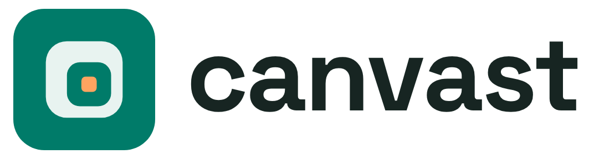
  </picture>
</p>

<h3 align="center">An endless canvas for drawing and references</h3>

<p align="center">One HTML file, or a desktop app for Linux. It works offline, with no account.</p>

<p align="center">
  <picture>
    <source media="(prefers-color-scheme: dark)" srcset="docs/brand/header-figures-dark.png">
    
  </picture>
</p>

<p align="center">
  <a href="https://github.com/emarpiee/canvast/actions/workflows/tests.yml"></a>
  <a href="https://github.com/emarpiee/canvast/actions/workflows/ci.yml"></a>
  <a href="https://github.com/emarpiee/canvast/releases/latest"></a>
  <a href="LICENSE"></a>
  <a href="#installation"></a>
</p>


*Thirty seconds of canvast: the zoom through the showcase file below, from 30 levels out to one million levels in, recorded in the app, then a few of its features.*

**An offline-first endless canvas.** Pan in any direction and zoom in or out without ever reaching an edge or a zoom limit. Draw, write, place pictures, video and audio, and edit at whatever scale you reach. canvast is **one self-contained HTML file** that runs from your disk, and a **Linux desktop app** whose workspace is a folder of ordinary files: no server, no account, no network connection.

- **Endless in every direction.** There is no minimum or maximum zoom and no border. A line drawn at one scale stays sharp at any other, and what you drew a thousand zoom levels ago is still there when you come back.
- **Yours, on your machine.** In the browser everything is saved in the browser's own storage; in the desktop app, in a folder you choose, as plain files any sync or backup tool can see. Nothing is uploaded, ever. Back up to a single `.canvast` file whenever you like.
- **Made for projects, with a Library for what they use.** Storyboards, mood boards, references, sketches: from a small board to a very large one. Pictures, video and files you place are kept in the Library, where you can tag, sort into folders, search and reuse them. In the browser the library lives in the browser's storage, which has a size limit; the desktop app keeps it on your disk (see [Limitations](#limitations)).
- **One file, or a desktop app.** Copy `canvast.html` anywhere (a folder, a USB stick) and open it, or install the desktop app on Linux (see [Installation](#installation)).

## Contents

**Using canvast**

1. [Features at a glance](#features-at-a-glance)
2. [Installation](#installation)
3. [Getting started](#getting-started)
4. [Try the showcase](#try-the-showcase-powers-of-two)
5. [User guide](#user-guide)
6. [Keyboard and pointer reference](#keyboard-and-pointer-reference)
7. [Settings and accessibility](#settings-and-accessibility)
8. [Your data: saving, backups, the workspace folder](#your-data-saving-backups-the-workspace-folder)
9. [Privacy and security](#privacy-and-security)
10. [Limitations](#limitations)

**For developers**

11. [How it works](#how-it-works)
12. [API and file formats](#api-and-file-formats)
13. [Building from source](#building-from-source)
14. [Testing](#testing)
15. [Releasing and project scripts](#releasing-and-project-scripts)

**Project**

16. [Platform support](#platform-support)
17. [Contributing and support](#contributing-and-support)
18. [Notes from the developer](#notes-from-the-developer)
19. [Licence](#licence)

---

## Features at a glance


| Area | What you get |
| --- | --- |
| **Endless canvas** | No edge and no zoom limit in either direction; exact positions at any depth; bookmarks, tours, camera travel between far places, search, and stepping from item to item. [Navigating](#navigating) |
| **Drawing** | Pressure pens, shapes, Bézier paths, node editing, vector networks, boolean shapes, fills (gradients, pictures, repeated objects with variation), outlines, 39 pattern generators, SVG in and out. [Drawing](#drawing) |
| **Colour** | One OKHSL / OKHSV / OKLCH colour picker for everything, gradients, palettes (`.gpl`, `.ase`, `.aco`, `.ggr`) and linked styles. [Colour and styles](#colour-and-styles) |
| **Text** | Rich text stored as Markdown, imported fonts (variable fonts too), text on a path, notes, sharp letters at any zoom. [Text](#text) |
| **Pictures and media** | Pixel-exact pictures, non-destructive adjustments and shadows, crop and masks; video, audio and GIFs play on the canvas. [Pictures, video, audio and other files](#pictures-video-audio-and-other-files) |
| **Organizing** | Layers, groups, sheets that clip, masks, snapping, align and arrange, tags, Reveal for things under others. [Organizing](#organizing) |
| **Library** | Every imported file once, with folders, tags, favourites, notes and fields, similar-image search, a viewer and safe deletion. [The Library](#the-library) |
| **Privacy** | Hidden items and passwords; in the desktop app hidden files are encrypted, and can be decrypted outside the app. [Privacy and security](#privacy-and-security) |
| **Export** | PNG, WebP, JPEG, SVG and PDF from sheets and selections; `.canvast` backups of everything. [Exporting](#exporting), [Backups](#backups) |
| **Your data** | Saved as you work, verified, never uploaded; in the desktop app a plain folder that any sync tool can carry. [Your data](#your-data-saving-backups-the-workspace-folder) |

---

## Installation

canvast comes in two forms. Both are the same app; they differ in where your work is kept.

| | Browser version | Desktop app (Linux) |
| --- | --- | --- |
| What you download | `canvast.html`, one file | A package: AppImage, `.deb`, `.rpm` or `.tar.gz` |
| Where your work is kept | The browser's own storage (IndexedDB) | A folder you choose, as ordinary files |
| Library size | Limited by the browser's storage quota | Limited by your disk |
| Hidden items | Hidden behind a password, not encrypted | Encrypted on disk |
| Updates | Download the new file | The AppImage updates itself; see [Updating](#updating) |

Everything is on the [latest release](https://github.com/emarpiee/canvast/releases/latest). Each release's notes list its **Features** and its **Fixes** separately, and every file has its SHA-256 beside it.

### The browser version

Download [`canvast.html`](https://github.com/emarpiee/canvast/releases/latest/download/canvast.html) and open it in a modern browser: double-click it, or use *File → Open*. No installation and no web server are needed, and it works with no network connection. Keep the file wherever you like; moving it to another folder keeps your data (see [Where the data lives](#where-the-data-lives)).

### The desktop app (Linux)

canvast is **Linux-first**: Linux is where the desktop app is made, tested and shipped. There are no Windows, macOS or Flatpak builds and none is planned for now; the desktop shell is Electron and keeps platform details in one place, so other platforms remain possible later.

Each release has these packages, for 64-bit PCs (`x86_64`) and ARM64 machines (`aarch64`), named `canvast-X.Y.Z-<arch>.<format>`:

| Format | For | Install | Updates |
| --- | --- | --- | --- |
| **AppImage** | Any distribution | `chmod +x canvast-X.Y.Z-x86_64.AppImage`, then run it (or add it with an AppImage manager such as Gear Lever) | By itself, through an AppImage updater (below) |
| **`.deb`** | Debian, Ubuntu, Linux Mint and others | `sudo apt install ./canvast-X.Y.Z-x86_64.deb` | Install the new `.deb` the same way |
| **`.rpm`** | Fedora, RHEL, openSUSE and others | `sudo dnf install ./canvast-X.Y.Z-x86_64.rpm` (openSUSE: `sudo zypper install`) | Install the new `.rpm` the same way |
| **`.tar.gz`** | Anywhere, without installing | `tar -xzf canvast-X.Y.Z-x86_64.tar.gz`, then run `canvast` in the unpacked folder | Unpack the new one in its place |

The `.deb` and `.rpm` install the app under `/opt/canvast` with a menu entry, the command `canvast` and its icon. Every package is started on a fresh workspace folder before it is released (the `.deb` and `.rpm` are checked for their files and menu entry), and the `aarch64` packages are built and started on an ARM machine. On first start the app asks for a workspace folder: an empty folder starts a new workspace, a folder with `.canvast/` in it opens that one.

### Checking a download

Each file has a `.sha256` beside it. With both in one folder:

```sh
sha256sum -c canvast-X.Y.Z-x86_64.AppImage.sha256
```

### Updating

| You use | To update |
| --- | --- |
| The browser version | Download the new `canvast.html` and open it from the same place. Your work stays: it is in the browser, not in the file |
| The AppImage | It carries its update address, so an AppImage updater (Gear Lever, AppImageUpdate, or AppImageLauncher's update) finds a newer release by itself and downloads only the parts that changed (zsync). The app never checks for updates or goes online itself |
| The `.deb`, `.rpm` or `.tar.gz` | Install or unpack the new release's package. There is no package repository yet, so the system's own updates do not include canvast |

Your workspace folder is never touched by an update.

### Uninstalling

Remove the app the way you installed it (`sudo apt remove canvast`, `sudo dnf remove canvast`, or delete the AppImage or the unpacked folder). Your workspace folders stay where they are. The app's own working copy and settings on this device are in `~/.config/canvast/`; delete that folder too to remove everything. For the browser version, delete the file and clear the site data of `file://` pages in the browser (this deletes the work kept there: export a backup first).

### Building from source

```sh
git clone https://github.com/emarpiee/canvast.git
cd canvast
npm ci               # Node.js 26.4 (see .nvmrc) and npm
npm run build        # → dist/canvast.html
npm run build:all    # also the desktop packages in dist-package/ (needs zsyncmake and rpmbuild)
```

See [Building from source](#building-from-source) for what each step needs and makes.

---

## Getting started

### Your first minutes

| To do this | Do this |
| --- | --- |
| Draw | Press `P` and drag |
| Add a shape | Press `U`, choose a shape, drag on the canvas |
| Write | Press `T`, click, type |
| Add a picture, video or audio | Drag the file onto the page, paste it, or use the Import button |
| Move around | Drag with the middle button, hold `Space` and drag, or use two fingers; scroll the wheel to zoom |
| Go back to the start | Press `0` or `Home` |
| Find any command | Press `Ctrl/⌘+K` |
| Undo | `Ctrl/⌘+Z` |

The info bar at the bottom left shows the zoom level and position. Click the zoom, type a level (`3000`, `2^-500`, `10^900`) and press Enter to jump there.

### Terms

| Term | Meaning |
| --- | --- |
| Canvas | One endless surface you draw on |
| Board | A group of canvases (a project, a topic). The board and canvas menu (the name at the top left) switches between them |
| Workspace | Everything you have: all boards, canvases and the library |
| Object | Anything placed on a canvas: a stroke, shape, path, text, picture, video, audio, GIF or file card |
| Library | The shared store of every imported file. Each file is stored once, and objects on any canvas are *instances* of it |
| Sheet | A shape that holds other objects and cuts them at its edge; the unit you export |
| Zoom level | `z` means 2^z screen pixels per world unit. Level 0 is the starting scale |

---

## Try the showcase: powers of two

[`showcase.canvast`](showcase.canvast) is a journey through **one million and one thousand zoom levels** on a single canvas. Each scene is hidden inside a speck of the one above it, so you can get from one end to the other with nothing but the mouse wheel:

| Out (zoom out from home) | In (zoom into Earth) |
| --- | --- |
| The Solar System (home, level 0) | Earth, the Moon and a rocket (+5) |
| The heliosphere and the Voyager probes (−9) | An island with a reef and two boats (+12) |
| The Sun's neighbourhood, every star within 20 light years (−18) | A tree, seen from above (+19) |
| The Milky Way, with *You are here* (−27) | A leaf, its veins and pores (+25) |
| The Local Group: Andromeda, Triangulum, the Magellanic Clouds (−32) | Plant cells and their nuclei (+32) |
| The observable universe and its cosmic web (−40) | DNA (+40), a carbon atom (+47), its nucleus (+54) |
| Other universes, **1,000 levels up** | Inside a proton (+60), the Planck length (+116) |
| | Universes again at **+1,000**, and a last scene **one million levels down** |

To open it: click the save indicator at the bottom left, choose **Import archive…** and choose the file (or drop it on the page). Open the canvas *Powers of two*, then either scroll, or open **Bookmarks** and press **Play the bookmarks as a tour** (`→` and `←` step through its 19 stops).


| | |
| --- | --- |
|  |  |
| One million levels down: 10^301,030× magnified, still exact and editable | 1,000 levels up: our universe is the ringed bubble |

How the showcase and its pictures are made is in [Releasing and project scripts](#releasing-and-project-scripts).

---

## User guide

### Navigating

- **Zoom** with the wheel, a trackpad pinch, `+` and `−`, or the on-screen buttons. The point under the pointer (or between your fingers) stays where it is.
- **Pan** with the middle button, `Space`+drag, the Hand tool (`H`), two fingers, `Shift`+wheel or the arrow keys.
- **Boards and canvases:** the board and canvas menu (the name at the top left) switches between them. It and *Place on…* have a search field, *Find a board or canvas*; with more than four boards, each is folded to its name except the open one (click a name to unfold it).
- **Return** to the origin with `0`, `Home` or the house button. *Previous view* and *Next view* walk back and forth through where you have been; the dice button takes you to a random empty place.
- **Orientation aids:** a hierarchical grid, the axes and the position in the info bar show where you are, even very deep.
- **Bookmarks** save a place and a zoom, with a small picture of it.
  - Rename, update, move or delete one from its ⋯ menu, or drag a card to reorder the list.
  - The check-mark button saves a bookmark that brings the selected things into view (the camera stays where it is).
  - `Alt+1`…`Alt+9` go to the first nine; `]` and `[` to the next and previous (changeable in Shortcuts).
  - A **tour** plays them in list order: the bars fade, `→` and `←` step, `Esc` ends it. With *Tour: wait at each stop* (Settings) it moves on by itself.
  - Getting to a bookmark is a glide; a far one zooms out from here and in to there (see *Camera travel* below).
- **Search** (`Ctrl+F`) finds objects by name, tag or bookmark. Combine words with space or `AND`, `OR`, `XOR`, `NOT`, parentheses and `"phrases"`. `/` searches names only, `#` tags only, `@` bookmarks only. Searches that found something are remembered, and a help card lists the syntax.
- **Step through items** with `W` `A` `S` `D`: the nearest in view (when you are zoomed in on an item and nothing is near enough on the screen, the nearest of its size that way, however far), the nearest anywhere, by layer or by name A to Z (each either among the items in the window or among all of them; `W` and `A` go back, `S` and `D` on). On arriving, focus on the item or keep the zoom. `F` brings the selection into view; press it again to fit everything.
- **Jump anywhere:** click the zoom in the info bar and type a level. One jump can travel up to 2^50 levels.
- **Camera travel** (Settings → Navigation) is how the view gets to a bookmark or a previous view.

  | Style | What it does |
  | --- | --- |
  | *Fly* | One continuous path. When one place is in view of the other (nested views, a bookmark you can see), it is one zoom in or out at any depth. Farther apart, up to 20,000 zoom levels away, it zooms out until both places are about a view apart, crosses over and zooms in, so you see the way |
  | *Glide near only* | Flies to near places and cuts to far ones |
  | *Cut* | Always arrives at once |

  - **Timing:** the time can grow with the distance (up to *Longest trip*) or stay fixed; *Travel time (base)* sets a short trip's length. Easing is smooth, linear or ease-out. A key or a drag ends the glide.
  - **Very far trips** (more than a view apart and over 20,000 levels away) zoom out 24 levels from here and in to there, with a brief dip to dark at the switch (*Fade at the switch*, on by default).
  - The tour has its own travel speed.
  - **Reduced motion:** with Animation set to None the view always cuts. When the system asks for reduced motion the view cuts too and says so once, unless *Follow the system's reduced motion* is off.

| | |
| --- | --- |
|  | 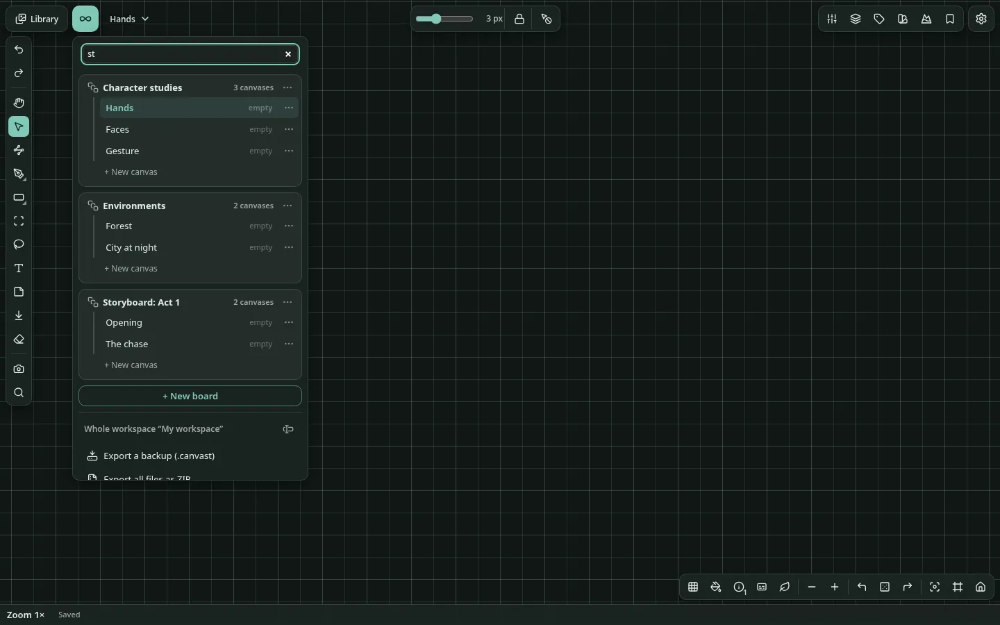 |
| A tour of the bookmarks | The board and canvas menu, searched |

### Drawing

- **Pen** (`P`): four pens (fine, pencil, ink, marker) with pressure, tilt and a stabilizer. Size is 0.5–128 px. A stroke is made at the current scale, so a 3 px line drawn deep in a zoom is a 3 px line there, and it stays vector-sharp at every magnification. *Thickness lock* keeps strokes the same width on screen at any zoom.
- **Shapes** (`U`): rectangle, ellipse, line, polygon and star. Sides, points, ratio and per-corner radii stay editable after drawing.
- **Paths** (`B`) and **Edit nodes** (`N`): Bézier curves with handles, snapping, a lasso for several nodes, and node editing across several paths at once. *Simplify* fits a curve to a rough path; *Pen stroke to path* converts a stroke.
- **Fill and outline**
  - Fills: solid colour; linear, radial or angular gradient; a picture; or other objects of the canvas repeated over the shape (*Objects*, which follows those objects live as you change them).
  - A repeated fill can **vary each copy**: turn it (up to ± an angle, or in whole steps), size it, move it in its cell, mirror some, leave some cells out, and copy each object on its own (in turn or shuffled) or the whole arrangement. A seed gives the same copies every time; *New seed* gives others.
  - New shapes have no outline: set a width (or move the Outline width slider off its left end) to add one.
  - Outlines have a position (inside, centre, outside), corners, ends, dashes, arrow heads and a sharp-corner limit, and can be a gradient.
- **Combine shapes**
  - Union, intersect, subtract and exclude stay editable until you flatten them.
  - *Divide* and the *Shape builder* split overlapping shapes.
  - *Fill gaps* fills every empty place the selected shapes close in (with the Shape tool's fill, under them); *Fill a gap…* fills the ones you click, one by one. A slit narrower than a few pixels (4 by default, in Settings) counts as closed, and the fill stops at it.
  - *Outline stroke* turns a line into a shape, *Taper* gives a line a varying width, and *Corner smoothing* rounds corners continuously.
- **Vector networks:** paths that meet at vertices, with the regions between them filled. Edges are split where they cross.
- **Initial state:** *Set*, *Update* and *Reset to initial state* remember a shape's geometry (and, by default, its fill and outline) so you can experiment and go back. *Apply rotation* makes a shape's current turn its new zero.
- **Eraser** (`E`): removes whole objects (optionally whole groups), or trims strokes in scissors mode.
- **Names on the canvas:** a sheet, picture, video or file card shows its name above its top-left corner; any other item shows its layer name while selected. Where the names of selected items would overlap (a group selected whole, a sheet and what is on it), only the outermost is written, as design tools write the name of a frame or group and not of every layer in it.
- **Pattern** (the mountain button) makes vector patterns.
  - **39 generators** in six families (Waves, Blobs, Soft, Lines, Tiles, Fields), shown as small pictures: Ripple, Tides, Drift, Bubbles, Glow, Grain, Stripes, Halftone, Tiles, Contours, Cells, Flow, Marble, Maze and more. Each has its own settings (counts, sizes, angles, colours, solid or outline) and a background you can hide.
  - **Where it goes:** select a sheet (the result goes on it) or a closed shape (it becomes the clipping mask that holds the result; its fill and outline come back on *Release*), or let it make a new sheet. With several sheets or shapes selected, it makes one pattern on each.
  - **Making it:** *Generate* makes the result, and every change after that replaces it live. The whole session is one undo step until *Done*.
  - **Seeds:** *Randomize* picks random settings and a new seed (a snowflake on a setting keeps that setting); *New seed* keeps the settings, and says when the seed changes nothing. Type or drag a seed to make a result again. The regular generators (Stripes, Tiles, Halftone and the like) have a *Looseness* setting; at 0 they stay exact.
  - **Afterwards:** the result is a group of ordinary editable shapes that remembers its settings. Select it later and the panel shows them; changes replace it in place. Resizing its sheet makes it again to fill the new size (it stretches while you drag).
- **SVG:** paste SVG text to get editable paths (gradients, including a radial one sized by its own transform and an angular one written as a CSS conic gradient box, dashes, transforms, `<use>`, symbols and clip paths, which become clipping masks), or make a vector copy of an SVG picture. Export shapes as SVG, copy them as SVG text, or save them to the library as an SVG picture.


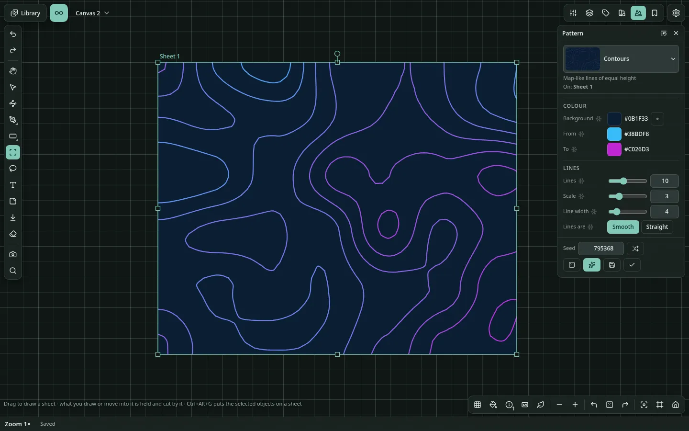

### Colour and styles

- **Colour picker:** one picker for every colour. Choose OKHSL, OKHSV or OKLCH (CSS `oklch()`'s own lightness, chroma and hue); a ring and box, a plane with a hue bar, or sliders; text as hex or another format. It also has an eyedropper, recent colours and saved colours. A number changes by dragging its name left or right; with `Shift` it snaps to round steps worked out from its range (steps of 5 for 0–100, 10 for 0–255).
- **Gradients:** linear, radial and angular, with stops you drag on the canvas, a *Randomize* button and a gradient map for pictures.
- **Palettes:** *Palette from a colour* builds harmonies, and a palette can be taken from a picture. Palettes and gradients can be imported and exported as `.gpl`, `.ase`, `.aco` and `.ggr` files.
- **Styles panel:** saved colours, gradients, text styles, adjustment stacks and patterns.
  - An object painted with a saved style is **linked** to it and follows when the style changes. A change by hand, or *Detach*, unlinks it.
  - A pattern style keeps a generator with its settings and seed (*Save as a style* in the Pattern panel saves or updates it). Pressing its card puts it back in the Pattern panel and makes it on what is selected (on each of several selected shapes).
  - **Copy** a colour, gradient or palette card with a long press or right click (a palette as CSS variables; a colour inside an opened palette as hex), or with *Copy hex* / *Copy as CSS* in its More menu. A long press copies without applying.
  - **Paste** CSS (a colour in any notation, or a gradient) with the pointer over the panel or nothing selected, and it is saved as a new style.

| | |
| --- | --- |
| 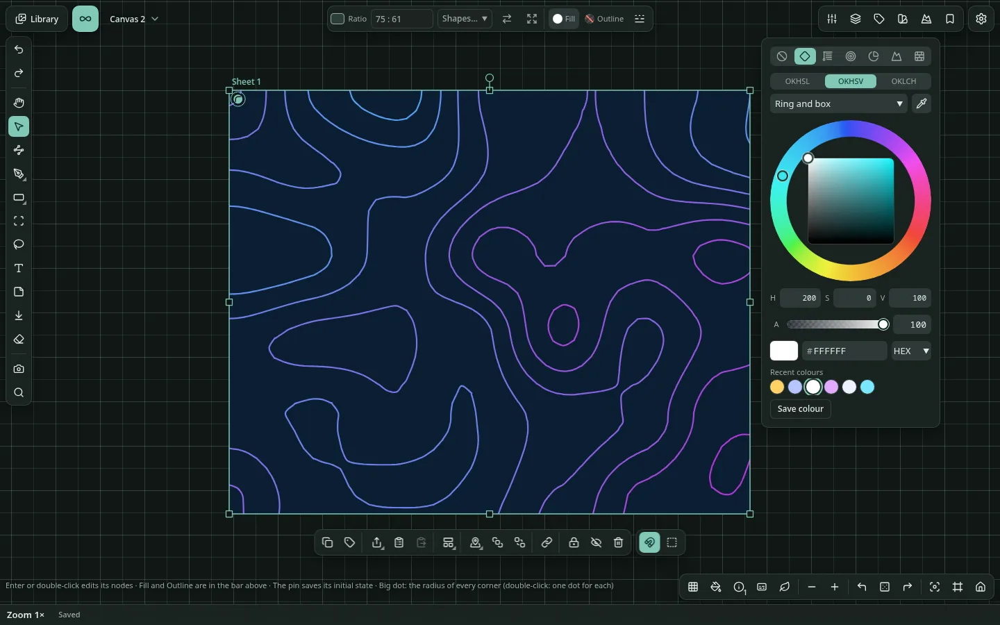 | 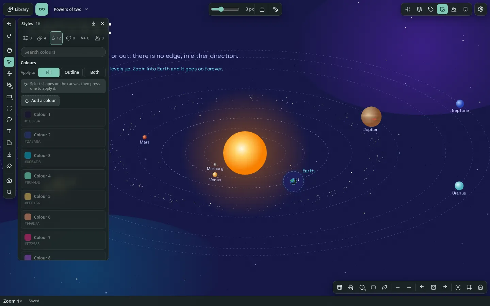 |
| The colour picker, opened from a fill | The Styles panel: saved colours, gradients, text styles, adjustments and patterns |

### Text

- **Text** (`T`): click and type. A click makes a text as wide as its words; a drag makes a box of that width. Double-click to edit.
- **Formatting:** bold, italic, underline, strikethrough, links, colour and size of any range, headings, bulleted, numbered and nested lists. Text is stored as Markdown; **Copy Markdown** is one click away.
- **Look:** colour or gradient, outline, size, line height, letter spacing, alignment, auto or fixed width, paragraph spacing, indent, case, line limit, a set height, kerning, OpenType features and the axes of variable fonts.
- **Fonts:** import `.ttf`, `.otf`, `.woff` or `.woff2` into the library, including variable fonts. One text may use several fonts. Right-to-left and mixed-direction text are supported.
- **Text on a path**, and **Text to path** (`Ctrl+E`) to turn letters into editable outlines.
- **Notes** (`M`): a text on a coloured card.
- **No zoom limit:** zoom into a letter as far as you like; the font's real outlines are drawn.

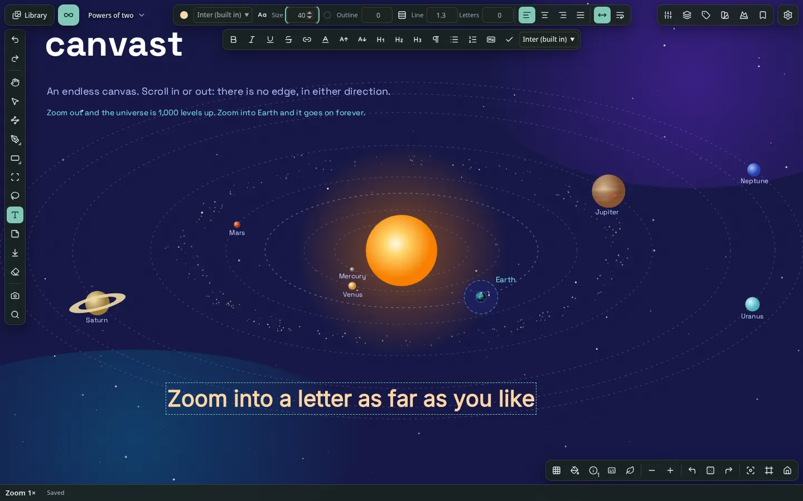

### Pictures, video, audio and other files

- **Pictures** are placed one source pixel to one screen pixel. Zooming in shows real pixels; nothing is invented and the file is never altered.
- **Adjustments** are non-destructive stacks you can reorder, hide and copy between pictures, video, GIFs, shapes, pen strokes and texts: exposure, contrast, highlights, shadows, temperature, tint, saturation, vibrance, red/green/blue, levels, curves, gradient map, blur, sharpen and grain.
- **Crop**, rounded corners and an outline work on pictures, video and GIFs. A picture can be masked by a shape, by opacity or by brightness, or by a brush mask painted with the Pen.
- **Drop shadow and inner shadow** (Adjust panel), for pictures, shapes, strokes and texts: opacity, across, down, blur, spread and a colour each.
  - A new shadow starts soft and a little below. Each group of adjustments has a *Reset* button.
  - Offset and blur are shares of the object's own size (an offset of 100 is a tenth of it), so a shadow looks the same at any zoom.
  - A picture's pixels are not touched; its shadow is drawn beside it. A playing video shows no shadow (its paused frame does).
- **Adjustments on shapes, strokes and text** apply to the object as drawn (fill, outline, gradient and texture together).
  - A blur is a share of the object's size, so it does not change with zoom (far inside an object it stays at most about 330 px wide).
  - Exporting a selection leaves room for a blur or a drop shadow.
  - An exported SVG carries them as a filter on the shape, and making the SVG into shapes again brings them back. A vector PDF draws such a shape as a picture instead (see Limitations).
- **Make a new picture** bakes the crop and adjustments into a new library item; **Copy as picture** puts the result on the clipboard. **Copy** and **Paste adjustments** move a whole stack between items. **Make vector copy** turns an SVG picture into editable shapes in its place, at its size, turn and layer (one undo step; the file stays in the library). **Show in library** opens the Library with the file selected.
- **Media player:** videos, audio and animated GIFs play on the canvas with a player right under the item. It has play and pause, a seek bar, step back and forward (seconds for video and audio, frames for GIFs), repeat, playback speed, volume, a waveform for audio, and a start and end to play only part of a file. The paused frame is saved. Playback continues when the item scrolls out of view.
- **Extract frame** turns the current frame of a video or GIF into a picture in the library (PNG, WebP or JPEG). Settings name it, file it in a folder and tag it, optionally placing it on the canvas.
- **File details:** EXIF, colour profile and codec information are shown. STL and OBJ 3D models and PDFs are kept as cards with a preview; any other file is kept as a card with its extension and can be downloaded again.
- **Import** by button (in the Library the Import button has a menu for files or for a whole folder), drag and drop, paste, or a whole folder. Files up to 256 MiB are accepted and decoded before being stored.

| | |
| --- | --- |
| 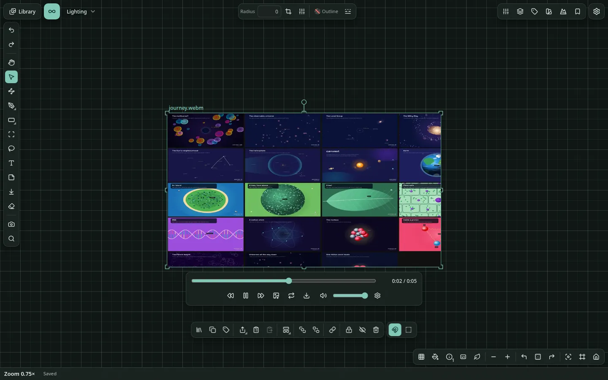 | 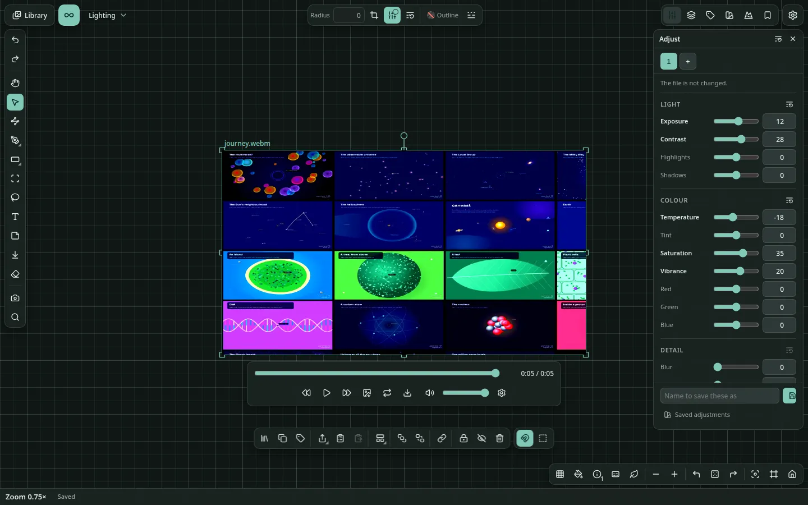 |
| A video playing on the canvas, with its player | The Adjust panel: the file itself is not changed |

### Organizing

- **Layers panel:** group and nest, rename, hide, lock, re-stack, set opacity and blend mode, rotate. Select with `Ctrl` (toggle) and `Shift` (range).
- **Sheets** (`C`): a sheet clips what it holds and has a ratio rather than a size (see [Shapes, sheets and masks](docs/reference/shapes-sheets-masks.md)).
  - Drawing a sheet over objects puts the ones wholly inside it on the sheet, in one undo step (ones it only crosses stay out).
  - *Put the selection on a sheet*, *Fit to contents*, *Release* and *Turn on its side*.
  - Ratio presets: `16:9`, `A4 portrait`, a number, or a size in px (`2000 x 1920` becomes `25 : 24`).
  - Each object on a sheet has pins per axis (left, right, both, centre or scale) that decide what it does when the sheet is resized; *Scale contents* resizes everything with it.
- **Masks:** a clipping mask (a sheet of any shape), a mask by opacity or brightness, or a brush mask painted in black and white with the Pen. Masks can be inverted, selected on their own and released. A click on a mask selects it as one unit; a double click goes inside.
- **Snapping:** moving, resizing, turning, dragging a node and dragging a gradient's handles snap to other things, with guide lines (the magnet button turns it off).
  - Boxes line up by their sides and middles.
  - Shapes snap by their geometry: a corner onto another corner or the middle of a side (a ring marks it), a corner onto any side (curves too), a straight side flush along a nearly parallel one (the side is drawn).
  - Turning brings a corner round to another, or a side parallel to a nearby one.
- **Arranging:** align, distribute, arrange in a grid (by name, date, size or type), copy, cut, paste, duplicate; `Alt`+drag copies. A group (also a boolean group) counts as one thing; its shapes line up with each other only when you select them one by one (in Layers, or inside the group).
- **Tags** on the selection, with a Tags panel listing every tag and its count. Renaming or deleting a tag applies to every canvas.
- **Reveal** finds things hidden under others.
  - Hold `Ctrl` and move over the canvas: the outline of everything under the pointer shows, with their names in a list beside it.
  - `Ctrl`+click selects exactly that thing, even deep inside a group, mask or sheet. On a revealed outline you get the thing it belongs to, even under a filled shape; elsewhere you get the top thing (`Ctrl`+`Alt`+click goes down the stack).
  - In the list of names, move onto a row (its outline turns strong): `Ctrl`+click selects it, `Ctrl`+`Shift`+click adds or removes it. Selected ones are ticked.
  - A selected thing moves when you drag from anywhere inside it, even under other things. A click without moving still selects the top thing.
  - A sheet is ground: dragging on a selected sheet draws a selection box (hold `Ctrl` to move the sheet).
- **Hide and lock:** *Show all hidden* and *Unlock all* bring everything back.
- **Kind chips:** with a mixed selection, chips at the start of the Actions bar (All, Pictures, Media, Shapes, Strokes, Texts) narrow it to one kind.


### The interface

- **Tool rail** (left): Undo and Redo, the tools (Import after Note), then Screenshot and Search.
- **Properties bar** (top): the options of the tool or of what is selected.
  - The colours of a selected pen stroke, or of several selected things, show as chips; changing a chip changes that colour everywhere it is used.
  - Pasting CSS with shapes selected sets their fill: a gradient (`linear-gradient(...)`, `radial-gradient(...)`, `conic-gradient(...)`) or a colour (hex, `rgb()`, `hsl()`, `oklch()` and the other CSS notations, or a name such as `rebeccapurple`).
  - In the colour picker, a long press (or right click) on a swatch or saved gradient copies it without choosing it. Copying the hex field includes the `#`; pasting one drops it. The Styles panel copies the same text (a colour as hex, a gradient as CSS).
- **Actions bar:** what can be done with the selection, grouped in menus (Align, Arrange, Shapes, Masks, Path tools, Sheets, Export, Initial state) that list only what applies.
  - It sits at the bottom or follows the selection (Settings).
  - When wider than the window it shows a fade and an arrow; the mouse wheel scrolls it sideways.
- **Panels** (Layers, Bookmarks, Tags, Styles, Adjust, Pattern) float or dock to either side, are resizable, and can minimize when inactive. *Reset the panel layout* puts them back.
- **Command palette** (`Ctrl/⌘+K`) runs any command by name, takes a value where one is needed (`@kind` narrows the list), and records and replays **macros**.
- **Context menus** open with a right click, the menu key, or a long press on a touch screen, and list what fits where you are:

  | Where | What it offers |
  | --- | --- |
  | On something on the canvas | The commands for it. On a picture, *Rename* renames its file in the library (a layer with a name of its own takes the new name) |
  | On empty canvas | The canvas commands. A long touch first lists what is under the finger |
  | On a library item | Its details-panel actions, plus *Copy*, *Copy file name* and *Paste* |
  | On empty library ground | *Select everything*, *Paste*, the imports, *New folder*, *Slideshow* and the details panel |
  | In Settings | A setting's reset; a shortcut's key actions |

  The viewer has no context menu.
- **Zen mode** (`Z`, or the leaf button) fades the bars and panels until the pointer is over them.
- **Screenshot** (camera button) saves the selection, or the whole view, to the library. Settings choose the format, quality, name, folder and tags. They also choose whether to include the canvas pattern and the interface, a transparent background, and a copy on the clipboard.
- **Info bar** (bottom left): the zoom, position and save state. *Information shown* switches between simple and technical (exact zoom as a power of two, frame rate, diagnostics). The bottom-right buttons cycle the canvas pattern (grid and others) and the item names (always, when selected, hidden).
- **Hint line** (bottom): what the tool does, and what each key does over a handle.
- **Notices** report results, often with a *View* button that opens what was made. They fade after a time that fits their length (an error stays to be read), and stack above the Actions bar, never over it.
- **Long work** (exporting, importing, opening a library, moving files, deleting everything) shows a notice with a progress bar and its current stage, which stays until the work ends and then says the result.

| | |
| --- | --- |
|  | 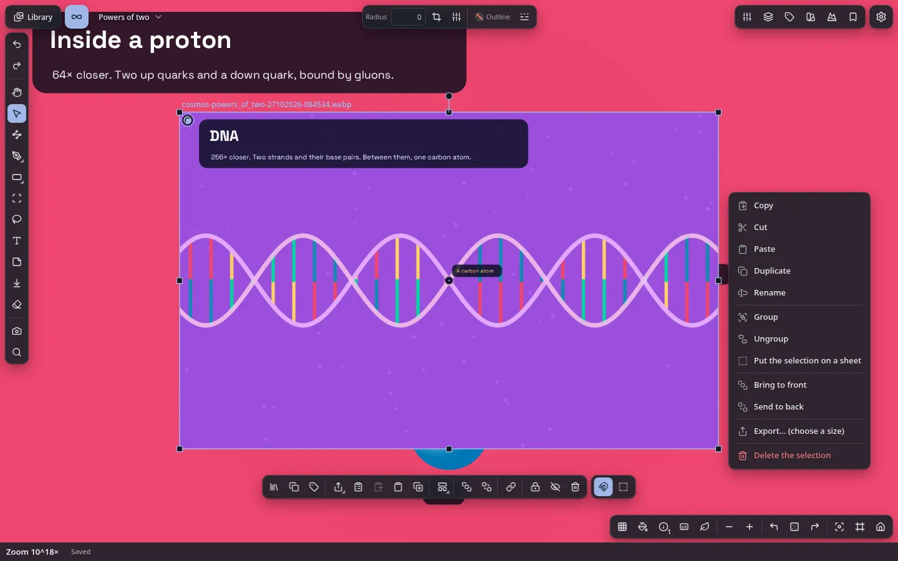 |
| The command palette | The context menu of a selected picture: its commands in groups, with *Rename* for the file in the Library |

### The Library

Switch between **Canvas** and **Library** at the top left. The canvas keeps its view, selection and undo history while you are away.

- **The gallery:** every imported file with its size, type and usage (*4 uses · 3 canvases*), with search, filters by file type, and sorting.
  - **Grid or list.** In the list, drag a column header's edge to resize it (double-click for its usual width). Columns, widths and the thumbnail size are kept.
  - **The sidebar's sections** (Folders, File types, Tags, Canvas tags) can be reordered by dragging their heads, or with `Alt+↑` / `Alt+↓` on a section's name.
  - **Filters** (Show, Sort by and its direction, the sidebar's list) are kept over a restart; the funnel-with-a-cross button resets them.
  - **Thumbnails** are made in the background after an import, so the grid fills in on its own. A font shows "Aa" in its letters; selected, its details show a sample sentence, and the viewer shows it at four sizes with the alphabet and digits.
  - **Back to top:** the arrow in the status bar, once you have scrolled down.
- **Dragging items** shows up to five of them stacked, with their count. Drop them on a folder, a tag or Favourites in the sidebar to file them, or on the strip across the top to place them on the open canvas (the library stays open).
- **The status bar** along the bottom (the same as the canvas's) shows how many items are listed (*3 of 5 items*), how many are selected and their size, and the size of the whole library. At its right end: grid or list, the list's columns, and the thumbnail size.
- **Open in default app** (desktop app; in the details, the right-click menu, and a file card's Actions bar on a canvas) opens an item's file in your system's app for that kind of file: for a file canvast cannot show, or to edit a picture elsewhere.
- **Show in file manager** (desktop app; in the details of one item, and its right-click menu) opens the item's folder in your system's file manager with its file selected. Hidden items have neither this nor *Open in default app*.
- A **viewer** with filmstrip, zoom, pan, slideshow and a details panel. The details show where an item is used (*Used on 3 canvases (4 times)*, then each canvas with its own count; past five canvases, **Show all** lists the rest), and **Show** takes you to it on the canvas at any depth. A button switches the background behind the picture, the controls can be hidden, and a double tap opens it on phones. The button beside the details button (or `F`) hides and shows the controls; with them hidden, the picture gets their room. A video or GIF plays with the canvas's player, floating over the bottom of the picture: while the pointer rests, playing or paused, the player fades away (after *Hide the player* in Settings > Media and playback, 1.5 s by default), and any move brings it back.
- **Folders** (an item lives in one folder, folders nest; a long list in the sidebar shows its first rows and **Show N more**, remembered on this device), **tags** (several per item, renamable), **favourites**, file types, **Similar images** (duplicates and near-duplicates found by their pixels) and **Hidden** items, which are kept out of every list until you open them (see [Hidden items and passwords](#hidden-items-and-passwords)).
- **Selecting and the details panel**
  - A click selects an item. The details panel opens and closes with its button (or `I`) and shows what is selected (for several: their tags and folder together). A click never moves the grid under the pointer.
  - When the grid is laid out again (the panel toggled, the window or thumbnails resized), the selected item stays where it is on the screen.
  - `Ctrl+A` selects all shown; a plain click then selects one alone. `Ctrl`+click adds or removes (on a touch screen, a tap does).
  - Selected items hidden by a search or filter are counted in the panel, with a button to keep only the shown ones.
  - The *Details* fold (the file's own metadata) stays open or closed as you left it.
- **Drag items onto the sidebar:** onto a folder to move them into it, onto *Unfiled* to take them out of their folders, onto a tag to tag them, onto *Favourites* to mark them; a selected item carries the whole select.
- **Undo in the library:** `Ctrl+Z` undoes the last change to tags, favourites, folders or names (`Ctrl+Shift+Z` or `Ctrl+Y` redoes), up to 50 steps; deleting from the library has its own safety (files are kept while undo on a canvas can need them).
- **Tags and folders of several items at once**
  - The details panel lists every tag any of them has, with how many have it (*2/4*). **×** takes a tag off all of them; **+** puts it on the rest.
  - The tag field suggests the library's tags and takes several at once, separated by commas.
  - Each folder shows how many of them it holds (a mixed selection has none ticked); *New folder for these…* makes one and moves them into it.
  - Changes to hundreds of items are one write, so they take a moment, not minutes.
- **Note and fields** (the details panel of one item)
  - **Note:** a plain-text box (not Markdown).
  - **Add a field** adds a row with a name you choose and its value: `link` and an address, `author`, `source`, `licence`… Names already used in the library are suggested.
  - Each is saved when you leave it or press `Enter`. **×** removes a field; the grip at its start moves it (drag it, or press `↑` / `↓` on it). `Ctrl+Z` undoes.
  - The library search (All) finds words in notes and in fields.
  - Notes and fields travel in backups and in the library index. Importing keeps an item's own note (the backup's fills an empty one) and adds the fields it does not have yet.
- **Rename** one item or many at once, with a preview: number them, replace text, add text or change the extension. Renaming one item edits only the name before the extension (it stays, so it cannot change by accident); *Change the extension too* opens the whole name.
- **Copy and paste** with the system clipboard: *Copy* (the menu, or `Ctrl`+`C` over the library) puts the picture, as a PNG, alone on the clipboard (a name beside it would be pasted instead of the picture by many programs); *Copy file name* puts the name as text; a file that is not a picture is copied as its name. *Paste* brings a picture from the clipboard in, named by the text beside it when there is one and it is a file name, else `image`.
- **Export** items as a `.canvast` archive, download files, or export all files as a plain ZIP sorted by file type or by folder.
- **Safe deletion:** the details panel has one **Delete…** button.
  - An unused item is deleted from the library.
  - An item in use is deleted everywhere, after a confirmation that says where it is used (the first three canvases and how many others). Its instances are removed from every canvas first; a text using it as its font keeps its words in the default font.
  - Undo brings them back on the open canvas, not on the others.
  - A file is erased only when nothing, undo included, can bring it back.
- **Missing files** (for example after clearing site data, or a file taken out of the library folder) are flagged with their usage; importing the same file again restores every instance.
- **Library folder** (browser version, Chromium only): keep the library's files on your disk instead of in the browser's storage, so its size is limited by your disk.
  - **Set it up** in Settings > Storage with *Choose library folder…*. Files are named by their content and keep their extension (`a07c9f….png`), so other programs can open them. *Move into folder* and *Move back to browser* move what is already there.
  - **The library index** (`.canvast-index`, a hidden file beside the files) is the whole workspace without the files: boards, canvases, objects, names, tags, folders, notes, fields, styles, settings. It is saved by itself shortly after each change (a checkbox turns that off; **Save index** saves at once). It is not a backup (a `.canvast` backup holds the files), and not a cache to delete: on another device it is your canvases.
  - **On another device**, choose the same folder: you are offered to open its index (**Open index** does it later). The canvases are added and every file is matched by name. Do this on a device with no canvases of its own yet, or they are added twice.
  - **After a restart** the browser asks for permission again: press *Reconnect folder*.
  - **Leave the files alone:** don't move, rename or edit them, as canvast finds each by its name. Files kept before extensions were added get one with *Add extensions* on the card.

| | |
| --- | --- |
|  |  |
| The Library, filled by six screenshots of the showcase (shown by file type: the showcase also carries its two font files) | The viewer with its filmstrip and details |

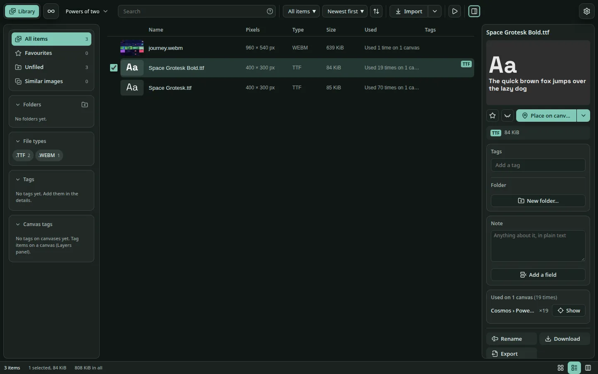

*The list layout with its columns, and a font's sample in the details panel.*

### Exporting

**Copy to other apps.** `Ctrl/⌘+C` keeps the real objects for pasting back here, and also puts a PNG picture on the system clipboard:

| You copy | The PNG is |
| --- | --- |
| Shapes | The shapes as drawn (their SVG text is a separate command, *Copy the selection as SVG*, in the right-click menu) |
| A picture | One PNG at full size, as it looks with its crop and adjustments |
| A GIF or video | The frame it shows |
| A shape with a picture or objects fill, or anything mixed | It as drawn, at most 1024 px on the long side |

- The picture goes alone, with no text beside it (an app offered both often takes the text). Copied texts carry their words too.
- `Ctrl/⌘+X` puts the text only (the shape is gone before a picture could be drawn).
- Browsers cannot put files (audio, PDF) on the clipboard, so those stay in canvast.

**Pasting back in canvast** brings the objects back exactly as they were (links, masks, crop, adjustments, exact positions), as long as nothing else was copied in between. Shapes and texts come back even from another tab; a picture or GIF only while this window keeps the focus (after switching windows it comes back as a new picture; see Limitations). Anything copied in another app is imported as usual: an SVG as shapes, an image as a picture.

**What you export is what you see.**

- Colours, widths and shapes are the ones stored in the document; the theme never changes them, on the canvas or in an export.
- A new shape starts with a fill and no outline (a line and an open path get one, or they would not show). The default ink (for the pen, those lines and a first outline) is near-black on a light canvas and light on a dark one, chosen when the object is made and stored with it. *Change the old default ink to the canvas ink* (command palette) updates older drawings.
- Exports match the canvas in every format, with one exception: **SVG has no angular gradient.** An SVG then holds a picture of it (a PNG up to 384 px a side, cut to the shape) plus the real gradient, which canvast reads back (so *Make vector copy* or pasting the SVG gives it back editable; other programs show the picture). The Export dialog and the SVG saves warn about it.

**Export…** works on a sheet, a picture or selected shapes.

| | |
| --- | --- |
| Size | From the shape: a width or height in px, in, cm or mm at 72–600 ppi, or a preset (A4, Full HD, a story, the picture's own pixels) |
| Formats | PNG, WebP, JPEG, SVG and PDF. What is on a sheet that clips is cut to the sheet in every format. PNG, JPEG and WebP carry their resolution |
| Background | Transparent, white or black |
| Result | Download it, copy it, or keep it in the library |
| Several sheets | One ZIP, or one multi-page PDF whose pages you can reorder |
| Vectors | Plain shapes are true vectors in PDF and SVG; masks are SVG masks; picture and pattern fills are embedded pictures clipped to the shape |


---

## Keyboard and pointer reference

Every shortcut can be changed in **Settings → Shortcuts**: a single key or a chord, with several keys per command, and warnings when a key clashes with another command or the browser. Defaults:

| Action | Input |
| --- | --- |
| Zoom at pointer | Wheel · trackpad pinch · `Ctrl`+wheel |
| Zoom at centre | `+` / `−` (`Shift` = 4× step) |
| Pan | Middle-drag · `Space`+drag · Hand tool · two fingers · `Shift`+wheel · arrow keys |
| Return to origin | `0` · `Home` |
| Tools | `V` select · `P` pen · `L` lasso · `H` hand · `T` text · `M` note · `U` shape · `B` path · `N` nodes · `C` sheet · `E` eraser |
| Undo · redo | `Ctrl/⌘+Z` · `Ctrl/⌘+Shift+Z` or `Ctrl+Y` |
| Copy · cut · paste · duplicate | `Ctrl/⌘+C` · `X` · `V` · `D` |
| Select all · clear · cancel a gesture | `Ctrl/⌘+A` · `Esc` |
| Delete | `Delete` · `Backspace` |
| Group · ungroup | `Ctrl/⌘+G` · `Ctrl/⌘+Shift+G` |
| Put the selection on a sheet · flatten | `Ctrl+Alt+G` · `Ctrl/⌘+E` (text to paths, a boolean group to one path) |
| Bring to front · send to back | `Ctrl/⌘+]` · `Ctrl/⌘+[` |
| Bookmarks | `[` previous · `]` next · `Alt+1` … `Alt+9` go to bookmark 1 to 9 |
| Previous view · next view | `Alt+Shift+←` · `Alt+Shift+→` |
| Command palette | `Ctrl/⌘+K` (`@kind` narrows it; commands can take a value; macros record and replay) |
| Context menu | Right-click the canvas |
| Search | `Ctrl+F` (library: `Ctrl+Shift+F`); on the canvas `#` searches tags, `@` bookmarks, `/` is the command palette and `?` the shortcut list |
| Focus on selection · fit everything | `F` · `F` again |
| Step to next item | `W` `A` `S` `D` |
| Zen mode | `Z` (bars fade out until the pointer is over them) |
| Text editing | `Ctrl/⌘+B` · `Ctrl/⌘+I` · `Tab` nests a list item · `Esc` or `Ctrl/⌘+Enter` finishes |
| Resize | Drag a handle; `Shift` keeps proportions, `Alt` resizes about the middle, `Ctrl` turns snapping off |
| Copy by dragging | `Alt` as the drag starts |
| Layer selection | `Ctrl`+click toggles · `Shift`+click selects a range |
| Jump to a zoom level | Click the zoom in the info bar, type `3000`, `2^-500` or `10^900`, Enter |

**Touch:** two-finger drag pans and pinches zooms; a two-finger tap is undo and a three-finger tap is redo; a long press on Select lists what is under the finger; a resting finger while another drags acts as `Shift`, two as `Alt`. Number fields change by dragging their name.

---

## Settings and accessibility

Open Settings with the gear button. Settings have a *device* scope and a *canvas* scope, can be searched, and reset individually (the undo-arrow icon at the end of a row) or together. Every group has an icon in the list on the left, and the groups are indented under their heading. Device settings travel in a workspace backup and in the library index (see Backups).

| Group | What it holds |
| --- | --- |
| Drawing and selection | Pen, colour picker model and layout, pen width and stabilizer, lasso filter, snapping, align to the selection box, grid spacing for Arrange, initial shape and paint, the distance Fill gaps closes openings by, eraser |
| Navigation | How `W` `A` `S` `D` choose the next item (nearest in view or anywhere, by layer or by name A to Z, in view or anywhere); focus on the item or keep the zoom; camera travel (style, time, longest trip, easing) and the wait at each tour stop |
| Shortcuts | Rebind any shortcut to a key or a chord; the full list is also on `?` |
| Media and playback | Viewer edges, slideshow time, how long the viewer's player stays while a video plays, starting volume, step sizes, extracted frames and edited pictures (format, quality, folder, name, tags), and the folder and tags of what is saved to the library from the canvas, one pair for each kind: pictures from Export… (*Exports*, `export`), patterns (*Patterns*, `pattern`) and shapes saved as SVG (*Shapes*, `shape`); screenshots have theirs in the Screenshot group |
| Screenshot | Format, quality, pattern, transparency, interface, clipboard, folder, name and tags |
| Appearance | Theme (system, light, dark), theme colour (or adaptive, from the canvas background), colourfulness, information shown, hints and tooltips, canvas pattern, Actions bar place, item names, density (comfortable, compact, dense), round or sharp corners, Zen mode |
| Panels | Minimize inactive panels, panels kept open |
| Performance | Adaptive quality, fixed quality level, memory for pictures, animation and its speed |
| Storage | Space used and whether the browser keeps the data; the library folder (choose it, move files in and out, the library index and its automatic saving); how saving is going; backups (export, changes only, files as ZIP, import); *Start from scratch* (delete all data, after a warning with a backup offered first) |
| Privacy | The word that opens the Hidden items, keeping them open until the tab closes, and the passwords of the workspace and of the Hidden items; what stays on your machine |
| About and diagnostics | Version and diagnostics |
| Develop | Developer tools (see [Building from source](#building-from-source)) |

- **Accessibility:** controls are keyboard reachable with visible focus; panels have title bars that work by keyboard; status changes are announced to screen readers; the system's reduced-motion preference is honoured and animation can be turned off; colour contrast is audited automatically.
- **Layouts** adapt to large, medium and phone-sized screens, with scroll cues on bars that scroll.


---

## Your data: saving, backups, the workspace folder

### Saving

- Every change is saved automatically within a fraction of a second, with the camera. Only the objects that changed are written, in one atomic transaction, then read back to check.
- The indicator shows *Unsaved changes… → Saving… → Saved → Saved (verified)*. Click it to open **Settings > Storage**: space used, whether the browser keeps the data, the library folder, how saving is going (and this tab's role) and backups.
- Reloading restores the canvas and the view.
- In the desktop app, the workspace folder follows these saves (see [The workspace folder](#the-workspace-folder-desktop-app)).

If storage cannot be opened, canvast keeps working in memory and says so.

### Several tabs

The first tab to open a workspace edits it. Other tabs are read-only, follow its changes live, and offer **Take over**. A stale tab can never overwrite newer data; its save is rejected and reported.

### Backups

- **Export a backup** (Settings > Storage) downloads one `.canvast` file holding every board, canvas, object and view, plus every file once, and your device settings (theme, shortcuts, panel layout). When you import it, only the settings this device has not set itself are restored; the ones you changed here are kept, and the import dialog says how many it will restore.
- A board, a canvas or a single library item can be exported on its own, with only the files it uses.
- **Import archive…** (or drop a `.canvast` file on the page) verifies every checksum first, shows what it contains and any problems, and only then adds the boards and canvases in a single transaction. Nothing existing is replaced and files you already have are not stored twice. Paintings and brush presets in a backup from an older version are left out, and the summary says so.
- A `.canvast` file is a standard, uncompressed ZIP you can open with any unzip tool. Do not re-compress it.
- Backups made in one browser import into another (tested between Chromium and Firefox).
- Incremental backups are available after the first full one.
- A backup asks what to do with hidden items and with the passwords and privacy settings (see [Hidden items and passwords](#hidden-items-and-passwords)); by default they stay out of it.

The browser does not say whether a download finished, so keep your backups somewhere safe.

### What can delete data

Only these remove anything:

| Action | What it removes |
| --- | --- |
| Deleting objects | Those objects (undo brings them back) |
| Deleting a canvas or board | It, after a confirmation; this cannot be undone. Pictures placed there stay in the library |
| *Delete…* in the library | An unused file, once undo can no longer need it |
| **Delete all data** (Settings > Storage, *Start from scratch*) | Everything canvast keeps in this browser. It asks first, offers a backup, an export of the files and the library index, and makes you type `DELETE`. Files on your disk (a library folder) stay where they are |

Damaged objects found when loading are skipped and reported, never silently changed.

### Where the data lives

- **Browser version:** the IndexedDB database `canvast`, in the browser's storage for local files.
  - Moving the HTML file to another folder keeps your data.
  - A different browser, profile or private window starts empty, and clearing the site data deletes it. This is why regular backups matter.
  - The browser's storage has a size limit, so the browser version suits projects rather than very large collections (see [Limitations](#limitations)).
- **Desktop app:** a folder you choose ([below](#the-workspace-folder-desktop-app)).

### The workspace folder (desktop app)

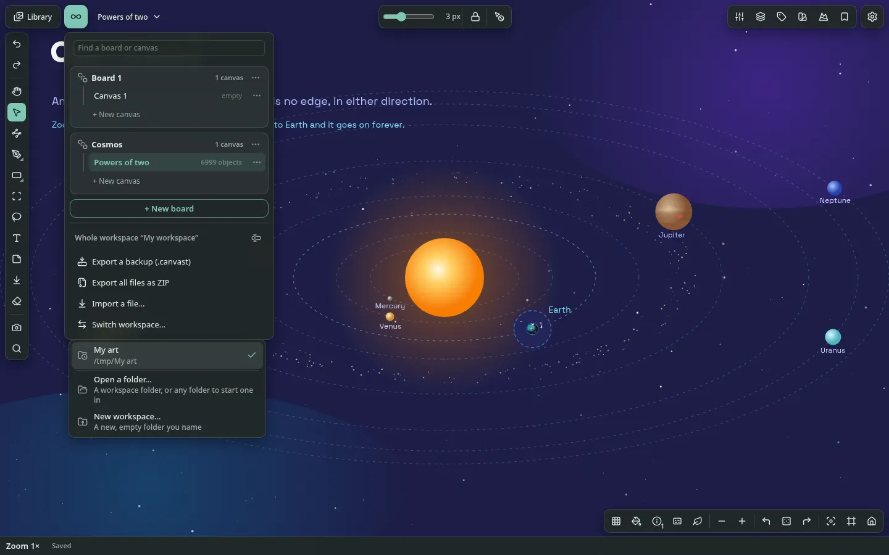

The same workspace on disk, as a file manager shows it:

```
My art/
  .canvast/
    boards/
      board_1/canvas_1.cvst
      cosmos/powers_of_two.cvst
    devices/<device id>.json
    folder.json
    library.json
    workspace.json
  library/
    fonts/space_grotesk.ttf, space_grotesk_bold.ttf
    images/deep-zoom.webp, hero.webp, journey.webp
```

In the desktop app your workspace is a **folder of ordinary files** that you choose, so any sync tool, backup tool or file manager can see it. It works offline and loads nothing from the network.

**Switching workspaces.** *Switch workspace…* is in the board and canvas menu (under *Whole workspace*), in Settings > Storage and in the command palette; *File > Open workspace folder…* and *File > New workspace…* do the same.

- It lists the open workspace and the five latest ones whose folders still exist, plus **Open a folder…** (an existing workspace, or any folder to start one in) and **New workspace…** (an empty folder you name). **Clear the recent list** keeps only the open one (no folder is touched).
- A switch writes your last edits into the folder, closes the window and starts the app again on the other folder.
- At start-up the app opens the last workspace. If its folder is gone (moved or deleted), it says so and offers the recent ones, a folder, or a new workspace.
- While a workspace opens, a start screen shows what is being done. Each step and its time also go to the developer tools' console (*View > Toggle Developer Tools*).
- A workspace is open in one window at a time: starting it while it is still closing waits for it, and one open in another window is asked about.

**Closing while files are written.** When the app is still writing many files into the folder (an import's), closing asks first: *Close anyway* keeps your work safe in the app and writes the rest the next time you open the workspace.

| In the folder | What it is |
| --- | --- |
| `.canvast/boards/<board>/` | A board, named after it (lowercase, `_` between words, `-` between parts; `-2` on a clash). Inside the app's own folder, so canvases are not edited by accident |
| `.canvast/boards/<board>/<canvas>.cvst` | A canvas: one JSON file with its objects, frames and bookmarks |
| `library/<folder path>/`, `library/images/`… | The library's files, named after their names in the library: in the folders of their library folders, or by kind when in none: `images`, `vectors` (svg, eps), `icons` (ico, icns), `art_sources` (psd, kra, xcf, clip, procreate, sai, ai, afphoto, …), `presets` (brushes and swatches: abr, kpp, ase, aco, gpl, …), `3d` (obj, fbx, glb, gltf, stl, blend, …), `video`, `audio`, `fonts`, `documents` (pdf, txt, md, office files, epub, html, …), `archives` (zip, rar, 7z, tar, gz, …), `other` |
| `.canvast/workspace.json`, `library.json` | Names, order, styles and passwords' kept forms; the library's names, tags, folders, notes and fields |
| `.canvast/devices/` | One file per device: its open canvas and cameras |
| `.canvast/folder.json` | This folder's own id, so a new folder at the same place is a new workspace |
| `.hidden/`, `.canvast/hidden.json` | Hidden items, encrypted (see [Hidden items and passwords](#hidden-items-and-passwords)) |
| `.trash/` | What canvast deleted, when Settings > Storage says so (the default) |

**How it saves**

- **Every edit** is saved first in the app's own storage on this device, then written to the folder about 2 seconds after editing pauses, and when the window closes.
- **Names on disk** are safe versions of the names in the app: lowercase, `_` between words, `-` between parts, `-2` on a clash. `Hand Study (Loomis).png` becomes `library/images/hand_study-loomis.png`, and the same file is stored once.
- **Library folders are real folders.** An item filed in a library folder lives under `library/<folder path>/`; an unfiled one under its kind's folder. Filing or renaming an item moves its file; the library's undo moves it back; an emptied folder of a renamed or deleted library folder is removed.
- **Deleted files** (one undo no longer needs, a deleted canvas or board) go where Settings > Storage says: into `.trash/` in the workspace folder (the default, so it syncs and can be put back by hand), into the system trash, or away for good.
- **Hidden items** are encrypted into `.hidden/` (see [Hidden items and passwords](#hidden-items-and-passwords)). A readable file put there from outside becomes a hidden item and is encrypted (once the Hidden items are opened).
- **A password** on the workspace is asked for wherever its folder is opened from.
- **Each folder has its own id** (`.canvast/folder.json`): a new folder made where a deleted one was is a new, empty workspace. Nothing of the deleted one comes back, and its copy on this device is cleared.

**Changes made outside the app** (by a sync tool, another device or a file manager). canvast watches the folder while it runs and catches up at start-up.

| What changed | What canvast does |
| --- | --- |
| A canvas file another device wrote | Reads it in; the open canvas is loaded again with its camera kept |
| The same canvas changed here and there | Keeps both: the folder's version, and this device's beside it as `<name> (conflict <date>)`. A file is never written over another device's newer version |
| A canvas file or board folder renamed in `.canvast/boards/` | Renames the canvas or board (its files then take their safe names) |
| A canvas file moved into another board's folder | Moves the canvas to that board |
| A file in `library/` renamed or moved | Finds it again by its content; the item takes its new folder and name |
| A new file in `library/` | Imports it where it lies, into the library folder of its folder (made if needed) |
| A file deleted from `library/` | Shows the item as missing |
| A file still being written (temporary, partial download) | Leaves it alone |
| `library.json` on a device with no copy yet | Takes the library from it; a device with no copy at all opens the whole workspace from the folder |

**Bringing a browser workspace in:** export a full backup in the browser and import it in the desktop app. One screen shows the import and how many files are written into the folder; then the app starts again on them and says what was imported, without asking for the workspace password again (it was given before the import).

---

## Privacy and security

### What stays on your machine

To report a security problem, see [SECURITY.md](SECURITY.md).

- The page's Content Security Policy is `default-src 'none'` with `connect-src 'none'`: it cannot make network requests, even if code tried. Only inline script and style are allowed, images come from `blob:` and `data:`, and workers (if any) from `blob:`.
- canvast has no runtime dependencies and makes no network requests. The interface font is supplied from memory, so no font source is allowed either. `npm run check:offline` and the end-to-end suite both verify this on every build. The desktop app is the same page in Electron: it opens no connection either (its updates are fetched by an AppImage updater, not by the app).
- Imports are limited to files of at most 256 MiB, and each is decoded before being stored. Files that fail to decode are rejected with a message.
- Archives are verified completely (structure, checksums and content hashes) before anything is written.
- Optional passwords for the workspace and the Hidden items (see [Hidden items and passwords](#hidden-items-and-passwords)). Only a salted PBKDF2 hash of the workspace password is kept.
  - In the browser, nothing is encrypted.
  - In the desktop app, the hidden items' files and index are encrypted (AES-256-GCM), in a documented format you can [decrypt outside the app](#decrypting-and-encrypting-outside-the-app).
  - The library index on disk, and any export you leave them out of, carry neither hidden items nor passwords.
- No analytics, no telemetry, no account.

### Hidden items and passwords

For a workspace that is shown in a public place, an item of the Library can be **hidden**, and the workspace or the Hidden list can be guarded by a **password**. In the browser both are gates in front of the data, not encryption; in the desktop app hidden files are encrypted (see the end of this section).

| | |
| --- | --- |
| 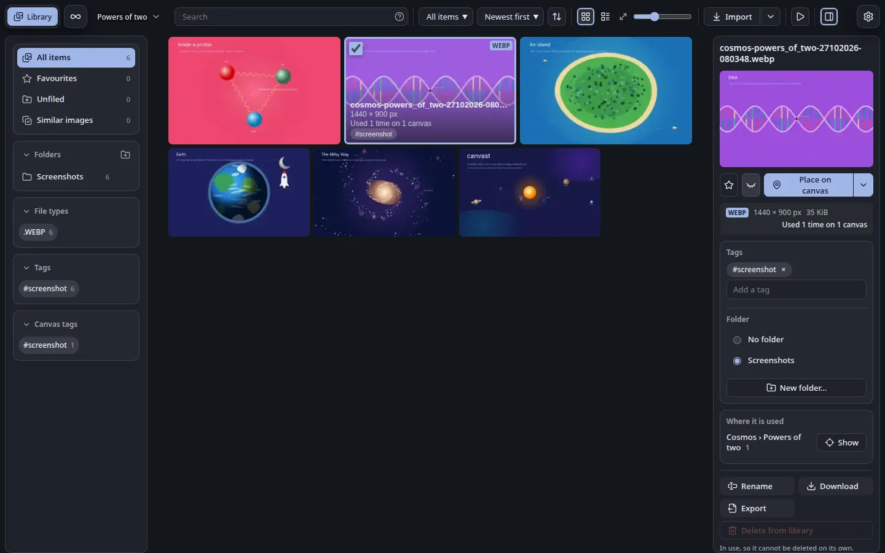 | 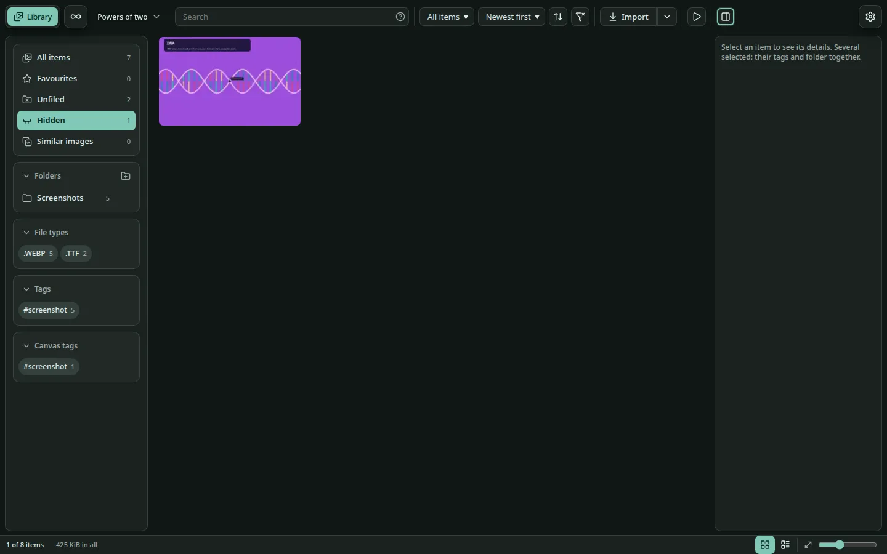 |
| **Hide** is the eye button beside the star in the details panel (also in the bulk bar of several selected items, and in the library's context menu) | The **Hidden** list, open: the hidden item is only here, and the sidebar counts do not include it |

**Hiding**

- A hidden item is left out of *All items*, every folder, tag and file type, the counts, searches, *Similar images*, and the pickers that list the library (a texture fill's picture, the fonts).
- Where it is already placed on a canvas, its picture shows a padlock at once (with or without a password) until it is shown again; its name stays in the Layers panel. A hidden video or sound does not play.
- Hiding does not move, delete or change the file. In the Hidden list, the same button shows the item again.

**Opening the Hidden list**

- It is not in the sidebar. Type its **opening word** in the library's search box (`hidden:` by default; change it, or empty it to turn this off, in Settings > Privacy).
- The word clears itself, the password is asked for if there is one, and the list opens as one more list in the sidebar.
- It closes when you choose another list or leave the library. With *Keep the Hidden items open until the tab closes* (Settings > Privacy) it stays open until the tab is closed or reloaded.

| | |
| --- | --- |
| 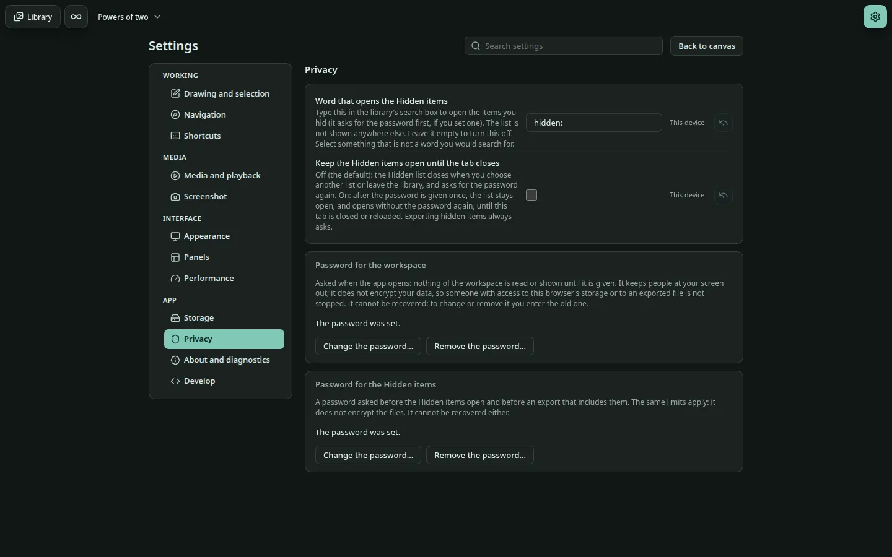 | 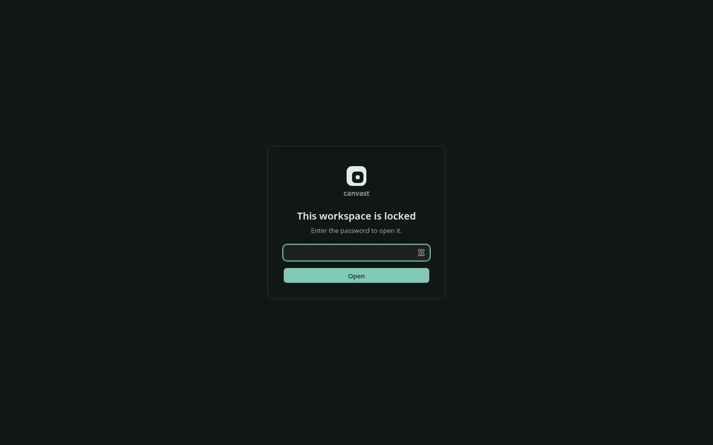 |
| **Settings > Privacy**: the opening word, the keep-open option and the two passwords | The **lock screen**: with a workspace password set, nothing is read or drawn until it is given |

**Two passwords, set separately** in Settings > Privacy (each is typed twice; changing or removing one asks for the old one). Every password field has an eye button at its end that shows what was typed, and hides it again:

| Password | Asked | Guards |
| --- | --- | --- |
| **Workspace** | Every time the app opens or is reloaded, before anything of the workspace is read. Escape does not close the screen | The whole workspace |
| **Hidden items** | When the opening word is typed (unless the tab remembers it), and before an export that includes hidden items | The Hidden list and exporting its items |

**Exports and backups ask.**

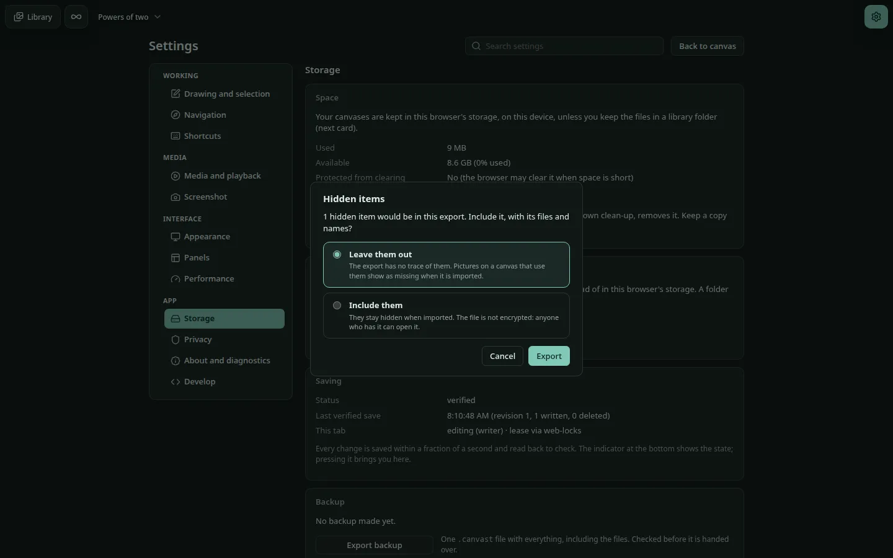

| Export | What is asked | If you leave it out |
| --- | --- | --- |
| Any export with hidden items in it (backup, board, canvas, files as ZIP) | *Include them, with their files and names, or leave them out?* Including asks the Hidden password first | The file has no trace of them; pictures on a canvas that use them show as missing when it is imported |
| A workspace backup, when a password or a changed privacy setting exists | *Include the passwords and the privacy settings (the opening word, keeping the list open)?* Each password is asked first, unless it was typed a moment ago | A copy restored from it starts with no password and the default settings |
| The library index kept in the library folder | Nothing: it is written by itself, so it always leaves hidden items and passwords out | |

Whether an item is hidden is data of the item, so it travels in any export that includes it and the item comes back hidden. Importing a backup that carries a password sets it only on a device that has none, and the import dialog says so.

**What this is not (browser version).**

- The passwords are asked by the app; the files are stored as they are. They keep out people at your screen, not someone who can open this browser's storage or who has an exported file with hidden items in it.
- Only a salted hash of each password is kept: in this browser, and in an archive only if you include it.
- A forgotten password cannot be recovered. The only way back into a locked workspace is to clear this site's data in the browser, which deletes it, so keep a backup (one made without the password opens without one).
- In the browser, hidden files are not encrypted (in the desktop app they are, below).

**In the desktop app, hidden items are encrypted.**

- Hiding asks for a Hidden password first, and warns that a lost password means lost files.
- The file is encrypted (AES-GCM) into `.hidden/` under a random name, read back to prove it, and the readable file is deleted (not moved to `.trash/`).
- Its name, tags, note and fields are kept only in an encrypted index (`.canvast/hidden.json`); its thumbnail is never stored.
- The password (stretched with PBKDF2) wraps one random key, so changing the password never re-encrypts a file. It cannot be removed while any item is hidden.
- Once given (to open the Hidden list, or when hiding), the key stays in memory until the app closes or you choose **Lock hidden items** (command palette).
- A hidden picture placed on a canvas always shows a padlock. Another device on the same folder learns of hidden items only when the password is given there.
- Showing an item again decrypts it back to its place in `library/`.
- The format is documented below, and the files can be decrypted outside the app.

### Hidden items: the file format

In a desktop workspace folder the hidden items are open, documented files, so they can be read without canvast. Everything is standard WebCrypto (or any crypto library):

| Part | Where | What it is |
| --- | --- | --- |
| The vault | `.canvast/hidden.json` | JSON: `format: "canvast-hidden"`, `version: 1`, `kdf: { name: "PBKDF2", hash: "SHA-256", iterations, salt }` (600,000 iterations, a 16-byte random salt), `key`, and `index` |
| The data key | `key` in the vault | A random 256-bit AES-GCM key, wrapped (AES-KW, RFC 3394) by the key PBKDF2 makes from the Hidden password and the salt. A wrong password fails to unwrap it. Changing the password wraps the same key again, so no file is encrypted again |
| A hidden file | `.hidden/<32 random hex digits>.bin` | 12 bytes of IV, then the file's bytes encrypted with AES-256-GCM under the data key, with the 16-byte tag at the end. The name says nothing about the item |
| The index | `index` in the vault: `{ iv, data }` | A JSON list sealed the same way (`iv` and `data`, base64): one entry per hidden item as in `library.json` (its `hash`, `file`, `name`, `type`, `size`, `tags`, `note`, `fields`, …), which names each item's `.hidden/` file |

All binary values in the vault are base64. The SHA-256 of a decrypted file is its `hash` in the index.

### Decrypting and encrypting outside the app

`scripts/hidden-items.mjs` does both with nothing but Node.js 20 or later (no install step, no dependencies). Close canvast on that workspace first. It asks for the Hidden password without showing it (or reads it from a pipe):

```sh
# Every hidden item's file, under its name in the library, with hidden-items.json (names, tags, notes, fields) beside them
node scripts/hidden-items.mjs decrypt ~/Art/my-workspace ~/decrypted

# Seal files into .hidden/ and the index: the app then lists them as hidden items
node scripts/hidden-items.mjs encrypt ~/Art/my-workspace ~/decrypted/sketch.png
```

`decrypt` changes nothing in the workspace. `encrypt` takes back files that came out of `decrypt` with their names, tags, notes and fields (it finds them in the `hidden-items.json` beside them), and new PNG or JPEG pictures (it reads their size). For any other new file, put it in `.hidden/` while canvast runs with the Hidden items open: the app reads it, encrypts it and lists it. `encrypt` leaves the readable files where they are, so delete them yourself when you no longer need them.

---

## Limitations

These are canvast's current limits: first those of both versions, then those of the browser version and of the desktop app. They describe the app as it is today. Some of them, such as fuller support for PDF and 3D files, may be lifted in later versions, but none is promised and there is no schedule: if one matters to you, plan around it as it stands.

### Both versions

**Content**

| Area | Limitation |
| --- | --- |
| PDF | A PDF is kept as a card with its page count; its pages are not rendered as pictures |
| 3D | Only STL and OBJ are read, and only as a preview card |
| Text | Complex scripts that need Indic shaping are not supported; OpenType positioning goes no further than kerning. Characters missing from the interface font fall back to a system font: their width then comes from the browser, so such text can wrap differently on another computer and pixelates at extreme depth |
| Vector networks | One fill for the whole network (no fill per region) |
| Angular gradient in SVG | SVG has no sweep gradient, so an SVG holds a picture of it (up to 384 px a side, about 300 KB), not vectors; the Export dialog, Save as SVG and Copy as SVG warn. A PDF of such a shape is made as a picture, and picture exports are exact |
| Varied fills | The copies of a varied texture repeat after a block of 16 to 31 cells |
| Pattern | A rotated sheet or shape is refused. A result is at most 600 shapes. Ungrouping a pattern, or moving one of its shapes out of its group, ends its link with the panel (the shapes stay as ordinary ones). Resizing the sheet makes the pattern again at the new size from its settings and seed, so a generator whose layout depends on the size (how many waves fit, say) can place its shapes differently |
| SVG import | Text, patterns and masks inside an SVG are not imported; a dropped SVG file is placed as a picture (make a vector copy to edit it) |
| Adjustments and shadows | Shadows are not shown on a video or GIF while it plays. Adjustments (and shadows) are written to an exported SVG only for shapes (not pen strokes or text), as an SVG filter that matches the canvas closely but not exactly (curves, levels and the gradient map are sampled; grain differs). A shape bigger than about 8 million pixels on screen is drawn unadjusted. Grain on a shape is fixed to the screen pixels, not to the shape |
| Boolean groups | Per-corner radii on a boolean result are not available |
| Fill gaps | Only places closed in on every side, or by slits narrower than the closing distance (on the screen, at the zoom you are at), are gaps; a wider opening leaves the place unfilled |
| Eraser | Trimming works on strokes, not on vector paths |
| Files | Imports are limited to 256 MiB per file |
| Clipboard | Ctrl+C keeps the real objects for pasting back only while nothing else was copied: a picture copied for other apps pastes back as the objects only if the window kept the focus and the app copied nothing else in between (otherwise it comes back as a new picture, and shapes as an SVG import or a picture). A copy of a single picture, GIF or video is one PNG (a GIF or video is its current frame); files such as audio and PDF cannot be put on the system clipboard by a web page; Cut puts text only |
| Video | H.265 video from phones shows as a card on Firefox for Android (it still plays from the player) |

**Scale and precision**

| Area | Limitation |
| --- | --- |
| Far trips | A trip to a bookmark that is more than a view apart and more than 20,000 levels of zoom away is not flown: it zooms out 24 levels from here and in to there, switching where both are tiny (with a brief dip to dark, unless turned off). A trip to a place within a view, however deep, is flown |
| Camera precision | After zooming out more than 4,096 levels beyond the deepest point and back in, the view returns to within 2^-96 px of the file rather than exactly |
| Very deep views | Magnification has no limit, but each level of depth enlarges the numbers involved, so extreme depths cost more CPU per frame |
| Dense scenes | With hundreds to thousands of objects visible at once, zooming shows a briefly scaled image of the last exact frame and snaps to the exact picture about 150 ms after you stop. Zooming out before the next level out has been prepared (it is made while the view rests, in a fraction of a second), the edge the scaled image does not reach is drawn exactly, so those frames are slower but the view is never cut off. A zoom that goes more than one level in one gesture pauses for one exact frame at each level it has nothing prepared for |
| Far zoom-out | Content too small to draw is shown as a soft mark in its own colour (pictures as grey). Marks cannot be selected; zoom in to edit |
| Very large documents | A board of one million objects needs about 940 MB of memory and about 6 s to build its index on load |
| Large libraries | The Library draws only the cards near the view, so scrolling stays smooth however deep you go (measured with 20,000 items: opening about 1 s, wheel scrolling at 60 frames a second at the top and at the end, no stall while typing a search). Search results are redrawn when typing pauses for a quarter of a second. A thumbnail missing from storage is made from its file, three at a time. Backups of many gigabytes have not been measured; an import holds about one 128 MiB batch of files in memory at a time, and each canvas is read whole |
| Frame rate | Measured on one desktop machine; no results exist for other device classes |

**Platform**

| Area | Limitation |
| --- | --- |
| Rendering | Canvas 2D only, on the main thread; no GPU or WebGL path, no workers |
| Collaboration | None. There is no network by design |

**Left out on purpose:** ratings, saved searches, a minimap (there are no bounds to map).

### The browser version

| Area | Limitation |
| --- | --- |
| Library size | The Library manages the files your projects use. It is not meant to hold a very large archive. Files are stored in the browser's storage for local files, whose size limit depends on the browser and on the free disk space, so a library that grows past it stops accepting new files, says so in plain words and loses nothing already stored. canvast asks the browser once to keep the data under storage pressure, and warns once when 80% of the browser's quota is used. In Chromium a *library folder* removes the limit (see Library); Firefox cannot offer one |
| What to do about it | Keep working files in canvast and long-term collections in your own folders. Use `.canvast` backups to move finished projects out, and *Delete…* in the library to free space |
| Storage | Browsers cap local storage, and the cap grows once the browser agrees to keep the data (*Ask the browser to keep it*, Settings > Storage): Firefox allows at most 10 GiB (or 10% of the disk, if smaller) before that and up to half the disk after, Chromium about 10 GiB (a Chromium library folder is not counted). Settings > Storage shows the current figure. With a library folder, files in it are outside the browser's protection: files removed there show as missing, and each session needs one click to allow access again. When the browser's storage is full, an import is refused with a notice that points to the backup and to *Delete from library*; edits stay queued and the indicator shows the error. Export backups regularly |
| Origin | Data belongs to the browser profile. Another browser, profile or private window starts empty |
| Browsers | Tested on Chromium and Firefox on one Linux machine. Safari has not been tested. Touch is tested by emulation |
| Passwords | In the browser the workspace and Hidden passwords are gates, not encryption: the data is stored as it is, so they do not stop someone with access to the browser's storage or to an exported file that includes hidden items. They cannot be recovered. The workspace password is asked at every open and reload |

### The desktop app

| Area | Limitation |
| --- | --- |
| Platform | Linux-first: no Windows, macOS or Flatpak builds for now; watching the folder for outside changes is verified on Linux only. A `.cvst` copied in from another workspace is not taken in. With a very large library, each change made in `library/` outside the app makes canvast list the whole folder again. A canvas file is written about 2 seconds after editing pauses: until then the edit is safe in the app's own storage on this device, but another device does not see it yet |
| Hidden items in the desktop app | The files and index are encrypted, but: deleting the readable file does not overwrite the disk blocks it used; an item hidden while the key is locked stays a readable file until the password is given; the app's own cache on the device keeps hidden items' names and tags (not their pictures); a canvas file names the content hash of each picture placed on it; exported backups that include hidden items are not encrypted |
| Packages | Linux only, for x86_64 and aarch64. The `.deb` and `.rpm` are not in a package repository, so the system's updates do not include them; only the AppImage updates itself. The `.deb` and `.rpm` are checked for their contents before a release, not installed on every distribution they name |

---

## How it works

This part is for readers who want to know why canvast behaves as it does.

### Exact coordinates

The algorithms behind the pens and deep zoom are described in [Pen and deep-zoom algorithms](docs/reference/pen-and-depth-algorithms.md), and the nested frames in [Nested frames](docs/reference/nested-frames.md).

Positions are not floating-point numbers. Each coordinate is a **dyadic number**: a `BigInt` mantissa times 2^exponent, so any position at any distance from the origin is stored exactly. The camera is a centre plus an integer-quantized log2 zoom, which makes zooming and panning exactly reversible. Plain doubles appear only when drawing, and only relative to the camera or to a cell, never as stored world positions.

When the view is very deep inside an object, drawing and selecting switch to exact arithmetic for that object; sizes in the numbers grow with depth, but nothing is clamped. Nested coordinate frames keep the cost per frame flat however deep you go.

### Rendering

Rendering is CPU-first **Canvas 2D**.

- **Shared projection:** drawing and hit-testing use the same object-to-screen projection, so what you see is what you select.
- **Spatial index:** a multi-scale index (levels × `BigInt` cells) with no world bounds returns the visible objects. Off-screen content costs almost nothing, even when it is 2^5000 away.
- **Level of detail:** content far below a pixel is skipped or summarized; identical opaque strokes are drawn in one call.
- **Raster tile cache** for committed objects keeps panning and drawing over dense scenes near 2–3 ms per frame, and a bounded **zoom preview** keeps zooming responsive (the levels one out and one in are prepared while the view rests, the outer one first; zooming out past what is prepared, the edge is drawn exactly).
- **Deep zoom into any kind of object:** every kind has a sampler so its colour never disappears when the view is inside it.
- **Text** uses the browser's glyphs normally and the font's exact outlines past about 2,000 px per letter.

Measured on a CPU-only configuration with about 500 visible objects: 1.7 ms per frame (p50) with 10 thousand objects in the document, 2.2 ms with 100 thousand, 7.7–9.6 ms with one million.

### Editing model

1. Input produces a transient preview, which is never stored.
2. On pointer-up the gesture becomes one validated transaction.
3. The document store applies it and reports the changed ids; the spatial index and undo history are updated, and the canvas redraws.
4. After a 150 ms debounce the changed objects are written in one atomic, revision-checked IndexedDB commit, then read back to verify it.

Every object is validated before it enters the document or is loaded: finite numbers, known kinds, well-formed ids and hashes.

### Storage

- **One boundary.** The app reaches storage only through the interfaces in `src/storage/store.ts` (the workspace, backups, the library's entries and its files). The browser's IndexedDB is one implementation (`src/storage/idb-storage.ts`), the workspace folder the other; `npm run check:storage` keeps IndexedDB out of the rest of the code.
- **Layout:** Workspace → Boards → Canvases. The IndexedDB schema (version 12) has stores for workspaces, boards, canvases, objects (one record each), per-canvas views, frames, bookmarks, thumbnails, assets, the asset catalog and metadata.
- **Files** are content-addressed by SHA-256 and stored once; objects on the canvas reference them. They are removed only by reference-checked garbage collection.
- **Several tabs:** a writer lease guarantees a stale tab cannot overwrite newer data.
- **Library folder:** a file is named `<sha256>.<ext>`; it is written, read back and compared before the browser keeps a stub of it (an `assets` record with an empty blob and `ext: 1`), so every rule keyed by hash is unchanged.

**Archives.** A `.canvast` archive holds a versioned `manifest.json`, one JSON file per canvas, and each file once under `assets/<sha256>`, with a CRC on every entry. It is an uncompressed ZIP (ZIP64 beyond 4 GiB or 65,535 files), always one file however big.

- Import is verified completely before anything is written.
- Files are then written a batch at a time (up to 128 MiB each), so an import needs about that much memory whatever the backup's size.
- Everything else (boards, canvases, library entries) is written in one transaction: it shows all at once or not at all.
- Files written by an import that did not finish are erased at once, or when the app next opens.

### Source layout

```
src/
  core/          exact numbers (dyadic) and the camera
  doc/           objects, transactions, document store, undo/redo, groups, clipboard
  render/        projection, drawing, hit-testing, tile cache, density preview
  scene/         multi-scale spatial index
  text/          font reading, Markdown model, layout
  interaction/   navigation, tools, snapping, pens, item stepping
  assets/        content addressing, decoding, catalog, garbage collection
  storage/       IndexedDB, workspace repository, persistence, writer lease, ZIP, archives
  search/        boolean query parser and evaluator
  settings/      declared settings, scopes, rebindable shortcuts
  commands/      command registry, palette providers, macros
  gen/           the pattern generators, a standalone module that imports nothing from the app: seeded random, geometry helpers, one pure function per pattern, an SVG writer
  colour-picker/ the colour picker, a standalone module that imports nothing from the app
  ui/            toolbars, panels, library, settings view, menus, player
  app/           bootstrap, editor state, actions, debug hook
scripts/         single-file build, offline check, naming and token checks
tests/           unit (Vitest) and end-to-end (Playwright)
docs/            reference notes, test logs, status
```

The colour picker can be built alone with `npm run build:picker`, and the pattern generators with `npm run build:patterns` (a script with the global `CanvastPatterns`, an ES module, TypeScript declarations and a demo page in `dist-patterns/`; see [src/gen/README.md](src/gen/README.md) for the API). Both are made to be published as packages of their own.

---

## API and file formats

canvast has no network API, by design: it never opens a connection. Other programs work with it through its files, which are documented and versioned, and through the entry points below. Each format names itself (`format`) and its `version`; a newer version than an app reads is refused, never half-read.

### File formats

| File | Format | What is in it |
| --- | --- | --- |
| `.canvast` backup | `canvast-archive`, version 6 | An uncompressed ZIP (ZIP64 when large): `manifest.json` (format, version, scope, the boards and canvases, the list of files), `canvases/<id>.json` (`objects`, `frames`, `view`) and each library file once as `assets/<sha256>`, with a CRC on every entry. Any unzip tool opens it; do not re-compress it |
| `.canvast/boards/<board>/<canvas>.cvst` | `canvast-canvas`, version 1 | One canvas as JSON: a header (`format`, `version`, `id`, `revision`, `savedAt`, `savedBy`) and the same canvas data a backup holds |
| `.canvast/workspace.json` | `canvast-workspace` | The boards and canvases (names, order, ids), styles, and the passwords' kept forms (salted PBKDF2 hashes) |
| `.canvast/library.json` | `canvast-library`, version 1 | The library: `folders`, and `items`, one per line: `hash` (SHA-256), `file` (its path under `library/`), `name`, `type`, `size`, `pixelW`, `pixelH`, `importedAt`, `tags`, `favorite`, `folderId`, `note`, `fields`, `state` |
| `.canvast/devices/<id>.json` | `canvast-device`, version 1 | One device's open canvas and camera per canvas |
| `.canvast/hidden.json`, `.hidden/*.bin` | `canvast-hidden`, version 1 | The encrypted hidden items: see [Hidden items: the file format](#hidden-items-the-file-format) |
| `library/…` | The files themselves | Each library file under its own name, as you would expect to find it |

Object positions are exact: a coordinate is a dyadic number (an integer mantissa and a power-of-two exponent), written as text, so nothing is lost at any depth (see [Exact coordinates](#exact-coordinates)).

### Desktop command line

| Option | What it does |
| --- | --- |
| `--workspace=<folder>` | Open that workspace folder (an empty folder starts a new one), instead of the last one opened |

Any other option is passed to Electron (for example `--user-data-dir=<folder>` to keep the app's own copy and settings elsewhere).

### Standalone modules

Two parts of canvast are made to be used on their own, with no dependency on the app:

| Module | Build | Documentation |
| --- | --- | --- |
| The colour picker | `npm run build:picker` | [src/colour-picker/README.md](src/colour-picker/README.md) |
| The pattern generators | `npm run build:patterns` (a script with the global `CanvastPatterns`, an ES module, TypeScript declarations and a demo page in `dist-patterns/`) | [src/gen/README.md](src/gen/README.md) |

### Automation hook

Opening the app with `#debug` at the end of its address (or turning on Settings → Develop) adds `window.__canvastDebug`, which the test suite uses to drive the app: the camera, the document, storage, the library and the clipboard. It is made for tests and changes with them; it is not a stable API.

---

## Building from source

Requires Node.js 26.4 (see `.nvmrc`) and npm. Packaging the desktop app also needs `zsyncmake` (the `zsync` package) and `rpmbuild` (`rpm-build` on Fedora, `rpm` on Debian and Ubuntu), and the network once (electron-builder fetches its packaging tools).

```sh
npm ci            # install pinned dev dependencies
npm run build     # → dist/canvast.html (minified, single file)
```

Open `dist/canvast.html` directly. Developer tools (frame times, camera internals, jump buttons, auto-zoom, the test hook) are in *Settings → Develop*, or add `#debug` to the address.

| Command | Purpose |
| --- | --- |
| `npm run build` | The single file, `dist/canvast.html` |
| `npm run desktop` | Build the app and run it in the desktop shell (Electron) on a workspace folder: `--workspace=<path>` after `electron dist-desktop`, else the last one opened, else a folder dialog |
| `npm run package:desktop` | Package the desktop app for this machine's architecture into `dist-package/`: `canvast-X.Y.Z-<arch>.AppImage`, `.deb`, `.rpm` and `.tar.gz`, each with its SHA-256; the AppImage with its update address written in and its `.zsync` beside it. The AppImage and the tarball are started on a fresh workspace folder and must write it; the `.deb` and `.rpm` must hold the app and its menu entry; a package that fails is deleted |
| `npm run build:all` | Everything a person can try: the single file, the desktop shell and all the packages |
| `npm run build:picker` · `npm run build:patterns` | The standalone modules (see [Standalone modules](#standalone-modules)) |

### Reproducible build

The build is deterministic: the same source produces the same `canvast.html`, and `npm run build` prints its SHA-256. Dependencies are pinned to exact versions and line endings to LF. `npm run check:repro` builds twice in different folders, time zones and locales and compares the SHA-256.

---

## Testing

| Command | Purpose |
| --- | --- |
| `npm run typecheck` | TypeScript check |
| `npm run test:unit` | Unit tests (seconds) |
| `npm test` | Typecheck, unit tests, the end-to-end **groups the changes need** (`test:affected`), token, storage, picker and pattern-generator checks |
| `npm run test:affected` | Only the end-to-end groups needed by what changed since `origin/main` (`-- --dry` shows which, and how long); `npm run test:group -- <group…>` runs named groups; `npm run test:all` every group (about an hour). Groups and the change map: [docs/testing/README.md](docs/testing/README.md) |
| `npm run check:patterns` | Fail if the pattern generators import from, or touch, anything outside their folder |
| `npm run test:full` | The full suite with long stress loops (about 1.5 hours) |
| `npm run test:snap -- <files or -g pattern>` | Run chosen end-to-end specs |
| `npm run test:status` | List test builds with their result and how far each is behind the source |
| `npm run bench` | Scale and tile-cache benchmarks |
| `npm run check:offline` | Fail if the built file references anything outside itself |
| `npm run check:tokens` | Fail on a hard-coded colour, size, space or radius in the CSS |
| `npm run check:storage` | Fail if code outside the storage implementation uses IndexedDB instead of the storage interfaces |

**How the tests work**

- Every end-to-end run builds its own copy of the app into `test-builds/` and tests that copy, so `dist/` can be rebuilt while tests run.
- Tests open the built file from `file://`, drive it through a debug hook, and fail on any network request. They run in Chromium (three set-ups) and Firefox; the desktop app has its own project, which runs the Electron build on a fresh workspace folder.
- Fixtures are generated in code; no binary fixtures are committed.
- Performance limits are fixed in advance and never loosened.
- Test logs with environments and timings are in [docs/testing/](docs/testing/); [docs/status.md](docs/status.md) is the status record.

**On GitHub** (every push to `main` and every pull request)

| Workflow | What it runs |
| --- | --- |
| `CI` (`.github/workflows/ci.yml`) | Typecheck, unit tests, the build, the offline, naming, token, storage, picker and pattern checks, and the reproducible-build check; keeps the built file as an artifact |
| `Tests` (`.github/workflows/tests.yml`) | The whole end-to-end suite, one job per test group and browser set-up (Chromium, Chromium CPU-only, Chromium at pixel ratio 2 with touch, Firefox) plus the desktop app under a virtual display, all at once. The full suite every Sunday and on request |

Shared machines vary in speed, so a failure there in a test that measures time is checked again on the reference machine before it counts.

---

## Releasing and project scripts

### Releasing

`npm run release` publishes a version. Run it after the version is bumped, `CHANGELOG.md` has its `## X.Y.Z — Title (date)` section, and everything is pushed.

1. It builds and checks `dist/canvast.html`.
2. It creates (or updates) the GitHub release `vX.Y.Z` with the file and its SHA-256, and marks it **Latest**.
3. It reads the release back to confirm it is the latest and serves the same file.
4. Publishing starts the `Release packages` workflow (`.github/workflows/release-packages.yml`). On an x86_64 and an ARM machine it builds the app from the tag, checks that its single file is the one released (the build is reproducible), makes the packages with `npm run package:desktop` (which checks each), and adds them with their SHA-256 and the AppImage's `.zsync`. No package is uploaded from the developer's machine; the workflow can also be run by hand for a tag.

`npm run release -- --dry-run` does everything but publish and prints the notes. The notes are split into **Features** and **Fixes** from the CHANGELOG: a bullet starting with `**Fixed:**` is a fix; `**Added:**`, `**Changed:**` and `**Removed:**` are features.

### The showcase and the screenshots

- `scripts/showcase/build.mjs` draws the showcase by driving the app like a person: it pastes SVG, combines shapes, draws with the Pen, writes the labels and adds the bookmarks.
- The labels are in **Space Grotesk** (SIL Open Font License 1.1, in `scripts/showcase/fonts/`), imported into the library and chosen in the Text tool, so the two font files travel inside `showcase.canvast`.
- On the bright scenes (the island, the tree, the cells, DNA, the proton) the text sits on a dark plate. The script measures every label's contrast against the pixels behind it (WCAG 2: 4.5 : 1 under 24 px, 3 : 1 from 24 px); the last build had none below (the tightest is 4.69 : 1).
- The `shots` scripts take the screenshots in the dark theme with the default theme colour, *Viridian*.

```sh
npm run build
node scripts/showcase/build.mjs showcase.canvast            # draws the showcase in the app and exports it
node scripts/showcase/shots.mjs showcase.canvast shots/     # imports it in a fresh profile and takes the README pictures (PNG)
node scripts/showcase/shots-privacy.mjs showcase.canvast shots/  # the same for the context menu, hiding, passwords and the lock screen
node scripts/showcase/shots-more.mjs showcase.canvast shots/     # the same for the text, Pattern panel and colour picker pictures
node scripts/showcase/shots-features.mjs showcase.canvast shots/ # the board menu, the video player, Adjust, Styles, the library list (needs ffmpeg)
node scripts/showcase/shots-desktop.mjs showcase.canvast shots/  # the desktop app on a workspace folder (after npm run desktop's build)
```

The README pictures are those PNGs converted to WebP (`cwebp -q 80`) in `docs/screenshots/`. The animation at the top (`canvast-30s.gif`) is made from a 30-second video recorded in the app: 720 px wide at 12 frames a second with its own palette (`ffmpeg … palettegen/paletteuse`), then `gifsicle -O3 --lossy=80`, which keeps it near 7 MB. The journey sheet is the stops of an earlier dive (`scripts/showcase/dive.mjs`), set in a grid with ImageMagick `montage`.

### The logo and its guidelines

```sh
npm run build
node scripts/brand/build.mjs docs/brand/canvast-brand-guidelines.canvast docs/brand/previews/   # draws the brand board in the app and exports the canvas (PNG of each page in previews/)
node scripts/brand/icons.mjs docs/brand/icons/      # the logo files: SVG masters, PNG 16–512 px, favicon.ico
node scripts/brand/preview.mjs preview/ 1,3         # a quick look at pages without the app
node scripts/brand/cover.mjs docs/brand/cover.webp  # the cover at the top of this README (cwebp -q 85)
node scripts/brand/cover.mjs social.png 800         # the same cover at 2:1, scaled to 1280 × 640 for docs/brand/social-preview.png
node scripts/brand/header.mjs docs/brand/            # the README's header: the logo with the wordmark, and the line of figures (dark and light)
```

The made files are kept in `docs/brand/`: the board (`canvast-brand-guidelines.canvast`, open it with **Import archive…**), the logo files in `icons/`, the page pictures in `previews/`, the cover and `social-preview.png` (the cover drawn at 2:1 and scaled to 1280 × 640 for the repository).

- **Defined in** `scripts/brand/pages.mjs`: the logo (a frame, a window cut from it a little low and to the right, and a dot in the window's middle), its colours (the default theme's Viridian in light mode, with an orange dot) and the nine guideline pages.
- **Drawn in the app:** the build draws the pages on one canvas as nine sheets with bookmarks. The construction glyph is made with the Shape tool and *Subtract*, the crosses with the Path tool, the labels with the Text tool in Space Grotesk. The cover's dot holds the mark again at 1/64, twenty times over (121 zoom levels). The scripts work on a copy of `dist/canvast.html` in the system's temp folder.
- **One drawing for every size**, the favicon too.
- **In the app:** the full-colour logo is only the favicon (inline in `src/index.html`). Everywhere else (over the lock screen, beside the name in Settings > About and diagnostics) the app shows the one-colour mark in the theme's text colour, so it follows light, dark and the theme colour (`src/ui/brand.ts`, the same geometry as `pages.mjs`).
- **The README cover** (`docs/brand/cover.webp`, made by `cover.mjs`) is drawn as a canvas in the default light theme: the grid and the orange origin axes, the tile selected with its dot on the origin, the wordmark on the x axis, and the status bar along the bottom.

---

## Platform support

- **Desktop app:** Linux, x86_64 and aarch64 (Linux-first; see [The desktop app](#the-desktop-app-linux)). Watching the workspace folder for changes made outside the app is verified on Linux.
- Requires `BigInt`, Pointer Events, `ResizeObserver`, Canvas 2D and IndexedDB. Roughly Chromium 67+, Firefox 68+, Safari 14+.
- **Tested** in Chromium 156 (default, CPU-only, and devicePixelRatio 2 with touch) and Firefox 157 on Linux. **Not tested** in Safari.
- Firefox on `file://` supports everything canvast uses (IndexedDB, Web Locks, BroadcastChannel) with frame times close to Chromium's.

---

## Contributing and support

| You want to | How |
| --- | --- |
| **Report a bug** or **ask for a feature** | [Open an issue](https://github.com/emarpiee/canvast/issues/new/choose) with its form; [CONTRIBUTING.md](CONTRIBUTING.md) says what helps |
| **Send a change** | Pull requests are welcome: [CONTRIBUTING.md](CONTRIBUTING.md) has the steps and the project's rules |
| **Report a security problem** | Privately, as [SECURITY.md](SECURITY.md) says, not in a public issue |
| **Support the developer** | If canvast helps your work, you can support its development through [PayPal](https://paypal.me/emarpiee) |

Everyone taking part follows the [code of conduct](CODE_OF_CONDUCT.md).

---

## Notes from the developer

canvast was planned and built with [Claude Code](https://claude.com/claude-code).

I do not believe that images made by generative AI are art, and by the same measure this project, its branding included, is not art either. I treat AI as a tool. It can make an artist's workflow better, and it can build the tools artists use to make their art. It should not be the one making the art for them.

The idea grew out of [Kambas](https://github.com/emarpiee/obsidian-kambas), my Obsidian plugin that extends Canvas with image controls. Shipping the app as a single HTML file was inspired by the one-file tools of [iamsingle.app](https://iamsingle.app/) and [Anton Burmistrov](https://antonburmistrov.com/).

canvast is open source in the first place: anyone is welcome to fork it and build a better version of it.

Apps, sites and references that help with creative work, which I use or recommend: [Tools and resources for artists](docs/creative-tools.md).

---

## Licence

canvast is free software: you can redistribute it and/or modify it under the terms of the **GNU General Public License** as published by the Free Software Foundation, either **version 3** of the License, or (at your option) any later version. It is distributed in the hope that it will be useful, but without any warranty; see [LICENSE](LICENSE) for the full text. Copyright (C) 2026 emarpiee.

The colour picker in `src/colour-picker/` is also published on its own and keeps its own MIT licence ([src/colour-picker/LICENSE](src/colour-picker/LICENSE)), with Björn Ottosson's notice for the OKHSL and OKHSV code.

| Part | Licence |
| --- | --- |
| Lucide icons, in the built file | ISC |
| Inter font, in the built file | SIL Open Font License 1.1 |
| Electron and Chromium, in the desktop packages | MIT and Chromium's licences (inside the packaged app) |
| Space Grotesk, two library files in `showcase.canvast` | SIL Open Font License 1.1, copyright 2020 The Space Grotesk Project Authors ([OFL.txt](scripts/showcase/fonts/OFL.txt)) |

The notices of what the built file bundles are embedded at its top, with canvast's own licence, and listed in [THIRD_PARTY_NOTICES.md](THIRD_PARTY_NOTICES.md). Development-only tools, which are not shipped: TypeScript, esbuild, Vitest, Playwright and electron-builder.

A history of changes is in [CHANGELOG.md](CHANGELOG.md).
