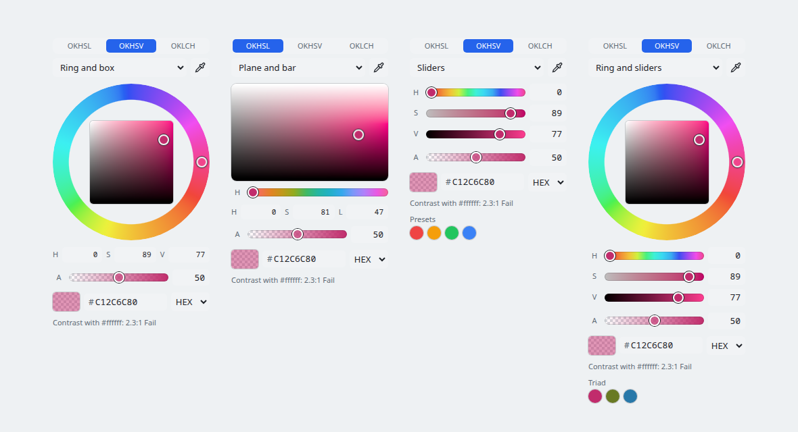

# colour-picker

A colour picker for the web with no dependencies and no link to the app it was made in (canvast). It is small (42 KiB minified, 15 KiB gzipped, all of it: maths, picker, gradient editor, styles), fast (a drag does about half a millisecond of work a step), themed by CSS custom properties, and works from `file://`.

* **Three perceptual models:** OKHSL, OKHSV and OKHCL. Every slider stays inside the sRGB gamut, and the same step looks like the same change of colour anywhere.
* **Four layouts:** a hue ring around a box, a plane with a hue bar, sliders, or the ring with sliders under it.
* **Transparency** (optional), with a chequered preview.
* **Text in three formats:** hex, `rgb()`, `oklch()`. Any of them can be typed or pasted, in any format, with or without `#`.
* **Eyedropper** where the browser has one, **WCAG contrast** against a colour you choose, **colour harmonies**, **swatch groups** you supply, and a **before and after** preview.
* **Keyboard and screen reader complete**, **translatable** (every word is an option), **light and dark** by default.
* **A gradient editor** (`createGradientEditor`): stops on a bar, linear or radial, angle or centre and radius, and this picker for the selected stop.
* **Also a custom element:** `<colour-picker>`.



## Use

```ts
import { createColourPicker } from "./colour-picker";

const picker = createColourPicker({
  value: "#2563eb",
  alpha: true,
  onInput: (hex) => preview(hex),   // every step of a drag or key press
  onChange: (hex) => save(hex),     // once, when a gesture ends
});
document.body.append(picker.el);
```

As a tag:

```html
<colour-picker value="#2563eb" view="mixer" alpha contrast="#ffffff"></colour-picker>
<script type="module">
  import { defineColourPickerElement } from "./colour-picker";
  defineColourPickerElement();
  document.querySelector("colour-picker").addEventListener("change", (e) => console.log(e.detail.value));
</script>
```

Without a bundler: `npm run build:picker` (in canvast) writes `dist-picker/colour-picker.js`, a single script that defines a global `ColourPicker`, and `dist-picker/demo.html`, a page with every option on that opens from `file://`.

## Files

| File | What it is |
| --- | --- |
| `colour.ts` | The maths: models, conversions, parsing and formatting, contrast, harmonies, the fast plane painter. Pure functions, no DOM; runs in Node or a worker. |
| `picker.ts` | The component: `createColourPicker`. |
| `gradient.ts` | The gradient editor: `createGradientEditor`. |
| `element.ts` | `<colour-picker>`, in a shadow root. |
| `style.ts` | The stylesheet as a string (`PICKER_CSS`) and `ensureStyles()`. |
| `index.ts` | The exports. |
| `docs/` | [api.md](docs/api.md) options, methods and the maths API · [theming.md](docs/theming.md) · [performance.md](docs/performance.md) · [design.md](docs/design.md) why it is built this way, and what comes next. |

A file in this folder may import only files in this folder (`npm run check:picker` in canvast fails otherwise).

## Credits

OKHSL and OKHSV follow Bjorn Ottosson's reference code (MIT; the notice is in canvast's `THIRD_PARTY_NOTICES.md` and must travel with the code). OKHCL is lightness and hue of OKLab with chroma as a fraction of the sRGB gamut at that lightness and hue.
