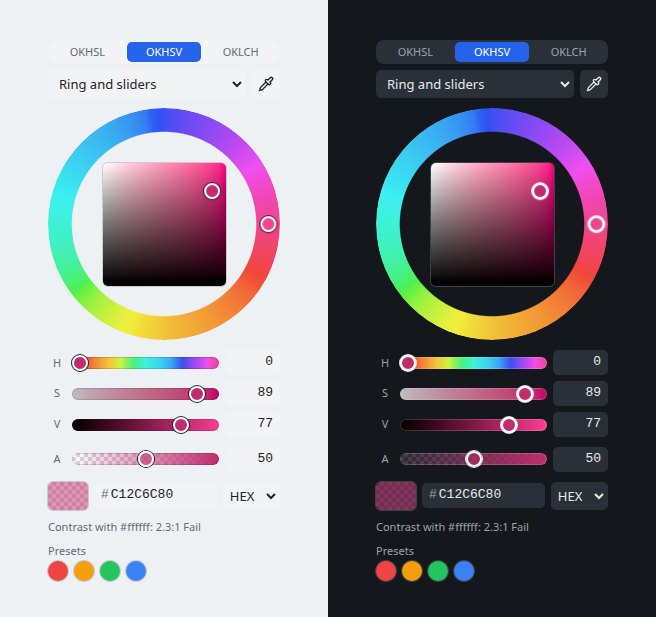
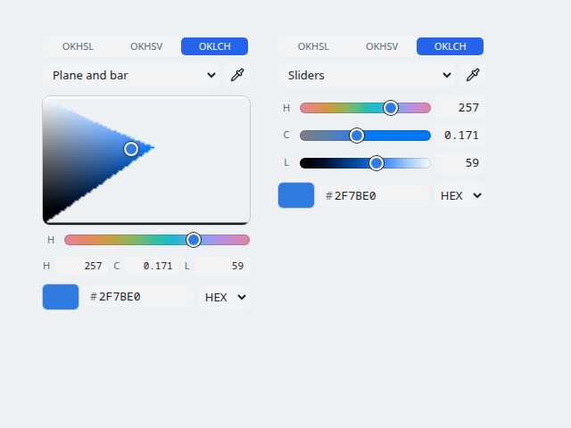

# colour-picker

A colour picker for the web with no dependencies and no link to the app it was made in (canvast). It is small (50 KiB of code minified, 18 KiB gzipped, with the gradient editor; 53 KiB with its licence notices), fast (a drag does about half a millisecond of work a step), themed by CSS custom properties, light and dark, and works from `file://`.




**Contents:** [What it has](#what-it-has) · [Use it](#use-it) · [Options and members](#options-and-members) · [The colour models](#the-colour-models) · [Theming and dark mode](#theming-and-dark-mode) · [The gradient editor](#the-gradient-editor) · [The custom element](#the-custom-element) · [Accessibility and translation](#accessibility-and-translation) · [Limitations](#limitations) · [Files and tests](#files-and-tests) · [Credits](#credits)

## What it has

* **Three perceptual models:** OKHSL and OKHSV (Ottosson's) and OKLCH (the polar form of OKLab, as CSS `oklch()` writes it). OKHSL and OKHSV keep every slider inside the sRGB gamut; in OKLCH chroma stops where sRGB cannot show more. The same step looks like the same change of colour anywhere.
* **Four layouts:** a hue ring around a box, a plane with a hue bar, sliders, or the ring with sliders under it.
* **Transparency** (optional), with a chequered preview.
* **Text in three formats:** hex, `rgb()`, `oklch()`. Any of them can be typed or pasted, in any format, with or without `#`.
* **Eyedropper** where the browser has one, **WCAG contrast** against a colour you choose, **colour harmonies**, **swatch groups** you supply, and a **before and after** preview.
* **Keyboard and screen reader complete**, **translatable** (every word is an option), **light and dark** by default (it follows the system) or by choice (`theme`, or `data-cp-theme` on it or around it), every colour a `--cp-*` custom property.
* **A gradient editor** (`createGradientEditor`): stops on a bar, linear or radial (and an angular gradient, which the host places), angle or centre and radius, and this picker for the selected stop.
* **Numbers you can drag:** every number field (the channels, the opacity) changes by dragging it left or right, and `Shift` snaps to round steps. **Swatches copy** by a long press, a right click or `Ctrl/⌘+C`, and a `#` in the hex field copies and pastes cleanly.
* **Also a custom element:** `<colour-picker>`.

## Use it

There is no npm package yet (see [Limitations](#limitations)). Three ways to take it:

**1. As source** (TypeScript, with a bundler or `tsc`): copy this folder, `src/colour-picker/`, into your project, with its `LICENSE`. It imports nothing outside itself, and only needs the DOM types (`"lib": ["ES2020", "DOM", "DOM.Iterable"]`, no Node types).

```ts
import { createColourPicker } from "./colour-picker";

const picker = createColourPicker({
  value: "#2563eb",
  alpha: true,
  onInput: (hex) => preview(hex),   // every step of a drag or key press
  onChange: (hex) => save(hex),     // once, when a gesture ends
});
document.body.append(picker.el);
// later: picker.setValue("#ff0000"); picker.destroy();
```

**2. As one script, no bundler:** `npm run build:picker` (in the canvast repository) writes `dist-picker/colour-picker.js`, a single file that defines the global `ColourPicker` (with the licence notices at its top), and `dist-picker/demo.html`, a page with every option on and an Auto, Light and Dark switch, that opens from `file://`. Both are build output: they are not in the repository, so build them, or ask for them to be attached to a release.

```html
<script src="colour-picker.js"></script>
<script>
  const p = ColourPicker.createColourPicker({ value: "#2563eb" });
  document.body.append(p.el);
</script>
```

**3. As a tag:** see [the custom element](#the-custom-element).

The picker adds one `<style>` to the document head the first time it is made (`injectStyles: false` turns that off; include `PICKER_CSS` yourself). With a strict Content-Security-Policy that stylesheet needs `style-src 'unsafe-inline'`, or the hash of `PICKER_CSS`, or your own copy of it.

Call `picker.destroy()` when you remove it: it cancels the frames and listeners it scheduled. It needs a DOM when it is made (`document`), so build it in the browser, not on the server; the maths in `colour.ts` needs none (see [the colour models](#the-colour-models)).

## Options and members

The full reference, with types and every option, is [docs/api.md](docs/api.md). The ones you will use first:

| Option | Default | Meaning |
| --- | --- | --- |
| `value` | `"#2563eb"` | The start colour: hex of 3, 4, 6 or 8 digits, `rgb()` or `oklch()`. |
| `model` | `"okhsv"` | `"okhsl"`, `"okhsv"` or `"oklch"`: the channels the sliders are in. The user can switch it. |
| `view` | `"wheel"` | `"wheel"`, `"plane"`, `"sliders"` or `"mixer"`. The user can switch it. |
| `alpha` | `false` | Offer transparency; values then carry `#rrggbbaa` when not opaque. |
| `format` | `"hex"` | How the text field writes the colour (`"hex"`, `"rgb"`, `"oklch"`). |
| `theme` | `"auto"` | `"light"`, `"dark"`, or `"auto"` (follows the system). |
| `contrast` | none | A colour to compare against: the WCAG 2 ratio and its grade are shown. |
| `harmony`, `groups` | none | Harmony swatches that follow the colour; swatch rows you supply (recent colours, a palette). |
| `size` | `232` | Side of the hue ring in CSS px; every layout is this wide. |
| `labels` | English | Every word the picker shows. |
| `onInput`, `onChange` | none | The hex on every step; once when a gesture ends (not when the value did not change). |
| `onModel`, `onView`, `onFormat`, `onCopy` | none | The user switched; a swatch was copied. Keep the switches to reopen the same way. |

Members of the picker: `el`, `value`, `setValue(text, asOriginal?)` (fires nothing), `setModel`, `setView`, `setFormat`, `setGroups`, `destroy`. Events never fire for what you set from outside.

## The colour models

The model decides what the three channels are. A colour is always a triple `{ h, s, x }`: hue in degrees, then two numbers from 0 to 1.

| Model | Channels | What it is |
| --- | --- | --- |
| **OKHSV** (default) | hue, saturation, value | Ottosson's. The Photoshop-style box: the corner is the pure colour. Saturation is relative to the sRGB gamut, so every triple is a real colour. |
| **OKHSL** | hue, saturation, lightness | Ottosson's. "Make it lighter or paler"; greys and tints. Lightness 0 and 1 are black and white at any saturation. |
| **OKLCH** | hue, chroma, lightness | OKLab in polar form, as CSS `oklch()` writes it: lightness is OKLab's own (no "toe"), hue in degrees, **chroma absolute** (the slider runs 0 to 0.4, the range CSS gives percentages; sRGB tops out near 0.32). What sRGB cannot show is reduced, at the same lightness and hue, to the most it can. The chroma you asked for is kept, so it comes back when you move the lightness or hue back; the sliders, thumbs and numbers show what is on screen. In the plane layout the part of the plane sRGB cannot show is transparent. |



The maths is in `colour.ts`, pure functions with no DOM and no imports, so it runs in Node or a worker: `toRgb(model, h, s, x)`, `fromRgb(model, r, g, b, hue?)` (a grey has no hue, so the one you give is kept), `convert`, `parseColour`, `formatColour`, `contrastRatio`, `harmonies`, `rgbToOklch`, `oklchToRgb`, `paintPlane` and more (list in [docs/api.md](docs/api.md#the-maths-colourts)). `toRgb` and `fromRgb` give bytes (0 to 255), so a round trip is within one byte.

The OKHSL and OKHSV code is checked against Ottosson's own JavaScript (see [Credits](#credits)).

## Theming and dark mode

Every colour, size, type and shape is a `--cp-*` custom property, set on `.cp`, on any ancestor, or on the `<colour-picker>` tag (custom properties pass through its shadow root). The defaults have no specificity, so any rule of yours wins. The full table is [docs/theming.md](docs/theming.md).

Light and dark: the defaults follow `prefers-color-scheme`. To choose whatever the system says, for a page with its own switch, put `data-cp-theme="light"` or `"dark"` on the picker, on any ancestor (the page, a panel) or on the tag, or pass `theme: "light" | "dark"`. That also sets `color-scheme`, so the browser's own controls (the layout list, scroll bars) match. The demo page has the switch.

```css
:root { --cp-accent: #7c3aed; --cp-radius: 4px; }   /* your palette: any rule of yours wins */
```

## The gradient editor

`createGradientEditor({ value, onInput, onChange, picker, theme })`: a bar with a handle per stop (drag to move, click the bar to add one, Delete or − to remove), linear or radial controls (angle, or centre and radius), a reverse and a randomize button, and this picker for the selected stop. The value is `{ type: "linear" | "radial" | "angular", angle, cx, cy, r, stops: [{ offset, colour }] }`. The editor makes no CSS gradient and draws nothing but its own bar: what angle and centre mean on a shape is the host's business. The Linear and Radial switch offers only those two; the host chooses `"angular"`. See [docs/api.md](docs/api.md).

## The custom element

```html
<colour-picker value="#2563eb" view="mixer" alpha contrast="#ffffff" theme="dark"></colour-picker>
<script type="module">
  import { defineColourPickerElement } from "./colour-picker";
  defineColourPickerElement();   // once; the tag name can be passed
  document.querySelector("colour-picker").addEventListener("change", (e) => console.log(e.detail.value));
</script>
```

Attributes: `value`, `model`, `view`, `format`, `alpha`, `contrast`, `size`, `theme`, `eyedropper="false"`. `value`, `model`, `view` and `theme` can change after the tag is made; the others are read once. Events `input` and `change` carry `{ detail: { value } }`; the inner controls' own events are stopped at the shadow root.

## Accessibility and translation

Every control is reachable and operable by keyboard (arrows turn and move, `Shift` is ten times, `Alt` a tenth, Page Up and Down turn the ring by 15°), has an accessible name, and announces its value; focus is always visible. The sliders are native range inputs. Every word the picker shows is the `labels` option (and `GradientLabels` for the editor), so it can be translated; the ratio sentence is a function so the order of words can change. Colour is never the only thing: the contrast line says the grade in words.

## Limitations

What it does not do, so you can decide before you build on it.

**Colour**
* **sRGB only.** No Display P3, Rec.2020 or other wide gamuts, no `color()`, no HDR. All three models are limited to what an sRGB screen can show; OKLCH "clips" there by lowering chroma, not by a gamut-mapping algorithm such as the one in CSS Color 4.
* **8 bits.** Colours are bytes (and an 8-bit alpha), so converting to a model and back can differ by one byte.
* **Typed or pasted colours that sRGB cannot show** (an `oklch()` with too much chroma) are clamped channel by channel, which can shift the hue a little; they are not gamut-mapped.
* **Text it reads:** hex, `rgb()`/`rgba()` and `oklch()` only. Not `hsl()`, `hwb()`, `lab()`, `color()` or named colours (a host that wants them parses them first).
* **OKHSL and OKHSV are Ottosson's models with their approximations:** the gamut edge is found with one correction step, so it is exact to about 1e-4, and the picker keeps saturation and lightness inside 0 to 1 where his reference gives up to about 1.01 for a few saturated blues.
* **Out-of-gamut OKLCH chroma is clipped:** a hex field can never show more chroma than sRGB has, and the plane shows that part as transparent.
* **WCAG 2 contrast only** (a transparent colour is mixed over the comparison colour first). No APCA.

**The component**
* **No npm package and no type declarations to install.** You take the source folder (TypeScript) or the built script (no `.d.ts`). No React or Vue wrappers; the custom element works in them.
* **Needs a DOM** to be made (no server-side rendering). `colour.ts` does not.
* **The tag is not a form control:** it takes no `name` and joins no form (no `ElementInternals`), and `alpha`, `contrast`, `size`, `format` and `eyedropper` are read once.
* **The eyedropper** needs the browser's `EyeDropper` API (Chromium, in a secure context); where it is missing the button is hidden. There is no fallback.
* **One value:** no colour lists, palettes import and export, colour-blindness preview, or recent-colour memory of its own (you supply `groups`, and keep what you want).
* **Styling the inside** is by `--cp-*` properties only (and by the classes in `style.ts`, which are not a stable API). The tag's shadow root hides them from page CSS.
* **Right-to-left layouts and tiny sizes** (under about 160 px) have not been checked.

**Browsers**
* Needs ES2020, Pointer Events, Canvas 2D and CSS `:where()` and custom properties; `color-scheme` and `:host()` for theming. Roughly Chromium 88+, Firefox 78+, Safari 14+.
* **Tested** in Chromium and Firefox (the package spec, the colour spec, and the whole of canvast around it). **Safari has not been tested.** Touch is tested by emulation, not on a device.

## Files and tests

| File | What it is |
| --- | --- |
| `colour.ts` | The maths: models, conversions, parsing and formatting, contrast, harmonies, the fast plane painter. Pure functions, no DOM; runs in Node or a worker. |
| `picker.ts` | The component: `createColourPicker`. |
| `gradient.ts` | The gradient editor: `createGradientEditor`. |
| `element.ts` | `<colour-picker>`, in a shadow root. |
| `style.ts` | The stylesheet as a string (`PICKER_CSS`) and `ensureStyles()`. |
| `scrub.ts` | `scrubNumbers`: number fields that change by dragging, with `Shift` snapping to round steps. |
| `press.ts` | `onLongPress`, `copyToClipboard`, `flashCopied`: the long press that copies a swatch. |
| `index.ts` | The exports. |
| `LICENSE` | The package's MIT licence and Ottosson's notice. They must travel with the code. |
| `docs/` | [api.md](docs/api.md) options, methods and the maths API · [theming.md](docs/theming.md) · [performance.md](docs/performance.md) · [design.md](docs/design.md) why it is built this way, and what comes next. |

A file in this folder may import only files in this folder (`npm run check:picker` in canvast fails otherwise). In the canvast repository: `npm run build:picker` builds the script and demo; `tests/unit/colour.test.ts` (the maths: round trips, fuzz, the plane painter, OKLCH), `tests/unit/colour-reference.test.ts` (OKHSL and OKHSV against Ottosson's JavaScript) and `tests/e2e/colour-picker-package.spec.ts` (the built demo, with every option, light and dark, and a speed guard) run in `npm test`; `npm run bench:picker` measures the painter.

## Credits

**OKHSL and OKHSV follow Björn Ottosson's reference code**, from his post [Two new color spaces for color picking – Okhsv and Okhsl](https://bottosson.github.io/posts/colorpicker/) (MIT): the gamut geometry (the cusp, the maximum saturation, the gamut intersection), the "toe" that corrects OKLab's lightness, and the two conversions. The colour space under them is his [OKLab](https://bottosson.github.io/posts/oklab/). His notice is in [LICENSE](LICENSE) in this folder, with the package's own MIT licence, and must travel with the code; `npm run build:picker` puts both at the top of `colour-picker.js`.

It is checked against his own JavaScript (the files in his repository's `misc/colorpicker`): OKHSL and OKHSV to sRGB give the same bytes for every colour tried (40,000 random ones when this was last compared), and sRGB back to OKHSL and OKHSV gives the same lightness, saturation and hue, with one deliberate difference: the picker keeps saturation and lightness inside 0 to 1, where the reference answers up to about 1.01 for a few saturated blues. canvast keeps that comparison as a test (`tests/unit/colour-reference.test.ts`, from numbers made by `scripts/gen-colour-reference.mjs`), so it cannot drift unnoticed.

**OKLCH** is the standard polar form of his OKLab, the one CSS Color 4's `oklch()` writes; the picker's clipping of chroma to the sRGB gamut reuses his gamut geometry. An earlier version had a third model called OKHCL (OKLab with chroma as a fraction of the gamut). It was this project's own invention, not a published model, so it was replaced by OKLCH.
